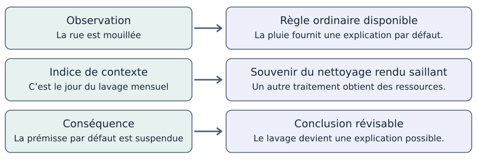

# ENS-PSL · La modularité de l’esprit selon Dan Sperber · 2016 — corrigé brut

*Corrigé rédigé par IA, non officiel. Signalez toute erreur.*

**Rédaction** · GPT-6.2 Astra Ultra · vitesse non renseignée · 26 novembre 2026

## 1. En quoi la modularité « massive » est-elle extrême ?

Quand un enfant apprend vite quelque chose sur les intentions d’autrui, on peut imaginer qu’une même capacité générale d’apprentissage rencontre un contenu nouveau. Sperber propose une hypothèse plus exigeante. Des mécanismes relativement autonomes seraient à l’œuvre dans les dispositions spécialisées. Leur grain varie, depuis de vastes domaines jusqu’à des mécanismes de la taille d’un concept. Enfin, cette organisation traverserait l’esprit entier, y compris les opérations qui donnent l’impression d’une intelligence générale. Chacune de ces propositions est discutable indépendamment des autres. On peut reconnaître des mécanismes de reconnaissance des visages sans accepter la modularité intégrale du raisonnement.

## 2. Cinq niveaux d’analyse

Au niveau **architectural**, on demande comment un mécanisme se distingue de ses voisins, ce qu’il réalise et comment ses sorties entrent dans des activités plus complexes. Au niveau **développemental**, il s’agit d’expliquer comment une compétence se construit chez l’enfant dans un environnement donné et pourquoi l’apprentissage général, appliqué aux seules données disponibles, l’expliquerait imparfaitement. Le niveau **neurologique** étudie les dispositifs cérébraux dont le fonctionnement, l’activation ou l’atteinte sélective soutient cette compétence. Au niveau **génétique**, Sperber évoque les interactions et les effets multiples de gènes qui, en réseaux relativement autonomes, contribuent au développement de caractères phénotypiques distincts. Le niveau **évolutif** cherche les conditions historiques qui expliqueraient la sélection ou la transformation du mécanisme et, plus généralement, de cette organisation. Une dissociation cérébrale renseigne sur un niveau sans suffire à démontrer une adaptation dans l’histoire de l’espèce.

## 3. Une épreuve empirique possible

Je proposerais d’observer des enfants dans deux tâches où un objet change de place. Dans la première, un personnage n’a pas vu le déplacement. Il faut anticiper l’endroit où il le cherchera. Dans la seconde, une photographie antérieure au déplacement garde la trace de l’ancien état. Il faut indiquer ce qu’elle montre. Les deux tâches exigent de mettre de côté la position actuelle. J’apparierais vocabulaire, mémoire de l’épisode, format de réponse et difficulté générale, puis vérifierais la compréhension de chacune des consignes. Une différence sélective et reproductible pour l’attribution de croyance serait compatible avec une spécialisation de la lecture des états mentaux. Si la différence disparaît une fois ces exigences égalisées, l’explication par les ressources générales gagnerait en vraisemblance. Même un écart robuste ne démontrerait pas que l’ensemble de la pensée est modulaire. Il resterait à distinguer un mécanisme spécialisé d’une expertise acquise.

## 4. L’apport de Fodor et le désaccord

Fodor a fourni une description influente des systèmes d’entrée, en particulier perceptifs, et réuni des observations en faveur d’une certaine autonomie de leur traitement. Une illusion persiste parfois après que le sujet a compris son erreur. Fodor accorde beaucoup moins de crédit à une décomposition modulaire des pensées centrales, pour lesquelles des connaissances très diverses peuvent devenir pertinentes. Son argument y prend un tour plus philosophique. Sperber propose au contraire d’expliquer cette souplesse par le concours de mécanismes locaux, et d’intégrer les niveaux évolutif et génétique, peu présents dans l’analyse initiale de Fodor.

## 5. Modules perceptifs et modules de haut niveau

Un dispositif visuel peut recevoir une information dont la provenance et le format sont relativement faciles à préciser. Une propriété de son fonctionnement est alors testable, par exemple la résistance d’une illusion à une connaissance explicite. Pour une opération centrale comme comprendre l’ironie, un énoncé littéralement flatteur peut devenir blessant à la lumière de ce que savent les deux interlocuteurs. Soutenir qu’il existe ici des modules oblige à dire quels mécanismes repèrent une intention, quelles informations leur parviennent et ce qui rend certains souvenirs disponibles au bon moment. Une réponse possible tient à une distribution du travail entre dispositifs dont aucun ne possède toute la conversation et toute la mémoire du sujet.

## 6. En quel sens le critère d’encapsulation est-il trop libéral ?

L’encapsulation est la restriction des informations auxquelles un mécanisme peut accéder pour traiter son entrée. Deux segments de Müller-Lyer continuent à paraître inégaux alors que j’ai vérifié leur égalité. Mais presque tout dispositif autonome a un accès limité aux connaissances de l’organisme. Ce seul critère classerait trop facilement un traitement comme modulaire. Sperber distingue l’ensemble des représentations qu’un mécanisme peut recevoir et le fonds d’information qu’il peut consulter pour les traiter. Le *modus ponens* peut porter sur n’importe quel sujet sans pouvoir consulter aucune croyance supplémentaire. La largeur de son domaine d’entrée n’établit donc aucune liberté d’accès à sa base.

## 7. Saillance et pertinence

La question française traduit *saliency* par « pertinence ». Sperber distingue les deux notions. La **saillance** est la disponibilité accrue d’une représentation dans une situation donnée. Si je remarque une rue mouillée le premier du mois, le souvenir du lavage mensuel peut devenir assez actif pour qu’un traitement qui l’utilise reçoive les ressources nécessaires. La **pertinence** (*relevance*), que Sperber et Wilson présentent comme un facteur plus fin, dépend des effets cognitifs accessibles et de l’effort nécessaire pour les obtenir. Une représentation frappante peut demander beaucoup de travail sans produire d’effet intellectuel appréciable. Saillance et pertinence ne se recouvrent alors que partiellement.

## 8. Un mécanisme modulaire dans l’article

Sperber construit le modèle d’un « réflexe » de *modus ponens*. Si deux croyances ont la forme « si P alors Q » et « P », il produit Q. Il ne sait pas, de sa propre initiative, découvrir ailleurs dans la mémoire une raison solide de tenir Q pour faux et de réexaminer les prémisses. Un mécanisme de même forme limité à des énoncés numériques accepte moins d’entrées, mais son accès aux autres croyances demeure tout aussi étroit. C’est un modèle hypothétique de mécanisme. La reconnaissance des visages et l’attribution d’états mentaux sont, à un autre titre, des exemples de spécialisations que Sperber juge plausibles comme adaptations.

## 9. Calcul local et sensibilité au contexte

Dans la conception inspirée de Turing, un processus mental opère sur la syntaxe des représentations. Une transition se laisse décrire par la forme des symboles qu’elle traite localement. Fodor objecte qu’une bonne hypothèse dépend de ce que l’on sait par ailleurs et que la rationalité d’une inférence peut changer quand surgit un souvenir. Sperber conserve les calculs locaux et propose d’étudier comment, faute de ressources pour les exécuter tous, l’un d’eux est déclenché plutôt qu’un autre. Par défaut, la rue mouillée suggère la pluie. Le rappel du calendrier du nettoyage peut faire suspendre cette inférence. Il n’est nul besoin qu’un arbitre supérieur calcule à chaque fois la bonne règle. L’histoire des activations et la saillance peuvent influer sur l’accès aux ressources par des mécanismes qui ne sont pas eux-mêmes des calculs sur la syntaxe. Le système dans son ensemble devient sensible au contexte. L’article esquisse un programme de recherche et reconnaît qu’il reste à en établir les mécanismes.

## 10. Qu’est-ce qui parlerait pour ou contre cette hypothèse ?

Je retiendrais la modularité massive comme programme de comparaison. Elle oblige à décrire les opérations et leurs limites, fait prévoir des dissociations sélectives et fournit une manière précise d’interroger l’articulation entre expérience, développement et évolution. Elle risque en revanche de perdre toute force explicative si chaque résultat crée après coup son propre module et chaque exception un mécanisme de sélection supplémentaire. Je lui demanderais d’annoncer à l’avance quelles informations doivent rester indisponibles, dans quelles tâches et dans quelles conditions une variation de contexte doit inverser le résultat. Si un modèle faisant appel à des capacités plus générales prédit à moindre coût les mêmes résultats et leur transfert à des situations nouvelles, il constitue un concurrent sérieux. La possibilité d’une explication modulaire du contexte mérite ainsi d’être éprouvée dans des tâches où plusieurs architectures font des prédictions différentes.
