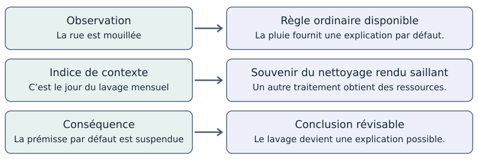

# ENS-PSL · La modularité de l’esprit selon Dan Sperber · 2016 — corrigé guidé

*Corrigé rédigé par IA, non officiel. Signalez toute erreur.*

**Rédaction** · GPT-6.2 Astra Ultra · vitesse non renseignée · 26 novembre 2026

## 1. Reconstituer la thèse forte

Former trois phrases, chacune plus engageante. « Une aptitude spécialisée peut reposer sur un mécanisme autonome. » « Ces mécanismes peuvent être très spécialisés, jusqu’au grain d’un concept. » « La pensée de haut niveau elle-même résulterait de leurs interactions. » Ce dernier passage fait comprendre l’expression de modularité massive. Reconnaître une habileté spécialisée ne tranche pas sa cause, qui pourrait aussi être un usage acquis de compétences générales. Sperber présente une hypothèse à tester.

## 2. Distinguer les cinq questions

Prendre l’exemple d’une compétence comme reconnaître un visage. **Architecture** : décrire ce que reçoit le mécanisme, ses transformations et ses sorties. **Développement** : expliquer son apparition et sa modification chez l’enfant en interaction avec l’expérience. **Neurologie** : rechercher des contributions cérébrales et des altérations sélectives. **Génétique** : examiner comment des réseaux de gènes aux effets multiples peuvent contribuer à une organisation phénotypique relativement autonome. **Évolution** : chercher pourquoi une telle organisation a pu apparaître, être conservée ou se transformer. Une capacité présente tôt autorise une question de développement, mais ne dispense pas d’établir son histoire évolutive.

## 3. Proposer un test et son résultat contraire

Un enfant voit un objet déplacé en l’absence d’un personnage. Où pense-t-il que ce personnage le cherchera ? Pour terme de comparaison, demander ce que représente une photographie prise avant le déplacement. Dans les deux cas, il faut inhiber ce que l’on sait de l’emplacement actuel. Égaliser la difficulté verbale, la mémoire de la scène et la manière de répondre, puis introduire un contrôle où le personnage a vu le déplacement. Un écart qui persiste spécialement pour les croyances serait un indice en faveur d’un mécanisme spécialisé. Son effacement après égalisation des contraintes soutiendrait une explication par la mémoire ou l’inhibition générale. Préciser la portée du test. Une dissociation locale rend une hypothèse crédible dans un domaine, tandis que la thèse massive concerne tous les domaines.

## 4. Placer le désaccord avec Fodor

Partir d’une illusion qui résiste à la connaissance du sujet. Elle donne à Fodor une raison empirique de distinguer certains traitements d’entrée et la pensée consciente. Dès que le problème devient « quelle hypothèse explique le mieux ce qui arrive ? », des informations potentiellement très diverses comptent. Fodor y voit une raison de douter de la modularité centrale. Sperber cherche une architecture capable de cette sensibilité d’ensemble avec des mécanismes restreints. Il accorde aussi plus d’importance aux hypothèses développementales, génétiques et évolutives.

## 5. Montrer ce que change le passage au haut niveau

Comparer **entendre une suite de sons** et **comprendre qu’un compliment est ironique**. Pour le premier problème, on peut spécifier assez étroitement le type d’entrée. Pour le second, les mêmes mots peuvent changer de sens selon l’histoire de l’échange. Il faut expliquer le recrutement des souvenirs, l’attribution d’une intention et leur coordination. On peut concevoir une mosaïque de mécanismes qui couvrent ces opérations, mais c’est une charge de preuve supplémentaire. Une compétence vaut comme module seulement si l’on parvient à préciser son autonomie au-delà du simple nom qu’on lui donne.

## 6. Tester la valeur du critère d’encapsulation

Se poser deux questions différentes. « Quels objets ce dispositif sait-il traiter ? » définit ses **entrées**. « Que peut-il aller consulter pour traiter l’un de ces objets ? » définit sa **base**. Dans l’exemple de la reconnaissance d’un mot, des représentations phonétiques entrent dans le dispositif, un répertoire lexical sert à les traiter. Un mécanisme peut accepter de nombreux contenus tout en consultant très peu de données auxiliaires. Puisque presque aucun dispositif ne peut parcourir tout le savoir du sujet, exiger seulement une restriction d’accès distingue mal les modules des autres traitements.

## 7. Expliquer le terme anglais du questionnaire

*Saliency* est la **saillance**. Une représentation déjà activée conjointement à d’autres a plus de chances d’alimenter un traitement. En voyant la rue mouillée le premier du mois, je peux me rappeler précisément ce jour-là le calendrier de nettoyage. Ce rappel augmente la concurrence que rencontre l’interprétation habituelle par la pluie. Réserver **pertinence** à *relevance*, également discutée par l’auteur, qui met en rapport l’effet cognitif d’une information et l’effort de traitement. Cette précision permet de répondre aux deux formulations du sujet.

## 8. Faire fonctionner un exemple

Proposer « si la salle est ouverte, le voyant est vert » et « la salle est ouverte ». Un dispositif autonome de *modus ponens* produit « le voyant est vert ». Supposons que j’aie aussi vu le voyant rouge. La règle seule ne va pas chercher ce souvenir pour réviser la première prémisse. C’est cette restriction d’accès qui en fait, pour Sperber, un « réflexe cognitif » possible, y compris lorsqu’elle porte sur tous les sujets. Fodor réserve ici plus volontiers l’étiquette modulaire à une règle dont le domaine serait restreint, par exemple aux nombres. Ne pas présenter ce dispositif imaginé comme une découverte anatomique.

## 9. Répondre à l’objection du contexte

Formuler d’abord le problème dans les termes les plus favorables à Fodor. Un calcul inspiré de Turing transforme des représentations en vertu de leur forme syntaxique locale. Comment le système peut-il alors prendre en compte une circonstance qui change la bonne conclusion ? Utiliser le schéma pour raconter deux déroulements de la même scène.

Dans un cas, le sol mouillé déclenche l’inférence de pluie. Dans l’autre, le souvenir du lavage mensuel conduit à suspendre la prémisse ordinaire. Chaque traitement peut rester local. La différence tient à celui qui dispose des ressources nécessaires. Étudier leur distribution par l’activation ou la saillance ouvre une piste que l’objection de Fodor laisse disponible. On évite ainsi de supposer qu’un esprit miniature décide par avance à quel mécanisme donner la main.

## 10. Donner un jugement personnel susceptible d’être discuté

Défendre un avantage précis, une limite et une condition décisive. **Avantage** : l’hypothèse oblige à chercher où une compétence échoue sélectivement et comment elle se développe. **Limite** : décrire après coup chaque activité comme un module risque de rendre l’ensemble compatible avec n’importe quel résultat. **Condition** : comparer deux modèles sur des données nouvelles en spécifiant d’avance l’information disponible pour chacun. Une prédiction de maintien d’une illusion, ou de disparition d’un effet lorsqu’on modifie le contexte, peut alors échouer. Conclure en distinguant ce qui est étayé localement et ce qui reste à démontrer pour l’architecture entière.
