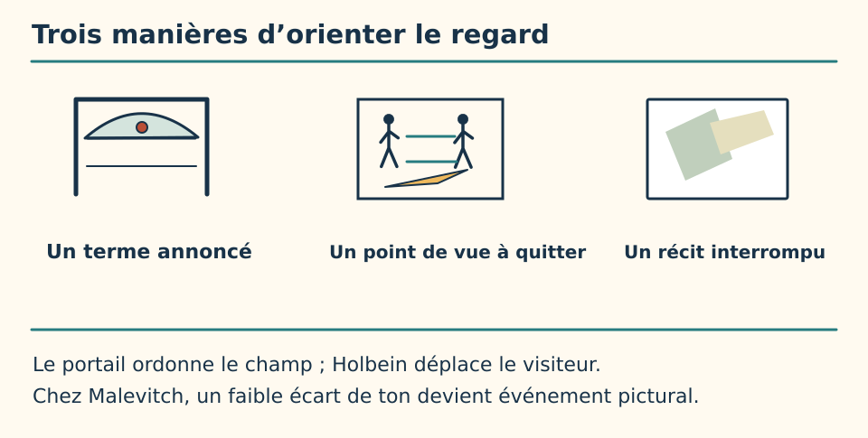

# ENS-PSL · Sélection internationale Lettres · 2016 · Corrigé brut

*Corrigé rédigé par IA, non officiel.*

**Lecture du rapport du jury** · GPT-6.2 Astra Ultra · vitesse non renseignée

**Rédaction** · GPT-6.2 Astra Ultra · vitesse non renseignée

**Révision (tour 1)** · GPT-6.2 Astra Ultra · vitesse non renseignée

## Art et fin de l’histoire

À Conques, le visiteur qui arrive au portail se place devant une image où le dernier jugement a déjà eu lieu. Chez Holbein, la mort qui met un terme aux vies ne se découvre pleinement qu’à celui qui déplace son regard. Appeler ces deux opérations « fin de l’histoire » ne peut donc avoir exactement le même sens. L’image peut proposer une fin du monde, mettre en crise le récit par lequel nous nous orientons, ou tenter d’imposer que l’histoire n’ait plus d’autre issue.

### Une fin destinée à ceux qui peuvent encore agir

Au portail de Sainte-Foy de Conques, les figures sculptées en registres convergent autour du Christ juge. Sa main levée et sa main abaissée participent à la séparation des élus et des damnés. Cette destination ordonnée donne sens à la multiplicité des gestes dans les compartiments. Le relief se déploie au seuil d’une église de pèlerinage. Avant de franchir la porte, le fidèle peut rapporter sa conduite présente à un terme qui, pour lui, reste à venir. La fin eschatologique est ainsi représentée comme un fait pour que la vie des spectateurs demeure ouverte à une décision. Le XIe siècle est la datation donnée par le feuillet.

### Voir finir un monde de certitudes

Dans *Les Ambassadeurs* de Hans Holbein le Jeune (1533), Jean de Dinteville et Georges de Selve se tiennent presque à l’échelle du visiteur de part et d’autre d’étagères chargées d’instruments et de livres. La pose, les étoffes et les objets donnent à voir des savoirs et des positions dans le monde. Au premier plan, une forme oblique contrarie la lisibilité de cet ensemble. Le crâne anamorphosé devient reconnaissable lorsqu’on regarde depuis le côté. La nécessité de quitter la position frontale sépare matériellement deux régimes de compréhension. Le crucifix partiellement dissimulé dans l’angle supérieur gauche invite à reprendre la question de ce qui survit aux puissances figurées. L’œil doit accomplir un trajet que le cartel ne saurait remplacer.

### La fin d’une convention et la prétention à clore l’histoire

Dans le *Suprématisme* de Malevitch reproduit sans date, des formes géométriques faiblement contrastées semblent se détacher puis se perdre dans le champ clair. Aucun épisode n’attend ici son dénouement. Le bord, l’orientation et l’écart de ton soutiennent l’expérience du tableau. Déclarer achevée une certaine histoire de la représentation ouvre donc une recherche picturale. À l’inverse, *Kameradschaft* de Josef Thorak (1937) donne, dans la photographie reproduite, un point de vue bas sur deux figures masculines monumentales qui se tiennent la main. L’idéal affiché de camaraderie transforme une construction politique du régime nazi en apparence intemporelle. Interroger cette exclusion suppose de replacer l’œuvre dans son usage de propagande et de tenir compte du cadrage photographique qui amplifie sa monumentalité.

### La mémoire déplace le point final

La cinquième reproduction montre l’installation de 2015 *Pour Madame de Staël : de l’Allemagne* d’Anselm Kiefer. Des objets séparés occupent le sol clair devant une grande image sombre. Le spectateur doit relier les éléments dans un espace traversable ; il ne reçoit pas la certitude d’un avenir déjà écrit. Le titre fait revenir un texte et une figure historiques dans un musée contemporain. La mémoire s’y construit par des rapprochements et des écarts. Dans le dossier confirmé par le rapport, Conques, Holbein, Malevitch et Thorak suffisent déjà à établir une distinction décisive. Faire image d’un terme, déclarer une convention épuisée et ériger un pouvoir en destin sont trois actes historiquement différents.

## Sources

L’ENS classe l’épreuve avec la session 2016. Le feuillet conserve un en-tête 2014. Le rapport de 2016 confirme le titre et les quatre premières œuvres. Le PDF comporte également une installation de Kiefer datée de 2015. Sa présence dans le fichier est certaine ; sa distribution aux candidats n’est pas confirmée par le rapport.

[Sujet de l’ENS](https://www.ens.psl.eu/IMG/file/admission/SI_2016/DHTA-ORAL.pdf) · [Rapport du jury](https://www.ens.psl.eu/IMG/file/admission/SI_2016/RApport%20jury%20HA%202016.pdf)
