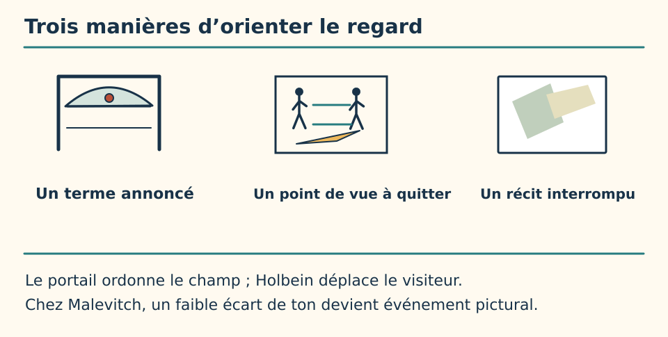

# ENS-PSL · Sélection internationale Lettres · 2016 · Corrigé guidé

*Corrigé rédigé par IA, non officiel.*

**Lecture du rapport du jury** · GPT-6.2 Astra Ultra · vitesse non renseignée

**Rédaction** · GPT-6.2 Astra Ultra · vitesse non renseignée

**Révision (tour 1)** · GPT-6.2 Astra Ultra · vitesse non renseignée

## Art et fin de l’histoire

Le feuillet réserve une heure de préparation pour une demi-heure de passage. Le jury demande de décrire, dater et contextualiser les œuvres avant d’avancer une explication générale. Préparer l’exposé sur les quatre œuvres qu’il nomme, puis réserver à la cinquième reproduction une comparaison signalée comme telle.

### Commencer au seuil

Sur la première reproduction, tracer la limite entre le portail et le tympan puis placer l’axe du Christ. Montrer par son propre geste comment les directions organisent la répartition latérale. À quelle personne réelle s’adresse cette image et à quel moment la rencontre-t-elle ?

### Faire éprouver le déplacement

Sur la deuxième, décrire d’abord le champ frontal sans nommer le crâne. Repérer ensuite la diagonale étrange du premier plan. Si le jury demande la définition d’une anamorphose, expliquer qu’une déformation réglée s’ordonne depuis un point de vue particulier. Éviter d’attribuer une date ou un titre plus précis au Malevitch que ceux portés par la source.

### Comparer deux emplois de la rupture

Malgré une proximité chronologique générale, Malevitch et Thorak engagent des rapports presque opposés à l’avenir. Préparer une phrase appuyée sur la matérialité pour chacun. Chez l’un, un faible écart de ton engage une recherche visuelle. Chez l’autre, la masse des corps et leur présentation sous un angle valorisant contribuent à naturaliser un ordre politique.

### Traiter les différences documentaires

Nommer les quatre œuvres du rapport. Si la cinquième planche est exposée, l’introduire à partir de sa légende, de sa date et de l’espace visible entre les éléments. Ne pas corriger silencieusement 2014 en 2016 : conserver la différence entre l’en-tête du fichier et le témoignage du jury sur la session.

## Sources

L’ENS classe l’épreuve avec la session 2016. Le feuillet conserve un en-tête 2014. Le rapport de 2016 confirme le titre et les quatre premières œuvres. Le PDF comporte également une installation de Kiefer datée de 2015. Sa présence dans le fichier est certaine ; sa distribution aux candidats n’est pas confirmée par le rapport.

[Sujet de l’ENS](https://www.ens.psl.eu/IMG/file/admission/SI_2016/DHTA-ORAL.pdf) · [Rapport du jury](https://www.ens.psl.eu/IMG/file/admission/SI_2016/RApport%20jury%20HA%202016.pdf)
