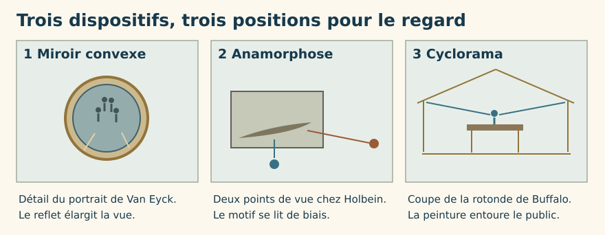

# ENS-PSL · Sélection internationale Lettres — Histoire de l’art — l’optique dans l’art occidental 2016 · Corrigé brut

*Corrigé rédigé par IA, non officiel. Signalez toute erreur.*

**Lecture du rapport du jury** · GPT-6.2 Astra Ultra · vitesse non renseignée

**Rédaction** · GPT-6.2 Astra Ultra · vitesse non renseignée

**Autocontrôle** · GPT-6.2 Astra Ultra · vitesse non renseignée

Le sujet demande de traiter l’optique dans l’art occidental de la fin du Moyen Âge au XXe siècle. Il autorise l’appui sur cinq figures et demande aussi des exemples extérieurs au dossier. La dissertation proposée est rédigée en français.

## De l’œil aidé à l’œil mis au travail

À Trévise, vers 1352, Tommaso da Modena montre Nicolas de Rouen penché sur un manuscrit. Un verre grossissant aide un lecteur à distinguer des signes, tandis qu’un peintre rend cette attention visible aux membres du chapitre dominicain. La petite scène engage déjà deux histoires de l’optique, celle des instruments qui modifient la vision et celle des œuvres qui nous font prendre conscience de notre façon de voir. On pourrait croire que ces histoires convergent vers une imitation du monde toujours plus exacte. Or la même connaissance des rayons, des distances et des couleurs permet de construire une illusion, de la découvrir ou de se passer du modèle reconnaissable. Qu’attend l’artiste de l’œil qu’il équipe, qu’il situe dans l’espace et dont il éprouve enfin les réactions ?

## Distinguer le détail, construire un point de vue

Dans la première figure du dossier, le mobilier ménage au religieux une place étroite autour de son livre. Le buste incliné, le regard rapproché de la page et le geste des mains lient l’instrument à un travail de lecture. Le dispositif a ici un usage et une histoire sociale, celle du livre et des milieux savants. On évitera de prendre cette loupe pour les lunettes qu’un autre religieux porte dans le même cycle peint. Dans le portrait dit des *Époux Arnolfini*, en 1434, Van Eyck emploie un autre dispositif. Le dossier agrandit le miroir convexe accroché au fond de la pièce. Dans son disque, les deux personnages se voient de dos et deux autres silhouettes apparaissent du côté de l’entrée. Une petite surface courbe rassemble ainsi un espace plus vaste que la portion de mur qu’elle occupe. La peinture montre au spectateur ce que sa position devant le couple lui cachait. Ce tour de force laisse ouverte l’identité des deux personnes supplémentaires.

À la Renaissance, le peintre peut utiliser la géométrie pour régler les rapports entre la position de l’œil, une surface et le monde à représenter. Les appareils de dessin illustrés dans le traité de mesure de Dürer en 1525 donnent une forme matérielle à ce rapport. Un point de vue fixé et un quadrillage aident à reporter des positions sur une feuille. Une chambre noire fait, elle, entrer la lumière par une petite ouverture dans un espace obscur et produit une projection inversée. L’une construit des correspondances géométriques, l’autre fait apparaître une image lumineuse. Dans les deux cas, il appartient encore à l’artiste de tracer, choisir et composer. La chambre claire de Wollaston, brevetée en 1806, relève d’un autre moment de cette histoire. Par un prisme, le dessinateur perçoit conjointement le motif et sa feuille. La ressemblance des noms n’autorise pas à attribuer cette dernière invention aux peintres du XVIe siècle.

## Déplacer le spectateur ou l’installer au centre

La perspective ordinaire rend une vue immédiatement cohérente depuis une position déterminée. Dans *Les Ambassadeurs* de Holbein en 1533, une forme oblongue au premier plan résiste à la lecture frontale. Vue sous un angle très oblique, elle devient un crâne. L’anamorphose utilise la régularité d’une projection pour produire d’abord une déformation. Il faut abandonner la position qui convenait aux visages et aux objets des étagères pour déchiffrer ce signe de la mort. La maîtrise optique donne ici une leçon de modestie à l’observateur qui se croyait maître de son regard.

Le cyclorama de Buffalo obéit à une économie presque inverse. La figure 3 est une coupe du bâtiment. Elle fait apparaître la plate-forme centrale surélevée, le dispositif qui la surplombe et la paroi peinte enveloppante. Un tel dessin explique ce que l’aménagement soustrait précisément au visiteur, l’organisation matérielle des limites du spectacle. Dans la salle, le regard peut tourner autour de son axe sans rencontrer le cadre rectangulaire habituel. Au XIXe siècle, le panorama organise ainsi un spectacle collectif autour d’un emplacement privilégié. Là où l’anamorphose récompensait un changement radical de point de vue, la rotonde règle la place physique du public pour entretenir la continuité de la vue. L’histoire de l’optique concerne autant l’architecture de l’exposition que l’atelier du peintre.

## Produire une expérience sensible

Avec les néo-impressionnistes, la touche divisée cesse d’être seulement la marque d’un geste. Dans *Un dimanche à la Grande Jatte*, commencé par Seurat en 1884, les relations de tons se modifient avec la distance à la toile. De près, les touches se distinguent. En reculant, on saisit mieux des rapports de masses et de lumière. L’expérience ne consiste pas à faire vérifier au visiteur une loi universelle du mélange des pigments. Elle fait concourir des recherches sur la couleur, l’organisation de la surface et les déplacements permis devant l’œuvre.

Les *Prismes électriques* de Sonia Delaunay en 1914 donnent deux foyers particulièrement nets aux anneaux polychromes, dont les bandes rencontrent des lignes qui les interrompent ou en déplacent les couleurs. Une même gamme change d’intensité selon les voisinages. Le tableau prend appui sur l’expérience moderne de l’éclairage électrique pour produire des vibrations avec une toile et des pigments. La lampe n’a plus besoin de figurer comme objet reconnaissable. La légende du sujet imprime « Trek-Delaunay », tandis que le musée donne Sonia Delaunay, née Terk.

Dans *Weisse Mühle* de Günther Uecker, datée de 1964, deux formes circulaires en vis-à-vis, un axe et un socle apparaissent sur la photographie. Le premier disque présente un relief serré de pointes claires et sombres, le second oppose des plages plus continues. Une toile de Delaunay organise une vibration avec des couleurs peintes. Le relief d’Uecker accueille la lumière réelle et projette de petites ombres variables avec l’éclairage et la position du spectateur. La reproduction fixe conserve un état de cette relation. Elle n’autorise pas à mesurer la vitesse d’un éventuel mouvement mécanique. À la même époque, les tubes fluorescents de Dan Flavin rendent cette transformation plus radicale encore, puisque murs et angles reçoivent la lumière et participent à l’œuvre.

Du verre du lecteur à la lumière d’exposition, on n’a donc pas abandonné les instruments au profit d’un œil soudain libre. L’œuvre reste une organisation matérielle de ce qui peut être vu, dans quelles conditions et par qui. L’histoire de l’optique dans les arts est aussi celle d’un apprentissage du spectateur. Il peut désormais reconnaître, jusque dans l’impression de présence la plus immédiate, les conditions qui la rendent possible.

[Sujet et planches](https://www.ens.psl.eu/IMG/file/admission/SI_2016/DHTA.pdf) · [Rapport du jury](https://www.ens.psl.eu/IMG/file/admission/SI_2016/RApport%20jury%20HA%202016.pdf)

[Seeing Renaissance Glass, instruments de lecture à Trévise](https://tile.loc.gov/storage-services/master/gdc/gdcebookspublic/20/20/71/83/92/2020718392/2020718392.pdf) · [National Gallery, portrait dit des Arnolfini](https://www.nationalgallery.org.uk/paintings/jan-van-eyck-the-arnolfini-portrait) · [National Gallery, Les Ambassadeurs](https://www.nationalgallery.org.uk/paintings/hans-holbein-the-younger-the-ambassadors) · [Smithsonian, chambre claire de Wollaston](https://americanhistory.si.edu/ne/collections/object/nmah_1184286) · [Centre Pompidou, Prismes électriques](https://www.centrepompidou.fr/fr/ressources/oeuvre/zS28bfR) · [Kulturstiftung des Bundes, Uecker et ZERO](https://www.kulturstiftung-des-bundes.de/de/projekte/detail/zero.html)
