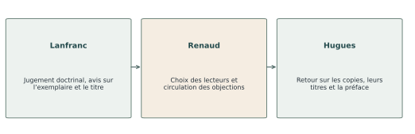

# Anselme et la publication du Monologion · Oral 2016 · Corrigé guidé

*Corrigé rédigé par IA, non officiel. Signalez toute erreur.*

**Rédaction** · GPT-6.2 Astra Ultra · vitesse non renseignée

Le document rassemble cinq lettres d’Anselme, prieur puis abbé du Bec en Normandie. Les trois destinataires sont Lanfranc, archevêque de Cantorbéry, Renaud, abbé de Saint-Cyprien de Poitiers, et Hugues de Die, archevêque de Lyon et légat pontifical. La série s’étend de 1076–1077 à 1082–1085.

## Un auteur qui remet à un autre le sort de son travail

> [!INDICATION]
> Dans la première lettre, distinguer l’exemplaire envoyé et celui qui reste au Bec.

#### Proposition de réponse

Comment « publier » un raisonnement théologique dans un monde de manuscrits ? Le mot désigne ici une suite d’envois, de lectures, de copies et de décisions sur le texte et son public. En 1076 ou 1077, Anselme voudrait lire lui-même son opuscule en présence de Lanfranc, son ancien maître. L’éloignement oblige à le confier à un lecteur intermédiaire. La lecture à haute voix reste une manière d’examiner une œuvre écrite. Dom Maurice, qui a encouragé sa rédaction, en recevrait le texte après approbation.

Le premier exemplaire n’a pas de titre. Anselme remet à Lanfranc la faculté de le nommer ou de le faire disparaître. Il promet de réserver à sa propre copie le même sort. Ces gestes constituent à la fois une demande de jugement doctrinal et une manifestation d’humilité monastique. Ce n’est pas une procédure institutionnelle d’autorisation préalable comparable à une censure imprimée. La destruction envisagée aurait en tout cas exigé une action coordonnée sur plusieurs objets matériels.

## Un dialogue sur la manière de prouver

> [!INDICATION]
> Dans la deuxième lettre, identifier les objections auxquelles l’auteur répond sans avoir la lettre du destinataire.

#### Proposition de réponse

On ne lit de Lanfranc que ce qu’Anselme rapporte. L’archevêque aurait demandé de peser plus précisément certaines propositions, de les confronter à l’Écriture et d’invoquer les autorités quand la raison défaille. Anselme accepte la remontrance mais affirme avoir déjà procédé à cette vérification. Augustin, spécialement le De Trinitate, garantirait les développements qu’il a présentés sous une forme plus brève. Il reconnaît à son raisonnement une cohérence propre tout en récusant la prétention de soutenir une nouveauté isolée. L’opposition moderne entre recherche rationnelle et obéissance religieuse rendrait mal compte de cette discussion.

L’ordre de garder ou de détruire est encore attendu à la fin. Le ton d’obéissance n’empêche donc ni l’explication ni la défense critique. Le corpus conservé donne une série de réponses de l’auteur. Les critiques originales et les conversations orales demeurent largement hors de portée.

## Choisir des lecteurs, recevoir des objections

> [!INDICATION]
> Comparer la crainte de la troisième lettre et l’assurance relative des deux dernières.

#### Proposition de réponse

Écrivant à Renaud entre 1077 et 1079, Anselme redoute les lecteurs empressés de dénoncer ce qu’ils n’ont jamais entendu. Le cas difficile est celui des termes « personne » et « substance » appliqués à la Trinité. La lettre avance que des expressions latines et grecques différentes peuvent viser la même foi, faute de mots pleinement adéquats. Ce propos révèle une difficulté de traduction et de raisonnement. Il faut l’attribuer à Anselme dans cet échange, sans le transformer en définition de l’ensemble des traditions grecque et latine.

L’abbé de Poitiers doit communiquer le texte à des lecteurs « raisonnables et paisibles ». Une objection sérieuse peut revenir par une lettre du contradicteur ou du relais. L’auteur promet qu’elle le corrigera ou que sa réponse la modifiera. La publication constitue déjà un réseau de discussion. L’exemple de critiques antérieures revenues sur leur première lecture témoigne, selon Anselme, de l’utilité de cette circulation contrôlée.

## Corriger le titre à distance

> [!INDICATION]
> Identifier les interventions concrètes demandées à Hugues de Die dans la cinquième lettre.

#### Proposition de réponse

Les porteurs remettent à Hugues les écrits qu’il a réclamés. Anselme, désormais abbé du Bec, fait valoir les difficultés de dicter dans les conditions de sa charge. L’attention d’un légat prestigieux le convainc que ses écrits méritent un titre approprié. À défaut de pouvoir réunir toutes les copies, il demande de récupérer celles que possède le destinataire. Il faut supprimer « de ratione fidei », remplacer « Monoloquium » par « Monologion », « Alloquium » par « Proslogion », et corriger la fin de la préface qui renvoie à ces titres. Ainsi l’une des interventions les plus précises de l’auteur porte sur des éléments qui organisent la lecture de deux ouvrages distincts.

Le mouvement qui va d’un texte sans titre à des titres choisis par son auteur ne se confond pas avec une prise de pouvoir solitaire. Il dépend de lecteurs dotés d’autorité, des porteurs et de la possibilité matérielle de retrouver les petits livres. Une question sur l’histoire de l’édition trouverait ici une réponse précise. La publication n’a pas une date unique, et une correction demandée ne garantit pas qu’elle figure dans chaque témoin manuscrit.
