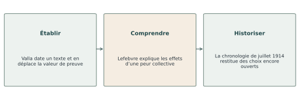

# La démarche historique consiste-t-elle à rationaliser des faits irrationnels ? · Écrit 2016 · Corrigé guidé

*Corrigé rédigé par IA, non officiel. Signalez toute erreur.*

**Rédaction** · GPT-6.2 Astra Ultra · vitesse non renseignée

La composition part d’une allocution de Reinhart Koselleck en 1985 à l’occasion du quatre-vingt-cinquième anniversaire de Hans Georg Gadamer. Le sujet renvoie à la traduction française publiée en 1997 et demande des exemples historiques et historiographiques précis.

## Introduction

> [!INDICATION]
> Distinguer l’histoire advenue, les matériaux disponibles et l’analyse que mène l’historien.

#### Proposition de réponse

En 1789, des paysans prennent au sérieux des nouvelles d’attaques que les enquêtes ne confirment pas. On pourrait les déclarer irrationnels et présenter l’historien comme celui qui rétablit enfin la raison. Mais comment expliquer qu’une menace imaginaire produise des mobilisations effectives ? Dans la formule de Koselleck, le « matériau historique » et le « pré-savoir » désignent ce que l’enquête doit organiser. « L’histoire elle-même » désigne le cours du passé, dont rien ne garantit qu’il soit ordonné par une intention générale. La rationalité peut enfin renvoyer aux raisons des acteurs ou à la validité de l’explication savante. Confondre ces trois niveaux conduit à croire soit que tout ce qui arrive est raisonnable, soit que les faits sont dépourvus de sens avant qu’un historien le leur impose.

La démarche historique construit effectivement un ordre vérifiable entre des traces dispersées. Elle doit cependant reconnaître les rationalités différentes qui ont produit ces traces et conserver dans son récit la contingence de ce qui est arrivé. C’est à cette condition qu’elle explique un événement sans le rendre nécessaire ni le justifier.

## I. L’enquête construit des faits à partir de traces déjà travaillées

> [!INDICATION]
> Montrer concrètement ce que change le passage du récit transmis à une proposition contrôlable.

#### Proposition de réponse

Les matériaux que reçoit l’historien ne s’offrent pas sous la forme d’une suite de faits certains. Une lettre est écrite à quelqu’un, une liste est établie pour des besoins administratifs, une chronique accorde plus de place à une victoire qu’à une récolte ordinaire. Avant même l’enquête, des acteurs ont sélectionné, conservé et classé. La difficulté ne tient donc pas à une propriété mystérieusement irrationnelle de chaque fait. Elle tient à la pluralité des questions et aux conditions inégales de la transmission.

Lorenzo Valla en donne au XVe siècle une démonstration classique lorsqu’il met en cause la Donation de Constantin. Le document prétendait faire remonter à l’empereur Constantin une concession de pouvoirs au pape. Le vocabulaire, les institutions supposées et les usages linguistiques ne conviennent pas à la date alléguée. Un travail rationnel confronte des indices et modifie le statut du texte. Celui-ci perd sa valeur pour établir la donation, mais en acquiert une pour étudier les usages d’une revendication d’autorité. Les intentions polémiques de Valla n’annulent pas la possibilité de discuter ses arguments. L’ordre analytique résulte ici d’une opération précise, la datation critique, dont on peut vérifier les raisons.

Le résultat n’est donc pas arbitraire. Deux interprétations peuvent partir du même parchemin sans disposer des mêmes preuves. La démarche historique gagne en rationalité lorsqu’elle montre ce qui autorise ou invalide chaque inférence.

## II. Expliquer des conduites, c’est reconstruire plusieurs raisons possibles

> [!INDICATION]
> Comparer la vérité d’une croyance, les raisons de l’adopter et ses conséquences.

#### Proposition de réponse

Georges Lefebvre, dans La Grande Peur de 1789, cherche pourquoi, au cours de l’été, l’annonce de brigands ou d’un complot aristocratique s’est répandue et comment les campagnes ont réagi. Il faut établir des lieux, des dates, la succession des alarmes et les transformations d’un message. Une chronologie qui distinguerait seulement les vraies nouvelles des fausses manquerait le phénomène historique. Le défaut de preuves d’un complot général ne supprime pas l’expérience de l’insécurité, les enjeux de subsistance ni les mobilisations déclenchées par les nouvelles.

Ceux qui agissent n’ont pas accès aux enquêtes postérieures et ne peuvent pas vérifier chaque rumeur avant de protéger leur village. Leurs décisions peuvent avoir une cohérence pratique compte tenu des risques qu’ils perçoivent. Cette cohérence n’oblige pas le chercheur à tenir leur croyance pour vraie. Elle ne permet pas non plus d’attribuer la même peur ou la même intention à tous les participants. L’enquête doit faire varier les lieux et les groupes, distinguer transmission d’une alarme et appropriation locale.

L’exemple donne un sens précis à « rationaliser ». Si le terme signifie restituer la relation entre informations disponibles, choix et effets, il désigne une ambition légitime. S’il signifie substituer les calculs d’un observateur informé aux incertitudes des acteurs, il décrit une erreur de perspective. Les émotions, peurs et habitudes font elles-mêmes partie des causes à étudier.

## III. Un ordre intelligible laisse subsister des bifurcations

> [!INDICATION]
> Tester une explication en demandant si elle présentait l’issue comme inévitable dès le départ.

#### Proposition de réponse

Un récit de juillet 1914 conçu depuis la guerre qui a suivi peut faire apparaître l’attentat de Sarajevo comme le signal automatique d’un conflit européen. Or entre l’attentat du 28 juin et les déclarations de guerre de la fin juillet et du début août s’interposent des décisions distinctes. L’appui allemand à l’Autriche-Hongrie au début de juillet, l’ultimatum austro-hongrois du 23 juillet, les réponses diplomatiques et les mobilisations ne sont pas un seul événement. Chacun transforme les choix des autres. L’historien doit distinguer les conditions structurelles, dont les alliances et les plans militaires, des décisions prises sous la pression du temps.

Les débats sur les responsabilités, des travaux de Fritz Fischer sur les buts et ambitions allemands aux approches multipolaires de Christopher Clark, déplacent les sources et les échelles du problème. Reconnaître plusieurs centres de décision n’impose pas de distribuer également la responsabilité. Cela oblige à préciser qui savait quoi, à quel moment, et de quelles alternatives il disposait. L’issue générale peut échapper aux intentions de chacun sans être inexplicable. À l’inverse, le fait de pouvoir l’expliquer ne la rend ni raisonnable ni justifiée.

La distance entre l’expérience acquise et l’avenir envisagé, que Koselleck analyse dans ses travaux sur les temporalités historiques, permet de formuler cette exigence. Une reconstruction solide doit faire place à ce que les acteurs espéraient ou redoutaient, y compris aux futurs qui ne se sont pas réalisés.

## Conclusion

> [!INDICATION]
> Revenir aux deux sens de « rationaliser » et à l’expression prudente « tout au plus ».

#### Proposition de réponse

L’histoire ne transforme pas un stock de faits absurdes en une suite enfin sensée. Elle établit progressivement ce qui a eu lieu, distingue les croyances de leurs effets et confronte des explications au matériau qui peut leur résister. Les raisons de l’enquête appartiennent au présent du chercheur. Les raisons d’agir appartiennent aux situations passées. Le cours des événements peut demeurer contingent malgré la cohérence de certaines conduites. On peut donc accueillir l’avertissement de Koselleck contre une raison supposée gouverner l’histoire entière, tout en affirmant que les acteurs, avant l’historien, ont eux aussi raisonné, prévu, hésité et parfois changé d’avis.
