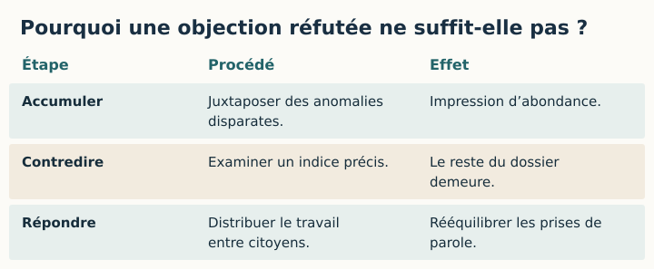

# ENS-PSL · Sélection internationale Lettres · Langue française — le conspirationnisme 2016 — Corrigé brut

*Corrigé rédigé par IA, non officiel. Signalez toute erreur.*

**Rédaction** · GPT-6.2 Astra Ultra · vitesse non renseignée

Gérald Bronner, « L’espace logique du conspirationnisme », Esprit, novembre 2015.

## Compréhension · 4 points

**« Mille-feuilles ».** Chaque couche figure une objection ajoutée aux précédentes. La hauteur de l’ensemble impressionne, même si chaque couche prise séparément offre peu de résistance à l’examen.

**« Arguments disparates et obscurément cumulatifs ».** Les indices viennent de domaines différents. Ils paraissent renforcer une même conclusion, sans que l’on sache par quel raisonnement leur addition la rendrait plus probable.

**« Vérolés ».** Certains arguments sont gâtés de l’intérieur, autrement dit entachés d’erreurs qui les rendent peu fiables. La métaphore donne à leur défaut logique l’aspect d’une corruption matérielle.

**« Logique déconcertante ».** On s’attend à ce que des hypothèses incompatibles affaiblissent une thèse. Le sondage sur l’assassinat de Kennedy illustre ici le mouvement inverse : la multiplicité des soupçons nourrit chez certains répondants la conviction indéterminée qu’il y a eu complot.

## Résumé · 8 points

Les récits de complot cherchent souvent des anomalies à accumuler avant même de disposer d’une explication commune. Cette manière de convaincre rappelle Charles Fort, qui rassemblait des observations étranges et défendait des thèses invraisemblables en multipliant les raisons de douter. Chacune pouvait être faible. La diversité des disciplines invoquées donnait pourtant à l’ensemble une allure savante et rendait sa vérification presque impossible pour un lecteur isolé.

La mise en commun des observations sur Internet accélère considérablement ce procédé. Après les attentats contre Charlie Hebdo, les objections à la version établie se sont multipliées en quelques jours. Leurs contradictions devraient limiter leur force démonstrative. Elles peuvent au contraire entretenir la conviction imprécise que quelque chose demeure caché, comme le montrent aussi les réponses attribuant la mort de Kennedy à des responsables différents. De nouveaux soupçons trouvent alors un terrain favorable.

Réfuter une objection laisse les autres intactes. Ceux qui pourraient intervenir risquent de se décourager devant le travail requis, pendant que les partisans diffusent leurs croyances avec constance. Or des travaux rapprochent pensée conspirationniste et extrémisme politique. Une mobilisation civique modeste mais régulière, répartie entre de nombreux internautes, pourrait corriger ce déséquilibre.

*191 mots, comptés par espaces. La consigne fixe 200 mots à 10 % près.*

## Rédaction · 8 points

Lorsqu’un message trompeur circule dans un groupe de discussion, la première personne à le contester peut avoir le sentiment de perdre son temps. Son interlocuteur maintient son accusation et produit deux nouveaux exemples. Pourtant, d’autres lecteurs, restés silencieux, ont pu prendre connaissance d’une pièce qui change leur jugement. La proposition de Gérald Bronner mérite d’abord d’être comprise à cette échelle. Dix minutes ne suffisent pas à convertir un militant, mais peuvent interrompre l’impression d’unanimité qui accueillait sa publication.

Un exemple banal permet de préciser ce que l’on peut faire en si peu de temps. Une photographie circule avec une légende qui la situe dans une ville qu’on connaît. Si l’on dispose du journal où elle a été publiée avec sa date et son lieu, on peut donner cette référence et expliquer la différence. La correction porte alors sur une affirmation vérifiable. Les autres lecteurs peuvent reprendre ce travail sans devoir accepter l’autorité de celui qui intervient. Il est également utile de reconnaître ce que la date de la photographie ne permet pas d’établir. La rigueur que l’on exige de l’auteur du message vaut pour sa propre réponse.

Il existe cependant des situations où la réplique individuelle produit peu d’effet. Devant vingt affirmations empruntées à cinq disciplines, choisir au hasard le point le plus facile laisse entière la prétention du dossier à former un tout. Il peut être plus éclairant de demander quelle conclusion précise est en jeu et quel fait pourrait conduire à la réviser. Et citer un message jusque-là confidentiel devant un public nombreux risque de le diffuser davantage, même si l’intention est de le réfuter.

L’effort individuel a donc besoin de relais. Un enseignant peut faire comparer deux sources, une rédaction conserver une correction aisément consultable, une association proposer aux citoyens de confronter leurs vérifications. Ces formes de coopération prolongent une intervention brève et évitent que chacun recommence seul le même travail. Je retiendrais de Bronner cette invitation à partager une responsabilité plutôt qu’une obligation comptable de répondre chaque semaine. Le temps donné a de la valeur lorsqu’il rend le raisonnement et ses preuves accessibles à d’autres.

*349 mots, comptés par espaces. Minimum demandé : 300.*

[Sujet officiel et texte intégral](https://www.ens.psl.eu/IMG/file/admission/SI_2016/L.FRANCAISE.pdf)
