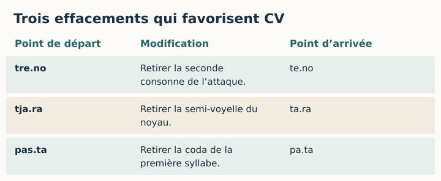
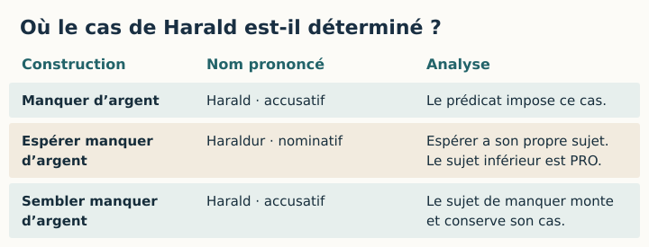

# ENS-PSL · Sélection internationale Lettres · Linguistique — erreurs phonologiques et sujet silencieux (oral) 2016 — Corrigé guidé

*Corrigé rédigé par IA, non officiel. Signalez toute erreur.*

**Rédaction** · GPT-6.2 Astra Ultra · vitesse non renseignée

## Exercice 1 · Erreurs phonologiques

### 1. Ce que suggère la direction des effacements

Dans *tre.no* devenu *te.no*, l'attaque perd sa deuxième consonne. Dans *tja.ra* devenu *ta.ra*, c'est la semi-voyelle du noyau qui disparaît. Dans *pas.ta* devenu *pa.ta*, c'est la coda de la première syllabe. Les trois changements aboutissent à CV, une attaque consonantique simple suivie d'une voyelle. Ils sont tous plus fréquents que la perte de l'unique consonne d'attaque de *me.la*. Les groupes d'attaque, les noyaux complexes et les syllabes fermées sont donc plus vulnérables dans ces données. Le tableau ne classe pas ces trois difficultés entre elles.

### 2. Pourquoi les insertions comptent aussi

À l'initiale de *a.ri.a*, DB ajoute une attaque et obtient *ta.ri.a*. Dans la ligne CwV, la réorganisation distribue le matériau sur deux syllabes de type CV. Effacer ou insérer sont des opérations physiquement opposées qui favorisent pourtant une même forme. Les contraintes plausibles favorisent une attaque présente et simple, un noyau vocalique simple et une syllabe ouverte. Elles expriment ici des préférences. Le document porte « CV → CVC » pour l'insertion rare, mais *te.la → tre.la* ajoute un *r* à l'attaque, donc produit CCV dans la première syllabe. Le libellé comme l'exemple illustrent une complexification de CV, mais seul l'exemple atteste ici la création d'une attaque complexe.

### 3. Toutes les attaques simples n'ont pas la même stabilité

À structure CV constante, l'attaque liquide s'efface plus souvent que la nasale, qui s'efface plus souvent que l'obstruante. Une attaque simple peu sonore résiste mieux. Les substitutions apportent une autre information. Dans *gri.da.re*, le passage de *g* à *k* conserve le lieu d'articulation et l'occlusion, mais supprime le voisement. Dans le deuxième exemple, le *f* initial devient *p*, occlusive sourde. Dans *ra.na*, la liquide initiale devient *t*. Les deux derniers changements convergent vers l'occlusion. On doit donc distinguer le nombre de positions dans la syllabe et les propriétés du segment qui en occupe une.

### 4. De ce cas individuel à une hypothèse de grammaire

Une explication limitée à l'impossibilité de produire tel son prédirait que celui-ci manque partout. Or DB peut produire les sons concernés dans d'autres contextes, et ses productions ne présentent pas la déformation articulatoire décrite dans une dysarthrie. Les régularités sont compatibles avec des contraintes phonologiques de structure et de sonorité. Pour éprouver leur portée, on comparerait, dans d'autres mots et chez d'autres locuteurs, le nombre d'effacements au nombre de positions offertes pour chaque type. On chercherait aussi des langues qui autorisent CV partout mais restreignent CCV ou CVC. Une fréquence clinique individuelle ne suffit pas à établir une loi de toutes les langues.

### 5. Conclusion sur la complexité

Une syllabe peut se compliquer parce qu'une position se ramifie, parce qu'une coda s'ajoute ou parce que l'attaque accueille un segment moins favorisé. Inversement, perdre un segment n'est pas toujours une simplification au sens pertinent ici. Perdre l'unique attaque rapproche la syllabe de V, structure que DB semble au contraire réparer par insertion. CV, particulièrement avec une attaque obstruante, est le point de convergence de plusieurs erreurs indépendantes.

### Préparer le raisonnement oral

**Tracer les frontières avant de compter.** Dans *pas.ta*, le point suit *s*. Le supprimer ouvre la première syllabe. Dans *tre.no*, le point suit *e* et le *r* supprimé appartient à l'attaque. Dessiner deux petites syllabes permet ici de distinguer deux opérations que la seule liste des lettres ferait passer pour identiques.

**Tester la règle sur le changement inverse.** La proposition « DB efface des consonnes » échoue immédiatement sur *a.ri.a*. La proposition « DB favorise CV » prédit à la fois une suppression dans *pas.ta* et une insertion au début de *a.ri.a*. Pour les substitutions, comparer ensuite des syllabes de même taille. *Ra.na → ta.na* garde autant de syllabes et de segments.

**Lire le signe de fréquence.** Dans la table, « plus fréquent que » relie chaque famille de la première colonne à la famille de droite. Le document ne donne ni effectifs bruts ni opportunités de production. L'argument repose sur la direction commune des réparations. Il ne permet pas de classer les trois familles de gauche ni de calculer un taux d'erreur.

## Exercice 2 · Sujet silencieux

### 1. L'espoir de chacun des candidats

La lecture naturelle est distributive. Pour chaque candidat x, x espère que x gagnera. Avec deux candidats, Jeanne peut espérer la victoire de Jeanne et Ali celle d'Ali sans que l'un souhaite la victoire de l'autre. Le groupe *chacun des candidats* ne désigne donc pas un individu dont on pourrait recopier le nom à la place de PRO. Le sujet silencieux varie avec la valeur donnée au sujet de la principale. Il faut enrichir l'hypothèse de simple identité référentielle par une relation de liaison.

### 2. Le souvenir de Churchill et les alternatives à « seulement »

Imaginons qu'une seconde personne se souvienne très bien d'avoir entendu Churchill prononcer son discours. Cela reste compatible avec l'idée que Churchill seul se souvient de l'avoir prononcé lui-même. Remplacer PRO par le nom *Churchill* ferait au contraire porter l'exclusion sur toute autre personne se souvenant de Churchill comme orateur. Le possessif *his* permet une lecture liée, mais aussi une lecture où il continue à désigner le même homme lorsque change le sujet de *remember*. Le réfléchi *himself* isole le mieux la lecture voulue. La propriété comparée entre les personnes est « se souvenir d'avoir prononcé soi-même le discours ». Cette comparaison montre une dépendance interprétative. Elle ne décide pas à elle seule si la syntaxe de PRO est celle d'un réfléchi anglais prononcé.

### 3. Les quatre formes de « tous » en islandais

Dans les indépendantes de (9), le quantificateur s'accorde avec son associé. Le prédicat enchâssé de (10) est successivement celui d'aller à l'école, d'en être absent, de s'y ennuyer et d'être mentionné dans le discours. Le quantificateur y porte respectivement le nominatif *allir*, l'accusatif *alla*, le datif *öllum* et le génitif *allra*. Pourtant le sujet exprimé de « espérer » est *Strákarnir*, nominatif masculin pluriel, dans les quatre phrases. L'accord direct avec lui n'explique pas la variation de cas. Un sujet local non prononcé rend compte des quatre séries. Il partage le nombre, le genre et l'interprétation des garçons, reçoit le cas du prédicat local et fournit ce cas au quantificateur. C'est un argument empirique en faveur de PRO dans l'analyse proposée.

### 4. « Espérer » et « sembler »

Le prédicat « manquer d'argent » exige *Harald* à l'accusatif dans (11). Sous « espérer », en (12), le nom exprimé doit prendre la forme nominative *Haraldur*. Harald est celui qui espère, tandis que PRO, sujet de l'infinitif, est celui qui manque d'argent et peut recevoir le cas local. Sous « sembler », en (13), le nom exprimé garde au contraire l'accusatif du prédicat inférieur. On propose une montée du sujet de l'infinitif vers la position supérieure. « Sembler » porte sur la proposition et n'introduit aucun participant distinct qui serait celui qui « semble ». L'argument de « manquer » peut ainsi apparaître en haut tout en conservant le cas exigé en bas.

### Préparer le raisonnement oral

**Rendre la liaison visible.** Remplacer mentalement *chacun* par deux noms, puis varier un nom à la fois. Faire ensuite varier la personne qui se souvient dans l'exemple anglais en gardant le discours constant. Si la personne remémorée varie avec celle qui se souvient, on a construit la lecture liée.

**Faire de l'islandais une comparaison contrôlée.** Dans (10), entourer les quatre occurrences identiques du sujet de « espérer » et souligner les quatre formes différentes du quantificateur. Dans (11)–(13), tenir « manquer d'argent » constant et changer seulement le verbe supérieur. Le premier test rend perceptible un associé local, le second oppose contrôle et montée. Une réponse orale peut conclure par deux phrases séparées, une sur le sens de PRO et l'autre sur son comportement syntaxique.

[Sujet officiel, 7 pages](https://www.ens.psl.eu/IMG/file/admission/SI_2016/Oral_Linguistique.pdf)
