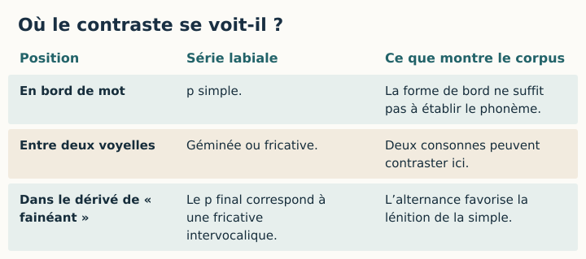
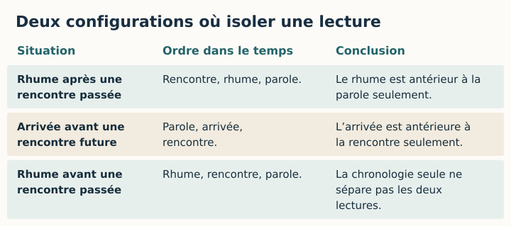
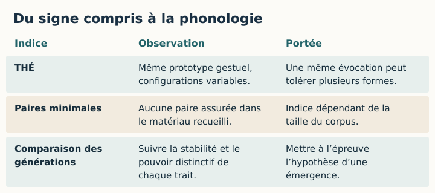

# ENS-PSL · Sélection internationale Lettres · Linguistique 2016 — Corrigé guidé

*Corrigé rédigé par IA, non officiel. Signalez toute erreur.*

**Rédaction** · GPT-6.2 Astra Ultra · vitesse non renseignée

## Phonèmes du lango

### A. Distribution locale des consonnes

Les quatre séries ont la même géographie. Les occlusives sourdes simples p, t, k et l'affriquée palatale simple apparaissent en début ou à la fin du mot dans cet échantillon. Le plus souvent, on les rencontre au contact d'une voyelle, par exemple p en tête du mot 1 et en finale des mots 44 et 46. L'initiale k peut aussi précéder une consonne, comme dans le groupe à semi-voyelle du mot 29. Les géminées pp, tt, kk et l'affriquée palatale longue sont entre voyelles. Les réalisations affaiblies, la fricative bilabiale sourde, la battue alvéolaire sourde, la fricative vélaire sourde et la fricative palatale sourde, sont elles aussi entre voyelles. On peut contrôler le contraste labial dans les mots 8 et 20, et le vélaire dans les mots 11 et 33. Le ton des voyelles n'est pas ce qui les oppose.

### B. Huit phonèmes et deux regroupements

Notons pour chaque lieu T la consonne simple, TT sa géminée et R la réalisation affaiblie. Les quatre lignes sont p/pp/ɸ, t/tt/ɾ̥, k/kk/x et t͡ɕ/t͡tɕ/ɕ, dans la notation du sujet. Ce sont les géminées et les formes affaiblies qui peuvent occuper **le même** environnement V_V. Elles ne peuvent donc être simplement deux variantes prévisibles dans ce contexte. La consonne brève de la périphérie est en revanche en distribution complémentaire avec chacune.

Première analyse, p, t, k et l'affriquée simple ont chacun pour réalisation la forme affaiblie entre voyelles, et la simple ailleurs. Les quatre géminées constituent les quatre autres phonèmes, attestés ici entre voyelles. Seconde analyse, les quatre simples deviennent les géminées correspondantes entre voyelles et restent simples ailleurs. Les quatre affaiblies sont alors des phonèmes distincts, attestés ici entre voyelles. Dans chaque cas, on a quatre séries de deux phonèmes, non douze phonèmes pour douze sons.

### C. Règles

Dans la première analyse, l'occlusive ou affriquée **brève** subit une lénition en position intervocalique. Elle garde son lieu d'articulation, mais se réalise comme une fricative ou, pour la série alvéolaire, une battue sourde. La géminée résiste à cette lénition. Dans la seconde analyse, c'est la consonne simple qui double en position intervocalique. La fricative ou la battue qui existe alors comme phonème autonome ne subit pas le doublement. Dans les deux analyses minimales, la distribution restreinte de la seconde série est une propriété du lexique observé.

### D. Ordre des règles

Ces deux règles minimales sont des **hypothèses concurrentes**, pas deux étapes à appliquer successivement à la même consonne. Dans chaque analyse une règle de classe suffit. Si on la décompose en quatre changements particuliers à chaque lieu, ils ont des entrées distinctes, donc leur ordre est indifférent. Par exemple, appliquer ou non la règle relative aux vélaires avant celle relative aux labiales ne change rien à la forme de p entre voyelles.

Une analyse plus riche pourrait vouloir obtenir toutes les distributions par des règles. Par exemple, si l'on posait /TT/ et /T/ jusque dans les contextes où le corpus ne les oppose pas, une dégémination périphérique TT → T hors de V_V pourrait accompagner la lénition de T entre voyelles. Leurs environnements respectifs sont disjoints. Ces données ne démontrent aucun ordre particulier entre les deux. Ce sont les contextes, et non le seul nombre des réalisations, qui permettent d'en décider.

### E. « Fainéant » et « fainéantise »

Le radical se termine en p dans le mot isolé et présente ɸ devant la voyelle du dérivé. Une même base /ɲap/ suivie ou non du suffixe vocalique rend immédiatement cette alternance par lénition intervocalique. La seconde analyse minimale prédirait pp pour ce p devant voyelle. Elle devrait ajouter une neutralisation périphérique d'un phonème fricatif ou postuler deux formes du radical. La paire favorise donc fortement le regroupement p/ɸ et, par parallélisme, les trois autres couples simple/affaiblie. Elle ne constitue pas une alternance morphologique indépendante pour chacun des trois autres lieux.

### Vérifier le raisonnement

**Partir d'une comparaison contrôlée.** Classer chaque consonne selon sa place avant de choisir son phonème. Au milieu des voyelles, les deux réalisations qui peuvent contraster sont la longue et l'affaiblie. C'est seulement la comparaison d'un mot et de son dérivé qui révèle à quelle série rattacher le p périphérique avec le moins d'hypothèses.

## Temps en proposition subordonnée

### 1. Deux jours avant quelle date ?

Plaçons l'énonciation lundi. Trois jours plus tard, jeudi, John rencontrera un homme arrivé deux jours auparavant, donc mardi. L'arrivée suit le lundi de parole, ce qui exclut un passé absolu. Elle précède la rencontre, ce qui établit le passé relatif.

### 2. Deux lectures hypothétiques sous un passé

Si le présent de (2a) pouvait avoir pour seul repère le moment de parole, le sens serait « à l'époque, il pensait qu'à l'heure où je parle il serait déjà mort ». Si le présent de (2b) pouvait avoir pour seul repère la pensée de 2010, le sens serait « en 2010 il croyait qu'elle était alors enceinte, sans rien présumer de maintenant ». Ces paraphrases isolent les lectures que la notation de l'exercice exclut. Elles n'excluent pas en général une lecture où un état dure depuis le moment de la pensée jusqu'au présent.

### 3. Le présent dans la relative sous passé

La lecture relative hypothétique de (3) serait « il a rencontré une femme qui était enrhumée à ce moment-là, mais qui peut être guérie maintenant ». Le présent anglais de la relative, dans le jugement donné, décrit la femme comme enrhumée au moment où l'on parle. C'est pourquoi l'imparfait français de la paraphrase aide à isoler la différence.

### 4. Le présent dans la complétive sous futur

Avec un présent exclusivement absolu, (4) voudrait dire « plus tard, il croira qu'elle est enrhumée aujourd'hui, même si elle est guérie lors de cette future pensée ». La lecture donnée est au contraire que, dans l'esprit du sujet, le rhume coïncidera avec le moment futur où il formera ce jugement.

### 5. Généralisation provisoire

Les relatives permettent, dans les exemples proposés, un repérage direct par rapport au moment de l'énoncé. Les complétives de *think* n'offrent pas le même libre choix d'un repérage **purement** absolu. C'est une généralisation sur un jeu de données et un type de verbe, non une propriété démontrée de toute subordonnée de l'anglais.

### 6. Une lecture exclusivement absolue en (6)

Il l'a rencontrée lundi, en parfaite santé. Elle n'a été enrhumée que mardi et nous sommes jeudi. Pour l'identifier, on peut dire qu'il a rencontré une femme qui a eu un rhume, en pensant à l'épisode de mardi. Celui-ci est passé par rapport à jeudi et postérieur à la rencontre. Un passé antérieur à la rencontre ne pourrait pas rendre compte de cette chronologie.

### 7. Peut-on isoler de la même manière l'antériorité relative ?

Avec une seule rencontre passée et un seul moment de parole, tout rhume antérieur à la rencontre est aussi antérieur au moment où l'on parle. Une chronologie qui rend vraie la lecture relative rend donc également possible l'absolue. La phrase ne réfute pas la lecture relative indiquée dans le tableau, mais sa vérité dans un tel contexte ne suffit pas à prouver qu'il existe deux représentations. Un autre test pourrait faire varier le temps de la principale sous un quantificateur pour chercher une lecture où le repère varie avec chaque rencontre.

### 8. Le passé dans la complétive de (7)

Supposons que Paul ait pensé lundi « Mary a été enrhumée dimanche ». (7) rapporte naturellement cette pensée et conserve l'antériorité du rhume par rapport à lundi. Pour tester un passé purement absolu, donnons-lui une autre pensée le lundi, « Mary ne tombera malade que mercredi ». Nous parlons jeudi. Bien que mercredi soit désormais passé, (7) ne rapporte pas cette prédiction. Il faudrait dire qu'il pensait qu'elle **aurait** un rhume plus tard. Le temps du complément dépend donc du point de vue temporel de la pensée. Il s'agit de ce que Paul croit, sans engagement sur la santé réelle de Mary.

### 9. Quand le rhume et la pensée coïncident

Paul se disait lundi « Mary est enrhumée en ce moment ». Dans le discours indirect au passé, (7) peut rapporter exactement cette pensée. Il n'y a aucune antériorité locale. Une analyse de concordance des temps traite *had* comme une forme de passé dépendant de celui de *thought*, avec une interprétation simultanée. (8) sépare le groupe verbal repris et l'auxiliaire passé *did*. Le présent *has* y rend visible un contenu simultané compatible avec la pensée passée. Cela appuie l'analyse d'un présent interprétatif sous la forme passée dans (7), au-delà de la simple constatation que les deux situations précèdent aujourd'hui.

### 10. Bilan pour la lecture absolue

L'impossibilité d'utiliser (7) pour la pensée prospective sur mercredi confirme que le locuteur ne peut pas librement dater le seul rhume par rapport à jeudi dans ce complément. La simultanéité de la question 9 a une autre explication. La généralisation provisoire de la question 5 reste compatible avec ces faits.

### 11. Question optionnelle, le passé sous futur

À partir de lundi, on peut imaginer qu'il pensera vendredi « elle a été enrhumée jeudi ». Le rhume est futur par rapport au locuteur mais antérieur à la pensée projetée. La lecture relative est donc nette pour les locuteurs qui acceptent (9) dans ce contexte. Si le rhume a eu lieu dimanche dernier, il est antérieur à la fois à lundi et à vendredi. Cette situation ne permet pas d'établir une lecture absolue indépendante. Pour une pensée future, tout événement antérieur au moment actuel sera déjà antérieur au futur point de vue. Le test chronologique seul ne force donc pas à réviser la généralisation, même chez un locuteur qui accepte cette seconde situation.

### Vérifier le raisonnement

**Garder trois repères distincts.** Écrire P pour parole, M pour événement principal et E pour état enchâssé. Si M précède P, E peut précéder P tout en suivant M. L'inverse est impossible dans cette configuration. Sous un futur M, c'est au contraire E qui peut précéder M tout en suivant P. Ce simple ordre explique pourquoi une même technique de contre-exemple ne marche pas dans les deux sens.

## Article de Sandler et al.

### 1. Reconstruire et discuter l'argument de Sandler et de ses collègues

La double articulation distingue la combinaison d'unités porteuses de sens et la combinaison d'unités distinctives sans sens propre. Dans de nombreuses langues des signes établies, changer la configuration de la main, le lieu ou le mouvement suffit parfois à changer le sens. De telles paires minimales sont un indice de phonologie, même en l'absence de sons.

La langue des signes bédouine d'Al-Sayyid (ABSL) s'est développée et transmise naturellement dans une communauté où personnes sourdes et entendantes l'utilisent pour converser, raconter et transmettre des informations. Les auteurs ont recueilli notamment trois tâches de dénomination d'images auprès de groupes en partie communs, soit 23 personnes et 128 images dans ces tâches. Dans le matériau décrit plus largement, qui comprend des phrases et des récits, ils ne trouvent pas de paire minimale assurée. Plusieurs propriétés formelles qui sont distinctives ailleurs varient fortement pour un même objet. Pour CITRON, changent la configuration, l'orientation, le mouvement ou la localisation. Pour THÉ, huit signeurs conservent l'évocation d'une tasse portée à la bouche, mais emploient trois configurations de main. La cible partagée semble donc souvent une représentation iconique globale. L'ensemble suggère que la convention lexicale et la communication peuvent précéder la stabilisation d'un vaste système d'unités distinctives.

L'absence de paires dans un corpus ne prouve pas leur impossibilité dans la langue. Le vocabulaire de dénomination est restreint, les participants n'ont pas tous reçu les mêmes images et le matériau ne permet pas de solide estimation statistique de la variation. Une variation abondante n'exclut pas des oppositions encore inconnues ni des régularités propres à un sous-groupe. Il faudrait suivre des formes chez plusieurs générations et tester la perception de variations contrôlées à contexte identique. Le faisceau d'indices est plus fort que le seul constat d'une paire minimale manquante, mais la conclusion porte sur une organisation en émergence.

### 2. Portée pour une théorie de l'innéité

L'existence d'une langue fonctionnelle sans inventaire déjà démontré de contrastes stables met en difficulté la thèse forte selon laquelle tout système humain devrait immédiatement manifester une phonologie entièrement constituée. Elle reste compatible avec une capacité biologique d'apprendre des unités discrètes ou avec des biais articulatoires et perceptifs communs qui s'expriment peu à peu au cours de la transmission sociale. Elle est également compatible avec l'effet de la taille du lexique et du besoin de distinguer des formes devenues nombreuses. Pour départager les explications, on chercherait à quelle vitesse des contraintes partagées se renforcent, dans quelles familles et dans quelles conditions d'interaction. L'extrait indique que des amorces de systématisation existent et s'interrompt avant la présentation des deux dernières parties de l'article.

### Vérifier le raisonnement

**Distinguer variation et opposition.** Une différence que deux personnes produisent pour THÉ ne suffit pas à créer deux mots distincts. Faire varier un seul trait tout en gardant les autres paramètres ou les propriétés de l'image constants permettrait de tester s'il change systématiquement la reconnaissance ou le sens du signe.

[Sujet officiel et document scientifique annexé](https://www.ens.psl.eu/IMG/file/admission/SI_2016/Ecrit_Linguistique.pdf)
