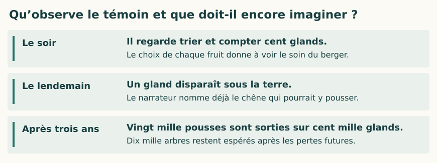

# Littérature — Giono et L’Homme qui plantait des arbres · Oral PSL 2016 · Corrigé brut

*Corrigé rédigé par IA, non officiel. Signalez toute erreur.*

**Rédaction** · GPT-6.2 Astra Ultra · vitesse non renseignée

## Commentaire du passage

Cent glands posés sur une table et dix mille chênes encore à venir sont-ils susceptibles de raconter la même action ? Dans ce passage de *L’Homme qui plantait des arbres*, récit de Jean Giono daté de 1953, un marcheur apprend comment un berger travaille à transformer un paysage. Le texte ne lui en livre pas d’emblée la raison. Le lecteur, qui connaît le titre, peut anticiper ce que le témoin va découvrir. Mais il lui faut encore comprendre l’allure d’une existence qui donne à un geste minuscule la portée d’une œuvre. Comment Giono fait-il éprouver ce changement d’échelle sans prêter à son personnage un discours de grand homme ?

### À la table du berger, apprendre à regarder

Le premier trait donné est une abstention discrète, le berger « ne fumait pas ». À quelques mots de là, la remarque « Je fumais ma pipe » installe deux emplois du même temps et de la même soirée. L’un observe, l’autre a les mains occupées à trier des glands. Le récit ralentit avec lui. D’abord, le narrateur enregistre la séparation des bons et des mauvais. Puis, à l’intérieur du premier tas, la présence de fruits trop petits ou légèrement fendus impose une seconde sélection. L’œil du lecteur acquiert peu à peu le degré de précision qu’il attribue au personnage. Des différences d’abord invisibles décident déjà du sort d’un arbre possible.

Le témoin propose ses services. Le berger répond que c’est « son affaire ». La suite aurait pu développer l’incident d’amour-propre ou faire entendre les raisons d’une vocation solitaire. Le narrateur se borne à constater qu’ayant vu le soin mis à ce travail, il n’a pas insisté. Il se retire au moment où il comprend qu’il ne suffirait pas d’avoir deux mains libres pour se rendre utile. La phrase qui met fin à « toute notre conversation » est suivie d’une description encore plus minutieuse. Le récit déplace ainsi la valeur de la parole. Pour connaître cet homme, il va falloir prêter une attention aussi soutenue à ce qu’il fait que lui-même en prête à ses semences. La clôture de la journée intervient à un seuil exact, cent glands parfaits, après quoi l’on va se coucher sans autre commentaire.

### Le lendemain, suivre deux routes qui se rejoignent

Un jugement semble enfin livré, la société de cet homme « donnait la paix ». Mais le narrateur retouche presque aussitôt ce qu’il s’est cru autorisé à savoir. Il est passé de l’idée que le berger trouvait son projet de repos naturel à l’« impression » que rien ne pouvait le déranger. Cette correction distingue un fait, l’hospitalité reçue, de l’interprétation intérieure que le témoin serait tenté d’en donner. Le même narrateur sait en revanche qu’il ne dit pas tout à son hôte. Son repos est un prétexte en partie, car il veut en savoir plus. Le contraste entre le calme de l’homme regardé et l’agitation curieuse du regardant commence à produire une comédie légère.

Le mouvement des personnages dans l’espace met cette différence en scène. Le marcheur emprunte une route parallèle en feignant de se promener. Lorsqu’il aperçoit le berger qui vient vers lui, il s’attend à un reproche. La coïncidence n’a rien d’une riposte à une indiscrétion, c’est simplement la route du berger. La proposition finale de l’accompagner rend superflue toute stratégie de poursuite. Giono donne à voir une relation morale dans la géométrie de deux chemins. Ce que le marcheur croyait ne pouvoir découvrir qu’en se dissimulant lui est ouvert du moment qu’il se trouve là et se laisse inviter. La tringle de fer remarquée pour sa longueur et son épaisseur aura, elle aussi, cessé bientôt d’être une énigme.

### Le travail accompli et ce qui reste à venir

La tringle pénètre dans la terre, un gland entre dans le trou, le trou est rebouché. La succession des propositions suit l’ordre exact des opérations et n’en omet aucune. Après cette longue préparation, la phrase « Il plantait des chênes » introduit une ellipse temporelle extraordinaire dans des mots ordinaires. L’observateur n’a vu entrer en terre que des glands. L’imparfait désigne pourtant l’activité par ce qu’elle fera peut-être advenir. Le titre avait donné au lecteur le nom général de l’action. La phrase nous apprend maintenant à reconnaître un arbre futur dans une manipulation qui tient dans la main.

Le dialogue sur la propriété pourrait ouvrir une enquête sur les droits du planteur. Les interrogations du témoin se succèdent et les hypothèses sur le propriétaire restent sans réponse certaine. Le travail reprend malgré cette ignorance. Le verbe « se soucier » se distribue entre d’éventuels propriétaires qui délaissent le terrain et le berger qui se désintéresse de leur identité. Cette reprise verbale fait sentir la différence entre le titre par lequel on possède un lieu et le soin qu’on lui donne. Giono se garde d’en tirer un discours général sur le droit de propriété. L’interrogation appartient au témoin, les cent gestes précis au berger.

Le dernier paragraphe dévoile enfin la durée à laquelle il faut rapporter la matinée observée. Cent mille glands en trois ans, vingt mille pousses sorties, dix mille chênes encore espérés après les pertes futures. Le calcul ne ressemble guère à une amplification héroïque, puisque les nombres successifs vont en diminuant. Il permet précisément au lecteur de mesurer la réussite. Malgré les rongeurs et l’imprévisible évoqué sous le nom de Providence, le dernier nombre se détache sur une absence antérieure. Là où il n’y avait rien, une forêt peut se former. L’expression « allaient pousser » désigne encore un avenir. Confondre ces dix mille chênes avec autant d’arbres déjà adultes ferait perdre le pari que prend le berger, aussi attentif à ce qu’il peut faire qu’aux limites de son pouvoir.

Le passage aura donc conduit du geste particulier à l’ampleur d’une œuvre, puis rendu à chaque geste sa vraie dimension. Le personnage parle peu et son interlocuteur doit réviser ce qu’il suppose de ses intentions. Cette réserve rend possible un hommage singulier. Le temps consacré par le récit à choisir correctement un gland répond à la façon dont le berger traite un avenir dont il ne sera jamais tout à fait maître.

## Deux relances pour l’entretien

**Pour quelle raison détailler la tringle avant son emploi ?** Le marcheur en connaît la taille avant d’en savoir l’utilité. Le retard donné à l’explication fait passer le lecteur par le même apprentissage du regard. Il découvrira ensuite dans cet outil la condition d’un changement considérable.

**Le récit doit-il sa force à l’exactitude documentaire des chiffres ?** Les chiffres construisent une vraisemblance de témoignage et permettent surtout de raisonner sur le temps. Leur décroissance inclut la perte dans la réussite et oblige à distinguer arbres espérés et germinations observées. Le texte demeure une fiction narrative.

[Énoncé](https://www.ens.psl.eu/IMG/file/admission/SI_2016/ORAUX-LITTERATURE-SIL2016.pdf)
