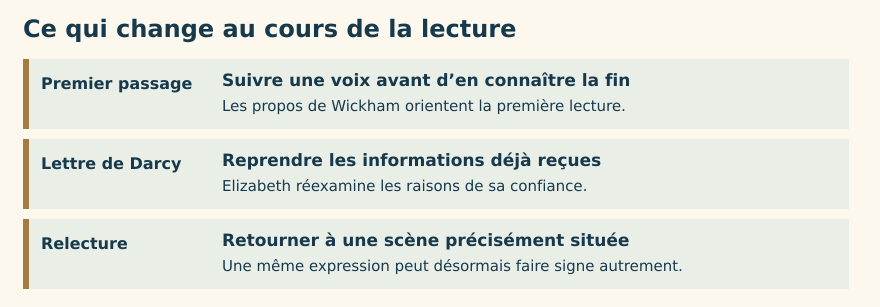

# ENS-PSL · Sélection internationale Lettres — Littérature — Modiano et le lecteur 2016 · Corrigé guidé

*Corrigé rédigé par IA, non officiel. Signalez toute erreur.*

**Rédaction** · GPT-6.2 Astra Ultra · vitesse non renseignée

**Relecture** · GPT-6.2 Astra Ultra · vitesse non renseignée · 26 novembre 2026

**Autocontrôle** · GPT-6.2 Astra Ultra · vitesse non renseignée

Le sujet demande de commenter la réflexion de Modiano sur la relation du roman à son lecteur, en mobilisant des lectures littéraires et critiques, françaises ou étrangères.

## Travailler les deux images

Le tirage argentique rend lentement visible une image préparée. Le chant implique une voix, une manière de la soutenir et une écoute. Relevez ce que chaque comparaison explique, puis identifiez où la seconde fait apparaître une limite de la première.

> [!INDICATION]
> Pourquoi revenir à une scène déjà lue ?

Après la lettre de Darcy, la parole de Wickham est la même sur la page et ne dispose plus pour le lecteur du même crédit. Ce changement distingue nettement la suite des événements et le temps propre de la relecture.

> [!INDICATION]
> Que veut dire « en sait plus long » ?

Séparez un renseignement sur les brouillons, un fait de l’intrigue et un effet que le roman produit sur une personne qui découvre la fin. Ne donnez pas au lecteur un savoir biographique auquel il n’a pas accès.

> [!INDICATION]
> Comment employer un ouvrage critique ?

La lecture chez Iser permet de décrire les anticipations et leurs corrections. Mettez cette idée au travail sur une relation vérifiable du récit. Une liste d’autorités théoriques ne répondrait pas à la demande d’illustrer le propos par des œuvres.

## Le lecteur sait-il ce que le romancier ne pouvait savoir ?

Au début de *Rue des Boutiques obscures*, Guy Roland se désigne comme un homme dont le passé s’est effacé. Le lecteur ne possède aucune information secrète dont le narrateur serait privé. Pourtant, au fil de la recherche menée à partir d’un nom, d’une photographie ou d’une adresse, il garde parfois rapprochés des éléments que le personnage traverse successivement. Voilà un premier sens possible de la supériorité paradoxale du lecteur dont parle Patrick Modiano dans sa conférence Nobel. Elle tiendrait moins au nombre des renseignements détenus qu’à la façon de former leurs relations. Le passage ajoute aussitôt deux comparaisons, le développement photographique et le chant qui peut forcer sa voix. La première fait de la lecture le temps d’une apparition. La seconde donne à l’auteur une responsabilité dans ce qui restera disponible pour l’entendre. Comment une œuvre peut-elle conduire son lecteur à une découverte qu’elle ne lui dicte pas ?

## Une apparition préparée par le livre

Dans le laboratoire photographique auquel pense Modiano, une image n’apparaît pas sur une feuille vierge au gré du désir de celui qui la regarde. Le papier a été exposé, puis certaines différences deviennent perceptibles dans le bain. La métaphore donne ainsi deux conditions à la lecture. Quelque chose a déjà été préparé, mais il ne suffit pas de posséder matériellement le livre pour que tout son sens se présente en même temps. Lire, c’est aussi subir une durée au cours de laquelle un trait auparavant aperçu comme négligeable acquiert de l’importance.

Dans *Rue des Boutiques obscures*, le roman ne dispose pas de l’état civil de Guy Roland sur la première page comme on déposerait sur un bureau un dossier déjà classé. Le personnage enquête quand prend fin son travail auprès du détective Hutte. Il sollicite des témoins et tente de se reconnaître parmi des noms et des figures. Les renseignements gagnent leur prix de la relation qu’ils peuvent entretenir avec une vie perdue. Ce qui paraît un instant rétablir une identité ouvre quelquefois une autre question. Le lecteur apprend par là une façon de regarder une adresse, comme le point où quelqu’un a peut-être eu une existence que les noms conservés ne suffisent plus à restituer. Formulée d’avance comme thèse sur la fragilité de la mémoire, cette idée n’aurait pas le même effet.

Le temps de la lecture n’est pas toutefois celui du seul premier parcours. Dans *Orgueil et Préjugés* de Jane Austen, la lettre de Darcy oblige Elizabeth à reprendre les renseignements qu’elle a reçus de Wickham et à réexaminer la préférence qui l’avait conduite à les croire. Le lecteur qui a partagé la vivacité de ses jugements peut revenir sur les scènes déjà lues. Les signes n’ont pas changé sur la page. Le statut de ce que l’on avait pris pour une preuve a changé. Une seconde lecture ne développe pas seulement une image plus nette. Elle révèle parfois pourquoi nous en avions construit une première qui était fausse.

Austen fait même de la vitesse de lecture un ressort de la scène. Au chapitre 35, la lettre de Darcy est donnée au lecteur, qui peut s’y arrêter. Au chapitre 36, Elizabeth se précipite pour en connaître la suite et saisit à peine ce qu’elle a sous les yeux. Puis elle déplie la lettre une seconde fois et examine phrase par phrase ce qui concerne Wickham. En revenant sur le même écrit, elle découvre aussi le parti qu’elle avait pris avant de le lire. Cette différence entre ses deux parcours éclaire la limite de la chambre noire de Modiano. Le bain révèle une image latente ; la relecture d’Elizabeth révèle en outre les obstacles que sa propre impatience avait opposés à l’image.

> [!INDICATION]
> Quel fait précis du chapitre 36 rend le travail du lecteur observable ?

Elizabeth replie la lettre, puis l’ouvre de nouveau. La première fois, son désir d’arriver à la phrase suivante l’empêche de comprendre celle qu’elle lit. La seconde fois, elle pèse les phrases sur Wickham. On peut donc discuter la comparaison photographique à partir de deux gestes, sans supposer qu’Elizabeth connaissait déjà la vérité.

## Une marge construite et non une licence illimitée

Dans « The Reading Process: A Phenomenological Approach » (1972), la théorie de Wolfgang Iser permet de préciser ce travail. Les points où un récit ne relie pas explicitement deux perspectives appellent l’activité du lecteur. Celui-ci anticipe une suite, puis doit parfois corriger une liaison qu’il avait tenue pour acquise. Dans le roman d’Austen, la lettre a un contenu précis qu’on ne peut remplacer arbitrairement par son contraire. Mais l’importance que je donnais moi-même à l’aisance de Wickham ou à la réserve de Darcy devient à son tour un objet de lecture. J’en sais peut-être davantage sur ce que cette opposition fait au lecteur que ne le disait chacune des scènes isolées.

La photographie et le chant font ici des propositions légèrement différentes. L’image latente paraît pouvoir attendre qu’une opération adéquate la livre un jour telle qu’elle était déjà. La relation entre chanteur et auditeur ne produit pas un second exemplaire de la voix. Elle dépend du souffle, d’une salle et d’une écoute. Lorsque Modiano veut que le romancier ne force pas son lecteur, il ne recommande donc pas l’absence de toute construction. Il demande une conduite assez précise pour entraîner et assez discrète pour qu’on puisse éprouver ce mouvement comme le sien.

*Le Tour d’écrou* de Henry James permet d’en mesurer la tension. L’histoire est transmise dans un récit-cadre, puis par l’écrit d’une gouvernante. Le lecteur dépend de sa manière d’observer les enfants et d’identifier les apparitions. Il peut s’interroger sur la réalité des présences rapportées et sur l’effet de son désir de protéger ceux qu’elle garde. Ce doute ne vient ni d’une page blanche ni d’une autorisation donnée à toutes les hypothèses. Il est produit par le dispositif qui rend un témoignage indispensable et laisse son interprétation contestable. Savoir davantage peut signifier ici être capable de tenir ensemble plusieurs possibilités que la voix qui raconte ne tient pas ensemble de la même manière.

## L’auteur et le lecteur ne possèdent pas le même savoir

Reste à discuter le premier « oui » de Modiano. L’auteur sait quelles pages il a supprimées, quels documents il a utilisés, quelles décisions ont conduit à telle place un détail du roman. Le lecteur ordinaire n’en sait pas davantage en ce sens. Mais le romancier ne rencontre pas son propre début comme le fait quelqu’un qui ignore encore la fin. La place qu’a prise une scène dans une autre existence, ou ce qu’une génération moins familière d’une adresse parisienne y reconnaîtra, ne peut être entièrement prévue au moment de l’écriture. L’asymétrie porte sur deux savoirs de nature différente, le savoir de la genèse et celui des effets que le livre rend possibles.

Il est également des romans qui guident très fortement la réponse du lecteur ou dont la voix brusque est précisément ce qui nous arrache à une habitude. Dans le cas de James, l’inquiétude est construite, et dans celui d’Austen le démenti de la première impression est énergiquement mis en scène. La discrétion défendue par Modiano éclaire une poétique du roman. Elle perdrait sa justesse si elle interdisait toute insistance ou si elle faisait de l’absence de conclusion nette une qualité suffisante. Il faut juger ce que l’insistance produit. Elle peut fermer la possibilité d’un examen, ou au contraire obliger à réexaminer ce que l’on avait trop vite tenu pour entendu.

La force du parallèle photographique est donc de reconnaître à une découverte sa durée et ses conditions matérielles. Sa limite est de suggérer une image définitive. Un lecteur peut savoir « plus long » lorsque la relation qu’il construit fait apparaître dans l’œuvre un effet réel dont son auteur ne pouvait posséder à l’avance l’expérience. Cette liberté demeure une manière de répondre au livre, jusque dans le retour sur la page qui nous a d’abord trompés.

[Feuille de l’écrit](https://www.ens.psl.eu/IMG/file/admission/SI_2016/LITTERATURE.pdf) · [Modiano, conférence Nobel de 2014](https://www.nobelprize.org/prizes/literature/2014/modiano/25249-conference-nobel/) · [Wolfgang Iser, The Reading Process](https://ctlsites.uga.edu/eberle/wp-content/uploads/sites/78/2017/08/iser_readingProcess.pdf) · [Austen, chapitres 35 et 36](https://austen.unl.edu/visualizations/pride_and_prejudice/all)
