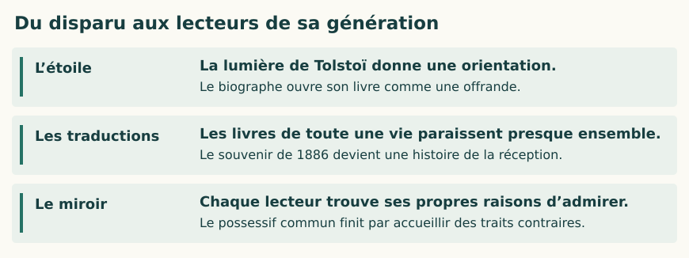

# Littérature — Romain Rolland et Tolstoï · Oral PSL 2016 · Corrigé guidé

*Corrigé rédigé par IA, non officiel. Signalez toute erreur.*

**Rédaction** · GPT-6.2 Astra Ultra · vitesse non renseignée

## Préparer le commentaire

Associez trois mots-images à trois opérations de lecture, l’étoile qui oriente, la porte qui s’ouvre, le miroir qui révèle. Repérez ensuite quelles données rendent ces images concrètes, les traductions datées, les désaccords du groupe, l’émotion discrète de lecteurs provinciaux.

Pour la lecture à voix haute, commencez par tenir le fil de la longue phrase d’offrande malgré les incises. Accélérez légèrement dans l’énumération des titres, puis donnez à chaque « Nôtre » un appui distinct. Pour mettre à l’épreuve votre interprétation, reprenez la série en supprimant le possessif. Dites ce que la phrase perd comme geste collectif.

## Commentaire de l’incipit

Au début d’une vie de grand écrivain, on pourrait s’attendre au récit de sa naissance ou à l’histoire de ses premiers livres. Romain Rolland, qui publie sa *Vie de Tolstoï* en 1911, l’année suivant la mort de l’écrivain russe, commence par le souvenir très précisément daté de sa propre lecture en 1886. Le premier être dont il raconte la jeunesse est en somme un lecteur français. Le titre du passage, « La lumière qui vient de s’éteindre », indique pourtant que l’enjeu est de rendre hommage à l’écrivain disparu. Comment ce détour par la mémoire des lecteurs peut-il faire apparaître une vérité sur l’œuvre ? Le texte passe de l’oraison à la chronique d’une découverte, puis de la chronique à un véritable chœur.

### Une voix se lève pour un disparu

La première phrase installe une échelle immense. Une grande âme, un pays, la terre tout entière et un siècle entrent dans l’image d’une flamme. La lumière se déplace ensuite avec précision. Elle n’éclaire plus la terre indistinctement, mais la jeunesse de « ceux de ma génération ». La fin du dix-neuvième siècle devient un crépuscule et la flamme une étoile. Une étoile ne fait pas disparaître la nuit. Elle donne une direction et, chez Rolland, un réconfort. Le « regard » qui appartient désormais à l’étoile renverse la métaphore de la lecture. Les jeunes gens ne contemplent pas seulement l’auteur lointain. Ils ont le sentiment que cette œuvre les regarde et répond à ce qu’ils vivent. Le passage de l’écrivain admiré à l’« ami » devient dès lors intelligible, sans supposer qu’il y ait eu entre eux une amitié personnelle.

La longue phrase qui mène à l’offrande du narrateur en retarde le sujet. Avant que « j’ai voulu » puisse se dire, il faut faire une place à tant d’autres, « nombreux en France ». Les tirets étendent et rectifient les qualifications. Cet homme fut un artiste aimé, un ami, pour beaucoup le seul ami véritable dans l’art européen. Le superlatif et le lexique presque religieux de la mémoire « sacrée » appartiennent au ton de l’hommage. Mais le biographe se réserve une position singulièrement modeste. Ce qu’il offre est un « tribut ». Le livre s’écrit pour rendre quelque chose de ce que son auteur a reçu. L’autorité du témoin tiendra donc à une dette reconnue plutôt qu’à la prétention de tout savoir de son sujet.

### La découverte d’une œuvre devient un événement de l’histoire française

« C’était en 1886 » ramène sans transition la lumière cosmique à la brièveté d’une notation datée. Une floraison succède à l’étoile. Surtout, ces fleurs russes surgissent « de la terre de France ». L’image résume le paradoxe de la traduction. Les œuvres viennent d’ailleurs, mais leur parution simultanée constitue sur le sol français un événement nouveau. Un catalogue prend le relais de la métaphore. Grands romans, récits brefs, souvenirs d’enfance et contes passent les uns après les autres comme les livres qui sortaient des maisons d’édition. La syntaxe de la liste fait éprouver la compression du temps. Une vie entière de production devient la lecture de quelques semaines. Rolland ne reconstitue donc pas encore la chronologie de Tolstoï. Il montre le renversement que cette chronologie a subi pour ses premiers admirateurs français.

Le groupe des jeunes normaliens pourrait passer pour le public prédestiné à une admiration uniforme. L’énumération dément cette facilité. Georges Dumas et Suarès reçoivent des profils nommés, puis viennent des appartenances littéraires et religieuses que les coordinations mettent en vis-à-vis. Des lecteurs de Stendhal et des amateurs de Wagner, des athées et des mystiques ne se rejoignent pas spontanément. Le « mais » qui suit cette accumulation donne alors son poids à l’événement. « Presque tous » maintient une réserve là où une commémoration facile les aurait unifiés sans reste. Chacun trouve dans la même œuvre ses raisons singulières de l’aimer. L’image de la porte ouverte sur l’univers suit significativement l’idée que chacun « s’y retrouvait soi-même ». L’œuvre dont on partage la lecture peut être en même temps ouverture sur l’étranger et accès à ce qu’on portait déjà en soi.

L’épisode du Nivernais étend la démonstration. Un garçon venu de province peut y retourner, écouter dans sa propre région des gens qui lisent peu et les entendre parler d’*Ivan Iliitch*. La « grande voix » traverse le continent jusqu’à cette conversation presque privée. À l’amplification sonore de cette voix répond une émotion « concentrée ». Rolland peut en observer la retenue sans prétendre rendre les bourgeois semblables aux normaliens. Le témoignage change ainsi d’échelle et de milieu, en gardant pour unité une réaction de lecture.

### De l’objection de la mode au chant du « nous »

On pourrait opposer au biographe ses propres dates. À voir toutes les maisons d’édition publier les mêmes auteurs en même temps, les jeunes gens n’obéissaient-ils pas à la mode ? Rolland distingue ici le canal de la rencontre et l’intensité de la réponse. La simultanéité des parutions a rendu possible la découverte. Elle n’explique pas pourquoi les œuvres leur ont paru répondre à un besoin intime. Le livre de critique de Vogüé, connu par la plupart d’entre eux après Tolstoï, sert à préciser ce désaccord. Le « littérateur » juge une œuvre, les adolescents disent l’avoir vécue. Le texte ne fournit pas une enquête sociologique qui éliminerait toute influence de la mode. Il cherche à rendre à une expérience son caractère irrécusable pour ceux qui l’ont éprouvée.

Une série de phrases brèves s’ouvre alors sur « Nôtre ». Le possessif semble d’abord placer l’œuvre sous une propriété commune. Or, à chaque reprise, ce qu’il faut faire tenir dans le même mot devient plus divers. La jeunesse du cœur côtoie la hantise de la mort, les rêves fraternels un jugement terrible sur la civilisation, le réalisme le mysticisme. La litanie permet de prononcer ensemble des traits contraires sans en annuler aucun. La fin poursuit l’élan des groupes introduits par « par », même après que la répétition du possessif s’est tue. Le lecteur peut entendre à quel point cette œuvre est devenue une manière, pour un collectif français, de prendre la parole.

La comparaison finale avec *Werther* permet de sortir d’une fausse alternative. Les lecteurs auraient-ils seulement rapporté Tolstoï à eux-mêmes ? Le « miroir » renvoie en effet une image de leur génération, et l’expérience a un précédent littéraire situé dans une autre époque et une autre langue. Mais ce miroir est dit « magnifique » et sa surface révèle autant les faiblesses que les puissances, les terreurs que les espoirs. S’y reconnaître peut être une découverte, y compris peu flatteuse. L’incipit de la biographie aura trouvé son point de départ. Pour faire connaître le disparu, le témoin commence par restituer la force avec laquelle des êtres très différents ont appris, grâce à lui, à lire leur propre vie.

## Deux relances pour l’entretien

**Pourquoi la liste des titres importe-t-elle ?** Elle documente un moment de traduction et fait entendre la vitesse avec laquelle se présente tout un monde. Remplacer la liste par « beaucoup de livres » ferait perdre à la fois son ampleur et son rythme.

**Le singulier disparaît-il dans le groupe ?** Le « je » date l’expérience, nomme ses camarades et rapporte une conversation en province. Il conserve une responsabilité de témoin alors même que le retour de « nôtre » met en voix une expérience commune.

[Énoncé](https://www.ens.psl.eu/IMG/file/admission/SI_2016/ORAUX-LITTERATURE-SIL2016.pdf)
