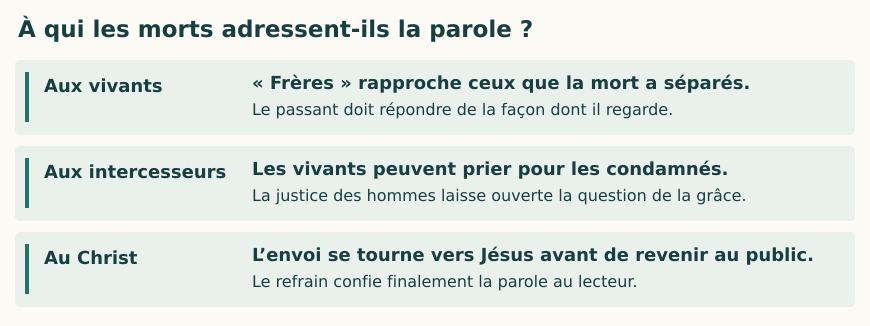

# Littérature — Villon et la Ballade des pendus · Oral PSL 2016 · Corrigé brut

*Corrigé rédigé par IA, non officiel. Signalez toute erreur.*

**Rédaction** · GPT-6.2 Astra Ultra · vitesse non renseignée

## Commentaire de la ballade

Le premier mot, « Frères », suppose déjà entre ceux qui parlent et ceux qui les entendent un lien que tout le poème va devoir établir. Dans cette ballade attribuée à François Villon, poète du quinzième siècle, les locuteurs se présentent comme des morts condamnés par la justice des hommes. Leur donner une voix constitue une prosopopée. L’interprétation peut s’appuyer sur cette fiction sans prétendre retrouver le moment biographique exact où Villon aurait écrit le poème. La question que pose la scène est plus saisissante. Comment des morts qu’on expose pour donner à voir les effets d’une condamnation peuvent-ils obtenir des vivants autre chose qu’un regard ? Les trois dizains et l’envoi transforment la vision en écoute, puis l’écoute en une prière que le passant pourra prendre à son compte.

### Un lien de parenté à faire exister

L’incise « qui après nous vivez » sépare par le temps ceux que l’apostrophe vient d’unir. Le « nous » n’a plus accès au monde dans lequel le « vous » continue de vivre. Pourtant chaque lecteur présent et futur peut entrer dans ce second pronom. L’interdiction initiale d’avoir des cœurs « endurcis » indique que la pitié demandée ne sera pas un sentiment automatique. Dans les premiers vers, les deux personnes grammaticales se croisent. Si les vivants prennent les morts en pitié, Dieu à son tour pourra faire merci aux vivants. L’argument procède par déplacement. Celui qui se croyait seulement appelé à juger découvre qu’il devra lui aussi un jour attendre une grâce. La fraternité commence dans cet avenir commun dont les deux parties du dialogue n’occupent pas encore le même point.

« Vous nous voyez cy » met en scène le geste d’un passant qui lève les yeux. Le démonstratif de lieu fait apparaître sur la page un véritable lieu de parole. Le compte approximatif « cinq, six » donne à ce groupe une présence concrète. Le lecteur en distingue presque les membres et ne reçoit pourtant aucun nom propre. La première personne du pluriel leur rend une voix dans ce qui aurait pu demeurer pour les passants un spectacle anonyme. Ils peuvent dire ce que fut leur existence terrestre, puis ce qu’il en demeure. La défense de rire, à la fin de la strophe, déplace la demande initiale. Une fois qu’on les a vus, on peut encore se défendre de ce que l’on voit en s’en moquant. Le « Mais » du refrain propose une autre réponse. Au lieu de regarder les morts et de les commenter entre soi, les vivants peuvent adresser une parole à Dieu.

### Le jugement terrestre et l’espérance d’être entendus

Le deuxième dizain reprend le premier mot pour en examiner la légitimité. L’objection prêtée aux passants se comprend aisément. Comment appeler frères des gens que la justice a condamnés ? La proposition concessive s’achève au vers suivant sur « Par justice ». Le rejet donne du relief à ces mots tout en faisant entendre ce qu’ils peuvent avoir de définitif aux yeux de la foule. Les morts admettent le fait de la condamnation. Ils ne demandent pas au passant de rejuger individuellement chacun de leurs actes. L’appel au peu de « bon sens rassiz » qu’ont parfois les hommes replace leur faute dans une fragilité que chacun peut comprendre sans l’absoudre de son propre chef.

D’où les verbes qui changent la fonction du « vous ». Il lui est demandé d’excuser les morts auprès du « filz de la Vierge Marie ». Dans le monde chrétien auquel se réfère la ballade, c’est à Dieu qu’appartient la grâce. Le passant peut intercéder. Son intervention prend la forme d’un détour de la parole, des morts aux vivants, puis des vivants à Dieu. Le retour du même refrain n’est donc pas seulement une contrainte de genre. Nous savons désormais auprès de qui et à quel titre la prière peut être prononcée. Le mot « tous » étend la supplique à chacun des locuteurs. Il résonne aussi avec l’universelle précarité humaine rappelée plus haut, sans qu’il soit nécessaire d’en faire grammaticalement un autre pronom.

### Une voix commune là où tout semble disperser le groupe

La troisième strophe est presque entièrement occupée, dans son premier mouvement, par ce que les éléments font aux morts. La pluie, le soleil et le vent deviennent les sujets grammaticaux d’actions qu’ils subissent. L’opposition entre le déictique du premier dizain, qui les attachait à « ici », et le balancement « puis ça, puis là » prête à la diction elle-même un mouvement sans repos. Les verbes et les déterminations temporelles donnent à la scène une durée sans issue. On pourrait croire les locuteurs définitivement livrés à des forces sur lesquelles leur volonté n’a aucune prise.

Or la forme fixe persiste au cœur de cette dispersion. Les trois strophes reprennent les mêmes sons de rime et s’achèvent sur le même impératif. Les locuteurs demeurent ensemble par la voix qui peut répéter une demande à chaque nouveau lecteur. L’expression « nostre confrarie » reprend presque ironiquement le mot initial. Les morts ne souhaitent aux vivants aucune communauté de sort dans la peine exposée. Ils demandent une fraternité assez active pour prier pour eux. Avec ce retour d’un terme de groupe, la strophe empêche donc de confondre deux sens du lien, partager une condition humaine et subir le même supplice.

L’envoi de cinq vers resserre cette circulation de la parole. La ballade adresse traditionnellement son envoi à un « Prince ». Ici, « Prince Jhesus » reçoit immédiatement cette dignité. La rime entre « maistrie » et « seigneurie » fait entendre un vocabulaire de juridiction dont l’usage se transforme. Les condamnés invoquent la souveraineté du Christ pour que l’Enfer ne puisse établir sur eux la sienne. La prière à Jésus semble un instant se suffire à elle-même. Mais l’avant-dernier vers interpelle de nouveau les « Hommes ». La dernière occurrence du refrain rend la demande au public qui la lit ou l’entend. Dans une lecture à voix haute, celui qui prête sa voix aux morts se découvre physiquement en train de prononcer lui-même la demande de prière. Cet effet achève le travail commencé par le mot « Frères ». Une communauté existe dès lors que le passant accepte de devenir celui par qui la parole des disparus continue de s’adresser à d’autres.

## Deux relances pour l’entretien

**Le refrain a-t-il toujours le même sens ?** Ses mots demeurent identiques. Après la vision initiale, il propose de remplacer la moquerie par la prière. Après la défense des condamnés, il précise une intercession. À la fin de l’envoi, il revient aux hommes après avoir directement invoqué Jésus. L’analyse de sa place fait entendre ces différences.

**Pourquoi commenter l’original quand une traduction est fournie ?** La traduction éclaire le sens d’un terme ancien, par exemple « merciz » ou « transis ». Pour comprendre la construction du poème, il faut revenir aux reprises sonores, au rejet de « Par justice » et à l’écho entre l’adresse « Frères » et « confrarie ».

[Énoncé](https://www.ens.psl.eu/IMG/file/admission/SI_2016/ORAUX-LITTERATURE-SIL2016.pdf)
