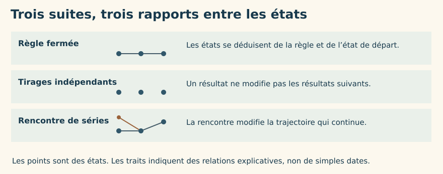

# ENS-PSL · Sélection internationale Lettres — Philosophie — histoire, nécessité et hasard 2016 · Corrigé guidé

*Corrigé rédigé par IA, non officiel. Signalez toute erreur.*

**Rédaction** · GPT-6.2 Astra Ultra · vitesse non renseignée

**Autocontrôle** · GPT-6.2 Astra Ultra · vitesse non renseignée

**Révision (tour 1)** · GPT-6.2 Astra Ultra · vitesse non renseignée

La feuille donne une phrase d’un « philosophe du XIXe siècle » et demande de l’expliquer et de la commenter librement. Le début de la phrase permet de l’identifier dans l’*Essai sur les fondements de nos connaissances et sur les caractères de la critique philosophique* de Cournot, publié en 1851.

## Lire le balancement de la phrase

La prémisse de la première moitié comporte une restriction indispensable. Les événements dérivent régulièrement les uns des autres **sans** rencontre avec une influence étrangère au système étudié. Dans la seconde moitié, les événements n’ont **aucune** liaison. La formule ne dit donc pas que toute régularité empêche l’histoire ni que tout imprévu suffit à la produire.

**Quelle expérience comparer ?** Tracez d’abord trois états déterminés par la même règle, puis trois résultats indépendants. Dans un troisième dessin, faites survenir une rencontre dont les conséquences demeurent dans les états ultérieurs. C’est cette dernière différence que le schéma appelle bifurcation.

**Qu’est-ce qui appartient à l’extrait ?** Le concours donne la seule phrase, sous une désignation anonyme. Les tirages indépendants et la partie d’échecs prolongent l’argument et trouvent leur répondant dans la suite du texte de Cournot. Aucun auteur n’avait à être deviné pour réussir le commentaire.

**Comment discuter la thèse ?** Prenez, par exemple, une éclipse. Séparez la question de son calcul et celle de la place qu’une société lui donne dans sa mémoire. La discussion devient ainsi une question sur le type d’explication recherché.

## Quand une succession fait-elle histoire ?

Une horloge indique successivement midi, une heure et deux heures. On peut dresser le relevé exact de ces indications. Pourtant, celui qui connaît la règle de la marche et l’heure initiale sait déjà pourquoi chacune a succédé à la précédente. À l’autre extrême, supposons que trois personnes, qui ne communiquent pas entre elles, tirent chacune un nombre au hasard. Le relevé demeure possible, mais le premier résultat n’explique pas le second. Cournot, que la feuille présente simplement comme un philosophe du XIXe siècle, définit l’histoire en écartant ces deux limites, l’enchaînement entièrement compris par une loi et l’absence de tout enchaînement. Pourquoi l’histoire a-t-elle besoin à la fois de relations intelligibles et de rencontres dont aucune règle interne ne suffit à rendre raison ?

## La première limite concerne ce qu’une théorie permet de déduire

Les premiers événements du texte « dérivent » les uns des autres. Le verbe semble les rendre particulièrement propres au récit. Cependant, Cournot ajoute deux conditions décisives. Les lois sont constantes et le système ne rencontre aucune influence accidentelle étrangère à celui que la théorie « embrasse ». Un pendule idéal dont on connaît le mouvement et la position initiale illustre cette situation. On peut noter ses passages successifs. La liste n’apporte pas à l’explication une relation qui manquerait à la loi. Ce qui arrive ensuite peut être déduit sans que le chercheur doive découvrir quelle rencontre singulière a modifié la marche.

Le cas change si l’horloge s’est arrêtée parce qu’un déménagement a interrompu son entretien. Ni les engrenages ni les lois du mouvement n’ont cessé de valoir. Mais connaître son mécanisme ne renseigne pas sur la date à laquelle une famille a quitté les lieux. Un document sur le déménagement ou une trace de l’interruption devient pertinent. Le système de l’horloge et celui des décisions familiales avaient chacun leur intelligibilité. Leur rencontre n’était pas contenue dans la théorie du premier.

Ainsi, « accidentel » ne signifie pas ici dépourvu de cause. Un événement est accidentel pour une série si l’enquête sur les causes propres à cette série ne suffit pas à expliquer la rencontre. Il faut distinguer les limites de notre information et la relation entre les causes elles-mêmes. Si le déplacement de la famille était précisément motivé par l’arrêt de l’horloge, il faudrait reconstruire une dépendance entre les deux séries. Pour parler d’une rencontre fortuite, l’enquête doit avoir des raisons de les tenir pour indépendantes avant leur rencontre. Si l’on réduit toute contingence à la seule ignorance d’une loi déjà supposée complète, on manque le rôle de cette rencontre entre séries. Inversement, il serait trop simple de faire de tout fait qu’on ignore provisoirement un événement historique. Encore faut-il montrer ce que son intervention a changé par la suite.

## La seconde limite concerne la capacité d’un événement à faire une différence

Dans l’hypothèse inverse, les événements se succèdent sans aucune liaison. Le hasard de chaque occurrence semble maximal. Pourtant, pourquoi raconter la première pour comprendre la seconde ? Dans un registre de tirages indépendants, un nombre déjà sorti ne devient pas pour cette seule raison moins probable au prochain tirage. Fabriquer une intrigue où les résultats antérieurs prépareraient le résultat qui suit introduirait entre eux une relation absente. Une liste peut avoir un intérêt statistique sans devenir pour autant l’histoire interne des coups.

L’institution de ce tirage peut évidemment avoir une histoire. Une ville change les règles, une personne conserve le registre, un gain modifie la possibilité pour une famille d’accomplir un projet. Dans ces cas, on a précisément quitté l’indépendance postulée entre les résultats. Ce qui précède a laissé une conséquence qui transforme une situation ultérieure. La distinction dépend donc de la question posée à la même suite de dates. Une chronologie est souvent indispensable à l’histoire, mais disposer de dates successives ne garantit pas qu’on ait identifié leur lien.

Une partie d’échecs rend plus sensible le milieu entre les deux extrêmes. Les règles définissent à chaque tour des coups autorisés, et la nouvelle position résulte de la position précédente. Pourtant, la décision d’un joueur ne se déduit pas des règles et du seul projet de l’adversaire. Un coup imprévu contraint celui-ci à réviser un plan qui, sans cette rencontre, aurait pu se poursuivre. Raconter pourquoi une position finale a été atteinte demande de restituer de telles bifurcations. La contingence n’abolit pas la liaison. Elle acquiert une portée historique parce qu’elle modifie les possibilités ultérieures.

## Les cas limites éclairent l’enquête sans épuiser ses objets

On pourrait objecter à Cournot qu’une éclipse exactement calculable a tout de même sa place dans une histoire. La difficulté se résout si l’on distingue deux questions. L’astronome qui explique la configuration des astres par leurs mouvements ne demande pas pourquoi telle population l’a inscrite dans une chronique ou ce qu’elle y a lu. Une date et un lieu d’observation peuvent faire de la même éclipse un événement décisif dans une autre série. La distinction entre théorie et histoire ne partage donc pas une fois pour toutes la nature et l’humanité. Une histoire de la Terre peut elle aussi expliquer une configuration particulière par des événements dont les effets demeurent inscrits dans des couches ou dans un relief.

Imaginons qu’un registre municipal mentionne à la même date la chute d’un pont et le passage d’une foire sur l’autre rive. Cette coïncidence fournit une piste. Pour en faire une explication historique, il faudrait établir que la foire avait déjà son propre calendrier et que la fermeture du pont a modifié le trajet des marchands. Des délibérations ou des comptes de péage pourraient permettre de le vérifier. L’ordre du récit dépendrait alors d’un effet attesté. La valeur d’un tel récit tient aussi au fait qu’une autre pièce pourrait défaire le lien proposé.

Une objection plus profonde demeure. Même un système clos régi par une loi peut avoir une trajectoire singulière que nous n’avons aucun moyen de déduire commodément. Et un historien choisit souvent de suivre une pratique régulière ou une répétition, précisément parce que leur durée demande explication. Le texte ne permet pas de nier ces usages courants du mot histoire. Il annonce expressément qu’il vise l’histoire « proprement dite ». Sa thèse est plus convaincante comme critère d’un besoin d’explication historique que comme interdiction d’user du mot ailleurs.

Comprendre historiquement une transformation exige finalement deux opérations. On doit établir ce qui relie les situations et ce qui, à un moment donné, a rencontré une série et en a modifié la suite. Sans liaison, une chronologie demeure une juxtaposition. Sans une différence dont la théorie des régularités ne détermine pas à elle seule la survenue, le récit devient une manière commode d’exposer la règle. Entre les deux, l’historien montre comment une possibilité est devenue ce qui est effectivement arrivé, puis a changé ce qui pouvait arriver à son tour.

## Tester la nécessité de chaque condition

Dans l’exemple du pont, retirez d’abord toute relation entre la crue et le trajet de la foire. Les deux dates composent une liste. Rétablissez la relation et supposez ensuite qu’une règle connue fixe à l’avance toutes les fermetures et tous les trajets. Qu’apporterait alors une enquête sur cette année singulière ? Les deux épreuves de pensée font comprendre pourquoi la phrase de Cournot comporte deux négations.

[Feuille de l’écrit](https://www.ens.psl.eu/IMG/file/admission/SI_2016/PHILO.pdf) · [Ministère, identification bibliographique de l’extrait de Cournot](https://www.devenirenseignant.gouv.fr/media/9883/download) · [Étude du COFRHIGÉO, l’histoire chez Cournot](https://www.annales.org/archives/cofrhigeo/gohau-whewell.pdf)
