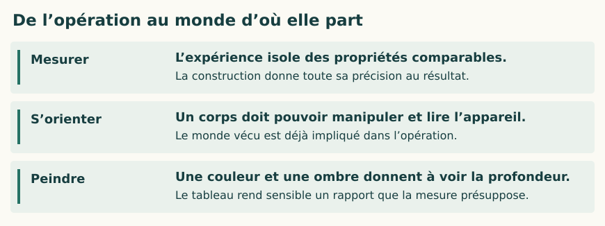

# Philosophie — Merleau-Ponty et la science · Oral PSL 2016 · Corrigé brut

*Corrigé rédigé par IA, non officiel. Signalez toute erreur.*

**Rédaction** · GPT-6.2 Astra Ultra · vitesse non renseignée

**Révision (tour 1)** · GPT-6.2 Astra Ultra · vitesse non renseignée

## Feuillet de l’oral

La page 5 du recueil donne un extrait de *L’Œil et l’Esprit*, pages 9 à 13 de l’œuvre. Le passage débute par « La science […] est, elle a toujours été » et s’achève par « sans aucun devoir d’appréciation. ». Les deux coupures entre crochets, à l’ouverture et après la référence au corps, figurent sur le feuillet. Il comporte quatre paragraphes.

Expliquez et commentez librement cet extrait de M. Merleau-Ponty, L’œil et l’esprit, p. 9-13 :

## Explication de l’extrait de *L’Œil et l’Esprit*

Mesurer la distance entre deux taches de couleur et les considérer pour préparer un tableau sont deux activités qui se déroulent dans le même monde visible. Pourquoi faudrait-il pourtant qu’une réflexion sur la science s’achève en donnant au peintre une place singulière ? Dans cet extrait de *L’Œil et l’Esprit*, Merleau-Ponty part du pouvoir opératoire de la science, isole une thèse philosophique qui tend à rendre ce pouvoir autosuffisant, puis fait de la peinture le témoin d’une expérience dont la pensée scientifique elle-même dépend. Il ne propose ni de rejeter la connaissance scientifique ni de faire du peintre un savant d’un autre genre. Il faut comprendre ce que l’opération de connaissance suppose sans toujours le thématiser.

### L’« objet en général » et la portée d’une abstraction

L’ouverture du texte tient ensemble trois adjectifs, admirative devant une pensée active et ingénieuse, plus ambiguë devant sa « désinvolture ». La science peut chercher les mêmes propriétés mesurables dans une tasse offerte par un ami et dans un récipient identique abandonné derrière une fenêtre. Pour étudier leur dilatation thermique, il est légitime de laisser de côté l’histoire du cadeau, la vue que j’en ai depuis ma place et le geste avec lequel je le prends. L’expression « objet en général » désigne cette décision de méthode. Les choses sont envisagées comme si elles ne tenaient rien de leur rapport singulier avec nous, et en même temps comme si elles se prêtaient d’avance aux opérations que nous inventons pour les connaître.

Cette double supposition explique la force de la science et la tentation qui l’accompagne. Les choses ne se réduisent pas spontanément à un réseau de propriétés mesurables. Il faut construire la situation où la température sera contrôlée, les variations comparées, les résultats rendus disponibles à d’autres. L’ingéniosité est dans cette construction même. Mais ce qui a été provisoirement laissé de côté risque ensuite de paraître moins réel que le résultat de l’opération. L’indifférence du dispositif à l’histoire du récipient ne démontre pourtant pas que cette histoire n’ait aucune part dans le monde où nous vivons.

### Où se situe la critique ?

Le second mouvement introduit une différence historique. Selon Merleau-Ponty, la science classique conservait le sentiment d’un monde opaque que ses constructions devaient rejoindre. Elle éprouvait le besoin de fonder leur validité, soit au-delà de l’expérience elle-même, soit dans les conditions qui rendent possible notre expérience. L’auteur formule ensuite une réserve décisive. Le fait nouveau ne se rencontre pas « dans la science » en bloc, mais dans une certaine philosophie des sciences. Ce que vise l’objection est la réduction de toute pensée à une opération qui se mesurerait exclusivement à son efficacité.

Le contrôle expérimental pourrait sembler écarter cette difficulté. N’est-ce pas le monde lui-même qui, à la fin, donne sa réponse ? Il y répond, mais dans une configuration hautement travaillée. Un appareil est réglé de telle sorte que certains phénomènes deviennent isolables et lisibles. Il y a ici une construction des conditions d’apparition, ce qui n’équivaut pas à une fabrication arbitraire de la vérité. Un dispositif peut très bien démentir l’hypothèse de celui qui l’a construit. La question est de savoir si cette situation particulière peut à son tour expliquer entièrement ce que signifie pour nous percevoir quelque chose, l’attendre, s’orienter pour lire un résultat ou se tourner vers un autre qui le vérifiera.

### Retrouver le sol du monde sensible

Dire qu’il faut replacer la pensée de « survol » dans un « il y a » préalable ne revient pas à demander au savant d’abandonner sa méthode à la première impression du sens commun. Le préalable a un sens de condition. Pour prendre une mesure, le physicien doit pouvoir se situer, manipuler, reconnaître une direction et partager la présence des moins théoriques de ses instruments avec ses collègues. Son corps n’est pas seulement un élément du dispositif que décrirait un second appareil. Il est aussi ce depuis quoi il y a pour lui un champ dans lequel apparaissent des objets et des déplacements. Le texte parle du monde « sensible » et du monde « ouvré ». Il inclut les objets du travail et de la vie sociale dans ce sol, loin de nous renvoyer à une nature primitive supposée intacte avant tout artifice.

La peinture « puise » à cette dimension. Regardons une surface peinte où une ombre fait se creuser un coin de pièce. Je vois à la fois le plan matériel de la toile et une profondeur qui n’est pas derrière lui comme le serait une seconde planche. Le tableau n’a pas fourni une mesure incomplète qu’un géomètre viendrait enfin corriger. Il a fait apparaître comment un champ coloré peut donner à voir du relief à un regard situé. L’expérience de la peinture permet ainsi de revenir sur ce qui était déjà à l’œuvre quand nous regardions autour de nous sans chercher à l’expliquer.

La dernière phrase mesure cette différence à deux mots de la vie publique, le droit et le devoir. Un « droit de regard » fait d’ordinaire penser à la faculté de surveiller ou d’approuver ce que fait autrui. Ici, le droit est justement dissocié de l’obligation de prononcer une appréciation. Regarder peut prendre du temps avant même qu’il y ait quelque chose de nettement identifiable à louer ou à condamner. Cela éclaire également le verbe « puiser » qui introduisait la peinture. Il fallait laisser le sensible se présenter avant de lui demander de servir de preuve ou de motif à une décision.

Le dernier paragraphe caractérise cette liberté par une série de positions. On demande à l’écrivain ou au philosophe de donner un avis et de prendre en charge ce qu’implique le fait de parler. La musique semble à Merleau-Ponty pouvoir figurer les mouvements de l’être en deçà de l’identification d’objets déterminés. Le peintre, lui, conserve un droit de regard sans avoir à juger ce qu’il regarde. La formule finale est volontairement forte. On peut lui objecter qu’une peinture peut prendre parti et qu’un texte littéraire peut suspendre un jugement. L’objection vise avec raison toute hiérarchie fixe entre les arts. Elle laisse toutefois subsister le point méthodologique du passage. La pensée opératoire gagne à rencontrer une activité qui n’a pas pour première fin de maîtriser son objet et qui lui rend sensible comment un monde lui était déjà donné à voir.

## Questions d’entraînement

Ces questions ont été rédigées pour préparer la discussion. Le feuillet du concours donne la seule consigne d’expliquer et de commenter librement l’extrait.

**Dire qu’un appareil produit un phénomène retire-t-il sa valeur au résultat ?** La construction expérimentale spécifie les conditions dans lesquelles un phénomène peut être observé et contrôlé. La critique porte sur la prétention de faire de cette situation la définition exhaustive de tout rapport au monde.

**Pourquoi mentionner le monde « ouvré » ?** Le sol préalable comprend outils, lieux et manières de faire partagées. Merleau-Ponty ne confond pas le monde perçu avec un paysage supposé vierge de toute activité humaine.

[Énoncé](https://www.ens.psl.eu/IMG/file/admission/SI_2016/ORAUX-PHILO-SIL2016.pdf)
