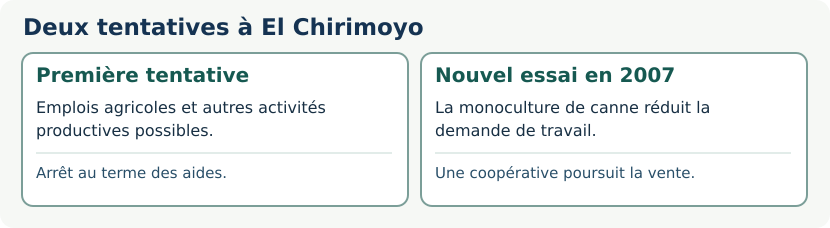
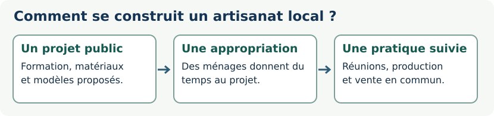

# ENS-PSL · Sélection internationale Lettres · Sociologie — Inda et la communauté villageoise (oral) 2016 — Corrigé brut

*Corrigé rédigé par IA, non officiel. Signalez toute erreur.*

**Rédaction** · GPT-6.2 Astra Ultra · vitesse non renseignée

## Un même projet, deux issues

Dans le village mexicain d’El Chirimoyo, un agent de l’administration revient proposer un programme d’artisanat huichol qui avait déjà échoué. La première formation s’était achevée avec les bourses versées pendant les cours. Après le second essai, en 2007, une coopérative poursuit la production et la vente. Comment expliquer que la proposition du même fonctionnaire rencontre des réponses aussi différentes ? Daniele Inda, dans un article de *Genèses* paru en 2015, se sert de cette variation pour examiner les conditions de l’efficacité du pouvoir d’État.

## Une asymétrie réelle dont il faut étudier les effets

Le texte discute une lecture des politiques indigénistes mexicaines selon laquelle les catégories élaborées au centre transformeraient directement les pratiques des populations auxquelles elles s’appliquent. Cette lecture identifie un pouvoir réel. L’État dispose de financements, d’agents et de la capacité de désigner les activités qu’il entend soutenir. Appeler une production « artisanat traditionnel huichol » contribue déjà à fixer ce qui mérite d’être enseigné et sauvegardé. Mais le mot « traditionnel » pose ici une énigme empirique. Lors de la première visite du fonctionnaire, les villageois concernés n’avaient pas de compétence artisanale dans cette activité. Il faut donc observer dans quelles circonstances des familles en viennent à la pratiquer.

Une réunion permet à l’agent de proposer une formation. Le gouvernement fournit la matière première et une bourse à ceux qui la suivent. Si l’offre suffisait à installer un artisanat, le premier cours aurait été suivi d’une poursuite de l’activité. Or il attire peu de participants et la production s’arrête lorsque la formation et les aides prennent fin. Accepter temporairement un apprentissage et investir durablement du temps dans un métier sont deux décisions distinctes.

## Ce qui a changé dans l’économie du village

Au moment du premier essai, les familles peuvent trouver du travail salarié. Une boulangerie, un magasin et un élevage de poulets comptent aussi parmi les activités mises en place par le programme PRONASOL. Le temps consacré à produire des objets entre donc en concurrence avec d’autres ressources possibles. Par la suite, les cultures de maïs, de tomate et de cacahuète cèdent la place à une monoculture de canne à sucre qui requiert moins de main-d’œuvre. Avec la baisse des possibilités de travail, la production artisanale présente un intérêt nouveau. Son coût d’opportunité diminue : lui consacrer une journée demande de renoncer à des alternatives devenues plus rares.

En 2007, la nouvelle tentative aboutit à la formation d’un groupe réunissant une trentaine de familles, soit à peu près la moitié de celles de la Colonia. Cette continuité après le cours forme un indice plus solide de l’implantation du programme que le seul nombre d’inscrits. On ne connaît cependant ni le revenu net de chacune des familles ni les raisons propres à chaque membre de rejoindre la coopérative.

## Comment une pratique acquiert une forme collective

Les réunions du mardi matin ont lieu chez un membre du groupe. Jorge Alvarez examine les objets, discute des figures et des couleurs et rapporte de Tepic des modèles à reprendre. Les séances peuvent aussi porter sur l’agriculture, l’économie domestique ou l’hygiène. La relation avec l’administration se prolonge donc après la création du groupe. Ce que le programme reconnaît comme une production traditionnelle se construit au fil des apprentissages, de la circulation des modèles et des opérations de vente. En retour, les familles rendent l’activité durable en se réunissant et en produisant.

L’État peut proposer une catégorie et financer sa mise en œuvre. L’économie locale modifie ce qu’il en coûte aux habitants de s’en saisir. Enfin, le collectif et ses réunions stabilisent la pratique. Cette explication respecte l’asymétrie entre fonctionnaire et habitants tout en expliquant pourquoi elle produit des effets variables. Le cas documente une réorganisation de l’activité économique et des catégories qui lui sont appliquées. Pour savoir comment chaque famille se définit elle-même, il faudrait une enquête distincte sur les usages de l’appartenance.

[Feuillet officiel, pages 10 à 11](https://www.ens.psl.eu/IMG/file/admission/SI_2016/ORAUX-SOCIO-SIL2016.pdf#page=10) · [Attentes générales du jury, p. 3](https://www.ens.psl.eu/IMG/file/internationale/2008/Lettres/Lettres.pdf#page=3)
