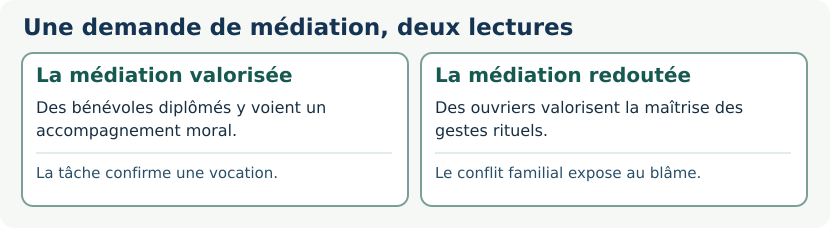

# ENS-PSL · Sélection internationale Lettres · Sociologie — Jouanneau et les vocations d’imams (oral) 2016 — Corrigé guidé

*Corrigé rédigé par IA, non officiel. Signalez toute erreur.*

**Rédaction** · GPT-6.2 Astra Ultra · vitesse non renseignée

## Définir le fait à expliquer

Relisez les deux premiers paragraphes. Le sujet porte sur le maintien des vocations de bénévoles dans les mosquées françaises. Une bonne entrée consiste à distinguer trois questions : qui est reconnu comme imam, quelle forme d’emploi caractérise son activité, et ce qui lui donne des raisons de rester. La diversité des procédures locales de reconnaissance et la coexistence durable du bénévolat et du salariat rendent ces questions distinctes.

Pour présenter la source, notez l’article de Solenne Jouanneau paru en 2011, les deux pages de l’extrait et la mention d’entretiens approfondis auprès d’une trentaine d’imams. Expliquez que la structuration locale du culte remonte ici à la fin des années 1970. Le point de départ historique et la date de publication ne donnent pas la date individuelle d’entrée en fonction des enquêtés.

## Distinguer un coût, une rétribution et une reconnaissance

Essayez d’expliquer chaque terme par un fait. Une tension avec la vie familiale est un coût possible. La possibilité d’être écouté comme un homme instruit est une rétribution symbolique. Cette gratification suppose que des fidèles accordent de la valeur à la parole religieuse du bénévole. Le prestige a donc un public et des conditions d’existence. Des relations entre municipalité et association peuvent en étendre le rayon. Le passage réserve cet effet à certaines situations locales.

**Comment parler de rétribution sans juger la foi ?** En distinguant le sens religieux que la personne donne à son engagement et les relations qui contribuent à le rendre durable. La reconnaissance peut se constituer après l’entrée en fonction et renforcer le dévouement. Le texte n’attribue aux bénévoles aucun projet initial de recherche du prestige.

## Comparer deux réponses à une même sollicitation

Fixez une situation commune, une famille demande de l’aide. Suivez d’abord les bénévoles dotés de diplômes universitaires et d’une position assurée qui acceptent cette médiation. La tâche peut s’inscrire dans leur manière de guider moralement le groupe. Suivez ensuite les ouvriers évoqués dans les entretiens. La tâche rituelle leur paraît un domaine d’autorité mieux défini. Ils anticipent les conséquences d’une intervention familiale contestée. Cette comparaison porte sur l’appréciation d’une tâche précise. Elle n’établit aucune hiérarchie entre les convictions religieuses des enquêtés.

Pour vérifier votre lecture, complétez oralement la phrase suivante : « Une même fonction procure un prestige publiquement reconnaissable, mais la gratification concrète de la tenir varie avec… ». Une réponse attendue dans ce raisonnement associe la position locale de la mosquée, le parcours scolaire et professionnel du bénévole, ainsi que sa définition des responsabilités dignes d’être assumées.

## Délimiter la portée de l’enquête

Le jury pourrait demander si l’on peut déduire que tout bénévole ouvrier refuse d’intervenir dans les familles. L’autrice présente des tendances rapportées à des trajectoires. Le matériau fait entendre les raisons données et permet la comparaison qualitative ; il ne fournit ni échantillon représentatif ni taux de refus. Pour prolonger l’étude du maintien dans le temps, on pourrait aussi interroger des personnes ayant quitté la fonction et suivre l’évolution des tâches effectivement assumées. Présentez cette dernière piste comme un prolongement de l’enquête.

[Feuillet officiel, pages 3 à 4](https://www.ens.psl.eu/IMG/file/admission/SI_2016/ORAUX-SOCIO-SIL2016.pdf#page=3) · [Attentes générales du jury, p. 3](https://www.ens.psl.eu/IMG/file/internationale/2008/Lettres/Lettres.pdf#page=3)
