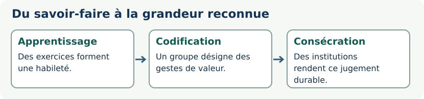

# ENS-PSL · Sélection internationale Lettres · Sociologie — Schotté et les excellences corporelles (oral) 2016 — Corrigé brut

*Corrigé rédigé par IA, non officiel. Signalez toute erreur.*

**Rédaction** · GPT-6.2 Astra Ultra · vitesse non renseignée

## Quand un geste devient une excellence

Que faut-il voir quand quelqu’un porte une charge ? Un mouvement que l’on pourrait décrire en termes de force et d’équilibre, mais aussi une action dont le sens dépend de la scène. Dans un exercice de rééducation, le critère pertinent peut être le rétablissement d’une capacité. Dans une compétition, c’est un règlement qui fixe la réussite et rend les performances comparables. Le même geste a encore une autre valeur dans un cours d’éducation physique ou sur une scène de foire. Dans l’introduction au dossier de *Genèses* paru en 2016, Manuel Schotté propose de comparer les façons dont diverses sociétés et institutions consacrent des maîtrises corporelles.

## Construire la comparaison

Un pianiste, un footballeur professionnel et un potier mobilisent des savoir-faire appris avec le corps. La spécialisation des recherches tend à reprendre les séparations entre art, sport et artisanat, alors que ces séparations sont elles-mêmes des faits à expliquer. Mauss offrait un point de départ en montrant que les techniques du corps s’apprennent socialement. Schotté déplace la question vers l’histoire des échelles de valeur. Comment un groupe en vient-il à distinguer certaines personnes au titre d’une maîtrise physique particulière ? Les luttes sur les usages légitimes du corps analysées par Jacques Defrance permettent de comprendre que le sport est devenu un ordre identifiable de pratiques, d’épreuves et de classements.

## Les frontières ont des effets matériels

Le rapprochement entre danse classique et gymnastique de haut niveau est instructif. Ces activités requièrent un entraînement prolongé, l’anticipation d’une échéance publique et une grande intensité physique. Chacune possède toutefois ses critères et ses institutions de reconnaissance. Le geste réussi d’une danseuse reçoit une qualification artistique qui informe la manière dont elle perçoit sa carrière. Reconnaître la parenté des contraintes d’entraînement permet précisément d’étudier le travail accompli pour maintenir une frontière entre art et sport.

Le passage montre que les classements affectent aussi l’organisation du travail et la protection professionnelle. Le modèle du championnat structure de nombreux sports, alors qu’il est rejeté dans le cas de l’alpinisme évoqué. Des artistes peuvent relever du régime de l’intermittence, tandis que des coureurs professionnels dont les revenus sont eux aussi discontinus restent hors de ce régime. La qualification collective d’une activité change les possibilités offertes au pratiquant. Elle est suffisamment concrète pour produire des droits et suffisamment incorporée pour orienter la manière dont les personnes se décrivent.

## Des reconnaissances d’étendue inégale

Une compétence valorisée par un groupe de proches peut être presque invisible ailleurs. Le contraste construit par l’auteur entre une endurance célébrée dans un collectif d’atelier étudié par Michel Pialoux et la reconnaissance plus étendue des épreuves de trail porte sur la portée sociale du jugement. Pour comparer ces reconnaissances, il faut examiner qui attribue de la valeur à la pratique, devant quel public et par quels relais ce jugement circule. La capacité à faire reconnaître une performance au-delà des pairs dépend aussi des ressources de ceux qui la promeuvent.

Schotté aboutit ainsi à une critique de l’association mécanique entre travail corporel et domination sociale. La danse classique et la pratique de certains instruments sont des excellences physiques valorisées dans des milieux dominants. Savoir moduler sa voix, tenir une posture ou maîtriser ses émotions peut aussi procurer un avantage scolaire ou professionnel. Des différences socialement acquises sont alors perçues comme une aisance individuelle. Le corps est à la fois formé par des apprentissages et engagé dans les opérations qui classent les personnes. Le texte ouvre un programme comparatif ; ses exemples rendent le mécanisme intelligible sans constituer une enquête exhaustive sur la hiérarchie des métiers.

[Feuillet officiel, pages 7 à 9](https://www.ens.psl.eu/IMG/file/admission/SI_2016/ORAUX-SOCIO-SIL2016.pdf#page=7) · [Attentes générales du jury, p. 3](https://www.ens.psl.eu/IMG/file/internationale/2008/Lettres/Lettres.pdf#page=3)
