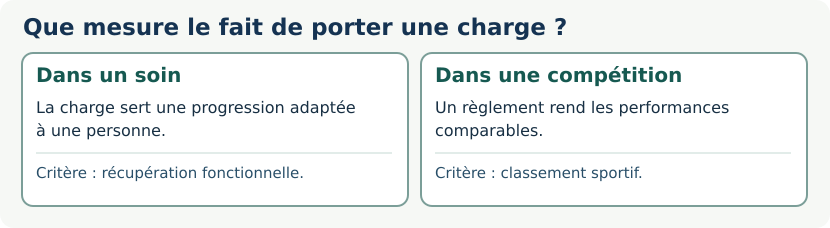
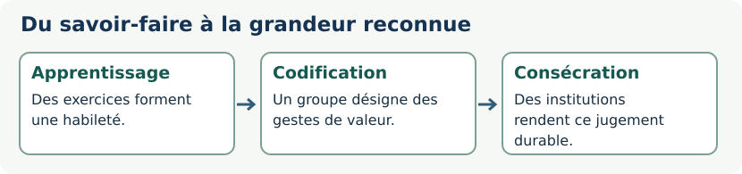

# ENS-PSL · Sélection internationale Lettres · Sociologie — Schotté et les excellences corporelles (oral) 2016 — Corrigé guidé

*Corrigé rédigé par IA, non officiel. Signalez toute erreur.*

**Rédaction** · GPT-6.2 Astra Ultra · vitesse non renseignée

## Partir d’une expérience de pensée

Imaginez deux personnes soulevant la même charge, l’une dans un exercice thérapeutique, l’autre au cours d’une compétition. Que faudrait-il connaître pour dire si elles ont « réussi » ? Il faudrait savoir qui observe, dans quel but et avec quels critères. Cette entrée reprend un exemple du feuillet de Manuel Schotté. Elle vous conduit de l’habileté corporelle au jugement d’excellence. Vous pouvez ensuite identifier le document : une introduction à un dossier collectif publié en 2016, avec des références bibliographiques aux pages 8 et 9 du recueil.

## Donner une fonction à deux références

Avec Mauss, retenez que les gestes s’acquièrent et se transmettent. Avec Defrance, ajoutez que la valeur accordée à des usages du corps s’est formée dans des luttes historiques entre groupes. Dites ce que permet ce second déplacement. Pour rendre compte d’un champion, un sociologue peut étudier sa formation technique, mais aussi l’apparition des épreuves en vertu desquelles quelqu’un peut être déclaré champion. La construction d’une échelle d’excellence et l’apprentissage individuel sont deux objets articulés.

## Expliquer pourquoi les frontières comptent

Choisissez un exemple pour chacune des trois dimensions. Pour l’organisation, comparez la place des championnats dans le sport et leur rejet dans l’alpinisme mentionné par Schotté. Pour les conditions d’emploi, comparez la qualification d’artiste ouvrant accès, sous conditions, à l’intermittence et la discontinuité des revenus d’un coureur qui ne relève pas de ce régime. Pour l’expérience vécue, montrez comment des danseurs tiennent à leur identification comme artistes tout en connaissant des contraintes physiques proches de celles des sportifs de haut niveau. Ces exemples donnent à « ordre symbolique » un contenu observable.

**Faut-il effacer toutes les différences entre les gestes ?** Revenez au cas du danseur et du gymnaste. Leur proximité sur certaines dimensions rend justement possible l’étude des frontières, des juges et de leurs effets. Aucun des deux ne pourrait se produire dans la discipline de l’autre sans apprentissage particulier.

## Examiner la portée du jugement

Distinguez « être reconnu » et « être reconnu par qui ». Le passage oppose une endurance valorisée localement dans un groupe de pairs à la reconnaissance potentiellement plus étendue du trail. La question sociologique est celle des publics et des soutiens qui donnent au jugement une portée plus ou moins grande. Le texte ne donne ni chiffres de pratiquants ni score objectif de légitimité.

Terminez par la critique de l’opposition entre corps et esprit. Appuyez-la sur deux faits distincts. Certaines disciplines corporelles, telle la danse classique, portent un grand prestige. Des manières de parler et de se tenir contribuent aussi aux chances scolaires et professionnelles. Le dernier point étend l’enquête au-delà des virtuoses. Si le jury vous invite à imaginer un terrain, proposez de suivre l’apprentissage d’un même geste, puis son évaluation devant deux publics. Vous pourrez alors distinguer la performance, la règle de jugement et les effets de sa reconnaissance.

[Feuillet officiel, pages 7 à 9](https://www.ens.psl.eu/IMG/file/admission/SI_2016/ORAUX-SOCIO-SIL2016.pdf#page=7) · [Attentes générales du jury, p. 3](https://www.ens.psl.eu/IMG/file/internationale/2008/Lettres/Lettres.pdf#page=3)
