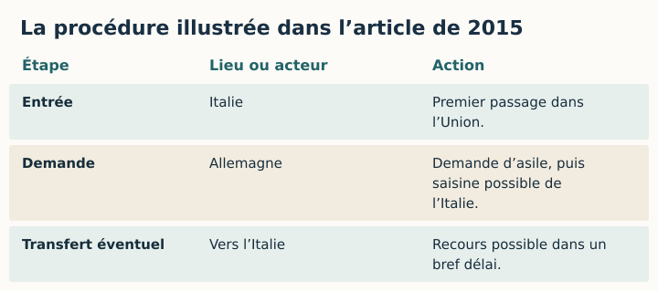

# ENS Rennes · D1 · Allemand 2016 — Corrigé guidé

*Corrigé rédigé par IA, non officiel. Signalez toute erreur.*

**Rédaction** · GPT-6.2 Astra Ultra · vitesse non renseignée

Épreuve écrite de l’École normale supérieure de Rennes. D’après Der Spiegel, 22 avril 2015.

## Version française

**Arrivés en Europe, et après ?**

C’est par le règlement de Dublin que l’Europe organise l’accueil des réfugiés. Un réfugié doit demander l’asile dans l’État par lequel il est entré pour la première fois sur le territoire de l’Union européenne. Cette entrée a lieu principalement aux frontières extérieures de l’Union, notamment en Italie, en Grèce ou en Hongrie.

Lors d’un entretien individuel, les autorités commencent par déterminer où le demandeur d’asile est entré dans l’Union. Elles disposent aussi pour cela de bases de données à l’échelle européenne où sont notamment enregistrées les empreintes digitales de réfugiés. Si, par exemple, un réfugié arrive en Italie, puis poursuit sa route vers l’Allemagne et n’y dépose sa demande d’asile qu’une fois sur place, les autorités peuvent demander sa prise en charge par l’Italie. Autrement dit, il est renvoyé dans le pays par lequel il est entré dans l’Union. Les réfugiés ont toutefois le droit de former un recours contre cette décision dans un bref délai.

Qu’en est-il pour l’Allemagne ? C’est en Allemagne que les réfugiés sont les plus nombreux à demander l’asile. L’année précédente, dans le cadre du règlement de Dublin, les autorités allemandes ont adressé aux autres États membres 35 115 demandes de prise ou de reprise en charge. En tout, seulement 4 800 personnes relevant de cette procédure ont effectivement été renvoyées dans leur pays d’entrée.

Voilà des années que l’on discute au sein de l’Union d’une suspension ou d’une modification du règlement de Dublin. Jusqu’ici, ces discussions n’ont rien donné. Dernièrement, Thomas de Maizière, ministre allemand de l’Intérieur, a proposé de répartir les réfugiés de manière plus équitable, au moyen de quotas. De nombreux États de l’Union s’y sont cependant opposés, car ils devraient alors accueillir davantage de réfugiés. Une telle répartition allégerait pourtant la tâche de pays comme l’Italie ou la Hongrie, débordés par le très grand nombre de réfugiés qu’ils ont actuellement à prendre en charge. Elle soulagerait aussi l’Allemagne.

## Expression en allemand

Expliquer les défis que rencontrait alors la politique d’asile et d’accueil des réfugiés de l’Union européenne. Environ 100 mots.

Die Europäische Union muss zunächst sicherstellen, dass Schutzsuchende an ihren Außengrenzen überhaupt ein faires Verfahren bekommen. Ein Staat, in dem viele Menschen zuerst ankommen, braucht dafür Personal, Unterkünfte und Dolmetscher. Zugleich reicht es nicht, zwischen Regierungen über die Zuständigkeit zu verhandeln. Wer bereits Angehörige in einem anderen Mitgliedstaat hat, braucht eine verständliche Auskunft darüber, ob und wie er zu ihnen gelangen kann. Eine gemeinsame Verteilung könnte einzelne Staaten entlasten, setzt aber verlässliche Zusagen der übrigen voraus. Die politische Herausforderung besteht darin, diese Solidarität auch dann aufrechtzuerhalten, wenn Regierungen zu Hause mit Widerstand rechnen und schnelle Erfolge versprechen möchten.

*98 mots, comptés par espaces.*

## Comment construire la réponse

**Suivre le trajet.** Dans l’exemple, la personne entre par l’Italie, dépose sa demande en Allemagne et peut être transférée vers l’Italie. Le groupe *durch Italien* indique quel pays assurerait sa prise en charge. L’entretien et la consultation des bases de données servent d’abord à reconstituer le point d’entrée. L’article du 22 avril 2015 présente le dispositif tel qu’il l’explique à cette date.

**Comparer les opérations.** Le premier nombre porte sur des demandes adressées par les autorités allemandes, le second sur des transferts effectivement exécutés. Ne pas attribuer leur différence à une cause que le texte ne donne pas. Dans le dernier paragraphe, *müssten* et *würde … entlasten* expriment les effets envisagés d’une proposition contestée ; le quota demeure une proposition.

**Répondre au pluriel.** La question vise plusieurs défis. Le modèle articule la capacité d’accueil des pays de première entrée, l’accès concret des demandeurs à une procédure et la coopération entre gouvernements. Un interprète est un exemple de moyen à mobiliser ; la question des proches introduit le point de vue de la personne.

[Feuillet original, p. 1](https://www.ens-rennes.fr/medias/fichier/sujet-allemand-e-crit-d1-2016_1476109339566-pdf#page=1) · [Rapport du jury, partie écrite](https://www.ens-rennes.fr/medias/fichier/rapport-allemand-e-crit-d1-2016_1478511418470-pdf#page=1)
