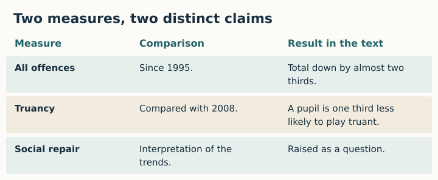

# ENS Rennes · D1 · Anglais 2016 — Corrigé brut

*Corrigé rédigé par IA, non officiel. Signalez toute erreur.*

**Rédaction** · GPT-6.2 Astra Ultra · vitesse non renseignée

Épreuve écrite de l’École normale supérieure de Rennes. Adapté du New Statesman, 3 février 2016.

## Version française

Chaque génération aime à déplorer les excès et l’irresponsabilité des jeunes. Il serait temps d’en finir. Depuis les bouleversements sociaux et culturels des années soixante, aucune génération ne s’est aussi bien conduite que les jeunes d’aujourd’hui. Le goût de l’effort semble avoir pris la place de la recherche du plaisir. À l’heure où les frais d’inscription à l’université se montent à 9 000 livres et où la conjugaison de la crise financière, de la concurrence de travailleurs venus d’ailleurs et de l’essor des nouvelles technologies rend l’emploi incertain, beaucoup de jeunes n’ont ni le temps ni l’envie de se laisser aller comme leurs parents le faisaient autrefois.

Vingt-deux ans après qu’Oasis a chanté « Je n’ai besoin que de cigarettes et d’alcool », les jeunes se détournent des unes comme de l’autre, peut-être au profit d’un café au lait de type *flat white*.

De plus, les jeunes se montrent plus tolérants que les générations précédentes. Le racisme recule. En ces temps d’inquiétude face à l’immigration, nous devrions saluer la contribution des migrants et des minorités ethniques à l’évolution des attitudes des jeunes envers les autres.

Les bonnes nouvelles concernent également la sécurité publique. Depuis 1995, le nombre total d’infractions a baissé de près des deux tiers. Par rapport à 2008, la probabilité qu’un élève fasse l’école buissonnière a diminué d’un tiers. Se pourrait-il que nous soyons entrés dans ce que certains appellent une « période de reconstruction du lien social » ?

## Expression en anglais

Would you say that recent decades have brought significant progress in public behaviour and health? Environ 100 mots.

Recent decades have brought real progress in some areas of public behaviour and health. If fewer young people smoke, both they and the people who share their homes benefit from cleaner air. A decline in crime can likewise make public places safer, including for strangers who must travel alone. Yet a fall in recorded offences tells us little about the health of a student anxious about debt or insecure work. Nor does better behaviour at school guarantee equal opportunities afterwards. I would therefore call these changes significant while asking whose experience each figure measures and which problems it leaves out.

*100 mots, comptés par espaces.*

[Feuillet original, p. 1](https://www.ens-rennes.fr/medias/fichier/sujet-anglais-e-crit-d1-2016_1476109326966-pdf#page=1) · [Rapport du jury, partie écrite](https://www.ens-rennes.fr/medias/fichier/rapport-anglais-e-crit-d1-2016_1478511444714-pdf#page=1)
