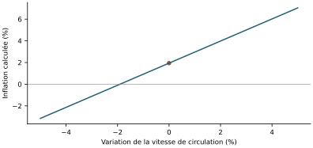

# ENS Rennes D1 — Composition d’ordre économique 2016 · Corrigé guidé

*Corrigé rédigé par IA, non officiel.*

**Rédaction** · GPT-6.2 Astra Ultra · vitesse non renseignée

## « La monnaie est une chose trop sérieuse pour la confier aux banquiers centraux » — Milton Friedman, Capitalism and Freedom (1962)

### Introduction

> [!INDICATION]
> Identifier précisément l’auteur, la date et le pouvoir que la formule met en discussion.

Lorsqu’une banque centrale relève son taux, des projets d’investissement peuvent être abandonnés, tandis que les épargnants prêtent à meilleur rendement. La décision met en jeu des revenus et des emplois, même si son annonce paraît technique. En 1962, Friedman place au centre du débat la délégation d’un pouvoir important à quelques décideurs. Au-delà du caractère indispensable de la monnaie, la question concerne la façon de régler sa gestion. Peut-on protéger l’économie des erreurs discrétionnaires sans entraver la réponse aux crises ? Les arguments en faveur de règles stables conduisent à distinguer le mandat collectif, les instruments confiés à la banque centrale et les institutions qui en contrôlent l’usage.

### I. Encadrer la discrétion monétaire protège contre des erreurs et des incitations prévisibles

#### A. La règle monétaire répond aux limites de l’information

> [!INDICATION]
> Repartir de MV = PY en faisant varier la vitesse.

La monnaie sert de moyen de paiement, d’unité de compte et de réserve de valeur. Une variation de son pouvoir d’achat redistribue entre débiteurs et créanciers et brouille l’interprétation des variations de prix relatifs. Pour les monétaristes, l’expansion monétaire ne peut maintenir durablement le chômage sous son niveau compatible avec les structures du marché du travail. Les anticipations finissent par intégrer les hausses de prix et de salaires. La politique doit donc être jugée aussi sur ses résultats à moyen terme, au-delà de son effet initial sur la demande.

Friedman souligne les délais longs et variables entre l’action et ses effets. Réagir trop tard à une récession risque de stimuler une activité déjà repartie. Sa proposition d’une croissance stable de la quantité de monnaie limite l’ajustement au gré des prévisions. Dans l’identité $MV=PY$, la croissance des prix égale approximativement celle de la monnaie plus celle de la vitesse de circulation moins celle de la production réelle. Avec une masse monétaire en hausse de 5 %, une vitesse constante et une production qui croît de 3 %, l’inflation vaut approximativement 2 %. Une diminution de la vitesse change le résultat. L’identité éclaire le pari empirique de la règle sans le garantir.

#### B. La crédibilité exige de traiter le conflit entre promesse et décision

> [!INDICATION]
> Décrire la tentation d’une expansion après formation des salaires et la réaction anticipée des agents.

Une autorité peut annoncer la stabilité des prix pour modérer les revendications nominales, puis souhaiter davantage d’activité lorsque les salaires sont fixés. Si cette incitation est comprise, les agents anticipent l’inflation et le gain durable d’activité disparaît. Kydland et Prescott formulent le problème d’incohérence temporelle, que Barro et Gordon appliquent à la politique monétaire. Un dispositif d’engagement peut donc améliorer le résultat avant même qu’un taux ne soit modifié.

La délégation à une autorité indépendante dotée d’un mandat clair constitue une réponse institutionnelle. Rogoff étudie l’intérêt de confier la politique à un décideur relativement plus soucieux d’inflation tout en montrant le coût d’une moindre stabilisation de l’activité. Retirer la monnaie au pilotage électoral quotidien est compatible avec l’intuition de Friedman si les banquiers sont tenus par une règle définie publiquement. Une indépendance des instruments et une liberté de choisir les fins n’ont pas les mêmes conséquences démocratiques.

### II. Une règle soutenable doit permettre une expertise responsable face aux chocs

#### A. Les crises et l’instabilité financière rendent certaines réponses contingentes nécessaires

> [!INDICATION]
> Séparer manque de liquidité, insolvabilité et faiblesse de la demande.

La vitesse de circulation varie lorsque la préférence pour la liquidité ou les moyens de paiement changent. Des banques peuvent conserver des réserves en raison de pertes anticipées. L’augmentation de la base monétaire ne se transmet alors pas mécaniquement aux crédits ni aux prix. Une règle de quantité mal calibrée peut laisser s’installer une déflation qui augmente le poids réel des dettes. Dans une crise de liquidité, une banque centrale prêteuse en dernier ressort peut éviter qu’un besoin temporaire de monnaie centrale ne déclenche des ventes simultanées d’actifs.

Cette fonction impose des choix sur les contreparties, l’échéance et les garanties. Une difficulté de liquidité diffère d’une insolvabilité qui exige une répartition explicite des pertes. Quand les taux nominaux proches de zéro réduisent la marge immédiate, des engagements de taux futurs ou des achats d’actifs agissent sur les maturités longues et les primes. Les développements de la zone euro observables en 2016 montrent pourquoi une règle mécanique sur un agrégat ne décrit pas tout le métier du banquier central.

#### B. L’indépendance opérationnelle demande mandat, publicité et responsabilité

> [!INDICATION]
> Identifier qui fixe le mandat, qui décide normalement des instruments et qui rend compte.

Le traité sur le fonctionnement de l’Union européenne donne au système européen de banques centrales l’objectif principal de stabilité des prix (art. 127) et protège l’indépendance institutionnelle (art. 130). Cela distingue le choix d’une finalité de la décision sur les instruments. À la date de 2016, la BCE vise une inflation inférieure à, mais proche de, 2 % à moyen terme. L’horizon lui permet de différencier un choc ponctuel sur l’énergie d’une chute persistante de la demande.

La publication des prévisions, des motifs, des incertitudes et l’audition par les représentants élus rendent la décision contrôlable sans établir un droit d’instruction sur chaque taux. Puisque les achats d’actifs et les garanties peuvent exposer le secteur public à des risques, il importe d’expliquer le partage des responsabilités avec les budgets nationaux. Une banque centrale ne peut durablement remplacer une politique budgétaire soutenable, une supervision bancaire ni les choix de redistribution. Le contrôle des résultats et des moyens fait ainsi partie du mandat.

### Conclusion

> [!INDICATION]
> Distinguer une règle rigide d’une discrétion encadrée et justifiée.

La formule de Friedman met en cause la concentration d’une discrétion mal encadrée. L’expertise et l’autonomie d’exécution gardent leur place, dès lors qu’un mandat public donne un repère nominal, aménage des réponses identifiables aux chocs et oblige à rendre compte de leurs conséquences. La difficulté consiste à inscrire la flexibilité indispensable dans une règle que le public puisse effectivement comprendre et vérifier.

[Sujet distribué](https://www.ens-rennes.fr/medias/fichier/sujet-e-conomie-d1-2016_1476109137855-pdf) · [Rapport du jury](https://www.ens-rennes.fr/medias/fichier/rapport-e-conomie-e-crit-d1-2016_1478511522326-pdf)

[Traité sur le fonctionnement de l’Union européenne](https://eur-lex.europa.eu/legal-content/FR/TXT/?uri=CELEX%3A12012E%2FTXT)
