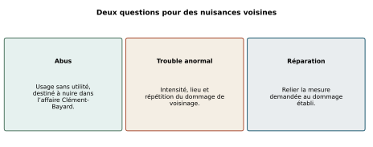
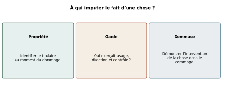

# ENS Rennes D1 — Droit civil 2016 · Corrigé brut

*Corrigé rédigé par IA, non officiel.*

**Rédaction** · GPT-6.2 Astra Ultra · vitesse non renseignée

## Propriété et responsabilité

### Introduction

Un propriétaire subit le vol de sa voiture, puis le voleur cause un accident. Le titre demeure chez le premier alors que la maîtrise effective du véhicule lui a échappé. Cet exemple invite à distinguer deux questions. La propriété, définie à l’article 544 du Code civil, confère l’usage, la jouissance et la disposition d’une chose dans les limites de la loi et des règlements. La responsabilité civile oblige à réparer un dommage imputable selon un fondement déterminé. En avril 2016 les articles 1382 à 1386 conservent leur numérotation ancienne. Le pouvoir de propriétaire explique parfois la responsabilité, mais la réparation des victimes peut aussi rechercher le responsable parmi ceux qui exercent effectivement un pouvoir sur la chose. Jusqu’où le titre explique-t-il la charge du dommage ?

### I. L’exercice du droit de propriété peut engager la responsabilité de son titulaire

#### A. De l’usage fautif à l’abus d’un droit

Le propriétaire qui laisse tomber un matériau sur le terrain voisin peut avoir commis une imprudence. Les articles 1382 et 1383 imposent, sur ce terrain, d’établir faute, dommage et causalité. L’objet immédiat du reproche porte sur le comportement de l’auteur. Le droit de bâtir, planter ou clore sa parcelle n’efface pas l’obligation de respecter les droits d’autrui. L’article 544 lui-même contient la réserve des usages prohibés.

La jurisprudence Clément-Bayard, chambre des requêtes, 3 août 1915, illustre l’abus dans l’exercice d’une prérogative. Les installations litigieuses ne présentaient aucune utilité pour leur auteur et avaient été élevées dans l’intention de nuire au voisin. Cette combinaison permet de comprendre pourquoi la sanction de l’abus protège les droits concurrents sans soumettre tout aménagement à la preuve d’une utilité maximale. La victime peut demander réparation de son préjudice et cessation de l’abus dans les conditions appropriées. L’intention de nuire, centrale dans cet exemple, ne constitue pas une exigence générale de toute responsabilité pour faute.

#### B. L’anormalité du trouble dépasse la recherche d’une faute

En 2016, le principe jurisprudentiel selon lequel nul ne doit causer à autrui un trouble anormal du voisinage permet d’indemniser un dommage qui excède les inconvénients ordinaires. Son intensité, sa répétition, son horaire et son environnement comptent. Des nuisances sonores peuvent dépasser ce seuil même si l’exploitant respecte une autorisation administrative. La preuve d’un manquement fautif ou d’une intention de nuire n’est pas une condition de ce fondement.

Le trouble peut provenir d’un propriétaire ou d’un occupant à un autre titre. La propriété immobilière explique la proximité des usages, mais ne désigne pas seule le responsable. La préoccupation des lieux par une activité antérieure ne constitue pas une immunité générale. L’article L. 112-16 du Code de la construction et de l’habitation alors applicable soumet sa protection à des conditions tenant notamment à la catégorie d’activité, à l’antériorité, au respect des textes et à la poursuite dans les mêmes conditions. Le remède doit se rapporter à la gêne anormale établie. Le droit concilie les usages voisins, au lieu de traiter toute nuisance comme un fait illicite.

### II. La responsabilité liée à la chose oscille entre désignation du propriétaire et attribution au gardien

#### A. Des textes particuliers maintiennent un lien étroit avec la propriété

L’article 1386 du Code civil désigne le propriétaire du bâtiment pour le dommage causé par sa ruine lorsqu’elle résulte d’un défaut d’entretien ou d’un vice de construction. Une victime doit caractériser un bâtiment, sa ruine, le dommage et le lien prévu par le texte. La propriété ne crée pas une garantie générale contre tout accident dans un immeuble. La qualité de locataire de l’occupant ne suffit pas à substituer celui-ci au propriétaire dans le champ de cet article. Une éventuelle action récursoire doit être distinguée du droit de la victime.

L’ancien article 1385 vise le propriétaire de l’animal ou celui qui s’en sert pendant qu’il est à son usage, y compris lorsque l’animal s’est égaré ou échappé. La propriété joue un rôle de désignation, mais l’usage peut déplacer la responsabilité. L’animal confié pour un temps ne fait pas automatiquement de toute personne qui le surveille le gardien pertinent. L’étendue du pouvoir effectivement transféré compte. Ces régimes particuliers illustrent deux degrés différents d’attachement au titre.

#### B. Le pouvoir effectif et l’organisation du risque peuvent devenir déterminants

L’article 1384, alinéa premier, fonde le principe de responsabilité du fait des choses que l’on a sous sa garde. Depuis Jand’heur (chambres réunies, 13 février 1930), cette responsabilité ne repose pas sur la démonstration d’une faute personnelle du gardien. La victime établit l’intervention de la chose dans son dommage selon les circonstances. Le propriétaire est présumé gardien. L’arrêt Franck (chambres réunies, 2 décembre 1941) reconnaît que le propriétaire d’un véhicule volé, privé de l’usage, de la direction et du contrôle, en a perdu la garde. La présomption peut donc être renversée.

Ce raisonnement prépare un élargissement au-delà du couple propriétaire-gardien. Pour les accidents de circulation relevant de la loi du 5 juillet 1985, l’implication d’un véhicule terrestre à moteur et la qualité des personnes en cause organisent l’indemnisation. Pour un produit défectueux, le producteur peut être recherché en raison du défaut de sécurité, sous les conditions alors prévues aux articles 1386-1 et suivants. La victime peut avoir acheté l’objet elle-même. La propriété reste pertinente pour déterminer les rapports entre les parties, mais le législateur choisit pour chaque risque un critère d’imputation.

### Conclusion

La responsabilité limite l’exercice dommageable de la propriété et accompagne certains biens que la loi place spécialement sous la charge du propriétaire. Elle dépasse pourtant le titre lorsque le trouble anormal, la garde effective ou la mise en circulation d’un produit explique mieux le dommage. Le raisonnement doit partir des faits puis identifier le fondement, la personne visée et la preuve requise.

[Sujet distribué](https://www.ens-rennes.fr/medias/fichier/sujet-droit-civil-d1-2016_1476109220114-pdf) · [Rapport du jury](https://www.ens-rennes.fr/medias/fichier/rapport-droit-civil-e-crit-d1-2016_1478511463550-pdf)

[Code civil au 1er avril de la session](https://www.legifrance.gouv.fr/codes/texte_lc/LEGITEXT000006070721/2016-04-01/)
