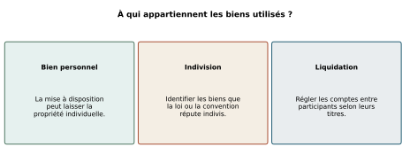
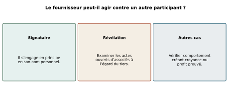

# ENS Rennes D1 — Droit commercial 2016 · Corrigé guidé

*Corrigé rédigé par IA, non officiel.*

**Rédaction** · GPT-6.2 Astra Ultra · vitesse non renseignée

## Le droit des tiers et des associés dans la société en participation

### Introduction

> [!INDICATION]
> Définir la société non immatriculée et les intérêts distincts en présence.

Deux commerçants conviennent de monter une opération ensemble. Un seul signe la commande du fournisseur. Les bénéfices seront partagés par les deux, mais le fournisseur peut-il réclamer l’intégralité de sa facture au participant qui n’a rien signé ? Le contrat de société met en commun des apports en vue d’un bénéfice ou d’une économie et implique contribution aux pertes. Par l’article 1871 du Code civil, les associés d’une société en participation (SEP) conviennent de ne pas l’immatriculer. Elle ne possède donc pas la personnalité morale et peut être prouvée par tous moyens. Ce choix structure les droits dans les rapports internes et à l’égard des tiers. Une organisation sociétaire peut-elle exercer ses effets sans faire naître un débiteur social doté d’un patrimoine autonome ?

### I. Entre participants, le contrat crée de véritables droits d’associés sans patrimoine social autonome

#### A. L’absence d’immatriculation laisse subsister le noyau du contrat de société

> [!INDICATION]
> Repartir des conditions de la société et des droits impératifs de chaque associé.

Un simple partage de recettes ne suffit pas nécessairement à établir une SEP. Il faut établir les apports, la participation aux résultats et aux pertes et la volonté de collaborer à une entreprise commune. Les participants peuvent choisir cette forme dès l’origine pour une activité ponctuelle sans créer une personne distincte. L’absence d’une formalité de publicité n’efface ni l’exigence de licéité de l’objet ni l’intérêt commun qui doit gouverner l’opération. La qualification civile ou commerciale dépend de l’activité de la participation.

La liberté d’organiser les rapports internes est étendue, sous réserve des dispositions impératives visées à l’article 1871. Chaque associé a notamment vocation à participer aux décisions collectives et l’on ne peut augmenter ses engagements sans son consentement. Une clause qui attribuerait tout le profit à un participant ou exonérerait entièrement l’autre de toute contribution aux pertes appelle l’application de la prohibition des clauses léonines. Dans le silence de l’accord, les relations entre associés relèvent, en tant que de raison, des règles des sociétés civiles ou de celles des sociétés en nom collectif selon le caractère de l’activité (art. 1871-1). Le participant peut exiger de son cocontractant information ou comptes selon le mandat et les règles convenues.

#### B. La propriété des biens et la contribution aux pertes suivent des mécanismes distincts

> [!INDICATION]
> Séparer mise à disposition, propriété individuelle et indivision.

Faute de personne morale, aucune masse de biens ne devient la propriété d’une SEP personnifiée. Selon l’article 1872, chacun reste, à l’égard des tiers, propriétaire des biens qu’il met à disposition. Certains biens sont réputés indivis, notamment ceux acquis par emploi ou remploi de deniers indivis ou ceux que les associés ont convenu de mettre en indivision. Les participants peuvent aussi convenir que l’un sera propriétaire, à l’égard des tiers, de tout ou partie des biens acquis pour réaliser l’objet de la société. Le titre et l’accord déterminent alors les droits sur chaque bien.

Supposons un local mis à disposition par A et des machines acquises par A et B avec leurs fonds indivis. Les deux catégories ne suivent pas nécessairement le même sort lors de la liquidation. Il faut restituer les biens selon leur titre, recouvrer les créances et régler les comptes et la contribution définitive aux pertes. Lorsqu’une SEP est à durée indéterminée, un participant peut en provoquer la dissolution par notification à tous selon les conditions de bonne foi et d’opportunité prévues à l’article 1872-2. La reddition des comptes entre associés répond à une question différente de celle du débiteur du fournisseur.

### II. Pour les tiers, le débiteur se détermine d’après la signature et le comportement des participants

#### A. Dans la participation restée occulte, le signataire s’engage personnellement

> [!INDICATION]
> Identifier qui a personnellement contracté avec le fournisseur.

En vertu de l’article 1872-1, chaque associé contracte en son nom personnel et est seul engagé à l’égard des tiers. Lorsque A achète du matériel pour l’opération sans révéler ni engager B, le fournisseur dispose d’un débiteur identifiable, A. A ne peut lui opposer la répartition interne des dépenses pour limiter le paiement de sa propre dette. Il peut en revanche demander à B sa contribution conformément à leur convention. Le créancier ne peut poursuivre une « société » qui n’a aucune personnalité juridique.

Une révélation à l’administration fiscale ou un simple soupçon de coopération ne suffisent pas à établir que B s’est présenté comme associé à ce fournisseur. Il faut regarder à qui le comportement était perceptible et en quelle qualité la commande a été passée. Un mandat exprès donné pour contracter au nom d’autrui appelle l’application des règles de représentation et doit être prouvé. Les règles internes d’organisation n’ont donc pas toutes pour conséquence d’ouvrir aux tiers un recours contre chaque participant.

#### B. L’extériorisation ou l’implication personnelle ouvre des recours supplémentaires

> [!INDICATION]
> Tester successivement l’action au vu et au su des tiers, l’immixtion et le profit.

Si les participants agissent en qualité d’associés au vu et au su des tiers, chacun de ceux qui ont ainsi agi est tenu des obligations nées des actes accomplis en cette qualité par l’un des autres. La solidarité existe lorsque la société est commerciale. En matière civile, l’obligation à plusieurs ne devient pas pour autant solidaire. Un fournisseur face aux deux commerçants qui présentent ensemble leur engagement pour une opération commerciale peut, si ces conditions sont prouvées, réclamer l’entier à l’un d’eux. La contribution finale entre eux peut différer de l’obligation envers le tiers.

L’article 1872-1 prévoit aussi le cas du participant qui, par son immixtion, a laissé croire au cocontractant qu’il entendait s’engager à son égard, et celui dont il est prouvé que l’engagement a tourné à son profit. Examiner actes, correspondance, livraison et bénéficiaire concret. Un gain espéré sur l’ensemble de l’activité ne dispense pas de prouver les conditions de l’exception invoquée. La protection du tiers s’attache ici à des faits extérieurs ou à un profit démontré sans faire apparaître rétroactivement une personne morale.

### Conclusion

> [!INDICATION]
> Déduire de chaque qualification le patrimoine sur lequel peut agir le créancier.

Le contrat organise en interne des droits de société, de propriété et de contribution. À l’extérieur, la signature personnelle constitue le point de départ, complété par les règles de représentation, de comportement ostensible, d’immixtion ou de profit. Tenir ensemble ces deux plans explique qu’un associé puisse devoir contribuer à une perte sans être directement poursuivable par un fournisseur, ou être tenu envers celui-ci au-delà de sa part définitive.

[Sujet distribué](https://www.ens-rennes.fr/medias/fichier/sujet-e-preuve-a-options-droit-commercial-et-droit-public-d1-2016_1476109233660-pdf#page=2) · [Rapport du jury](https://www.ens-rennes.fr/medias/fichier/rapport-droit-commercial-d1-2016_1478511479859-pdf)

[Code civil au 1er avril de la session](https://www.legifrance.gouv.fr/codes/texte_lc/LEGITEXT000006070721/2016-04-01/) · [Code de commerce au 1er avril de la session](https://www.legifrance.gouv.fr/codes/texte_lc/LEGITEXT000005634379/2016-04-01/)
