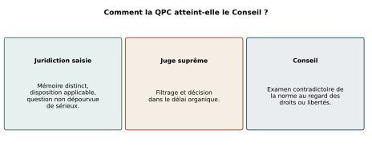
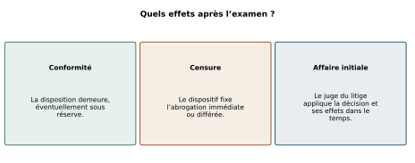

# ENS Rennes D1 — Droit public 2016 · Corrigé guidé

*Corrigé rédigé par IA, non officiel.*

**Rédaction** · GPT-6.2 Astra Ultra · vitesse non renseignée

## La question prioritaire de constitutionnalité

### Introduction

> [!INDICATION]
> Partir d’un litige réel et de la loi que le justiciable souhaite contester.

La disposition législative sur laquelle un tribunal s’apprête à statuer peut avoir été promulguée bien avant que son effet sur une liberté n’apparaisse. Avant la question prioritaire de constitutionnalité (QPC), le contrôle de l’article 61, exercé avant promulgation sur saisine d’autorités déterminées, n’offrait pas au justiciable une telle voie de contestation. La révision du 23 juillet 2008 a introduit l’article 61-1. La loi organique du 10 décembre 2009 en a organisé la mise en œuvre à compter du 1er mars 2010. Comment ce droit incident du justiciable permet-il de soumettre la loi déjà en vigueur à la Constitution, tout en préservant les fonctions du juge du litige et des juges européens ?

### I. Une initiative individuelle déclenche un procès de la loi encadré par deux niveaux de filtrage

#### A. Un justiciable conteste, dans un litige, une disposition qui porte atteinte à un droit garanti

> [!INDICATION]
> Nommer l’objet de la QPC et les droits constitutionnels invocables.

La question doit viser une disposition législative applicable au litige ou à la procédure, ou constituant le fondement des poursuites. Une partie à une instance peut soutenir que cette disposition porte atteinte à un droit ou une liberté que la Constitution garantit, par exemple l’égalité ou les droits de la défense. Une incompétence négative du législateur ne peut utilement être invoquée en elle-même sans lien avec un tel droit ou une telle liberté. Un acte réglementaire, l’appréciation des faits ou une simple violation d’un traité ne se contestent pas dans ce cadre. Sous conditions, la portée effective qu’une jurisprudence constante confère à la disposition peut être discutée.

La partie présente un écrit distinct et motivé. Le juge ne relève pas d’office une QPC. Les juridictions de l’ordre administratif et de l’ordre judiciaire constituent les deux voies ordinaires, selon leurs règles procédurales. Le justiciable contribue ainsi à la défense de la hiérarchie des normes par l’intermédiaire d’un intérêt concret. Il ne dispose pas d’un recours direct et abstrait contre toutes les lois devant le Conseil constitutionnel.

#### B. Les juridictions apprécient des conditions de transmission puis de renvoi distinctes

> [!INDICATION]
> Distinguer le niveau de sérieux exigé au premier et au second filtre.

Le juge saisi vérifie sans délai que la disposition est applicable, qu’elle n’a pas déjà été déclarée conforme dans les motifs et le dispositif d’une décision, sauf changement des circonstances, et que la question n’est pas dépourvue de caractère sérieux. Si ces conditions sont remplies, il transmet au Conseil d’État ou à la Cour de cassation. La règle du sursis au fond connaît des aménagements, notamment pour certaines situations d’urgence ou de privation de liberté. Protéger l’efficacité du recours ne doit pas priver la personne d’une décision rendue dans les délais nécessaires.

La juridiction suprême dispose en principe de trois mois et vérifie pour sa part, outre l’applicabilité et la condition tenant à une décision antérieure, si la question est nouvelle ou présente un caractère sérieux. Elle peut aussi être saisie du moyen dans une affaire déjà pendante devant elle. Le Conseil constitutionnel ne statue donc qu’après renvoi. Le filtrage allège la procédure et évite les répétitions, mais une sélection trop stricte ferait dépendre la protection du seul regard des juges de renvoi. Les motivations et les exemples de questions transmises permettent d’apprécier cet équilibre.

### II. L’autorité de la réponse constitutionnelle transforme le litige tout en s’articulant avec d’autres contrôles

#### A. L’abrogation peut bénéficier au-delà du requérant sans effacer automatiquement le passé

> [!INDICATION]
> Lire le dispositif et la date d’abrogation d’une décision avant d’en déduire les effets.

Le Conseil constitutionnel statue en principe dans les trois mois après une procédure contradictoire, donnant normalement lieu à une audience publique. Il peut rejeter la contestation, assortir une conformité de réserves ou censurer tout ou partie de la disposition. Selon l’article 62, la disposition déclarée inconstitutionnelle sur le fondement de l’article 61-1 est abrogée à la publication de la décision ou à la date ultérieure qu’elle fixe. Le Conseil détermine les conditions et limites de la remise en cause des effets passés. Sa décision s’impose aux pouvoirs publics et aux autorités administratives et juridictionnelles.

La décision 2010-1 QPC du 28 mai 2010, relative à la cristallisation de pensions, illustre l’intérêt individuel et la portée générale d’un contrôle fondé sur l’égalité. La décision 2010-14/22 QPC du 30 juillet 2010 sur la garde à vue diffère les effets de certaines censures au 1er juillet 2011 pour permettre au législateur d’intervenir. La date de censure, celle de l’abrogation et le sort d’une procédure en cours doivent donc être lus séparément. La juridiction du fond tranche ensuite le litige concret dans le cadre fixé par la décision constitutionnelle.

#### B. La priorité organise la procédure sans soustraire la loi aux exigences européennes

> [!INDICATION]
> Expliquer les moyens qu’un juge national doit conserver au regard du droit de l’Union.

Une partie peut soutenir à la fois l’inconstitutionnalité de la loi et son incompatibilité avec un traité. La priorité donnée à l’examen de la question constitutionnelle ne confère pas au Conseil constitutionnel un monopole du contrôle de conventionnalité. Le juge ordinaire peut écarter dans un litige une disposition nationale contraire à une norme internationale applicable, tandis que la QPC peut conduire à l’abrogation de la loi pour tous. Effets et autorités de jugement diffèrent.

Dans Melki et Abdeli, 22 juin 2010, la Cour de justice admet un mécanisme national prioritaire lorsque le juge conserve la possibilité de la saisir à tout moment, d’assurer une protection juridictionnelle provisoire et de laisser inappliquée la norme contraire au droit de l’Union. La question Jeremy F., le 4 avril 2013, montre que le Conseil constitutionnel lui-même peut interroger la Cour de justice lorsqu’une interprétation du droit de l’Union éclaire la réponse constitutionnelle. Le dialogue ne fait disparaître ni la spécificité des droits constitutionnels ni l’autonomie du recours devant le juge du litige.

### Conclusion

> [!INDICATION]
> Distinguer rôle du requérant, des juridictions de renvoi et du Conseil constitutionnel.

La QPC a ouvert à la partie un accès incident au contrôle d’une loi en vigueur et a donné aux décisions rendues sur ce fondement une portée générale à effets modulables. Sa contribution à l’État de droit dépend des conditions d’accès réelles, de l’usage du filtrage et de la possibilité, pour les différents juges, d’assurer chacun la protection relevant de son office.

[Sujet distribué](https://www.ens-rennes.fr/medias/fichier/sujet-e-preuve-a-options-droit-commercial-et-droit-public-d1-2016_1476109233660-pdf#page=2) · [Rapport du jury](https://www.ens-rennes.fr/medias/fichier/rapport-droit-public-e-crit-d1-2016_1478511500405-pdf)

[Constitution à la session](https://www.legifrance.gouv.fr/loda/id/JORFTEXT000000571356/2016-04-01/)

[QPC sur les pensions, 28 mai 2010](https://qpc360.conseil-constitutionnel.fr/2010-05-28/decision-2010-1-qpc-28-mai-2010) · [QPC sur la garde à vue, 30 juillet 2010](https://www.legifrance.gouv.fr/cons/id/CONSTEXT000022762681/) · [CJUE, Melki et Abdeli](https://curia.europa.eu/jcms/upload/docs/application/pdf/2010-06/cp100059fr.pdf) · [Renvoi Jeremy F., 4 avril 2013](https://qpc360.conseil-constitutionnel.fr/2013-04-04/decision-2013-314p-qpc-4-avril-2013)
