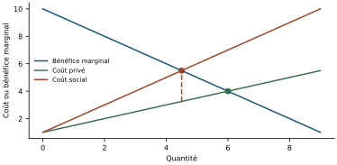
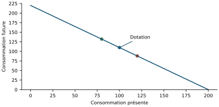
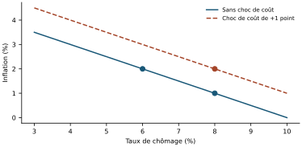

# ENS Rennes D1 — Économie (oral) 2016 · Corrigé brut

*Corrigé rédigé par IA, non officiel.*

**Rédaction** · GPT-6.2 Astra Ultra · vitesse non renseignée

Le jury donne 13 exemples de sujets tirés à la page 2 de son rapport. La feuille exhaustive des tirages manque. Les numéros ci-dessous suivent l’ordre des puces imprimées. Après trente minutes de préparation, le jury a observé 10 à 12 minutes d’exposé, puis 10 à 15 minutes de questions.

## Exemple 1 — Choix économiques et comportements stratégiques

**I. Choisir suppose parfois d’anticiper les autres.** Un ménage prenant un prix affiché comme donné ne se pose pas la même question que deux enseignes concurrentes choisissant leur tarif. Dans un jeu, on décrit les acteurs, leurs actions, leurs informations et leurs gains pour chaque combinaison. Une meilleure réponse maximise le gain compte tenu du choix des autres. Un équilibre de Nash est une combinaison de meilleures réponses mutuelles. Il peut exister sans stratégie dominante, celle-ci devant au contraire être préférable quel que soit le choix d’autrui.

**II. L’équilibre peut être inefficace et sensible aux règles.** Si deux enseignes maintenant un prix élevé gagnent chacune 3, que chacune peut gagner 4 en baissant seule (sa rivale reçoit 0), et que la baisse simultanée donne 1 à chacune, baisser est dominant. Le couple (1,1) est stable malgré le gain commun possible à (3,3). La répétition et la visibilité des décisions modifient les incitations, avec des limites imposées par le droit de la concurrence. L’ordre des décisions change aussi le raisonnement : dans un jeu séquentiel, anticiper la meilleure réponse future permet de tester une menace.

**Relance.** Si la rivale a déjà baissé son prix, faut-il maintenir le prix élevé dans cet exemple ?

Maintenir rapporte 0, baisser rapporte 1. Si elle maintient le prix élevé, les mêmes deux actions rapportent respectivement 3 et 4. Comparer les deux colonnes démontre la dominance.

## Exemple 2 — Déflation : risque ou opportunité ?

**I. Une baisse de prix n’a pas toujours la même origine.** La déflation est une baisse durable du niveau général des prix. Un gain de productivité peut abaisser les coûts et élargir les quantités produites. Une baisse du seul prix de l’énergie améliore par exemple le pouvoir d’achat des importateurs mais ne suffit pas à diagnostiquer une déflation générale. Un diagnostic exige l’évolution d’un indice large, sa diffusion entre secteurs et le comportement de la production.

**II. Lorsque la demande se contracte, la baisse peut s’autoentretenir.** Si les prix attendus diminuent de 2 % et le taux nominal est nul, le taux réel anticipé est voisin de +2 %. Certains achats durables sont différés. Une dette nominale pèse davantage en biens, ce qui conduit les emprunteurs contraints à réduire leurs dépenses ou à vendre des actifs. La redistribution vers les créanciers ne compense pas nécessairement ces réductions. Une politique monétaire ou budgétaire stabilisatrice vise alors demande et anticipations en tenant compte des contraintes de taux et de financement.

**Relance.** Une inflation qui passe de 4 % à 1 % réduit-elle le niveau des prix ?

Le niveau général continue d’augmenter, plus lentement. C’est une désinflation. Si l’indice valait 100 au départ, il passe à 104 puis à environ 105,04.

## Exemple 3 — Les avantages comparatifs

**I. La spécialisation repose sur les coûts d’opportunité.** Dans le pays A, une journée permet de produire six unités de tissu ou trois de vin. Dans B, elle permet de produire deux de tissu ou deux de vin. A possède un avantage absolu dans les deux productions ; une unité de tissu lui coûte une demi-unité de vin contre une dans B. A a l’avantage comparatif dans le tissu, B dans le vin. À trois quarts d’unité de vin par unité de tissu, les deux partenaires gagnent relativement à leurs possibilités domestiques.

**II. Le gain global n’en garantit ni la répartition ni la permanence.** Les coûts de transport peuvent absorber la différence de coûts relatifs. La demande détermine les termes de l’échange dans l’intervalle compatible avec des gains réciproques. Si les travailleurs changent difficilement de secteur, les pertes peuvent être concentrées et durables. Les qualifications et la technologie peuvent également modifier l’avantage comparatif. Évaluer une politique d’ouverture demande donc de distinguer les possibilités de consommation de l’économie et les coûts supportés par ses différents groupes.

**Relance.** Pourquoi B achète-t-il du tissu à A si B peut le produire lui-même ?

B renonce à une unité de vin pour produire une unité de tissu. En remettant 0,75 unité de vin à A, il obtient la même unité de tissu et conserve 0,25 unité de vin.

## Exemple 4 — Les externalités et les biens publics

**I. Le calcul privé omet certains effets sur autrui.** Une externalité apparaît lorsque produire ou consommer modifie le bien-être d’un tiers sans paiement correspondant. Si le bénéfice marginal est $10-q$, le coût marginal privé $1+0,5q$ et le social $1+q$, le marché choisit 6 alors que l’optimum est 4,5. Une taxe par unité de 2,25 égale au dommage marginal au niveau optimal décentralise ce résultat dans cet exemple. Une subvention peut encourager un effet positif si sa mesure est suffisamment fiable.

**II. La non-rivalité appelle une autre condition d’efficacité.** Une alerte météo disponible pour tous peut être approximativement non rivale et difficile à soustraire aux non-payeurs. Chacun a intérêt à laisser les autres contribuer. Pour un bien public pur, on additionne verticalement les dispositions marginales à payer pour une même quantité avant d’égaler leur somme au coût marginal. Production publique, commande à un fournisseur ou financement mutualisé peuvent répondre à ce problème. Une ressource commune, telle une pêcherie ouverte, est au contraire rivale et pose un problème de surexploitation.

**Relance.** Le fait qu’une bibliothèque soit publique rend-il chaque livre non rival ?

Une même copie physique ne peut être empruntée à deux personnes au même moment. Le statut du propriétaire, les règles d’accès et les propriétés économiques du service doivent être distingués.

## Exemple 5 — L’intégration économique européenne depuis le traité de Rome

**I. La construction européenne a progressivement modifié les échanges.** Le traité de Rome de 1957 institue la Communauté économique européenne et prévoit une union douanière. Suppression des droits internes et tarif extérieur commun peuvent créer des échanges en remplaçant une production coûteuse, mais aussi détourner des achats d’un fournisseur extérieur plus efficace. L’Acte unique pousse plus loin la libre circulation et la réduction des obstacles réglementaires. L’ouverture peut accroître l’échelle de production et la pression concurrentielle, avec des coûts de réallocation localisés.

**II. La monnaie commune renouvelle les interdépendances.** Maastricht définit le cadre d’une union monétaire et l’euro devient monnaie scripturale en 1999 puis fiduciaire en 2002 dans les pays participants. Le risque de change interne disparaît, mais un membre ne dévalue plus sa propre monnaie. Face à un choc local, mobilité, ajustements de prix et transferts deviennent plus importants. Les difficultés de la zone euro après 2010 éclairent les enjeux de coordination budgétaire et de supervision bancaire. Union européenne, marché unique et zone euro couvrent des périmètres différents en 2016.

**Relance.** Une union douanière augmente-t-elle nécessairement le bien-être de tous ?

Elle peut déplacer les achats d’un pays tiers au coût réel bas vers un membre plus coûteux bénéficiant de la préférence tarifaire. Le résultat dépend de la création et du détournement d’échanges, ainsi que des recettes tarifaires et des effets dynamiques.

## Exemple 6 — Les choix intertemporels de consommation

**I. L’emprunt et l’épargne dissocient revenu et consommation à chaque date.** Avec deux périodes, des revenus de 100 puis 110, et un taux réel de 10 %, le budget est $c_1+c_2/1,1=200$. Consommer 80 aujourd’hui laisse 132 demain. Consommer 120 ramène la consommation future à 88. À un optimum intérieur, la pente d’indifférence en valeur absolue vaut 1,1. Un ménage patient accepte de déplacer davantage de consommation vers l’avenir à revenus comparables.

**II. La réponse aux revenus et aux taux dépend des contraintes.** Une hausse durable de revenu accroît davantage les ressources actualisées qu’une prime temporaire du même montant aujourd’hui. Un ménage empêché d’emprunter peut néanmoins consommer immédiatement la prime. Une hausse du taux augmente le prix en biens futurs de la consommation présente et le revenu financier de l’épargnant ; ces deux effets peuvent s’opposer pour sa consommation présente. Risque sur le revenu, épargne de précaution et retraites complètent le modèle à deux dates.

**Relance.** Une personne qui reste exactement à sa dotation (100,110) bénéficie-t-elle mécaniquement d’une hausse de taux ?

La dotation appartient toujours à la droite de budget, qui pivote autour de ce point. Le ménage peut réviser son choix ; il ne reçoit pas mécaniquement des intérêts sur une épargne initiale nulle.

## Exemple 7 — Peut-on encore lutter contre le chômage en France aujourd’hui ?

**I. Commencer par le diagnostic du chômage français.** Une contraction de la demande peut laisser simultanément travailleurs et machines inutilisés. Une stabilisation de l’activité et de l’investissement soutient alors les embauches. L’importance des échanges, la situation de la zone euro et la politique monétaire commune encadrent l’effet d’une mesure française en 2016. Les délais de recrutement, le manque de qualifications recherchées et la distance aux emplois produisent, eux, des vacances coexistantes avec du chômage. Le taux moyen ne tranche pas entre ces explications.

**II. Relier chaque outil à un obstacle et à une évaluation.** Une formation peut améliorer les chances de retour à l’emploi lorsque des postes qualifiés restent vacants ; son effet peut être faible en l’absence d’offres. Un allègement du coût du travail peut soutenir des emplois sensibles à ce coût, sous réserve d’effets d’aubaine et du mode de financement. Des services de placement réduisent les coûts d’appariement. Comparer les trajectoires des bénéficiaires et d’un groupe crédible, et suivre aussi durée en emploi, salaire et inactivité, évite de prendre une sortie administrative pour un emploi durable.

**Relance.** Une baisse du nombre de chômeurs inscrits prouve-t-elle une baisse du chômage au sens du BIT ?

Les définitions et la collecte diffèrent. Une personne radiée peut continuer de chercher activement et rester chômeuse au sens du BIT. Une enquête sur l’emploi et les transitions vers emploi ou inactivité complète l’information administrative.

## Exemple 8 — L’équilibre du consommateur en microéconomie

**I. Construire le meilleur panier accessible.** Avec deux biens, la contrainte est $p_x x+p_y y\le R$. Si les préférences sont monotones, le budget est épuisé. Pour un optimum intérieur régulier, le taux marginal de substitution égale le prix relatif. Avec $U=xy$, $R=100$, $p_x=2$ et $p_y=1$, les dépenses se partagent par moitié et le panier est (25,50). Une solution de coin est possible, notamment avec des substituts parfaits : la tangence n’est pas un critère universel.

**II. Décomposer une variation du panier.** Une hausse du prix de $x$ pivote la contrainte autour de son interception sur l’axe $y$. À utilité compensée, elle encourage la substitution vers $y$. La perte de pouvoir d’achat modifie aussi les deux demandes selon leur sensibilité au revenu. Pour un bien inférieur, l’effet revenu peut aller dans le sens opposé à la substitution ; dans le cas rare d’un bien de Giffen il domine. Les demandes individuelles peuvent ensuite être additionnées à prix donnés, mais la distribution des budgets compte pour le résultat.

**Relance.** Avec les mêmes prix et préférences, que se passe-t-il si le revenu double ?

La droite de budget se déplace parallèlement. Les quantités optimales de cet exemple deviennent (50,100), les parts de dépenses restent égales. Cette propriété résulte des préférences retenues.

## Exemple 9 — La politique budgétaire en économie fermée et en économie ouverte

**I. En économie fermée, une dépense peut entraîner des revenus successifs.** À prix fixes, sans impôt proportionnel, investissement et taux donnés, une hausse de dépense publique de 10 avec une propension marginale à consommer de 0,75 augmente le revenu d’équilibre de 40. L’épargne absorbe progressivement les dépenses induites. Une réaction haussière des taux, une économie proche de ses capacités ou des anticipations différentes réduisent l’effet sur la production réelle. La nature et le financement de la dépense comptent.

**II. L’ouverture modifie les fuites et le régime d’ajustement.** Si les importations augmentent de 0,25 par unité de revenu, le même multiplicateur devient $1/(1-0,75+0,25)=2$. Dans Mundell-Fleming, sous mobilité parfaite des capitaux et taux mondial donné, un change flottant peut s’apprécier et évincer des exportations. Un change fixe engage au contraire la banque centrale à défendre la parité. Un État de la zone euro n’a pas d’instrument de change national ; ses partenaires peuvent bénéficier de retombées sur leurs exportations. Une relance coordonnée ne se calcule donc pas comme une relance isolée.

**Relance.** Dans le premier exemple ouvert, combien de demande fuit vers les importations ?

Le revenu augmente de 20 pour un choc de 10. Les importations augmentent de 5 et l’épargne privée de 5. Les deux fuites additionnées correspondent à la dépense initiale supplémentaire.

## Exemple 10 — Les différentes situations de concurrence imparfaite

**I. Un pouvoir de marché peut provenir de structures différentes.** Une entreprise avec demande décroissante compare coût marginal et recette marginale. Si $p=12-q$ et le coût marginal vaut 4, le monopole choisit $q=4$ et $p=8$, contre 8 unités au prix 4 en concurrence. Le monopole naturel tient à une structure de coûts, par exemple un réseau à fort coût fixe et faibles coûts variables, tandis qu’un brevet ou un autre droit exclusif crée une barrière d’origine institutionnelle.

**II. La concurrence imparfaite comprend aussi rivalité et entrée.** En oligopole, quantité de Cournot, prix de Bertrand, capacité disponible et différenciation affectent le résultat. En concurrence monopolistique, de nombreuses entreprises différencient leur offre : l’entrée peut ramener le profit économique à zéro tout en laissant un prix supérieur au coût marginal. La politique de concurrence examine barrières, substitutions, pratiques et effets possibles d’innovation. Le nombre d’entreprises donne une indication, mais ne suffit pas à mesurer la pression concurrentielle.

**Relance.** Un duopole peut-il donner le prix de concurrence parfaite ?

Oui, dans le modèle de Bertrand avec bien homogène, coûts marginaux identiques, capacités suffisantes et choix simultané des prix. Une légère sous-enchère capte la demande jusqu’au coût marginal. Différenciation ou capacités limitées modifient ce résultat.

## Exemple 11 — Les instruments conventionnels et non-conventionnels de la politique monétaire

**I. Les taux directeurs orientent les conditions financières.** Par ses facilités et ses opérations de refinancement, une banque centrale influence le coût de la liquidité de court terme. Les anticipations des futurs taux courts contribuent ensuite aux taux longs, avec des primes de risque et de maturité. Des prêts moins chers ou un taux de change plus faible peuvent soutenir consommation, investissement et prix. La transmission dépend du bilan des banques, de la demande de prêts et des risques perçus.

**II. Les mesures non conventionnelles traitent d’autres marges.** Dans la zone euro de 2016, achats de titres, indications sur les taux futurs et refinancements ciblés portent respectivement sur les portefeuilles et primes de terme, les anticipations et l’offre de crédit. Un achat de titre modifie la composition des actifs détenus par le secteur privé ; les réserves ne sont pas distribuées mécaniquement aux ménages. Les rendements peuvent baisser sans que l’investissement reprenne immédiatement si les débouchés demeurent incertains.

**Relance.** Pourquoi une obligation existante à coupon fixe monte-t-elle lorsque le rendement exigé baisse ?

Ses paiements futurs sont actualisés à un taux plus faible. Pour un titre versant 105 dans un an, la valeur passe de 100 au taux de 5 % à environ 102,94 au taux de 2 %. Le risque de crédit est tenu constant dans l’exemple.

## Exemple 12 — La courbe de Phillips depuis les années 1950

**I. Une régularité observée dépend du contexte.** Phillips étudie en 1958 le lien entre chômage et variation des salaires nominaux au Royaume-Uni. Une relation entre inflation des prix et chômage exige aussi des hypothèses sur productivité et marges. Sur un marché du travail tendu, les salaires peuvent croître plus vite ; si les coûts se transmettent aux prix, une relation décroissante apparaît à anticipations et chocs constants. Une série de points observés mêle cependant déplacements de la relation et mouvements sur la courbe.

**II. Anticipations et chocs modifient l’arbitrage.** Une écriture simple est $\pi=\pi^e-\alpha(u-u^*)+z$, avec $\alpha>0$. Si l’inflation anticipée ou les coûts importés augmentent, la courbe de court terme monte. Une hausse simultanée du chômage et de l’inflation, comme lors d’un choc pétrolier, devient possible. Lorsque les anticipations s’ajustent, maintenir durablement le chômage sous son niveau compatible avec une inflation stable exige des surprises répétées. La crédibilité monétaire et les changements de pente rendent l’estimation empirique délicate.

**Relance.** Comment distinguer graphiquement une relance de demande d’un choc de coût ?

À anticipations fixes, la relance déplace normalement l’économie le long de la relation vers moins de chômage et plus d’inflation. Un choc de coût positif pousse toute la relation vers le haut, y compris à chômage inchangé.

## Exemple 13 — Opportunités et risques de la globalisation financière contemporaine

**I. Les flux financiers permettent de partager les risques dans le temps et l’espace.** Une économie peut financer des investissements supérieurs à son épargne courante et un épargnant diversifier son portefeuille. Un investissement direct, un achat d’action et une dette à court terme en monnaie étrangère ne répartissent pas les risques de la même manière. Le revenu futur doit pouvoir servir une dette, alors que des fonds propres absorbent une part des pertes. Les flux bruts croisés peuvent être considérables même si le solde net est faible.

**II. La liquidité et les bilans peuvent propager la crise.** Un arrêt brutal des flux contraint les emprunteurs à refinancer ou réduire leurs dépenses. Si leurs recettes sont en monnaie locale et leur dette en devises, une dépréciation accroît la charge réelle. La vente générale d’actifs comprime leurs prix et détériore les garanties. Réserves de liquidité, surveillance des expositions et régulation macroprudentielle répondent à ces risques sans supprimer les bénéfices de diffusion du capital. Leur efficacité dépend des engagements en devises et des maturités effectivement observés.

**Relance.** Un compte courant équilibré protège-t-il de tout risque de refinancement extérieur ?

Non. Un pays peut avoir des actifs étrangers à long terme et des engagements étrangers exigibles à court terme d’un montant voisin. Le solde net masque alors le besoin de liquidité au moment du renouvellement.

[Rapport officiel du jury](https://www.ens-rennes.fr/medias/fichier/rapport-e-conomie-oral-d1-2016_1478511511522-pdf)
