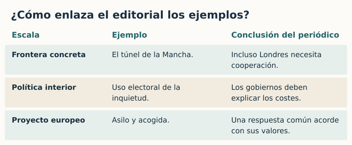

# ENS Rennes · D1 · Espagnol 2016 — Corrigé brut

*Corrigé rédigé par IA, non officiel. Signalez toute erreur.*

**Rédaction** · GPT-6.2 Astra Ultra · vitesse non renseignée

Épreuve écrite de l’École normale supérieure de Rennes. Éditorial d’El País, 30 juillet 2015.

## Version française

**Ouvrir les yeux**

**Les morts dans le tunnel sous la Manche attestent l’absence de politique migratoire commune**

Les immenses façades maritimes de l’Europe et ses milliers de kilomètres de frontières terrestres avec des pays plus pauvres et plus durement touchés par les conflits permettent aux États de l’Union de limiter l’immigration clandestine, mais pas d’y mettre fin. Ce qui se passe à l’entrée française du tunnel ferroviaire sous la Manche illustre cette crise : chaque jour, la misère et la haute technologie s’y heurtent. […] Ils sont prêts à affronter la mort, tout comme les nombreuses personnes qui se noient en Méditerranée en tentant de gagner la Grèce ou l’Italie.

Les guerres qui se déroulent aux abords de l’Europe, en Irak, en Syrie, en Libye et au Soudan, font du sud de la Méditerranée et du Proche-Orient des régions sous pression que des foules fuient en quête d’un refuge. Ces vagues de départs bouleversent le jeu politique et sont devenues un enjeu important des élections dans de nombreux pays. Sans tenir compte du fait qu’une population aussi vieillissante que celle de l’Europe a besoin de sang neuf, les partis hostiles à l’immigration en profitent pour dénoncer une Europe qui, selon eux, change trop vite, se mondialise de l’intérieur et risque de voir les étrangers consommer trop de ressources.

Aussi les principaux courants politiques des démocraties doivent-ils prendre une autre direction. Il leur faut mettre en commun la politique d’immigration et d’asile, ouvrir les yeux de leurs concitoyens et se préparer à assumer le coût, assurément élevé, d’une réponse crédible à un problème de grande ampleur. Les partisans de la construction européenne ne sauraient abandonner chacun des pays les plus directement touchés à ses propres moyens. Le gouvernement de David Cameron, à la tête de l’un des États les plus réticents à s’engager en faveur de l’Europe, a incontestablement besoin de la coopération de la France et, plus généralement, de l’Europe pour maîtriser les conséquences d’une situation qui fait le jeu de la droite populiste britannique.

L’accueil des immigrants et l’asile accordé aux réfugiés font partie de l’ADN européen. Ce lien pourrait se rompre si les familles politiques qui ont construit l’Europe commettaient l’erreur d’accepter une dérive vers un système plus autoritaire. Hérisser l’Europe de frontières intérieures, de murs, de clôtures et de forces de police revient à fermer les yeux sur l’ampleur d’un problème qui dépasse ces prétendues solutions.

## Expression en espagnol

¿Cuáles son los fallos de la política migratoria que subraya este editorial? Environ 100 mots.

En su editorial de julio de 2015, El País reprocha a los gobiernos europeos que traten como asuntos nacionales las consecuencias de guerras próximas y de desplazamientos que atraviesan varias fronteras. Las muertes junto al túnel de la Mancha muestran que el Reino Unido depende de la cooperación francesa, pese a sus reservas ante los compromisos europeos. Al dejar solos a los países más expuestos, los demás favorecen a quienes explotan electoralmente la inquietud. Además, levantar barreras internas confunde control con solución. Para el periódico, una política común debería asumir los costes del asilo y explicar esa responsabilidad a los ciudadanos.

*101 mots, comptés par espaces.*

[Feuillet original, p. 1](https://www.ens-rennes.fr/medias/fichier/sujet-espagnol-e-crit-d1-2016_1476109350390-pdf#page=1) · [Rapport du jury, partie écrite](https://www.ens-rennes.fr/medias/fichier/rapport-espagnol-e-crit-d1-2016_1478511563650-pdf#page=1)
