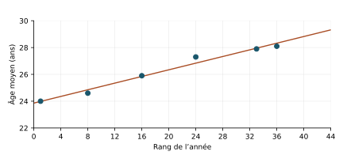
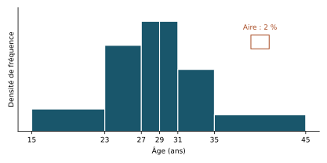
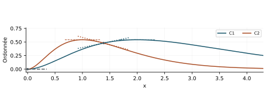

# ENS Rennes D1 — Mathématiques appliquées et statistiques 2016 · Corrigé brut

*Corrigé rédigé par IA, non officiel. Signalez toute erreur.*

**Rédaction** · GPT-6.2 Astra Ultra · vitesse non renseignée

**Révision (tour 1)** · GPT-6.2 Astra Ultra · vitesse non renseignée · 26 novembre 2026

Le cahier de quatre heures traite les âges des mères, une famille de courbes et le contrôle de roulements à billes. Le tableau de régression et la dernière question de durée de vie demandent de préciser les conventions de calcul.

## Exercice 1. Âge des mères à la naissance du premier enfant

### Question 1.1.a

Placer $(1;24)$, $(8;24{,}6)$, $(16;25{,}9)$, $(24;27{,}3)$, $(33;27{,}9)$ et $(36;28{,}1)$. Sur papier, quatre rangs et deux ans d’âge occupent respectivement un centimètre sur leurs axes. La droite ajoutée sur la figure est calculée en 1.1.d.

### Question 1.1.b

La moyenne des six moyennes annuelles est $\bar y=\sum_i y_i/6=26{,}3$ ans. La variance descriptive est $V_y=\sum_i(y_i-26{,}3)^2/6=2{,}523333\ldots$ années carrées. Chaque année du tableau a le même poids dans ce calcul.

### Question 1.1.c

Avec les rangs fournis, $\bar x=19{,}6667$ et $V_x=160{,}2222$. La covariance $C_{xy}=\sum_i(x_i-\bar x)(y_i-\bar y)/6=19{,}88333$. D’où $r=C_{xy}/\sqrt{V_xV_y}=0{,}98887$. Il est proche de $1$ et le nuage est presque aligné. Une droite croissante ajuste bien ces six observations.

### Question 1.1.d

La pente des moindres carrés de $y$ en $x$ est $a=C_{xy}/V_x=0{,}12409847$. L’ordonnée à l’origine est $b=\bar y-a\bar x=23{,}85939667$. La droite tracée en 1.1.a a donc pour équation $\widehat y=0{,}12409847x+23{,}85939667$.

### Question 1.1.e

Le tableau attribue le rang 36 à 2010. En poursuivant d’un rang par année, 2016 a le rang 42 et la prévision est $29{,}0715$ ans. Les rangs imprimés présentent un décalage d’une unité : les trois premières lignes suivent $x=\text{année}-1973$ et les trois dernières $x=\text{année}-1974$. Avec la première convention, on emploierait $x=43$ et obtiendrait $29{,}1956$ ans. Nous gardons les six rangs fournis pour l’ajustement et la convention la plus récente pour prévoir.

### Question 1.1.f

$\widehat y>30$ équivaut à $x>(30-b)/a=49{,}4817$. Le premier rang entier est 50. Rapporté au couple $(2010,36)$, cela correspond à **2024**. Si l’on prolongeait le calendrier des trois premières lignes, la réponse serait 2023. Il s’agit d’une extrapolation de la droite.

### Question 1.2.a

L’âge est un caractère quantitatif continu. Il s’agit d’une série à une variable regroupée en classes d’amplitudes inégales, avec fréquences exprimées en pourcentages.

### Question 1.2.b

Diviser chaque fréquence en pourcentage par son amplitude en années. Pour les largeurs $8,4,2,2,4,10$ on obtient les hauteurs $1{,}625$, $6{,}25$, $8$, $8$, $4{,}5$ et $1{,}2$ en pourcentage par année. Les rectangles sont contigus. Leurs aires totalisent $100\,\%$.

### Question 1.2.c

La densité maximale vaut $8\,\%$ par an. Deux classes sont modales, $[27,29[$ et $[29,31[$, chacune ayant une fréquence de $16\,\%$ pour une largeur de deux ans.

### Question 1.2.d

La moyenne des bornes inférieures pondérées vaut $0{,}13(15)+0{,}25(23)+0{,}16(27)+0{,}16(29)+0{,}18(31)+0{,}12(35)=26{,}44$. Avec les bornes supérieures $23,27,29,31,35,45$, la même somme vaut $31{,}04$. La moyenne réelle vérifie donc $26{,}44\le\bar a<31{,}04$ ans. Les extrémités sont optimales sans information sur les âges au sein des classes.

L’encadrement est optimal sous le modèle continu. En concentrant chaque classe sur son extrémité gauche, on atteint $26{,}44$. Pour $0<\varepsilon<2$, placer toutes les mères de chaque classe à $\varepsilon$ an de sa borne droite donne une moyenne $31{,}04-\varepsilon$. Les mêmes fréquences autorisent ainsi une moyenne aussi proche que voulu de la borne supérieure.

### Question 1.2.e

Les fréquences cumulées atteignent $13\,\%$, $38\,\%$, puis $54\,\%$. Le rang médian tombe donc dans $[27,29[$. On ne peut resserrer cet intervalle sans connaître la répartition des $16\,\%$ d’observations dans cette classe.

### Question 1.2.f

Le tableau répartit les premières naissances entre les âges. Pour connaître le pourcentage de premières naissances parmi toutes les naissances d’une tranche, il faudrait rapporter les premières naissances de cette tranche à l’ensemble des naissances de cette même tranche. Il manque les effectifs totaux par âge, ou leurs parts pour comparer les tranches.

## Exercice 2. Étude de fonctions

### Question 2.I.1

$2n^2x-n^3x^2=n^2x(2-nx)$. Ce produit est négatif pour $x<0$, nul en zéro, positif sur $]0,2/n[$, nul en $2/n$ puis négatif.

### Question 2.I.2

Les facteurs polynôme et exponentielle sont dérivables sur $\mathbb R$. On obtient $f'_n(x)=(2n^2x-n^3x^2)e^{-nx}=n^2x(2-nx)e^{-nx}$.

### Question 2.I.3

La dérivée a le signe de 2.I.1. De $-\infty$ à zéro, $f_n$ décroît de $+\infty$ à zéro. De zéro à $2/n$ elle croît de zéro à $4e^{-2}$. De $2/n$ à $+\infty$ elle décroît vers zéro. Les limites extrêmes sont celles données dans l’énoncé.

| $x$ | $-\infty$ |  | $0$ |  | $2/n$ |  | $+\infty$ |
| --- | --- | --- | --- | --- | --- | --- | --- |
| $f_n'(x)$ |  | $-$ | $0$ | $+$ | $0$ | $-$ |  |
| $f_n(x)$ | $+\infty$ | $\searrow$ | $0$ | $\nearrow$ | $4e^{-2}$ | $\searrow$ | $0$ |

### Question 2.I.4

Sur $[0,+\infty[$, le maximum $4/e^2$ est atteint seulement en $x=2/n$.

### Question 2.I.5

On trouve $f_{n+1}-f_n=(n+1)^2x^2e^{-nx}\big(e^{-x}-(n/(n+1))^2\big)$. Les abscisses communes sont zéro et $\alpha_n=2\ln((n+1)/n)>0$. L’exponentielle $e^{-x}$ décroît strictement, donc $C_{n+1}$ est au-dessus de $C_n$ pour $x<\alpha_n$ sauf au point d’égalité zéro, puis au-dessous pour $x>\alpha_n$. Les deux courbes se touchent à l’origine.

### Question 2.I.6

Posons $L=\ln2$, alors $\alpha_1=2L$, $e^{-\alpha_1}=1/4$, $e^{-2\alpha_1}=1/16$. Il vient $f_1(\alpha_1)=f_2(\alpha_1)=L^2$, $f'_1(\alpha_1)=L(1-L)$ et $f'_2(\alpha_1)=L(1-2L)$. Les pentes sont de signes opposés.

### Question 2.I.7

Dans un repère orthonormé à 5 cm par unité, tracer les courbes d’après 2.I.3. Les tangentes horizontales sont $y=0$ à l’origine et $y=4/e^2$ aux maxima. Les deux tangentes à l’abscisse $2L$ ont pour équations $y=L^2+L(1-L)(x-2L)$ et $y=L^2+L(1-2L)(x-2L)$.

### Question 2.II.1

Le produit définissant $G_n$ est dérivable et $G'_n=[2n^2x+2n-n(n^2x^2+2nx+2)]e^{-nx}=-n^3x^2e^{-nx}=-nf_n(x)$.

### Question 2.II.2

Une primitive sur $\mathbb R$ est $-G_n(x)/n=-(n^2x^2+2nx+2)e^{-nx}/n$.

### Question 2.II.3

$\int_0^{2/n} f_n(x)\,dx=(G_n(0)-G_n(2/n))/n=(2-10e^{-2})/n$. Comme $f_n\ge0$, c’est l’aire en unités d’aire. Avec l’unité graphique de 5 cm sur chaque axe, la surface vaut $25(2-10e^{-2})/n$ cm².

### Question 2.III.1

Sur $[0,1]$, $\varphi'(x)=1/(1+x)-1=-x/(1+x)\le0$. Ainsi $\varphi$ décroît de zéro à $\ln2-1$, et $\ln(1+x)\le x$.

### Question 2.III.2

Comme $1/n\in[0,1]$, on a $\alpha_n=2\ln(1+1/n)\le2/n$.

### Question 2.III.3

$\psi(x)=\ln(1+x)-x/2$ a pour dérivée $(1-x)/(2(1+x))\ge0$ sur $[0,1]$. Elle croît à partir de zéro, donc $\ln(1+x)\ge x/2$. En $x=1/n$, on obtient $\alpha_n\ge1/n$.

### Question 2.III.4

On a $1/n\le\alpha_n\le2/n$ et $f_n$ est croissante sur ce segment. Les valeurs aux bornes sont $1/e$ et $4/e^2$, donc $e^{-1}\le f_n(\alpha_n)\le4e^{-2}$.

## Exercice 3. Contrôle des billes, roulements et coût du contrat

### Question 3.I.1

Le sujet donne $P(D)=0{,}05$, $P(E\mid D)=0{,}80$, $P(E\mid\bar D)=0{,}04$.

### Question 3.I.2

$P(D\cap E)=0{,}05\times0{,}80=0{,}0400$.

### Question 3.I.3

$P(\bar D\cap E)=0{,}95\times0{,}04=0{,}0380$.

### Question 3.I.4

Les événements $D,\bar D$ forment un système complet. Les deux contributions incompatibles donnent $P(E)=0{,}0400+0{,}0380=0{,}0780$.

On peut suivre les deux erreurs du contrôle sur 10 000 billes théoriques aux proportions données.

| État | Éliminées | Conservées | Ensemble |
|---|---:|---:|---:|
| Défectueuses | 400 | 100 | 500 |
| Conformes | 380 | 9 120 | 9 500 |
| Ensemble | 780 | 9 220 | 10 000 |

Pour les deux questions suivantes, les dénominateurs sont les totaux des colonnes de décision.

### Question 3.I.5

$P(\bar D\mid E)=0{,}038/0{,}078=0{,}4872$ à $10^{-4}$ près.

### Question 3.I.6

$P(D\cap\bar E)=0{,}05(1-0{,}80)=0{,}0100$ et $P(\bar E)=0{,}922$. Leur quotient donne $P(D\mid\bar E)=0{,}0108$.

### Question 3.II.1

Les dix billes du roulement portent dix indicatrices de défaut indépendantes, de même probabilité $0{,}01$ d’après l’hypothèse de cette partie. Donc $X\sim\mathcal B(10,0{,}01)$.

### Question 3.II.2

$\mathbb E X=10(0{,}01)=0{,}1000$ et $\operatorname{Var}X=10(0{,}01)(0{,}99)=0{,}0990$.

### Question 3.II.3

$P(X\ge1)=1-0{,}99^{10}=0{,}0956$.

### Question 3.II.4

$P(X\ge2\mid X\ge1)=[1-0{,}99^{10}-10(0{,}01)0{,}99^9]/[1-0{,}99^{10}]=0{,}0446$.

### Question 3.III.1.a

Pour $Y\sim\mathcal P(4)$, $P(Y=0)=e^{-4}=0{,}0183$.

### Question 3.III.1.b

$p=P(Y\ge4)=1-e^{-4}(1+4+4^2/2!+4^3/3!)=0{,}5665$.

### Question 3.III.2.a

La marge normale est 200 € et la pénalité coûte 360 €. La loi du bénéfice est donc, avec $p$ calculé en 3.III.1.b,

| Bénéfice $G$ en euros | $-160$ | $200$ |
|---|---:|---:|
| Probabilité | $p\simeq0{,}5665$ | $1-p\simeq0{,}4335$ |

### Question 3.III.2.b

$G=200-360\mathbf1_{\{Y\ge4\}}$. Avec la valeur non arrondie de $p$, $\mathbb EG=200-360p=-3{,}9508$ euros et $\operatorname{Var}G=360^2p(1-p)=31\,826{,}3613$ euros carrés.

### Question 3.III.2.c

Le contrat entraîne une perte d’environ 3,95 € en moyenne par caisse selon ce modèle. Aux mêmes conditions de production, la marge de 200 € ne couvre pas la pénalité moyenne, proche de 203,95 €. Pour rendre le contrat rentable en moyenne, il faut en modifier les conditions ou réduire la fréquence des caisses pénalisées.

### Question 3.IV.1.a

$(Z-10)/0{,}02$ est normale centrée réduite. On a $P(Z>10{,}05)=1-\Phi(2{,}5)=0{,}0062$.

### Question 3.IV.1.b

Les bornes réduites sont $-1{,}5$ et $1{,}5$, d’où $P(9{,}97\le Z\le10{,}03)=2\Phi(1{,}5)-1=0{,}8664$.

### Question 3.IV.2

Au sens littéral, $\mathbb ET=3$, $\operatorname{sd}(T)=0{,}3$. Si $\ln T\sim\mathcal N(\mu,s^2)$, alors $s^2=\ln(1+0{,}3^2/3^2)=\ln(1{,}01)$ et $\mu=\ln3-s^2/2$. La probabilité vaut $\Phi((\ln10-\mu)/s)=\Phi(12{,}1196)\simeq1{,}0000$. Une autre convention donne comme paramètres les moments du logarithme. Si l’énoncé entend $\ln T\sim\mathcal N(3,0{,}3^2)$, on obtient $\Phi((\ln10-3)/0{,}3)=0{,}0100$. Ces lectures correspondent à des durées moyennes différentes.

En effet, pour $U=\ln T$ normale de paramètres $(\mu,s^2)$, $\mathbb E(e^{kU})=\exp(k\mu+k^2s^2/2)$. En prenant $k=1$ et $k=2$, on obtient
$$\frac{\mathbb E(T^2)}{\mathbb E(T)^2}=e^{s^2}=1+\frac{\operatorname{Var}(T)}{\mathbb E(T)^2}.$$
C’est le rapport sans unité $0{,}3^2/3^2$ qui intervient lorsque les moments portent sur la durée mesurée en années.
