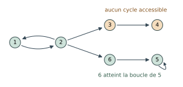
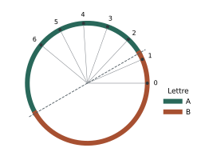
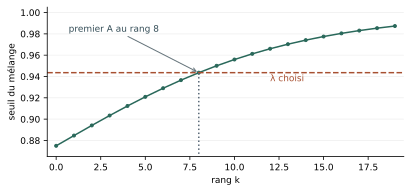

# ENS MP · Informatique-mathématiques 2016 · Corrigé brut

*Corrigé rédigé par IA, non officiel. Signalez toute erreur.*

**Rédaction** · GPT-6.2 Astra Ultra · vitesse non renseignée · 25 novembre 2026

**Révision** · GPT-6.2 Astra Ultra · vitesse non renseignée · 26 novembre 2026

Les distributions sont des vecteurs colonnes. Au rang $k$, la lettre est $A$ si la première coordonnée de $M^kX$ atteint ou dépasse le seuil, et $B$ si elle lui est strictement inférieure. La notation $A^\omega$ désigne une suite infinie de lettres $A$.

## I · Distributions et composantes fortement connexes

### Question 1 · Conservation d’une distribution

Posons $Y=MX$. Chaque $Y_i=\sum_j M_{ij}X_j$ est positif ou nul. En sommant et en utilisant la normalisation de chaque colonne, on obtient $\sum_iY_i=\sum_j X_j\sum_i M_{ij}=1$. Chaque coordonnée appartient donc à $[0,1]$. Par récurrence, $M^kX$ est aussi une distribution pour tout $k\geq0$.

### Question 2 · Quels indices finissent par disparaître ?

Pour $n\geq1$, $(M^n)_{ij}$ est la somme des produits des entrées le long des marches de longueur $n$ allant de $i$ à $j$ dans le graphe du sujet. Les facteurs sont non négatifs. L’entrée est strictement positive exactement quand une telle marche existe. En prenant comme distribution le vecteur unité $e_j$, on teste la colonne $j$. Ainsi $i\in I$ exactement quand, à partir d’un certain rang, **aucune marche** de cette longueur ne part de $i$.

**a.** Si $j\neq i$ appartient à sa composante, concaténons un chemin de $i$ à $j$ et un chemin de retour. La marche fermée obtenue, de longueur $d>0$, se répète. Ainsi $(M^{md}e_i)_i>0$ pour tout $m\geq1$, ce qui exclut $i$ de $I$.

**b.** Une boucle en $i$ donne $(M^n e_i)_i\geq M_{ii}^{\,n}>0$ à tout rang.

**c.** Appelons cyclique une composante à plusieurs sommets ou un singleton muni d’une boucle. Si $i$ atteint une telle composante, on rejoint puis répète un cycle pour obtenir des marches arbitrairement longues. Réciproquement, une marche d’au moins $N$ arcs visite $N+1$ sommets avec répétition. Elle atteint donc un cycle. Finalement $I$ est l’ensemble des sommets **d’où aucune composante cyclique n’est accessible**. Le même entier $N$ convient comme rang d’extinction pour tous les sommets de $I$.



### Question 3 · Composantes et calcul effectif de I

**a.** Construire la matrice booléenne $R$ en cochant la diagonale puis, pour chaque $v$, les cases $(v,w)$ avec $w\in L_v$. Appliquer ensuite ce pseudo-code.

```text
libre ← tableau vrai pour tous les sommets
résultat ← liste vide
pour chaque sommet v :
    si libre[v] :
        C ← liste vide
        pour chaque sommet w :
            si R[v,w] et R[w,v] :
                ajouter w à C
                libre[w] ← faux
        ajouter C à résultat
renvoyer résultat
```

L’accessibilité mutuelle est une relation d’équivalence. À chaque passage dans la boucle intérieure, on énumère exactement la classe de $v$, puis on la retire des sommets libres. Chaque classe est donc émise une seule fois. La construction de $R$ et les balayages coûtent $O(N^2)$ en temps et la matrice occupe $O(N^2)$ places.

**b.** Calculer chaque $L_v$ par un parcours en profondeur depuis $v$ avec un tableau des sommets déjà vus réinitialisé. Marquer les composantes cycliques selon la question 2. Pour chaque $i$, regarder dans la ligne $R[i,\cdot]$ si un sommet d’une composante marquée est accessible. Inscrire $i$ dans $I$ exactement quand la réponse est négative. Avec des listes d’adjacence et $m=|E|$, le coût est $O(N(N+m)+N^2)=O(m^2)$ puisque $N\leq m$. On peut donc prendre $k=2$.

```text
pour chaque v :
    R[v,·] ← marques du parcours en profondeur depuis v, v inclus
classes ← composantes obtenues en a avec R
cyclique ← tableau faux
pour chaque classe C :
    si taille(C) > 1 ou si son unique sommet a une boucle :
        marquer dans cyclique tous les sommets de C
I ← liste vide
pour chaque i :
    si aucun j ne vérifie R[i,j] et cyclique[j] :
        ajouter i à I
renvoyer I
```

**c.** Avec un algorithme correct de Tarjan, calculer les composantes coûte $O(N+m)$. Repérer ensuite les composantes cycliques en parcourant leurs listes de sommets et les boucles. Amorcer un parcours sur le **graphe transposé** avec tous les sommets de ces composantes. Il marque exactement leurs prédécesseurs accessibles, dont le complément est $I$. On examine chaque sommet et chaque arc un nombre borné de fois. Le coût total est $O(N+m)=O(m)$, donc $k'=1$.

Le pseudo-code imprimé omet le marquage $b(w)\gets1$ avant l’appel récursif de la ligne 8. Un sommet découvert récursivement et muni d’une boucle peut se rappeler sans fin. Le jury signale cette omission. Il admet par ailleurs que les composantes sont correctement affichées. Pour une **implémentation**, utiliser la pile des sommets dont la composante est encore ouverte, distincte de la pile des appels. Même après ajout du marquage, le seul test de présence dans la pile des appels peut échouer. Avec les arcs $1\to2$, $2\to1$, $1\to3$, $3\to2$, explorés depuis 1 dans cet ordre de voisins, les trois sommets forment une seule composante. L’appel en 2 revient avant la visite de 3. La ligne 17 a effacé $p(2)$, si bien que la ligne 3 ignore $3\to2$ et l’affichage est prématuré.

## II · Langages et spectres

### Question 4 · Trois langages au seuil un demi

**a.** Pour $M_1=I_2$, la première coordonnée reste $x$. Le langage est $\{A^\omega,B^\omega\}$.

**b.** Pour $M_2$, elle alterne entre $x$ et $1-x$. Les choix $x>1/2$, $x<1/2$ et $x=1/2$ donnent respectivement $(AB)^\omega$, $(BA)^\omega$ et $A^\omega$. Ces trois mots forment le langage.

**c.** Les deux colonnes de $M_3$ valent $(3/5,2/5)^t$. Toute distribution devient ce vecteur au premier pas et le conserve ensuite. Le langage est $\{A^\omega,BA^\omega\}$. La première lettre, de rang zéro, dépend encore de $x$.

### Question 5 · Spectres des quatre matrices

**a.** $M_1$ a la valeur propre 1 de multiplicité deux. Les deux vecteurs de la base canonique conviennent.

**b.** Pour $M_2$, les vecteurs $(1,1)^t$ et $(1,-1)^t$ ont pour valeurs propres 1 et $-1$, toutes deux simples.

**c.** Pour $M_3$, $(3,2)^t$ est fixe et $(1,-1)^t$ appartient au noyau. Les valeurs propres sont 1 et 0, simples.

**d.** Les sommes des lignes de $M_4$ valent aussi 1. Le vecteur $u=(1,1,1)^t/3$ est donc fixe. Posons $s=i\sqrt3$, $v=(-1-s,-1+s,2)^t$. Le produit par $10M_4$ donne

$$
10M_4v=(-1-5s,-7+3s,8+2s)^t=(4+s)v .
$$

La conjugaison donne $(4-s)/10$ pour $\bar v$. Ces deux nombres distincts ont pour module $\rho_0=\sqrt{19}/10$ et arguments respectifs $\theta_0$ et $-\theta_0$, avec $\cos\theta_0=4/\sqrt{19}$ et $\sin\theta_0=\sqrt{3/19}$. Les trois valeurs propres distinctes sont simples.

### Question 6 · Borne spectrale et valeur propre unité

**a.** Pour $z\in\mathbb C^N$, l’inégalité triangulaire donne

$$
\|Mz\|_1\leq\sum_{i,j}M_{ij}|z_j|=\sum_j |z_j|=\|z\|_1 .
$$

Si $Mz=\nu z$ avec $z\neq0$, on trouve $0\leq |\nu|\leq1$.

**b.** Le vecteur colonne de toutes les unités vérifie $M^t\mathbf1=\mathbf1$. Comme le déterminant est invariant par transposition, $M$ et $M^t$ ont le même polynôme caractéristique. Ainsi 1 est valeur propre de $M$.

## III · Une trajectoire non ultimement périodique

### Question 7 · Écrire le critère dans une base propre

Les valeurs propres distinctes fournissent une base de $\mathbb C^N$. Écrivons $X=\sum_j c_jV_j$. Posons $\alpha_0=-\tau$ et $\alpha_j=c_jV_j(1)$. Alors

$$
(M^kX)(1)-\tau=\alpha_0+\sum_{j=1}^{N}\alpha_j\rho_j^ke^{ik\theta_j}.
$$

Le membre de gauche est réel. Son appartenance à $[0,+\infty[$ équivaut exactement à la lettre $A$. Pour $k=0$, même une valeur propre nulle contribue avec le facteur 1, selon $M^0=I$.

### Question 8 · Oscillation autour d’un tiers

Avec $u,v,\bar v$ de la question 5, $X_4=u+(v+\bar v)/24$. Son écart au seuil, après $k$ pas, est

$$
\frac{\rho_0^k}{12}\operatorname{Re}\bigl((-1-i\sqrt3)e^{ik\theta_0}\bigr)
=\frac{\rho_0^k}{12}\bigl(\sqrt3\sin(k\theta_0)-\cos(k\theta_0)\bigr).
$$

Le facteur extérieur est strictement positif. On obtient le signe demandé. Au rang zéro, l’écart vaut bien $1/4-1/3=-1/12$.

### Question 9 · Une trajectoire qui n’est jamais périodique à partir d’un rang

Supposons une période $P\geq1$ à partir du rang $h$. Les rangs $h+rP$, pour $r\geq0$, portent alors tous la même lettre. Or leurs angles modulo $2\pi$ forment le translaté par $h\theta_0$ de l’ensemble dense admis pour $P$. La fonction continue $f(t)=\sqrt3\sin t-\cos t$ vaut $-1$ en 0 et $1$ en $\pi$. Elle a donc des intervalles ouverts de signe strictement négatif et strictement positif. La même classe de rangs rencontre les deux, contradiction. La décroissance de $\rho_0^k$ affecte l’amplitude et laisse intact le signe.



## IV · Valeurs propres réelles positives

### Question 10 · Décomposition de la cinquième chaîne

**a.** Une multiplication directe donne trois vecteurs propres indépendants

$$
V_1=(5,4,3)^t/12,\qquad V_2=(1,-1,0)^t,\qquad V_3=(1,0,-1)^t,
$$

de valeurs propres $1$, $7/10$ et $3/5$ respectivement. Par exemple $10M_5V_2=(7,-7,0)^t$ et $10M_5V_3=(6,0,-6)^t$. Chacune des trois valeurs propres est réelle strictement positive et $V_1$ est une distribution.

**b.** Avec $X=(x,y,z)^t$, sa décomposition est $X=V_1+(1/3-y)V_2+(1/4-z)V_3$. Le premier coefficient vaut 1 puisque la somme des coordonnées est 1 pour $X,V_1$ et 0 pour $V_2,V_3$. Le terme fixe de la première coordonnée est annulé par le seuil $5/12$. Ainsi, pour l’écart au seuil,

$$
(\alpha_1,\alpha_2,\alpha_3)(X_0)=(0,1/3,1/4),\qquad
(\alpha_1,\alpha_2,\alpha_3)(X_1)=(0,0,-1/12).
$$


**c.** Pour $X_0$, les deux termes non constants sont strictement positifs à tout rang. Sa trajectoire est $A^\omega$. Pour $X_1$ l’écart vaut $-(3/5)^k/12<0$ à tout rang. Sa trajectoire est $B^\omega$.

### Question 11 · Rang du premier A pour un mélange

**a.** La question imprimée mentionne $X_2$ alors que le segment a pour extrémités $X_0$ et $X_1$. Les coefficients de la question 10 sont affines en $X$. Avec le paramétrage donné, la formule est $\alpha_i(X_\lambda)=(1-\lambda)\alpha_i(X_0)+\lambda\alpha_i(X_1)$.

**b.** Pour $0\leq\lambda<1$, divisons l’écart au seuil par $(7/10)^k$. La lettre $A$ équivaut à

$$
g_\lambda(k)=\frac{1-\lambda}{3}+\frac{3-4\lambda}{12}\left(\frac67\right)^k\geq0 .
$$

Si $3-4\lambda\geq0$, tous les termes sont positifs. Sinon $g_\lambda$ est strictement croissante et tend vers $(1-\lambda)/3>0$. Ainsi il existe un premier rang $\ell_\lambda$ portant $A$, tous les rangs suivants portent également $A$. Plus précisément, $g_\lambda(0)=(7-8\lambda)/12$. On a $\ell_\lambda=0$ pour $\lambda\leq7/8$. Pour $7/8<\lambda<1$,

$$
\ell_\lambda=\left\lceil\frac{\log((4\lambda-3)/(4(1-\lambda)))}{\log(7/6)}\right\rceil .
$$

L’arrondi supérieur inclut dans $A$ un rang où l’écart s’annule exactement.

### Question 12 · Tous les retards finis

**a.** Prolongeons les écarts de la question 10 au temps réel $x\geq1$. On a $f_0(x)=(7/10)^x/3+(3/5)^x/4>0$ et $f_1(x)=-(3/5)^x/12<0$. Une unique combinaison $\mu_x f_0(x)+(1-\mu_x)f_1(x)=0$ est donnée par

$$
\mu_x=\frac{-f_1(x)}{f_0(x)-f_1(x)}=\frac1{4(1+(7/6)^x)}\in(0,1).
$$

Ici $\mu_x$ est le poids de $X_0$, donc $\lambda=1-\mu_x$.

**b.** Étant donné $\ell_0\geq0$, choisissons $x=\ell_0+1$ et $\lambda=1-\mu_x$. L’écart normalisé $g_\lambda$ est nul en $x$ et sa limite est strictement positive. Son coefficient devant $(6/7)^k$ est donc négatif et $g_\lambda$ est strictement croissante. Les rangs $0$ à $\ell_0$ portent $B$ et tous ceux à partir de $\ell_0+1$ portent $A$.

**c.** Les valeurs de $\ell_\lambda$ sur $[0,1[$ comprennent tous les entiers positifs par **b**. Aucun majorant réel ne convient, même sur ce domaine. En $\lambda=1$ le premier $A$ n’existe pas.

**d.** Le langage sur le segment est

$$
\{B^n A^\omega:n\in\mathbb N\}\ \cup\ \{B^\omega\}.
$$

Le cas $n=0$ vient de $X_0$, le mot tout $B$ de $X_1$. La question 11 exclut toute autre forme.



### Question 13 · Classification sur un segment quelconque

Écrivons l’écart réel au seuil avec ses coefficients issus de la décomposition de la question 7. Les deux contributions constantes se compensent puisque le seuil est celui du vecteur stationnaire. Pour $j=0,1$, il existe des réels $a_j,b_j$ tels que l’écart pour $X_j$ au rang $k$, divisé par $\rho_2^k>0$, soit $d_j(k)=a_j+b_j r^k$, avec $r=\rho_3/\rho_2\in[0,1[$. On prend $r^0=1$. Les hypothèses donnent $d_0(k)\geq0$ et $d_1(k)<0$. Par affinité en $X$, le signe pour le mélange est celui de $(1-\lambda)d_0(k)+\lambda d_1(k)$. Par conséquent

$$
\sigma_k(X_\lambda)=A\quad\Longleftrightarrow\quad
\lambda\leq t_k,\qquad
t_k=\frac{a_0+b_0r^k}{a_0-a_1+(b_0-b_1)r^k}\in[0,1[ .
$$


Pour $0<r<1$, la différence $t_{k+1}-t_k$ a le signe de $D=a_1b_0-a_0b_1$. En effet, son numérateur après réduction est $r^k(1-r)D$ et les deux dénominateurs sont strictement positifs. Le langage est ainsi complètement déterminé.

- Si $D=0$, les $t_k$ sont constants. Le langage est $\{A^\omega,B^\omega\}$.
- Si $D>0$, les $t_k$ sont strictement croissants. Le langage est $\{B^nA^\omega:n\geq0\}\cup\{B^\omega\}$. Pour un retard $n\geq1$, choisir $t_{n-1}<\lambda\leq t_n$.
- Si $D<0$, les $t_k$ sont strictement décroissants. Le langage est $\{A^nB^\omega:n\geq0\}\cup\{A^\omega\}$. Pour une coupure au rang $n\geq1$, choisir $t_n<\lambda\leq t_{n-1}$.

Dans chacun des cas, $\lambda=0$ et $\lambda=1$ fournissent les deux mots constants. La monotonie empêche toute seconde coupure. Cette méthode couvre aussi les cas où le coefficient du mode dominant s’annule à une extrémité, ou lorsque la première distribution atteint exactement son seuil.

Si $r=0$, on lit $t_0$ puis un **seul autre seuil** $t_1=t_2=\cdots$, puisque la composante propre nulle disparaît dès le premier pas. Aux deux mots constants s’ajoute uniquement $BA^\omega$ si $t_0<t_1$, uniquement $AB^\omega$ si $t_0>t_1$, aucun autre mot si les deux seuils sont égaux. Les intervalles de choix de $\lambda$ sont les mêmes que ci-dessus pour $n=1$.
