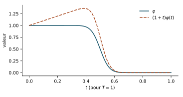

# ENS · MP · Mathématiques C 2016 · Corrigé brut

*Corrigé rédigé par IA, non officiel. Signalez toute erreur.*

**Rédaction** · GPT-6.2 Astra Ultra · vitesse non renseignée

**Révision** · GPT-6.2 Astra Ultra · vitesse non renseignée · 26 novembre 2026

Le sujet construit des commandes qui annulent un état au temps T. Les deux premières parties traitent les équations différentielles ordinaires. Les trois dernières construisent un raccordement de Gevrey utilisé pour l’équation de la chaleur.

## 1. Commande d’une équation différentielle scalaire

### Question 1.1

Posons $Y=(f,f',\ldots,f^{(n-1)})^t$. L’équation équivaut à $Y'=AY+e_nu$, où $A$ a des uns sur la surdiagonale et la dernière ligne $(-a_0,\ldots,-a_{n-1})$, avec $Y(0)=(c_0,\ldots,c_{n-1})^t$. Le théorème de Cauchy pour un système linéaire continu donne une solution unique de classe $C^1$ sur $[0,T]$. Les premières lignes identifient successivement les dérivées de sa première composante jusqu’à l’ordre $n$, ce qui donne existence et unicité de $f\in C^n$.

### Question 1.2

L’application $L$ est linéaire. Si $L(P)=0$, alors $X^n$ et $(X-T)^n$ divisent $P$ par les formules de Taylor aux deux points. Ces facteurs sont premiers entre eux car $T>0$. Leur produit de degré $2n$ divise donc $P$ de degré au plus $2n-1$, d’où $P=0$. Les deux espaces sont de dimension $2n$, donc $L$ est un isomorphisme.

### Question 1.3

Prenons le polynôme $f=L^{-1}(c_0,\ldots,c_{n-1},0,\ldots,0)$. Il est lisse sur toute la droite et satisfait précisément les jets demandés en zéro et en $T$.

### Question 1.4

Pour la fonction de 1.3 posons $u=f^{(n)}+\sum_{j=0}^{n-1}a_j f^{(j)}$ sur $[0,T]$. Ce $u$ est continu et la fonction $f$ est la solution unique de 1.1 avec les conditions initiales. Ses valeurs finales et leurs dérivées jusqu’à l’ordre $n-1$ sont nulles.

### Question 1.5

Les fonctions $f$ et $f+X^n(X-T)^n$ ont les mêmes jets initiaux et finaux des ordres zéro à $n-1$. En construisant leurs commandes comme en 1.4 on obtient deux commandes distinctes, car sinon l’unicité de 1.1 imposerait que les deux fonctions coïncident. La commande n’est donc pas unique.

## 2. Système linéaire et critère de contrôlabilité

### Question 2.1

Le système $y'=Ay+ub$ a une matrice constante et un terme $t\mapsto u(t)b$ continu sur $[0,T]$. Le théorème de Cauchy linéaire donne pour chaque $y^0$ une unique solution $C^1$ sur le segment entier.

### Question 2.2

En dérivant, $(e^{-tA}y(t))'=e^{-tA}bu(t)$. Après intégration, $y(T)=e^{TA}(y^0+\int_0^Te^{-tA}bu(t)dt)$. L’exponentielle est inversible, donc $y(T)=0$ équivaut à $y^0=\Phi(A,b,u)=-\int_0^Te^{-tA}bu(t)dt$.

### Question 2.3

Soit $P_k$ le reste de $X^k$ modulo le polynôme caractéristique unitaire $\chi_A$, de degré $n$. On a $\deg P_k<n$ et $A^k=P_k(A)$ par Cayley–Hamilton, puisque $\chi_A(A)=0$.

### Question 2.4a

Les $n$ vecteurs $b,Ab,\ldots,A^{n-1}b$ ne formant pas une base, leur espace engendré est strict dans $\mathbb R^n$. Il admet un vecteur orthogonal non nul $z$. Par 2.3, chaque $A^kb$ pour $k\ge n$ est combinaison de ces premiers vecteurs, donc $\langle z,A^kb\rangle=0$ pour tout $k\ge0$.

### Question 2.4b

Les sommes partielles de $e^{tA}b$ sont des combinaisons des $A^kb$, toutes orthogonales à $z$. Par convergence de l’exponentielle matricielle et continuité du produit scalaire, $\langle z,e^{tA}b\rangle=0$ pour tout réel $t$.

### Question 2.4c

Si une commande annulait $y(T)$, alors par 2.2 et 2.4b, $\langle z,y^0\rangle=-\int_0^T u(t)\langle z,e^{-tA}b\rangle dt=0$. C’est contraire à l’hypothèse sur $y^0$.

### Question 2.4d

Si (E1) échoue, choisir $y^0=z$ donne $\langle z,y^0\rangle=\|z\|^2>0$. La question précédente exclut (E2), donc (E2) implique (E1).

### Question 2.5

Pour $1\le k\le n$, on a $v_k=A^{n-k}b+\sum_{j=k}^{n-1}a_jA^{j-k}b$, avec somme vide en $k=n$. En effet le cas $k=n$ donne $b$ et la multiplication par $A$ dans le rang supérieur suivie de l’addition de $a_kb$ fournit la formule en $k$.

### Question 2.6

La formule de 2.5 donne $v_{n-j}=A^jb$ plus une combinaison de $b,\ldots,A^{j-1}b$. Par récurrence croissante en $j$, chaque $A^jb$ appartient donc à l’espace engendré par les $v_k$. Par (E1), cet espace est tout $\mathbb R^n$, et ses $n$ générateurs constituent une base.

### Question 2.7

On a $Av_1=(A^n+\sum_{j=1}^{n-1}a_jA^j)b$. Or $A^n+\sum_{j=0}^{n-1}a_jA^j=0$ par Cayley–Hamilton. Ainsi $Av_1=-a_0b=-a_0v_n$.

### Question 2.8

Prenons $U=[v_1\ \cdots\ v_n]$, inversible par 2.6. Pour $k\ge2$, $Av_k=v_{k-1}-a_{k-1}v_n$ par définition, et $Av_1=-a_0v_n$. Dans cette base $U^{-1}AU$ a donc des uns sur la surdiagonale, une dernière ligne $(-a_0,\ldots,-a_{n-1})$ et zéro ailleurs. Comme $v_n=b$, $U^{-1}b=e_n$.

### Question 2.9a

Pour $F=U^{-1}y$ on a $F'=\widetilde A F+e_nu$ et $F(0)=U^{-1}y^0$. Ces équations forment le problème de Cauchy transformé.

### Question 2.9b

Les premières lignes donnent $F_j=f^{(j-1)}$ pour $1\le j\le n$, où $f=F_1$. La dernière donne $f^{(n)}+\sum_{j=0}^{n-1}a_j f^{(j)}=u$, avec toutes les données $f^{(j)}(0)=(U^{-1}y^0)_{j+1}$ pour $0\le j<n$.

### Question 2.10

Pour les données de 2.9b, la partie 1 fournit un $u$ continu tel que chaque $f^{(j)}(T)=0$ pour $0\le j<n$. Ainsi $F(T)=0$ et $y(T)=UF(T)=0$. On a prouvé (E1) implique (E2). Avec 2.4d, l’équivalence est complète.

## 3. Stabilité de la classe de Gevrey

### Question 3.1

Pour $g(t)=f(T-t)$, $g^{(n)}(t)=(-1)^n f^{(n)}(T-t)$. La régularité aux bords est conservée et les mêmes constantes $M,R$ donnent la borne Gevrey.

### Question 3.2

Pour $P$ de degré $d$, prenons $R=1$ et $M=1+\max_{0\le j\le d}\|P^{(j)}\|_\infty/(j!)^s$ sur $[0,T]$. La borne vaut par choix jusqu’au rang $d$ et ensuite par nullité des dérivées. Le polynôme nul convient aussi.

### Question 3.3

Pour $\alpha f+\beta g$, choisissons $R=\min(R_f,R_g)$ et $M=1+|\alpha|M_f+|\beta|M_g$. La linéarité des dérivées et l’inégalité triangulaire donnent $| (\alpha f+\beta g)^{(n)}|\le M(n!)^sR^{-n}$. Comme la fonction nulle appartient à la classe, c’est un espace vectoriel.

### Question 3.4

En prenant $R=\min(R_1,R_2)$, la formule de Leibniz donne $|(f_1f_2)^{(n)}|\le M_1M_2(n!)^s R^{-n}\sum_{k=0}^n\binom nk^{1-s}$. Puisque $s\ge1$, la somme est au plus $n+1\le2^n$ pour $n\ge0$. Les constantes $M_1M_2$ et $R/2$ conviennent.

### Question 3.5a

Posons $g=1/f$, lisse car $f\ge\delta>0$. Pour $n\ge1$, $0=(fg)^{(n)}=fg^{(n)}+\sum_{k=1}^n\binom nk f^{(k)}g^{(n-k)}$. Une division par $f$ donne la relation imprimée.

### Question 3.5b

Pour $0<\varepsilon<1$, on a $\sum_{k=1}^n\binom nk^{1-s}\varepsilon^k\le\sum_{k\ge1}\varepsilon^k=\varepsilon/(1-\varepsilon)$. Le choix $\varepsilon=\delta/(M+\delta)$ donne la borne $\delta/M$.

### Question 3.5c

Prenons $M'=1/\delta$, $R'=\varepsilon R$. Au rang zéro, $|g|\le M'$. Supposons la borne acquise aux ordres inférieurs à $n$. La formule 3.5a donne
$$|g^{(n)}|\le M'(n!)^s(R')^{-n}\frac M\delta\sum_{k=1}^n\binom nk^{1-s}(R'/R)^k.$$
Par 3.5b, le facteur placé après le majorant est au plus un. L’induction donne $g\in G^s$ avec les constantes annoncées.

## 4. Fonctions plates de Gevrey d’ordre trois demis

### Question 4.1

Sur $t>0$, $h^{(k)}(t)=P_k(1/t)e^{-1/t^2}$ avec $P_0=1$. En posant $x=1/t$, la récurrence est $P_{k+1}(x)=-x^2P_k'(x)+2x^3P_k(x)$. Chaque $P_k$ est polynomial et $P_k(x)e^{-x^2}\to0$ quand $x\to+\infty$, d’où la limite demandée.

### Question 4.2

Prolongeons chacun des produits de 4.1 par zéro en $t=0$. Ils sont continus grâce à 4.1. Le quotient différentiel à droite en zéro du prolongement du rang $k$ est $t^{-1}P_k(1/t)e^{-1/t^2}$, qui tend aussi vers zéro. Sa dérivée est donc le prolongement du rang suivant, y compris au bord. Par récurrence $h$ est lisse sur $[0,T]$ et plate en zéro.

### Question 4.3

Pour $r<\rho$, la série de $F(re^{i\theta})$ converge normalement en $\theta$ car $\sum|a_k|r^k<\infty$. Après division par $(re^{i\theta})^n$ on peut encore intégrer terme à terme. La moyenne de $e^{i(k-n)\theta}$ sur $[0,2\pi]$ vaut un si $k=n$ et zéro sinon. L’intégrale normalisée est donc $a_n$.

### Question 4.4a

Pour $z\ne t_0$, $-(t_0-z)^{-2}=-t_0^{-2}(1-z/t_0)^{-2}$. Le développement de l’exponentielle, convergent en tout complexe, donne $\sum_{j\ge0}(-1)^j/[j!t_0^{2j}(1-z/t_0)^{2j}]$.

### Question 4.4b

Pour $j\ge1$, $(1-w)^{-2j}=\sum_{l\ge0}\binom{2j+l-1}{l}w^l$ sur $|w|<1$. Pour $|z|\le r'<t_0$, la somme absolue des développements substitués dans 4.4a est majorée par $\sum_{j\ge0}(j!t_0^{2j})^{-1}(1-r'/t_0)^{-2j}=\exp((t_0-r')^{-2})$. Le terme $j=0$ vaut un. On peut donc regrouper par puissances de $z$ et obtenir une série $\sum_l a_lz^l$ convergente sur $|z|<t_0$, à coefficients réels.

### Question 4.4c

Sur un voisinage réel de zéro, la fonction développée vaut $h(t_0-z)$, en prenant la même expression lisse sur $t>0$ si $t_0=T$. Donc $a_n=(-1)^nh^{(n)}(t_0)/n!$. La formule 4.3 avec $r=t_0/3$ identifie $a_n$ à la moyenne du quotient imprimé. En prenant les modules on obtient exactement l’égalité demandée.

Plus précisément, avant le passage aux modules, le calcul donne $$\frac{(-1)^n h^{(n)}(t_0)}{n!}=\frac{1}{2\pi}\int_0^{2\pi}\frac{\exp\bigl(-1/(t_0-re^{i\theta})^2\bigr)}{(re^{i\theta})^n}\,d\theta.$$ Les barres verticales de chaque côté de la formule imprimée éliminent le signe $(-1)^n$.

### Question 4.4d

Écrivons $t_0-re^{i\theta}=r(3-e^{i\theta})$, et $3-e^{i\theta}=u+iv$. On a $u\ge2$, $|v|\le1$ et $|u+iv|\le4$. Ainsi $\operatorname{Re}(u+iv)^{-2}=(u^2-v^2)/|u+iv|^4\ge3/256=\lambda>0$. Le module de l’exponentielle en 4.4c est donc au plus $e^{-\lambda/r^2}$. Cela donne $|h^{(n)}(t_0)|\le n!r^{-n}e^{-\lambda/r^2}$ avec $\lambda$ indépendant de $t_0$.

### Question 4.4e

Pour $\alpha,\beta>0$, la dérivée logarithmique de $x^\alpha e^{-\beta x}$ vaut $\alpha/x-\beta$. Son signe montre que le maximum est atteint en $\alpha/\beta$ et vaut $(\alpha/(e\beta))^\alpha$.

### Question 4.4f

Par croissance de $\ln$, $\ln(n!)=\sum_{j=2}^n\ln j\ge\int_1^n\ln x\,dx=n\ln n-n+1$. Après exponentiation cela donne $n^n\le e^{n-1}n!$, y compris pour $n=1$.

### Question 4.4g

Dans 4.4d posons $x=r^{-2}$ et $\alpha=n/2$. Pour $n\ge1$, 4.4e–f donnent $r^{-n}e^{-\lambda/r^2}\le(n/(2e\lambda))^{n/2}\le (2\lambda)^{-n/2}\sqrt{n!}$. Ainsi $|h^{(n)}|\le(n!)^{3/2}(\sqrt{2\lambda})^{-n}$ sur $]0,T]$ et aussi en zéro par 4.2. Le rang zéro est borné par un. Donc $h\in G^{3/2}(0,T)$.

### Question 4.5

Sur tout le segment, $\varphi(t)=h(T-t)/(h(T-t)+h(t))$. Le dénominateur est continu et strictement positif, car ses deux termes ne s’annulent jamais ensemble pour $T>0$. Il admet un minimum $\delta>0$. Par réflexion, somme, inversion puis produit (partie 3), $\varphi\in G^{3/2}$.

### Question 4.6

Tout polynôme $P$ appartient à $G^{3/2}$ par 3.2. Par 3.4 et 4.5, $P\varphi$ y appartient aussi.

### Question 4.7

Notons $D=h(T-t)+h(t)$. Près de zéro, $1-\varphi=h(t)/D$ est plate par 4.2 et Leibniz. Près de $T$, $\varphi=h(T-t)/D$ est plate de même. Ainsi $\varphi(0)=1$, $\varphi^{(n)}(0)=0$ pour $n\ge1$, et $\varphi^{(n)}(T)=0$ pour tout $n\ge0$. Une nouvelle application de Leibniz donne $(P\varphi)^{(n)}(0)=P^{(n)}(0)$ et $(P\varphi)^{(n)}(T)=0$ pour tout $n\ge0$.

## 5. Contrôle de l’équation de la chaleur

### Question 5.1

Sur le rectangle $[0,T]\times[0,1]$, le terme d’indice $n$ a module au plus $a_n=M(n!)^s/(R^n(2n)!)$. Le quotient $a_{n+1}/a_n=(n+1)^s/(R(2n+2)(2n+1))$ tend vers zéro car $s<2$. On a donc convergence normale et en particulier existence et continuité de $H$.

### Question 5.2

Pour $j,k\ge0$, la dérivée formelle $\partial_t^j\partial_x^k$ du terme $n$ est nulle si $2n<k$ et sinon vaut $f^{(n+j)}(t)x^{2n-k}/(2n-k)!$. Son module est au plus $M((n+j)!)^s/(R^{n+j}(2n-k)!)$. À $j,k$ fixés, le quotient de deux majorants consécutifs est $(n+j+1)^s/(R(2n+2-k)(2n+1-k))\to0$. Toutes les séries dérivées convergent normalement sur le rectangle. La dérivation terme à terme, itérée dans chaque variable, donne donc toutes les dérivées continues, avec dérivées unilatérales aux bords.

### Question 5.3

Grâce à 5.2, $H_t=\sum_{n\ge0} f^{(n+1)}(t)x^{2n}/(2n)!$ et $H_{xx}=\sum_{n\ge1}f^{(n)}(t)x^{2n-2}/(2n-2)!$, expressions égales par changement d’indice. La première dérivée spatiale ne contient que des puissances impaires positives de $x$, d’où $H_x(t,0)=0$.

### Question 5.4

Écrivons $H^0(x)=\sum_{n=0}^d a_n x^{2n}$. Prenons $P(t)=\sum_{n=0}^d a_n(2n)!t^n/n!$, puis $f=P\varphi$. Par 4.6, $f\in G^{3/2}$ et l’on peut appliquer 5.1–3. En zéro, $f^{(n)}(0)=(2n)!a_n$ pour $n\le d$ et zéro au-delà par 4.7. Ainsi $H(0,x)=H^0(x)$. Au temps $T$, tous les jets de $f$ sont nuls, d’où $H(T,x)=0$. Enfin $u(t)=H_x(t,1)$ est continue par 5.2 et fournit la condition de Neumann requise à droite, tandis que celle à gauche découle de 5.3. Cette commande accomplit le transfert demandé.

Par exemple $H^0(x)=1+3x^2+5x^4$ impose $P(t)=1+6t+60t^2$. La série pour la commande est $u(t)=\sum_{n\ge1}f^{(n)}(t)/(2n-1)!$. Elle donne $u(0)=6+120/6=26$, égal à $(H^0)^{\prime}(1)$, et $u(T)=0$.
