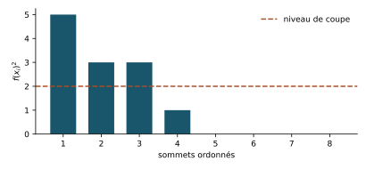

# ENS Ulm · Filière MPI · Mathématiques D 2016 · Corrigé brut

*Corrigé rédigé par IA, non officiel. Signalez toute erreur.*

**Rédaction** · GPT-6.2 Astra Ultra · vitesse non renseignée

**Révision (tour 1)** · GPT-6.2 Astra Ultra · vitesse non renseignée · 26 novembre 2026

Le sujet étudie le spectre des graphes finis, depuis le minimax jusqu’aux cisaillements de Gabber–Galil. Sauf mention contraire, une somme sur les arêtes non orientées compte chaque paire voisine une seule fois. Le rapport du jury précise deux coquilles de notation dans les définitions.

## I. Spectre du laplacien d’un graphe

### Question I.1

On évalue $T_Gf$ en un **sommet** $x\in V$, comme le précise le rapport. La formule est linéaire en $f$. Dans $\sum_{(x,y)\in E}(f(x)-f(y))g(x)$, la permutation $(x,y)\mapsto(y,x)$ conserve $E$. En prenant la demi-somme des deux expressions,
$$
\langle T_G f,g\rangle=\tfrac12\sum_{(x,y)\in E}(f(x)-f(y))(g(x)-g(y)).
$$
C’est symétrique en $f,g$. Avec $g=f$, on obtient la formule de $q_G$.

### Question I.2a

Pour $f=\sum f_i e_i$, on a $T_Gf=\sum\lambda_i f_i e_i$. L’orthonormalité laisse $q_G(f)=\sum\lambda_i f_i^2$. D’après I.1, $\lambda_1=q_G(e_1)\ge0$.

### Question I.2b

Pour $f\in F_k$, la somme précédente commence en $k$ et est au moins $\lambda_k\sum_{i\ge k} f_i^2=\lambda_k\|f\|^2$, y compris pour $f=0$. Sur la sphère, cette borne est atteinte par $e_k$. Elle est donc l’infimum demandé.

### Question I.2c

Pour $\dim W=k$, la somme des dimensions de $W$ et de $F_k$ vaut $n+1$, d’où un vecteur unitaire dans leur intersection. Par I.2b, le supremum sur $W\cap S$ est au moins $\lambda_k$. Pour $W=\operatorname{Vect}(e_1,\ldots,e_k)$, I.2a majore $q_G$ sur la sphère par $\lambda_k$, atteint en $e_k$. D’où l’égalité du minimax.

### Question I.3a

Si $T_G f=0$, chaque différence de I.1 est nulle. Les valeurs coïncident le long de tout chemin et la connexité impose que $f$ soit constante. Réciproquement toute constante annule chaque terme de $T_G f$. Le noyau est donc la droite des constantes.

### Question I.3b

Le spectre est positif ou nul et zéro est valeur propre simple par I.3a et le théorème spectral. Ainsi $\lambda_1=0<\lambda_2$.

### Question I.4a

Choisissons $x$ tel que $M=|f(x)|=\max|f|>0$. Alors $\lambda M\le\sum_{y\sim x}|f(x)-f(y)|\le2\operatorname{val}(x)M\le2d_GM$. En divisant par $M$, on obtient $\lambda\le2d_G$.

### Question I.4b

Prenons $f=1$ sur la première classe et $f=-1$ sur la seconde. Pour tout voisin, $f(y)=-f(x)$. Chaque sommet a degré $d_G$, donc $T_G f=2d_G f$.

### Question I.4c

Pour $\lambda=2d_G$, toutes les bornes de I.4a sont des égalités. Le sommet extrémal a degré $d_G$ et tous ses voisins vérifient $f(y)=-f(x)$, puisque $|f(x)-f(y)|=2M$. Ces voisins sont à leur tour extrémaux. La connexité propage ces deux propriétés à tous les sommets. Le graphe est régulier et les classes des valeurs $M$ et $-M$ le rendent biparti.

### Question I.5a

La suppression d’arêtes enlève des termes positifs à l’énergie, d’où $q_{G'}(f)\le q_G(f)$ sur la même sphère. Prendre le supremum sur chaque $W$ puis l’infimum commun à tous les $W$ de dimension $k$ dans I.2c donne $\lambda'_k\le\lambda_k$.

### Question I.5b

Dans le graphe complet, $(T f)(i)=nf(i)-\sum_j f(j)$. La droite constante correspond à zéro, l’hyperplan de somme nulle à $n$ avec multiplicité $n-1$. Tout graphe simple sur ces sommets est un sous-graphe de $K_n$, donc son spectre est majoré par $n$ selon I.5a.

## II. Le graphe du buckminsterfullerène et le groupe alterné

### Question II.1a

Le groupe $A_3$ est formé de l’identité et des deux cycles $(123)$ et $(132)=(123)^2$. Il est donc engendré par $(123)$.

### Question II.1b

Le groupe $H$ engendré par $c=(123)$ et $b=(12)(34)$ envoie $4$ sur $3$ par $b$, puis sur $1,2$ en composant avec les puissances de $c$. Son orbite a quatre éléments. Le stabilisateur de $4$ contient $\langle c\rangle$ d’ordre trois. Donc $|H|\ge12=|A_4|$. Les générateurs étant pairs, $H=A_4$.

### Question II.1c

Avec la composition de droite à gauche on vérifie lettre par lettre que $a^{-1}ba^2b=(123)$. Ainsi $\langle a,b\rangle$ contient par II.1b toutes les permutations paires fixant $5$. L’orbite de $5$ sous les puissances de $a$ a cinq éléments. Le groupe engendré a donc au moins $5\cdot12=60$ éléments et, contenu dans $A_5$, il lui est égal.

### Question II.2a

Les couples d’arêtes appartiennent à $A_5^2$, comme le relève le jury. Les trois voisins distincts de $g$ sont $ga,ga^{-1},gb$, différents de $g$. Les inverses sont dans la même liste de générateurs, donc le graphe est non orienté et régulier de degré trois. Écrire $g^{-1}h$ comme un mot en ces générateurs fournit un chemin de $g$ à $h$. Le graphe est connexe.

### Question II.2b

Le changement de variable $x\mapsto g^{-1}x$ est bijectif, donc préserve le produit scalaire des fonctions. On a $L_g L_h f(x)=f(h^{-1}g^{-1}x)=L_{gh}f(x)$. Enfin, pour $D=\{a,a^{-1},b\}$,
$$
(T_GL_g f)(x)=3f(g^{-1}x)-\sum_{s\in D} f(g^{-1}xs)=(L_gT_G f)(x).
$$

### Question II.2c

Tout morphisme de $A_5$ vers un groupe abélien est trivial. En effet, $A_5$ est engendré par les 3-cycles : regrouper par deux les transpositions d’une écriture paire, puis utiliser par exemple $(ij)(kl)=(ikj)(ikl)$ pour quatre lettres distinctes. Chaque 3-cycle est conjugué à son inverse par le produit d’une transposition sur son support et de celle des deux lettres restantes. Dans une image abélienne, son ordre divise donc deux et trois. Un morphisme vers $O(1)$ est trivial, et le déterminant d’un morphisme vers $O(2)$ est trivial. Ce dernier morphisme prend alors ses valeurs dans le groupe abélien $SO(2)$ et est lui-même trivial. Or un espace propre est stable par les isométries $L_g$. En dimension un ou deux elles y agiraient toutes trivialement. Une fonction invariante par toutes les translations à gauche est constante, donc ne peut être propre pour une valeur non nulle. La multiplicité est au moins trois.

### Question II.3a

Les permutations préservent la somme des coordonnées, donc stabilisent $F=\mathbf1^\perp$. L’espace $\mathcal A=\operatorname{Vect}(\widetilde\rho(g))$ est une algèbre car les produits restent dans la famille. Posons $u_i=e_i-\mathbf1/5$. La moyenne $P_i$ sur le stabilisateur de $i$ est le projecteur orthogonal sur ses vecteurs fixes : cette moyenne est symétrique par inversion, fixe les invariants et a son image invariante. Le stabilisateur agit transitivement sur les quatre autres lettres. Ses vecteurs fixes dans $F$ forment donc $\mathbb R u_i$. Ainsi $P_i=u_i u_i^t/\|u_i\|^2$. Comme $u_i^tu_j=\delta_{ij}-1/5$ ne s’annule jamais, $P_iP_j$ est un multiple non nul de $u_i u_j^t$. Les $u_i$ engendrent $F$ car ils sont les projections des vecteurs de base. Les endomorphismes $u_i u_j^t$ engendrent donc $\operatorname{End}(F)$, qui est égal à $\mathcal A$.

### Question II.3b

Notons $f_M(g)=\operatorname{Tr}(\widetilde\rho(g)M)$. Si $f_M=0$, la question précédente donne $\operatorname{Tr}(BM)=0$ pour tout $B\in\operatorname{End}(F)$. Prendre $B=M^t$ donne $M=0$. En écrivant les trois voisins à droite, on obtient $T_G f_M=f_{A_F M}$, où $A_F=3I-\widetilde\rho(a)-\widetilde\rho(a^{-1})-\widetilde\rho(b)$ est la restriction à $F$ de la matrice $A$ affichée. Ainsi il faut et il suffit que $M\ne0$ et $(A_F-\lambda I)M=0$, autrement dit que $\lambda$ soit valeur propre de $A_F$. En effet on peut choisir n’importe quelle application non nulle vers l’espace propre. La droite des constantes est dans le noyau de $A$ et le facteur $x$ du polynôme fourni est simple. Les valeurs sur $F$ sont donc $2,5,(7-\sqrt{17})/2,(7+\sqrt{17})/2$.

On peut vérifier le facteur quadratique admis sur la matrice du feuillet. Le renversement qui échange $1$ avec $4$ et $2$ avec $3$, en fixant $5$, commute avec $A$. Sur les vecteurs $(a,b,-b,-a,0)$, la matrice réduite est $\left(\begin{smallmatrix}3&-2\\-2&4\end{smallmatrix}\right)$, de polynôme caractéristique $X^2-7X+8$. Sur les vecteurs symétriques de $F$, écrits $(a,b,b,a,-2a-2b)$, elle devient $\left(\begin{smallmatrix}5&0\\-2&2\end{smallmatrix}\right)$. Ces deux plans sont en somme directe dans $F$. On retrouve les quatre valeurs propres et le cinquième mode, constant, est annulé par $A$.

### Question II.3c

Pour un vecteur propre $v\ne0$ de $A_F$ associé à $\lambda$, toute forme linéaire $\ell$ sur $F$ donne $M=v\ell$ d’image dans $\mathbb Rv$. L’application $\ell\mapsto f_{v\ell}$ est injective par II.3b et linéaire. Son image est dans l’espace propre du graphe, de dimension au moins $\dim F^*=4$.

## III. Constante de Cheeger, diamètre et plongements sphériques

### Question III.0

Toute arête se parcourt dans les deux sens. Renverser un chemin minimal de $x$ à $y$ donne $d(y,x)\le d(x,y)$ et échanger les rôles donne l’égalité. Concaténer un chemin minimal de $x$ à $y$ et un de $y$ à $z$ donne un chemin de longueur $d(x,y)+d(y,z)$, qui majore $d(x,z)$.

### Question III.1a

La seule destination d’un chemin de longueur zéro partant de $y$ est $y$, donc $B(A,0)=A$. Chaque arête du bord se termine dans $B(A,1)\setminus A$ et chaque tel sommet en reçoit au plus $d_G$. Si $0<|A|\le n/2$, il s’ensuit $d_G(|B(A,1)|-|A|)\ge|\partial A|\ge h_G|A|$. La formule vaut aussi pour la partie vide.

### Question III.1b

Le graphe étant fini connexe avec $n\ge2$, on a $h_G>0$ et $d_G>0$. Posons $c=1+h_G/d_G$ et $m=\lfloor\ln(n/2)/\ln c\rfloor+1$. Partant d’un singleton, tant que la boule n’a pas dépassé $n/2$, la boule suivante multiplie son cardinal par au moins $c$, car $B(B(A,k),1)=B(A,k+1)$. À l’étape $m$ elle a donc dépassé $n/2$, puisque $c^m>n/2$. Deux boules de ce rayon se rencontrent, si bien que toute distance est au plus $2m\le 2\ln(n/2)/\ln c+2$.

### Question III.2a

La somme des valeurs de $f$ est $ab-ba=0$, ce qui donne l’orthogonalité par I.3a. Sa norme au carré vaut $ab^2+ba^2=ab(a+b)$. Chaque arête non orientée du bord contribue $(a+b)^2$ à l’énergie. On obtient $q_G(f)=(a+b)|\partial A|\,\|f\|^2/(ab)$.

### Question III.2b

Si $a\le n/2$, alors $b\ge a$, donc $(a+b)/b\le2$. Par I.2b et III.2a, $\lambda_2\le q_G(f)/\|f\|^2\le2|\partial A|/a$. Minimiser sur les parties non vides de taille au plus $n/2$ donne $\lambda_2\le2h_G$.

### Question III.3a

Comptons une fois chaque arête. On a $S(f)=\sum_{\{x,y\}}|f(x)-f(y)|\,|f(x)+f(y)|$. Cauchy–Schwarz donne pour premier facteur $\sqrt{q_G(f)}$. Le carré du second est au plus $2\sum_{\{x,y\}}(f(x)^2+f(y)^2)\le2d_G\|f\|^2$. D’où la majoration demandée.

### Question III.3b

Ordonnons $t_i=f(x_i)^2$ par valeurs décroissantes, posons $t_{n+1}=0$ et $A_k=\{x_1,\ldots,x_k\}$. Une arête entre les positions $i<j$ contribue $t_i-t_j=\sum_{k=i}^{j-1}(t_k-t_{k+1})$ à $S(f)$, et traverse précisément les bords correspondants. Dès lors
$$
S(f)=\sum_{k=1}^{n}(t_k-t_{k+1})|\partial A_k|
\ge h_G\sum_{k=1}^n k(t_k-t_{k+1})=h_G\sum_i t_i.
$$
La borne de Cheeger s’applique à tout terme de poids non nul car $t_k>0$ impose $k\le n/2$ par l’hypothèse sur le support. La dernière somme est $h_G\|f\|^2$.

### Question III.3c

Soit $v$ propre pour $\lambda_2$, orthogonal aux constantes et non nul. Ses deux signes sont présents. En changeant son signe, on peut imposer $0<|\{v>0\}|\le n/2$. Posons $f=v_+$. Sur $\{v>0\}$, $T_G f(x)\le T_Gv(x)=\lambda_2 f(x)$, puisque les valeurs voisines n’ont pu qu’augmenter. Hors de cet ensemble, $f=0$. Multiplier par $f$ et sommer donne $q_G(f)\le\lambda_2\|f\|^2$. III.3a–b impliquent alors $h_G\|f\|^2\le\sqrt{2d_G\lambda_2}\|f\|^2$, d’où $\lambda_2\ge h_G^2/(2d_G)$.

### Question III.4a

Pour une application $f=(f_j)_j$ de somme nulle, chaque composante est orthogonale aux constantes. Alors $Q(f)=\sum_j q_G(f_j)\ge\lambda_2\sum_j\|f_j\|^2$. Sur $S$ le dernier facteur vaut un. L’égalité est atteinte par $f(x)=v(x)w$ avec $v$ fonction propre réelle unitaire de valeur propre $\lambda_2$ et $w$ vecteur unitaire de l’espace d’arrivée.

### Question III.4b

Prenons les quatre vecteurs $v_i$ obtenus en divisant $(1,1,1),(1,-1,-1),(-1,1,-1),(-1,-1,1)$ par $\sqrt3$. Ils sont unitaires, de somme nulle, et $v_i\cdot v_j=-1/3$ pour $i\ne j$. Posons $u_i=v_i/\sqrt3$. La calotte $D(i)$ est définie par $w\cdot v_i>1/\sqrt3$. Pour deux indices distincts, $w\cdot(v_i+v_j)\le\|v_i+v_j\|=2/\sqrt3$, donc les calottes ouvertes sont disjointes. Le vecteur unitaire dans la direction $v_i+v_j$ satisfait les deux égalités de bord. Les adhérences se touchent pour chaque paire, exactement comme les sommets de $K_4$.

### Question III.4c

Écrivons $v_x=u(x)/\|u(x)\|$, $r_x=\|u(x)\|$. La calotte $v_x\cdot w>r_x$ sur la sphère unité a pour aire $2\pi(1-r_x)$, par intégration des bandes de latitude. Les intérieurs étant disjoints, $\sum_x(1-r_x)\le2$. Pour une arête $\{x,y\}$, un point commun des adhérences appartient aux deux bords : s’il était intérieur à l’une, tout voisinage y rencontrerait l’autre calotte ouverte. En ce point $w$, on a $\|v_x-w\|^2=2(1-r_x)$ et de même pour $y$. Ainsi
$$
\|v_x-v_y\|^2\le 2(\|v_x-w\|^2+\|v_y-w\|^2)
=4(1-r_x+1-r_y).
$$
La somme sur les arêtes non orientées est au plus $4d_G\sum_x(1-r_x)\le8d_G$. Or $\sum_x v_x=0$ et $\sum_x\|v_x\|^2=n$. Tester III.4a sur $v/\sqrt n$ donne $\lambda_2\le8d_G/n$.

## IV. Transformation de Fourier et cisaillements de Gabber–Galil

### Question IV.1a

La somme $\sum_{x\in H_n}\omega^{x\cdot(v-u)}$ se factorise en deux sommes géométriques et vaut $n^2$ si $u=v$, zéro sinon. Développer $\sum_x\widehat f(x)\overline{\widehat g(x)}$ puis employer cette identité donne $n^2\sum_u f(u)\overline{g(u)}$. Ainsi $\|\widehat f\|=n\|f\|$, donc la transformation linéaire est injective, puis bijective en dimension finie.

### Question IV.1b

Comme $\det A=\pm1$, son inverse a des coefficients entiers et induit l’inverse de $A$ sur $H_n$. Poser $z=Ay+b$ permute donc les termes. Alors $-x\cdot y=(A^{-1}b)\cdot x-((A^{-1})^tx)\cdot z$. En factorisant, $\widehat g(x)=\omega^{(A^{-1}b)\cdot x}\widehat f((A^{-1})^tx)$.

### Question IV.1c

Les pas unitaires engendrent $H_n$, donc le graphe est connexe. Il est invariant par translation, de degré quatre pour $n\ge3$, mais de degré deux pour $n=2$ car les pas opposés y coïncident. Les $n^2$ caractères $\chi_{(r,s)}$ sont orthogonaux et forment une base complexe d’après les sommes géométriques de IV.1a. Pour $n\ge3$, la valeur propre associée est $4-2\cos(2\pi r/n)-2\cos(2\pi s/n)$. La plus petite non nulle est $2-2\cos(2\pi/n)$, atteinte par $(1,0)$. Pour $n=2$, le graphe est un cycle de longueur quatre et la formule adaptée est $2-(-1)^r-(-1)^s$, d’où $\lambda_2=2$. La matrice étant réelle symétrique, sa complexification conserve le spectre et ses multiplicités.

Dans le cas $n=2$, les quatre caractères indexés par $(0,0),(1,0),(0,1),(1,1)$ ont respectivement les valeurs propres $0,2,2,4$. Leur somme vaut $8$, la trace du laplacien de quatre sommets de degré deux. Cela contrôle la convention du graphe simple lorsque deux pas coïncident.

### Question IV.2a

Chacune des quatre applications affines de la définition de $T$ permute $H_n$. Ainsi $\sum_x(Tf)(x)=0$. Si $Tf=\lambda f$ et $\lambda\ne0$, on obtient $\sum_x f(x)=0$.

### Question IV.2b

Soit $Tf=\lambda f$ avec $\lambda\ne0$ et posons $F=\overline{\widehat f}$. Alors $F\ne0$, $F(0)=0$ par IV.2a. Comme $T_1^t=T_2$, $T_1^{-1}e_1=e_1$ et $T_2^{-1}e_2=e_2$, IV.1b donne, après conjugaison, $\overline{\widehat{Tf}}=4F-UF$. Donc $UF=(4-\bar\lambda)F$ et (T1) impose $|4-\lambda|\le73/20$. L’inégalité triangulaire donne $|\lambda|\ge4-73/20=7/20$.

### Question IV.2c

Avec $G=|F|$, les facteurs ont pour modules $|1+\omega^{-x_j}|=2|\cos(\pi x_j/n)|$. D’où $|UF|\le2U'G$, puis $|\langle F,UF\rangle|\le2\langle G,U'G\rangle$. Comme $G(0)=0$ et $\|G\|^2=\|F\|^2$, (T2) entraîne (T1).

### Question IV.2d

Échanger les coordonnées ou changer leurs signes permute les quatre comparaisons. Supposons $a=|\bar x_1|\ge b=|\bar x_2|$ avec $0<a+b<n/2$. Les quatre opérations remplacent un module $u\in\{a,b\}$ par la distance à $n\mathbb Z$ de $u+2v$ ou de $u-2v$, où $v$ est l’autre module. Comme $n-(u+2v)>u$, toute réduction modulo $n$ d’une valeur dont le module dépasse $n/2$ conserve la comparaison stricte « supérieur à $u$ ». On peut donc comparer directement $|u\pm2v|$ à $u$.

Si $a>b>0$, les changements $a+2b,b+2a$ et $|b-2a|$ augmentent strictement le module modifié, tandis que $|a-2b|<a$. Si $a=b>0$, les deux sommes augmentent le module modifié et les deux différences en préservent le module. Si $b=0$, les changements de la première coordonnée la laissent fixe, ceux de la seconde l’augmentent strictement. Dans les deux derniers cas les valeurs de modules identiques sont incomparables pour l’ordre strict imprimé, même lorsqu’il s’agit du même point. Cela donne toutes les configurations annoncées.

### Question IV.2e

Dans le losange $D_n$ privé de zéro, on majore les cosinus par un. Chaque voisin strictement supérieur à $x$ donne le poids $4/5$, chaque inférieur $5/4$ et chaque incomparable un. Les sommes de IV.2d valent donc $3(4/5)+5/4=73/20$ ou $2(4/5)+2=18/5$. Hors du losange, posons $u=\pi|\bar x_1|/n$, $v=\pi|\bar x_2|/n$. Ils sont dans $[0,\pi/2]$ et $u+v\ge\pi/2$. Par la formule de la somme des cosinus, $\cos u+\cos v\le2\cos((u+v)/2)\le\sqrt2$. Les quatre poids étant au plus $5/4$, le membre de gauche est au plus $(5/2)\sqrt2<73/20$.

### Question IV.2f

Comme $\gamma(x,y)\gamma(y,x)=1$, le carré de $\sqrt{\gamma(x,y)}G(x)-\sqrt{\gamma(y,x)}G(y)$ est positif ou nul et donne l’inégalité. Appliquons-la aux couples $(x,T_j^{-1}x)$ dans $2\langle G,U'G\rangle$, avec le cosinus correspondant. Dans les termes en $G(T_j^{-1}x)^2$, posons $y=T_j^{-1}x$. Le cisaillement $T_2$ préserve la première coordonnée et $T_1$ la seconde, donc le cosinus correspondant reste inchangé. Le coefficient total de $G(x)^2$ est exactement la somme des quatre poids de IV.2e. Le terme en zéro s’annule car $G(0)=0$. Il reste $2\langle G,U'G\rangle\le(73/20)\|G\|^2$, soit (T2).
