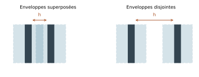
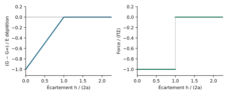
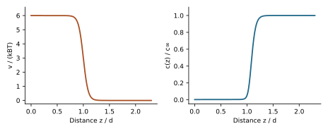
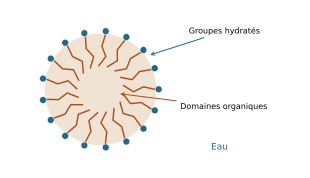
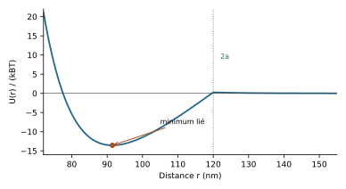
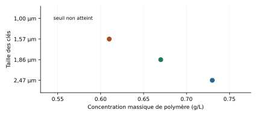
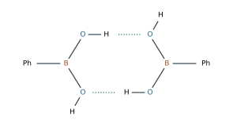
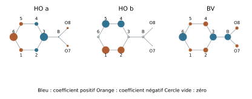

# ENS Ulm — PC, Chimie B 2016 · Corrigé guidé

*Corrigé rédigé par IA, non officiel.*

**Rédaction (tour 1)** · GPT-6.2 Astra Ultra · vitesse non renseignée

Les deux éditions corrigent entièrement 69 questions sur 94, dont toute la première partie sur les interactions de déplétion (Q1 à Q50), ainsi que Q51 à Q62, Q64 à Q66 et Q69 à Q72. Q87 traite seulement la structure de Lewis de l’ion. Les 24 questions hors couverture sont repérées individuellement. Les calculs, les tableaux et les figures ont été confrontés aux vingt pages de l’original et au rapport de l’épreuve de chimie de l’ENS Ulm.

## 1.1. Potentiels chimiques et pression osmotique

### Question 1 — Différentielle de l’enthalpie libre

> [!INDICATION]
> Quelle transformation de Legendre conduit de l’énergie interne à $G$ ?

#### Solution

Avec $G=U+PV-TS$ et $dU=T\,dS-P\,dV+\mu\,dN$ pour un système simple, **$dG=-S\,dT+V\,dP+\mu\,dN$**. $N$ est un nombre de particules et $\mu$ s’exprime en joules par particule.

### Question 2 — Définition du potentiel chimique

> [!INDICATION]
> Quelle dérivée partielle reste quand seules les particules peuvent être ajoutées ?

#### Solution

À température et pression fixées, **$\mu=(\partial G/\partial N)_{T,P}$**. Pour une phase pure homogène, l’extensivité donne de plus $G=N\mu(T,P)$.

### Question 3 — Dérivée par rapport à la pression

> [!INDICATION]
> Appliquer à $G=N\mu$ la relation $(\partial G/\partial P)_{T,N}=V$.

#### Solution

À $T$ et $N$ fixés, $N(\partial\mu/\partial P)_T=V$. Ainsi **$(\partial\mu/\partial P)_T=v=V/N$**, le volume par particule, en $\mathrm{m^3}$.

### Question 4 — Solution idéale diluée

> [!INDICATION]
> Sous quelle hypothèse le rapport d’activités est-il donné par un rapport de concentrations ?

#### Solution

Pour un soluté suffisamment dilué, les interactions entre solutés sont négligeables et le coefficient d’activité ramené à l’état de référence dilué est voisin de un. On peut alors écrire **$\mu=\mu^*(T,P)+k_BT\ln(c/c^\circ)$**. $c$ est une concentration en particules par unité de volume et $c/c^\circ$ un rapport sans dimension. Les interactions avec le solvant sont incluses dans la référence.

### Question 5 — Référence du solvant

> [!INDICATION]
> Pour le corps pur, quelle quantité multiplie le potentiel chimique dans $G_0$ ?

#### Solution

À $T,P$ fixés, **$\mu_S^*=(\partial G_0/\partial N_S)_{T,P}=G_0/N_S$** pour un système homogène extensif.

### Question 6 — Volume du solvant

> [!INDICATION]
> Quel est le sens de $v_S$ dans le sujet ?

#### Solution

Le volume particulaire $v_S$ étant défini pour le solvant pur à $T,P$ données, le volume total vaut **$V_S=N_Sv_S$**.

### Question 7 — Intégrer le potentiel du soluté

> [!INDICATION]
> Quelle est la limite de $n\ln n$ lorsque $n$ tend vers zéro ?

#### Solution

À $V$ accessible supposé constant, $G-G_0=\int_0^N[\mu^*+k_BT\ln(n/(c^\circ V))]\,dn$. Comme $n\ln n\to0$, **$G=G_0+N\mu^*+k_BT\,N[\ln(N/(c^\circ V))-1]$**. Le terme $-N$ après intégration est essentiel pour retrouver $\mu$ par dérivation.

### Question 8 — Potentiel du solvant dans le mélange

> [!INDICATION]
> Le volume $V$ est-il indépendant de $N_S$ lorsque toute la solution est accessible ?

#### Solution

Pour la dérivée par rapport à $N_S$, on pose $V=N_Sv_S$ et on garde $N,T,P$ fixes. Le terme en logarithme apporte $-k_BTN/N_S$ et $G_0$ apporte $\mu_S^*$. Donc **$\mu_S=\mu_S^*-k_BTN/N_S$**.

### Question 9 — Pression osmotique idéale

> [!INDICATION]
> Développer le potentiel du solvant pur autour de la pression $P$.

#### Solution

Au premier ordre en $\Pi$, $\mu_S^*(T,P-\Pi)=\mu_S^*(T,P)-v_S\Pi$. L’identification avec Q8 donne $v_S\Pi=k_BTN/N_S$, soit **$\Pi=k_BT\,N/V_S=k_BT c$**. On suppose que la correction de pression est petite et que $v_S$ varie négligeablement sur cet intervalle.

### Question 10 — Valeur numérique pour le polymère

> [!INDICATION]
> Convertir la longueur en mètres avant de prendre le cube.

#### Solution

$c=(120\times10^{-9}\ \mathrm m)^{-3}=5{,}79\times10^{20}\ \mathrm{m^{-3}}$. À 300 K, $k_BT=4{,}14\times10^{-21}\ \mathrm J$, d’où **$\Pi=2{,}40\ \mathrm{Pa}$** puisque $\mathrm{J\,m^{-3}=Pa}$.

## 1.2. Plaques parallèles et volume exclu

### Question 11 — Volume accessible entre deux plaques

> [!INDICATION]
> Le logarithme compte-t-il le volume du solvant ou les positions permises aux centres des polymères ?

#### Solution

À écartement $h$ fixé, les centres des polymères disposent du volume **$V_{\rm acc}=V_S-V_{\rm exc}(h)$**. En substituant ce volume dans Q7, on obtient $G(h)=G_0+N\mu^*+k_BTN[\ln(N/(c^\circ V_{\rm acc}))-1]$. Toute la dépendance en $h$ du modèle entre dans $V_{\rm acc}$.

### Question 12 — Développement à faible volume exclu

> [!INDICATION]
> Isoler le terme $-\ln(1-V_{\rm exc}/V_S)$.

#### Solution

Pour $V_{\rm exc}\ll V_S$, $-\ln(1-V_{\rm exc}/V_S)\simeq V_{\rm exc}/V_S$. Avec $c=N/V_S$, il vient **$G\simeq G_0+N\mu^*+k_BTN[\ln(c/c^\circ)-1]+k_BT cV_{\rm exc}$**. Une augmentation du volume exclu est défavorable de $\Pi\,\Delta V_{\rm exc}$.

### Question 13 — Géométrie des volumes exclus

> [!INDICATION]
> Compter les deux enveloppes extérieures puis le recouvrement entre les plaques.

#### Solution

Chaque plaque isolée exclut une bande d’épaisseur $e+2a$ aux centres, en négligeant les bords. Si $h\geq2a$, **$V_{\rm exc}=2(e+2a)\Sigma$**. Si $0\leq h<2a$, les deux couches de hauteur $a$ se recouvrent sur $2a-h$, d’où **$V_{\rm exc}=(2e+2a+h)\Sigma$**. Les deux expressions coïncident en $h=2a$.

### Question 14 — Énergie relativement à des plaques séparées

> [!INDICATION]
> Quel terme de Q12 subsiste quand on soustrait $G_\infty$ ?

#### Solution

La différence vaut $\Pi[V_{\rm exc}(h)-V_{\rm exc}(\infty)]$. Pour $h\geq2a$, **$G-G_\infty=0$**. Pour $h<2a$, **$G-G_\infty=k_BT c\Sigma(h-2a)$**. Le signe est négatif quand les deux enveloppes se recouvrent.

### Question 15 — Allure du potentiel de déplétion

> [!INDICATION]
> Que valent les ordonnées au contact et en $2a$ ?

#### Solution

Le graphe part de $G_\infty-2a\Pi\Sigma$ à $h=0$, monte **linéairement** avec pente $\Pi\Sigma$ jusqu’à $G_\infty$ en $h=2a$, puis forme un plateau horizontal. Le potentiel est continu mais présente une rupture de pente dans cette idéalisation de sphères dures.

### Question 16 — Sens de la force

> [!INDICATION]
> Dans quel sens les plaques se déplacent-elles si $G$ peut décroître ?

#### Solution

Pour $0<h<2a$, la force associée à la coordonnée $h$ est $F_h=-\partial_hG=-\Pi\Sigma<0$. L’interaction est **attractive** et tend à diminuer l’écartement. Pour $h>2a$, la force de déplétion est nulle dans le modèle.

### Question 17 — Travail fourni aux plaques

> [!INDICATION]
> Employer la variation de $G$ dans le sens fixé par la convention « fourni ».

#### Solution

Pour $h_1,h_2<2a$, **$W_{\rm fourni}=G(h_1)-G(h_2)=-\Pi\Sigma(h_2-h_1)$**. C’est le travail d’une force de valeur $\Pi\Sigma$ dirigée vers la fermeture. Le milieu fournit un travail positif lorsque les plaques se rapprochent.

### Question 18 — Profondeur du puits

> [!INDICATION]
> Quel travail extérieur réversible doit compenser l’attraction jusqu’au plateau ?

#### Solution

La profondeur est **$E_{\rm dép}=G_\infty-G(0)=2a\Pi\Sigma=2ak_BT c\Sigma>0$**. L’énergie d’interaction au contact, avec le plateau pour zéro, est égale à $-E_{\rm dép}$.

### Question 19 — Échelle énergétique de déplétion

> [!INDICATION]
> Ne pas confondre un micromètre carré avec un micromètre.

#### Solution

Avec $2a=1{,}20\times10^{-7}$ m, $\Sigma=1{,}20\times10^{-12}\ \mathrm{m^2}$ et $\Pi\simeq2{,}40$ Pa, **$E_{\rm dép}=3{,}45\times10^{-19}\ \mathrm J$**, soit **$83{,}3\,k_BT$**. Cette valeur est la seule contribution de déplétion au contact.

### Question 20 — Entropie et écartement

> [!INDICATION]
> Dériver la différence d’énergie libre par rapport à $T$ à géométrie et concentration fixes.

#### Solution

Dans le modèle de sphères dures et de volume supposé constant, pour $h<2a$, **$S(h)-S_\infty=k_Bc\Sigma(2a-h)$** puisque $S=-(\partial G/\partial T)_{P,N_S,N,h}$. Pour $h\geq2a$, la différence est nulle. La faible dilatation thermique du solvant et la dépendance éventuelle de $a$ en $T$ sont négligées à ce stade.

### Question 21 — Origine de l’attraction

> [!INDICATION]
> Quel terme de $\Delta G=\Delta H-T\Delta S$ reste dans le modèle ?

#### Solution

Les résultats précédents donnent **$G(h)-G_\infty=-T[S(h)-S_\infty]$**. La différence d’enthalpie correspondante est nulle. Rapprocher les plaques libère de l’espace pour les centres des polymères, accroît leur entropie de translation et abaisse $G$.

## 1.3. Paroi dans un potentiel extérieur

### Question 22 — Équilibre du solvant à proximité d’une paroi

> [!INDICATION]
> Le solvant est-il directement soumis au potentiel extérieur ?

#### Solution

Le champ extérieur considéré agit sur le soluté seul. À température fixée et à l’équilibre diffusif, le **potentiel chimique du solvant est spatialement constant**, soit $d\mu_S/dz=0$.

### Question 23 — Somme des pressions

> [!INDICATION]
> Quelle pression de solvant pur représente ce même potentiel chimique à toutes les altitudes ?

#### Solution

Définissons $P_S$ par $\mu_S^*(T,P_S)=\mu_S$, constant. Q9 donne localement $\mu_S=\mu_S^*(T,P(z)-\Pi(z))$. Comme $\partial_P\mu_S^*=v_S>0$, **$P(z)=P_S+k_BT c(z)$**.

### Question 24 — Force extérieure sur une tranche

> [!INDICATION]
> Combien de particules de soluté y a-t-il dans une tranche d’épaisseur $dz$ ?

#### Solution

La tranche contient $c(z)\Sigma\,dz$ particules. Chacune subit $-v'(z)\mathbf e_z$. La force de la paroi sur son soluté vaut **$d\mathbf F_{P/S}=-c(z)\Sigma v'(z)\,dz\,\mathbf e_z$**.

### Question 25 — Équilibre mécanique local

> [!INDICATION]
> Additionner la pression sur la face gauche, celle sur la face droite et la force extérieure.

#### Solution

À l’équilibre, $[P(z)-P(z+dz)]\Sigma-c(z)v'(z)\Sigma dz=0$, donc $P'(z)=-c(z)v'(z)$. Avec Q23, **$c'(z)=-\beta c(z)v'(z)$**, où $\beta=(k_BT)^{-1}$.

### Question 26 — Profil de Boltzmann

> [!INDICATION]
> Quelle constante d’intégration impose la condition loin de la paroi ?

#### Solution

En intégrant $d\ln c=-\beta\,dv$ entre l’infini et $z$, avec $v(\infty)=0$ et $c(\infty)=c_\infty$, on trouve **$c(z)=c_\infty e^{-\beta v(z)}$**.

### Question 27 — Zone inaccessible au soluté

> [!INDICATION]
> Que devient une exponentielle de grand argument négatif ?

#### Solution

Pour $z<d$, $c/c_\infty=e^{-V_0/(k_BT)}\ll1$ lorsque $V_0\gg k_BT$. La région est pratiquement **dépeuplée en soluté**, bien qu’elle puisse contenir du solvant.

### Question 28 — Action du soluté sur la paroi

> [!INDICATION]
> Appliquer l’action-réaction avant de remplacer $cv'$ par une dérivée de concentration.

#### Solution

La force de la tranche sur la paroi est l’opposée de celle de Q24. Donc **$d\mathbf F_{S/P}=c(z)v'(z)\Sigma dz\,\mathbf e_z=-k_BT\Sigma c'(z)dz\,\mathbf e_z$**.

### Question 29 — Force osmotique intégrée

> [!INDICATION]
> Quelle différence de concentrations subsiste quand on intègre la dérivée sur toute la solution ?

#### Solution

L’intégrale entre 0 et l’infini vaut $-k_BT\Sigma[c_\infty-c(0)]\mathbf e_z$. Dans la limite d’exclusion $c(0)\simeq0$, **$\mathbf F_{S/P}=-k_BT c_\infty\Sigma\mathbf e_z=-\Pi\Sigma\mathbf e_z$**. La force pousse la paroi vers les $z$ décroissants.

### Question 30 — Retour aux deux plaques

> [!INDICATION]
> Comparer les pressions osmotiques sur les deux faces quand aucune particule ne tient dans l’intervalle.

#### Solution

Pour $h<2a$, le soluté est exclu de l’entrefer alors qu’il exerce une pression osmotique $\Pi$ sur les faces extérieures. La force nette ferme chaque plaque et la force généralisée en $h$ vaut **$-\Pi\Sigma$**. Son travail entre deux écartements redonne Q17.

### Question 31 — Contribution directe à travers une interface virtuelle

> [!INDICATION]
> Commencer cette fois l’intégrale de la force sur la paroi à $z_0$.

#### Solution

La partie du soluté située à droite exerce directement sur la paroi $\mathbf F_{S/P}(z_0)=\Sigma\int_{z_0}^{\infty}c(z)v'(z)\,dz\,\mathbf e_z$. En utilisant Q25, **$\mathbf F_{S/P}(z_0)=-k_BT\Sigma[c_\infty-c(z_0)]\mathbf e_z$**.

### Question 32 — Pression locale du soluté

> [!INDICATION]
> Quel côté impose la direction de la force sur le milieu à gauche ?

#### Solution

Le gaz dilué de soluté exerce à l’interface la pression locale $k_BT c(z_0)$. Sa contribution de la droite sur la gauche vaut **$\mathbf F_{S/S}(z_0)=-k_BT c(z_0)\Sigma\mathbf e_z$**. Il s’agit de la composante osmotique de la pression.

### Question 33 — Indépendance de la section

> [!INDICATION]
> Qu’advient-il des deux termes contenant $c(z_0)$ ?

#### Solution

La somme de Q31 et Q32 est **$\mathbf F(z_0)=-k_BT c_\infty\Sigma\mathbf e_z$**, indépendante de l’emplacement de la coupe. Déplacer l’interface ajoute une tranche en équilibre mécanique et ne change donc pas la résultante transmise. La valeur peut également se lire très loin de la paroi, où ne subsiste que la force de pression osmotique.

## 1.4. Polymères et colloïdes clé–serrure

### Question 34 — Motif du PEG et degré de polymérisation

> [!INDICATION]
> Combien pèse le motif $\mathrm{C_2H_4O}$ ?

#### Solution

Le motif est **$\mathrm{-CH_2-CH_2-O-}$**, de masse molaire $44\ \mathrm{g\,mol^{-1}}$. En négligeant les groupes terminaux, $N_{\rm unités}=600\,000/44\simeq\mathbf{1{,}36\times10^4}$. En l’absence de monodispersité, c’est un degré moyen en nombre.

### Question 35 — Concentration massique et nombre de chaînes

> [!INDICATION]
> Combien de micromètres cubes contient un litre ?

#### Solution

Une concentration de $1\ \mathrm{g\,L^{-1}}$ représente $N_A/(6{,}00\times10^5)$ chaînes par litre. Comme $1\ \mathrm L=10^{15}\ \mathrm{\mu m^3}$, le facteur est **$1{,}00\times10^3$ chaînes par µm³ pour $1\ \mathrm{g\,L^{-1}}$**. Dans l’autre sens, une chaîne par µm³ correspond à environ $9{,}97\times10^{-4}\ \mathrm{g\,L^{-1}}$.

### Question 36 — Transformation des groupes du silane

> [!INDICATION]
> Quelles liaisons du motif triméthoxysilane sont concernées ?

#### Solution

L’hydrolyse remplace les groupes **Si–OCH₃ par des groupes silanol Si–OH**. Le bilan idéal pour les trois sites d’un motif $\mathrm{RSi(OCH_3)_3}$ est $\mathrm{RSi(OCH_3)_3+3H_2O\rightleftharpoons RSi(OH)_3+3CH_3OH}$. Le groupe organique R reste lié au silicium dans ce bilan.

### Question 37 — Réseaux siloxanes

> [!INDICATION]
> Quels solides possèdent un squelette formé de tétraèdres SiO₄ reliés par des oxygènes ?

#### Solution

Les **silices** telles que quartz ou verre de silice présentent des ponts Si–O–Si. De nombreux silicates et les **silicones** comportent également des enchaînements siloxanes.

### Question 38 — Organisation d’une gouttelette

> [!INDICATION]
> Quels groupes peuvent être hydratés au contact de l’eau ?

#### Solution

Dans l’émulsion aqueuse, les domaines organiques relativement hydrophobes des oligomères se regroupent vers l’intérieur. Les groupes silanols polaires ou ionisés sont préférentiellement exposés à l’eau et peuvent former des liaisons hydrogène. La figure représente cette **organisation interfaciale moyenne**. Les oligomères d’une gouttelette ne constituent pas nécessairement une monocouche micellaire parfaite.

### Question 39 — Cohésion de la goutte et stabilité de la dispersion

> [!INDICATION]
> Distinguer les interactions au cœur de la phase dispersée et celles à son interface.

#### Solution

Les interactions de dispersion entre domaines organiques et l’effet hydrophobe favorisent leur regroupement en milieu aqueux. Les silanols interagissent avec l’eau par liaisons hydrogène et avec d’autres sites polaires. L’hydratation de surface et la répulsion électrostatique de groupes ionisés peuvent limiter la coalescence. Les ponts Si–O–Si issus de la condensation sont des liaisons covalentes, distinctes de ces interactions intermoléculaires.

### Question 40 — Variation du volume lors de la polymérisation

> [!INDICATION]
> Comparer les distances entre unités avant et après formation de liaisons covalentes.

#### Solution

La conversion des doubles liaisons acrylates relie des unités par des liaisons covalentes C–C. Les distances d’équilibre entre unités liées deviennent plus petites que les séparations intermoléculaires initiales et le volume libre diminue généralement. Le **retrait** peut provoquer le flambage d’une enveloppe qui ne se contracte pas de manière uniforme et faire apparaître la cavité.

### Question 41 — Minimum du potentiel clé–serrure

> [!INDICATION]
> Écrire séparément l’annulation de la dérivée, l’appartenance à $0<r<2a$ et la comparaison avec un état très éloigné.

#### Solution

Posons $F_0=\Pi\Sigma$ et $E_C=E_{\rm Coul}$. Dans la zone $r<2a$, $U'=-(E_C/\lambda)e^{-r/\lambda}+F_0$ et $U''>0$. Un minimum intérieur existe si **$1<E_C/(\lambda F_0)<e^{2a/\lambda}$**, avec $r_{\rm eq}=\lambda\ln[E_C/(\lambda F_0)]$. Alors **$U_{\rm liaison}=F_0(\lambda+r_{\rm eq}-2a)$** car $E_Ce^{-r_{\rm eq}/\lambda}=\lambda F_0$. Pour une paire plus stable que l’état séparé, il faut aussi $r_{\rm eq}+\lambda<2a$. Numériquement, $E_C=6{,}72\times10^{-16}$ J, $F_0=2{,}88\times10^{-12}$ N, **$r_{\rm eq}=91{,}5$ nm et $U_{\rm liaison}\simeq-5{,}61\times10^{-20}$ J**, soit $-13{,}55\,k_BT$. Si le minimum formel sort de l’intervalle, il faut comparer le contact et la séparation directement.

### Question 42 — Transition observée avec le microgel

> [!INDICATION]
> Le rayon du déplétant a-t-il le même effet sur la portée de l’attraction et sur la répulsion électrostatique ?

#### Solution

Sous la transition de la figure 9, les capsules gonflées ont un plus grand rayon $a$. Le recouvrement des volumes exclus peut alors produire un puits attractif. En chauffant, les capsules se déshydratent et leur rayon diminue, notamment aux environs de **39 °C** sur la figure. La portée $2a$ et la profondeur de l’attraction à concentration donnée diminuent. Le bilan avec la répulsion peut alors ne plus donner de puits favorable aux paires.

### Question 43 — Population du volume de liaison

> [!INDICATION]
> Utiliser le facteur de Boltzmann avec une énergie $U_{\rm liaison}<0$.

#### Solution

Pour des clés libres à concentration voisine de $c_{0,c}$, la concentration locale dans le puits est **$c_{\rm liaison}=c_{0,c}e^{-\beta U_{\rm liaison}}$**. Le nombre moyen de clés dans le petit volume vaut **$N_{\rm paires}\simeq c_{0,c}V_{\rm liaison}e^{-\beta U_{\rm liaison}}$**, lorsque l’occupation d’une serrure reste faible.

### Question 44 — Concentration de paires au début de l’association

> [!INDICATION]
> Combien de serrures indépendantes apportent chacune la même occupation moyenne ?

#### Solution

En multipliant l’occupation de Q43 par la concentration initiale $c_{0,s}$ des serrures, on trouve **$c_p\simeq V_{\rm liaison}e^{-\beta U_{\rm liaison}}c_{0,s}c_{0,c}$** à faible fraction de paires. Les concentrations libres remplacent les concentrations initiales lorsqu’une immobilisation appréciable doit être prise en compte.

### Question 45 — Constante d’association sans dimension

> [!INDICATION]
> Introduire l’activité de chaque espèce, y compris la paire, avant de comparer à Q44.

#### Solution

$K=(c_p/c^\circ)/[(c_s/c^\circ)(c_c/c^\circ)]=c^\circ c_p/(c_sc_c)$. Le modèle donne **$K=c^\circ V_{\rm liaison}e^{-\beta U_{\rm liaison}}$**. Comme $125\times10^3\ \mathrm{nm^3}=1{,}25\times10^{-4}\ \mathrm{\mu m^3}$, avec $c^\circ=1\ \mathrm{\mu m^{-3}}$ et $\beta U_{\rm liaison}=-13{,}55$, **$K\simeq96$**. L’exponentielle rend ce résultat sensible à l’arrondi du puits.

### Question 46 — Fraction de serrures occupées

> [!INDICATION]
> Les clés sont en excès, mais peut-on assimiler la concentration en serrures libres à leur concentration totale ?

#### Solution

Les clés libres gardent $c_c\simeq c_{0,c}=1/125\ \mathrm{\mu m^{-3}}$. Avec $c_{0,s}=c_s+c_p$, la fraction est **$f=K(c_c/c^\circ)/[1+K(c_c/c^\circ)]$**. Ici $Kc_c/c^\circ\simeq0{,}77$ et **$f\simeq0{,}435$**, environ 44 %. Prendre directement 0,77 pour la fraction appliquerait l’approximation d’occupation faible de Q43 hors de son domaine.

### Question 47 — Effet de la surface de contact

> [!INDICATION]
> La surface figure-t-elle dans le rapport $E_C/F_0$ qui fixe la position du minimum ?

#### Solution

$E_C=A_{\rm Coul}\Sigma$ et $F_0=\Pi\Sigma$, donc $r_{\rm eq}=\lambda\ln[A_{\rm Coul}/(\lambda\Pi)]$ ne dépend pas de $\Sigma$. En revanche **$U_{\rm liaison}=\Sigma\Pi(\lambda+r_{\rm eq}-2a)$**. Si le puits est attractif, augmenter l’aire de contact le rend plus profond et $K$ augmente exponentiellement. Une clé bien ajustée bénéficie ainsi d’une plus grande surface efficace.

### Question 48 — Effet de la concentration en polymère

> [!INDICATION]
> Pour un écartement fixé dans la zone attractive, comment évolue le terme de déplétion lorsque $c$ augmente ?

#### Solution

Pour $r<2a$, $\partial U/\partial c=k_BT\Sigma(r-2a)<0$. Le minimum peut ainsi s’abaisser quand $c$ augmente. À température fixée, **$K$ augmente** dans le régime de puits attractif. Avec des clés libres en excès, $f=x/(1+x)$ où $x=Kc_c/c^\circ$. On attend une montée de la fraction de paires après un régime de faible occupation, puis une saturation. La valeur du plateau expérimental dépend aussi des populations réellement disponibles et des limites du modèle.

### Question 49 — Sélectivité en taille observée

> [!INDICATION]
> Comparer les courbes pour un même titre en polymère et relever celle dont la montée commence le plus tôt.

#### Solution

La courbe du rayon **1,57 µm** est la plus précoce. À concentration donnée dans la zone de transition elle présente la plus forte fraction liée. Les rayons 1,86 puis 2,47 µm demandent davantage de polymère et le rayon 1,00 µm donne très peu de paires dans la fenêtre mesurée. Le rayon 1,57 µm est donc celui qui s’ajuste le mieux parmi les quatre tailles de la figure 10.

### Question 50 — Séparation par affinité de forme

> [!INDICATION]
> Comment exploiter un écart de fraction liée si les courbes se recouvrent partiellement ?

#### Solution

Des serrures adaptées aux clés proches de 1,57 µm permettent d’enrichir une fraction liée dans la zone où leur courbe de liaison monte avant les autres. Une séparation physique des serrures portant les clés d’avec la fraction libre, puis une diminution de l’attraction pour libérer la fraction capturée, donne une **sélection par affinité géométrique**. Les distributions se recouvrent. On obtient un enrichissement en tailles voisines et sa sélectivité se vérifierait en mesurant la distribution des rayons.

## 2.1. Structures et spectres des acides boroniques

### Question 51 — Lewis du bore tricoordonné

> [!INDICATION]
> Combien d’électrons entourent B si les trois liaisons sont simples ?

#### Solution

Dans $\mathrm{CH_3-B(OH)_2}$ ou $\mathrm{C_6H_5-B(OH)_2}$, le bore porte trois liaisons simples, une vers C et deux vers les O. Chaque O possède **deux doublets non liants** et une liaison à H. Toutes les charges formelles sont nulles. B ne possède que six électrons de liaison autour de lui, sans doublet libre, et une **orbitale p vacante** perpendiculaire au plan trigonal.

### Question 52 — Caractère de la liaison B–C

> [!INDICATION]
> Comparer la dispersion des longueurs à l’écart ordinaire entre liaison simple et liaison multiple.

#### Solution

Les quatre $d_{\rm B-C}$ vont de **155,2 à 157,1 pm**. Les alkyles ont essentiellement une liaison $\sigma$. Pour les aryles, des formes limites par donation du cycle vers l’orbitale vide de B suggèrent une contribution $\pi$ et une liaison formellement multiple dans certaines écritures. On ne voit toutefois aucun raccourcissement net et systématique de l’aryle par rapport à l’alkyle. L’écart de moins de 2 pm ne démontre donc pas une forte liaison double B=C.

### Question 53 — Association dans le cristal

> [!INDICATION]
> Quels atomes sont donneurs de liaison hydrogène et quels atomes disposent de doublets accepteurs ?

#### Solution

Deux molécules de $\mathrm{PhB(OH)_2}$ peuvent s’associer en **dimère par deux liaisons O–H···O réciproques**. Chaque molécule fournit un site donneur et un site accepteur dans le cycle d’association. Les doublets d’O acceptent le proton donneur d’une liaison hydrogène. Les contacts de dispersion participent également à la cohésion du solide.

### Question 54 — Signature IR du dimère

> [!INDICATION]
> Comparer la large absorption des OH et la région des vibrations du squelette contenant B–O.

#### Solution

La bande large de l’acide, centrée vers **3 300 cm⁻¹** (large domaine d’environ 3 000 à 3 600), traduit des O–H associés par liaison hydrogène. Elle est compatible avec la dimérisation observée au solide, sans prouver seule la seule géométrie du dimère. La bande vers **1 350 cm⁻¹** peut comporter une forte contribution d’élongation B–O, éventuellement couplée aux déformations du motif B–OH. La persistance d’une absorption forte dans cette région pour la boroxine, dépourvue de OH, appuie la participation de B–O.

### Question 55 — Identification de la boroxine

> [!INDICATION]
> Combien de motifs $\mathrm{PhBO}$ retrouve-t-on dans la formule brute ?

#### Solution

La formule est celle de **$(\mathrm{PhBO})_3$**, cycle à six chaînons alternant trois B et trois O, avec un phényle sur chaque B. Le bilan de composition est $3\,\mathrm{PhB(OH)_2}\rightleftharpoons(\mathrm{PhBO})_3+3\,\mathrm{H_2O}$. Le spectre conserve les vibrations des phényles et les fortes bandes du squelette B–O, tandis que la large absorption OH disparaît pratiquement.

### Question 56 — Acidité de Lewis au niveau de B

> [!INDICATION]
> Dans quel sens sont polarisées les liaisons de B à O et C, et où se trouve l’orbitale acceptrice ?

#### Solution

O et C sont plus électronégatifs que B. Le bore tricoordonné est déficient en densité électronique et possède une orbitale p vacante. C’est un **centre électrophile et acide de Lewis**, susceptible d’accepter un doublet. $\mathrm{BF_3}$, l’acide borique et des cations métalliques fournissent d’autres exemples d’accepteurs de doublet.

### Question 57 — Lecture des trois orbitales frontières

> [!INDICATION]
> Comparer en priorité le module du coefficient sur B dans les deux HO et dans la BV.

#### Solution

Sur B les coefficients des deux orbitales occupées sont **0,02 et 0**, contre **0,12 pour la BV**. Les HO sont surtout portées par le système $\pi$ du cycle, avec des alternances de signe. La BV présente un lobe notable sur B et sur certains carbones du cycle. La figure reprend les neuf coefficients de chacune des trois orbitales sur une même échelle. Un nucléophile peut donner de la densité dans cette BV, ce qui rend compte de l’acidité de Lewis du bore. Le signe global de chaque orbitale est arbitraire.

### Question 58 — Deux types d’acidité

> [!INDICATION]
> Distinguer le transfert d’un proton et l’addition d’un doublet sur B.

#### Solution

Comme acide de Brønsted, $\mathrm{PhB(OH)_2+OH^-\rightleftharpoons PhB(OH)O^-+H_2O}$ produit une forme tricoordonnée. Comme acide de Lewis, $\mathrm{PhB(OH)_2+OH^-\rightleftharpoons[PhB(OH)_3]^-}$ donne un **adduit tétracoordonné**. Ces deux écritures distinguent des structures différentes d’anions.

### Question 59 — Géométrie de l’anion en solution

> [!INDICATION]
> Comparer le déplacement du bore à ceux des références trigonales et tétraédriques du tableau.

#### Solution

L’anion phénylboronate donne **2,6 ppm**, voisin de $[\mathrm{B(OH)_4}]^-$ à 1,6 ppm et très éloigné de l’acide phénylboronique trigonal à 28,9 ppm. La forme prédominante est donc le **boronate tétraédrique $[\mathrm{PhB(OH)_3}]^-$**.

### Question 60 — Acidités relatives des acides boroniques

> [!INDICATION]
> Quels effets stabilisent l’adduit tétraédrique ou favorisent sa formation à partir de la forme trigonale ?

#### Solution

L’ordre d’acidité croissante donné par les $pK_a$ est **Me (10,4), ortho-MeO–Ph (9,7), para-Me–Ph (9,3), Ph (8,9), composé cyclique (7,3), para-NO₂–Ph (7,1)**. Le méthyle donne de la densité et diminue l’affinité de B pour le nucléophile. Le nitro attracteur augmente cette affinité et favorise relativement la forme anionique. L’ortho-méthoxy combine donation et interactions de proximité, y compris la possibilité de stabiliser la forme neutre ou de gêner l’approche de l’eau. Dans le dérivé cyclique, les contraintes de géométrie du cycle peuvent favoriser le passage au centre tétraédrique. Les valeurs mesurent toujours la différence de stabilité des deux états en solution.

### Question 61 — Comparaison avec des oxoacides

> [!INDICATION]
> Comment se forme majoritairement la base conjuguée aqueuse dans les deux familles ?

#### Solution

Les acides boroniques ont ici des $pK_a$ d’environ 7 à 10, proches de l’acide borique (9,0), et sont en général plus faibles que l’acide acétique (4,8) et que la première acidité du méthylphosphonique (2,2). La deuxième acidité phosphonique (7,5) recouvre certaines valeurs boroniques. Le trait structural distinctif est la fixation d’hydroxyde avec changement de coordinence de B. Les acides carboxyliques et phosphoniques libèrent un proton depuis OH en formant une base conjuguée dont la charge est répartie sur des oxygènes. Deux OH sur B ne signifient donc pas automatiquement deux acidités successives analogues à celles d’un acide phosphonique.

### Question 62 — Addition d’un nucléophile au bore

> [!INDICATION]
> Quelle géométrie et quelle charge prévoit-on après apport d’un doublet par un anion ?

#### Solution

Le bilan de Lewis s’écrit **$\mathrm{PhB(OH)_2+Nu^-\rightleftharpoons[PhB(OH)_2Nu]^-}$**. Pour $\mathrm{Nu^- = F^-}$, on obtient $[\mathrm{PhB(OH)_2F}]^-$. Le bore passe de trois à quatre voisins et tend vers la géométrie tétraédrique.

*Question 63 hors couverture.*

### Question 64 — Influence électronique du fluor

> [!INDICATION]
> Comment les substituants électronégatifs modifient-ils le caractère accepteur du bore ?

#### Solution

Les fluors retirent de la densité électronique par induction. Dans ce dérivé, leur effet global renforce le caractère **acide de Lewis** du site boronique et sa capacité à fixer un donneur oxygéné par rapport à l’analogue phényle non fluoré. Cette comparaison porte sur la propriété électronique des deux catalyseurs.

## 2.2. Coordination et propriétés électroniques des ligands

### Question 65 — Nature des étapes 1 et 3 du cycle

> [!INDICATION]
> Suivre le degré d’oxydation du Pd et le nombre de ligands liés lors des deux étapes.

#### Solution

L’étape 1 est une **addition oxydante** : le métal forme deux liaisons et passe de Pd(0) à Pd(II). L’étape 3 est une **élimination réductrice** : deux groupes ligands forment une liaison entre eux et quittent le métal, qui repasse de Pd(II) à Pd(0). Le degré d’oxydation est un bilan formel de charges.

### Question 66 — Coordination et comptage électronique du palladium

> [!INDICATION]
> Le ligand phosphine est-il chargé et combien d’électrons donne-t-il dans le comptage ionique ?

#### Solution

Pd est dans le groupe 10. $\mathrm{Pd^0}$ est $d^{10}$ et une phosphine neutre apporte deux électrons. **$n=4$** conduit à 18 électrons, tandis que $n=3$ ou $n=2$ correspondent à des espèces insaturées de 16 ou 14 électrons, notamment possibles au cours d’un cycle. Le précurseur $\mathrm{PdL_n}$ est à 0. Les deux complexes portant deux ligands anioniques (aryle et halogénure, puis deux groupes carbonés) sont à **+II**, les phosphines restant neutres.

*Question 67 hors couverture.*

*Question 68 hors couverture.*

### Question 69 — CO comme ligand

> [!INDICATION]
> Comment répartir dix électrons de valence en donnant un octet à C et à O ?

#### Solution

La structure usuelle est **$\mathrm{^-{:}C\equiv O{:}^+}$**, avec un doublet non liant par atome et aucun octet incomplet. CO coordonne le plus souvent par C. Il est **donneur $\sigma$** par son doublet et **accepteur $\pi$** dans ses orbitales $\pi^*$, qui peuvent recevoir de la densité électronique du métal.

### Question 70 — Triphénylphosphine comme ligand

> [!INDICATION]
> Quel atome porte le doublet qui se coordonne au métal ?

#### Solution

P est lié par trois liaisons simples aux carbones ipso de trois phényles, et porte **un doublet non liant**. La phosphine libre est pyramidale, neutre et sans lacune au sens de la formule de Lewis usuelle. $\mathrm{PPh_3}$ est un ligand donneur $\sigma$ de deux électrons. Ses capacités d’acceptation dépendent des substituants et sont généralement moins marquées que la forte acceptation $\pi$ de CO.

### Question 71 — Paramètre électronique infrarouge

> [!INDICATION]
> Relier la donation de L, la rétrodonation du métal aux CO et la constante de force interne de C–O.

#### Solution

Une phosphine plus donneuse enrichit le métal, qui rétrodonne davantage vers $\pi^*_{\rm CO}$. La liaison interne C–O s’affaiblit et son nombre d’onde diminue. Pour $\mathrm{PCl_3}$, $\mathrm{PPhCl_2}$, $\mathrm{PPh_2Cl}$ et $\mathrm{PPh_3}$, la série donne respectivement **2 097,0, 2 092,1, 2 080,7 et 2 068,9 cm⁻¹**. Le remplacement de Cl par Ph augmente donc le pouvoir donneur net dans ce test.

### Question 72 — Classements stérique et électronique

> [!INDICATION]
> Quel ordre est donné par l’angle de cône et quel ordre par une diminution de la fréquence de CO ?

#### Solution

Par angle de cône croissant, l’encombrement suit **$\mathrm{PPh_3}$ (145°), $\mathrm{PCy_3}$ (170°), $\mathrm{P(tBu)_3}$ (182°), $\mathrm{P(o\!-\!tol)_3}$ (194°)**. Par pouvoir donneur net croissant, la série est **$\mathrm{PPh_3<P(o\!-\!tol)_3<PCy_3\lesssim P(tBu)_3}$**, d’après 2 068,9, 2 066,6, 2 056,4 et 2 056,1 cm⁻¹. Les deux dernières sont pratiquement équivalentes à la précision utile de ce paramètre.

*Question 73 hors couverture.*

*Question 74 hors couverture.*

*Question 75 hors couverture.*

## 2.3. Applications et portée des questions restantes

*Question 76 hors couverture.*

*Question 77 hors couverture.*

*Question 78 hors couverture.*

*Question 79 hors couverture.*

*Question 80 hors couverture.*

*Question 81 hors couverture.*

*Question 82 hors couverture.*

*Question 83 hors couverture.*

*Question 84 hors couverture.*

*Question 85 hors couverture.*

*Question 86 hors couverture.*

### Question 87 — Structure électronique de l’ion azoture

> [!INDICATION]
> Combien d’électrons de valence contient l’ion triatomique ?

#### Solution

**Partie traitée : structure de Lewis.** $\mathrm{N_3^-}$ compte 16 électrons de valence. Une forme symétrique est $\mathrm{^-N=N^+=N^-}$, avec deux doublets libres sur chacun des N terminaux. D’autres formes à octets complets ont une liaison triple à une extrémité et une simple à l’autre. Le squelette N–N–N est linéaire et la charge délocalisée. Les étapes de transformation demandées dans la suite de la question restent hors couverture.

*Question 88 hors couverture.*

*Question 89 hors couverture.*

*Question 90 hors couverture.*

*Question 91 hors couverture.*

*Question 92 hors couverture.*

*Question 93 hors couverture.*

*Question 94 hors couverture.*
