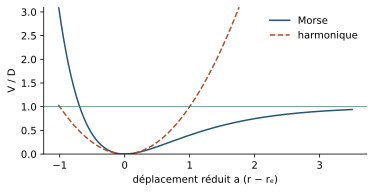
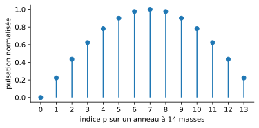
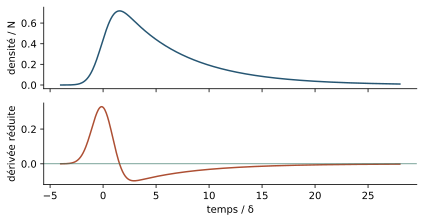
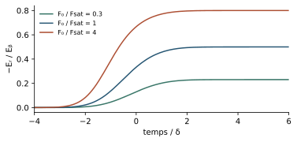
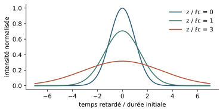
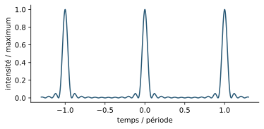

# ENS Ulm PC 2016 — Physique C · Corrigé brut

*Corrigé rédigé par IA, non officiel. Signalez toute erreur.*

**Lecture du rapport du jury** · GPT-6.2 Astra Ultra · vitesse non renseignée

**Rédaction** · GPT-6.2 Astra Ultra · vitesse non renseignée

## Impulsions ultracourtes et interactions avec la matière

**Corrigé partiel.** Questions 1 à 38 et 40 à 54 traitées sur les 54 du sujet. La question 39, sur le seuil et la profondeur d’enlèvement du métal, est hors de cette édition.

## Vibrations moléculaires et collectives

### Question 1 — Équilibre de liaison

Le potentiel étant un carré positif, son minimum est atteint lorsque $e^{-a(r-r_e)}=1$, donc $r_{\rm éq}=r_e$. Sa valeur y est nulle dans la convention du sujet.

### Question 2 — Oscillations près du minimum

Posons $r=r_e+\varepsilon$. Alors $1-e^{-a\varepsilon}=a\varepsilon+O(\varepsilon^2)$ et $V=Da^2\varepsilon^2+O(\varepsilon^3)$. La force radiale vaut $-2Da^2\varepsilon$ au premier ordre. On identifie $k=2Da^2$ et, pour la masse réduite $\mu$, $\omega_0=a\sqrt{2D/\mu}$.

### Question 3 — Puits et dissociation

Avec $u=a(r-r_e)$, le tracé compare $V/D=(1-e^{-u})^2$ à $u^2$. Les deux courbes ont la même courbure près de zéro. À gauche le mur répulsif est raide et à droite le vrai potentiel tend vers 1. La profondeur $D$ est l’énergie nécessaire pour séparer les atomes à partir du minimum classique. Depuis le fondamental quantique il faut $D-E_0$.

### Question 4 — Intervalles vibrationnels

Notons $X=\hbar\omega_0$. La soustraction des énergies donne $E_{i\to j}=(j-i)X[1-X(i+j+1)/(4D)]$. Pour $j=i+1$, on trouve $\Delta_i=X[1-X(i+1)/(2D)]$. L’oscillateur harmonique a au contraire $\Delta_i=X$. Le resserrement des niveaux du potentiel de Morse accompagne l’approche de la dissociation, pour les états liés du modèle.

### Question 5 — Inversion des deux transitions

Notons $A=E_{0\to1}$ et $B=E_{0\to2}$. Les expressions précédentes donnent $A=X-X^2/(2D)$ et $B=2X-3X^2/(2D)$. D’où $2A-B=X^2/(2D)$, puis $X=3A-B$ et $D=(3A-B)^2/[2(2A-B)]$. L’écart $2A-B$ mesure directement l’anharmonicité.

### Question 6 — Longueurs d’onde des transitions

$E=h\nu=hc/\lambda=hc\sigma$. Les inverses de $2870$ et $5638\,\mathrm{cm^{-1}}$ sont en centimètres, donc $\lambda_{01}=3{,}48\,\mu\mathrm m$ et $\lambda_{02}=1{,}77\,\mu\mathrm m$. Les deux transitions sont infrarouges.

### Question 7 — Échelles pour HCl

En divisant toutes les énergies par $hc$, on trouve $X/(hc)=2972\,\mathrm{cm^{-1}}$ et $D/(hc)=4{,}33\times10^4\,\mathrm{cm^{-1}}$. D’où $D\simeq8{,}6\times10^{-19}\,\mathrm J=5{,}4\,\mathrm{eV}$, $f_0=X/h\simeq8{,}9\times10^{13}\,\mathrm{Hz}$ et $1/f_0\simeq11\,\mathrm{fs}$. Un quantum typique vaut $0{,}37\,\mathrm{eV}$, une fraction de l’énergie de liaison.

### Question 8 — Ressorts en parallèle

Un même déplacement relatif $x$ allonge les $\lambda$ liaisons de la même quantité. Leurs forces se somment en $-\lambda kx$ et leurs énergies en $\lambda kx^2/2$. La raideur équivalente est $K=\lambda k$.

### Question 9 — Couplage des voisins

Dans le modèle linéaire de déplacements relatifs utilisé pour les vibrations tangentielles, les forces des deux voisins valent $K(\mathbf d_{j+1}-\mathbf d_j)$ et $K(\mathbf d_{j-1}-\mathbf d_j)$ à l’approximation locale du sujet. Ainsi $m_\beta\ddot{\mathbf d}_j=K(\mathbf d_{j+1}+\mathbf d_{j-1}-2\mathbf d_j)$, avec indices cycliques. Pour des ressorts axiaux on projette les déplacements sur leur axe, ici tangent au même ordre en petit angle.

### Question 10 — Composante tangentielle

La projection sur $\mathbf v_j$ donne $m_\beta\ddot\zeta_j=K[\cos\theta(\zeta_{j+1}+\zeta_{j-1})-2\zeta_j]$. L’approximation $\cos\theta\simeq1$ conduit à la différence seconde discrète $m_\beta\ddot\zeta_j=K(\zeta_{j+1}-2\zeta_j+\zeta_{j-1})$.

### Question 11 — Problème aux valeurs propres

Pour $\zeta_j=z_j\cos\omega t$, le système est $Kz_{j-1}+(m_\beta\omega^2-2K)z_j+Kz_{j+1}=0$ avec $z_{j+\mu}=z_j$. Il admet une solution non nulle lorsque le déterminant de la matrice cyclique s’annule. Ce déterminant est de degré $\mu$ en $\omega^2$. On dispose de $\mu$ modes indépendants en comptant les multiplicités, avec au plus $\mu$ pulsations positives ou nulles distinctes.

### Question 12 — Dispersion sur l’anneau

La somme des déplacements voisins est $2\cos\varphi_p\,z_j$ pour un mode sinusoïdal. Après substitution, $\omega_p^2=(2K/m_\beta)(1-\cos\varphi_p)=(4K/m_\beta)\sin^2(\varphi_p/2)$. La pulsation est prise positive.

### Question 13 — Périodicité et modes indépendants

La base $z_j=e^{ij\varphi}$ impose $e^{i\mu\varphi}=1$, soit $\varphi_p=2\pi p/\mu$, $p=0,\dots,\mu-1$. Ces $\mu$ vecteurs forment une base. Les modes $p$ et $\mu-p$ ont même pulsation et engendrent des combinaisons sinus et cosinus. La translation tangentielle uniforme $p=0$ et, pour $\mu$ pair, le mode alterné $p=\mu/2$ sont représentés par un cosinus, car le sinus proposé s’annule identiquement.

### Question 14 — Extrêmes du spectre

$\omega_p=2\sqrt{\lambda k/m_\beta}\,|\sin(\pi p/\mu)|$. Le mode uniforme est de pulsation nulle. Le premier mode vibrationnel a $\omega_{\min}=2\sqrt{\lambda k/m_\beta}\sin(\pi/\mu)$. Le maximum vaut $2\sqrt{\lambda k/m_\beta}$ si $\mu$ est pair, et cette valeur multipliée par $\cos(\pi/(2\mu))$ si $\mu$ est impair.

### Question 15 — Vibrations lentes des deux structures

Avec $M=M_{\rm mol}/N_A$ par molécule, $f_{\min}=\sqrt{k\Lambda/M}\sin(\pi/\mu)/\pi$. Pour l’immunoglobuline du tableau ($6{,}44\,\mathrm{kg/mol}$, $\Lambda=50$, $\mu=9$), on obtient $0{,}849\,\mathrm{THz}$, $1{,}18\,\mathrm{ps}$ et $f/c=28{,}3\,\mathrm{cm^{-1}}$. Pour la concanavaline ($13{,}32\,\mathrm{kg/mol}$, 110, 14), on trouve $0{,}569\,\mathrm{THz}$, $1{,}76\,\mathrm{ps}$ et $19{,}0\,\mathrm{cm^{-1}}$. Les deux raies larges mesurées à 28 et 20 sont compatibles avec cette vibration collective de l’ordre de la picoseconde.

## Dispersion métallique et photoconduction

### Question 16 — Observation de dynamiques rapides

En spectroscopie pompe–sonde, une impulsion prépare un état et une seconde mesure sa réponse après un retard ajustable. Des impulsions courtes permettent ainsi de suivre un mouvement moléculaire qui se déroule en quelques picosecondes.

### Question 17 — Conductivité de Drude

Pour la convention $e^{-i\omega t}$, la dynamique donne $m_e(1/\tau-i\omega)\mathbf v=-e\mathbf E$. Comme $\mathbf j=-ne\mathbf v$, $\sigma(\omega)=ne^2\tau/[m_e(1-i\omega\tau)]=\sigma_0/(1-i\omega\tau)$. À basse fréquence on retrouve la conductivité continue.

### Question 18 — Neutralité du volume

La continuité locale s’écrit $-i\omega\rho+\nabla\cdot\mathbf j=0$. Dans le milieu homogène, Gauss et Drude donnent $(-i\omega+\sigma/\epsilon_0)\rho=0$. Pour une fréquence réelle et un conducteur dissipatif le facteur est non nul, donc $\rho=0$ dans le volume. Des charges de surface aux interfaces restent possibles.

### Question 19 — Permittivité du métal

Avec $\nabla\cdot\mathbf E=0$, l’élimination de $\mathbf B$ dans les équations de Maxwell donne $\Delta\mathbf E+(\omega^2/c^2)[1+i\sigma/(\epsilon_0\omega)]\mathbf E=0$. Par substitution de Drude, $\epsilon_r=1-\omega_p^2/[\omega(\omega+i/\tau)]$, où $\omega_p^2=ne^2/(m_e\epsilon_0)$. La partie imaginaire décrit les pertes avec la convention choisie.

### Question 20 — Pouvoir réfléchissant

Pour le cuivre, $\tau=m_e\sigma_0/(ne^2)\simeq2{,}5\times10^{-14}\,\mathrm s$ et $\omega_p\simeq1{,}64\times10^{16}\,\mathrm{s^{-1}}$. À quelques THz, $|\epsilon_r|$ est grand et la réflexion est forte. Dans le visible, la figure 1 montre une bonne réflexion du cuivre dans le rouge et une chute dans le bleu, comme pour l’or dont la limite est décalée. Les transitions électroniques interbandes limitent ici le modèle de Drude seul. Bien au-delà de la fréquence plasma, $\epsilon_r$ tend vers 1 et le miroir métallique ordinaire devient peu efficace. L’aluminium possède une densité d’électrons et une fréquence plasma supérieures, ce qui repousse cette limite vers l’UV. Le graphe optique fourni trace notamment l’argent, tandis que les constantes de l’aluminium sont dans le tableau 3.

### Question 21 — Mobilités des porteurs

Dans la limite lente, la vitesse limite vaut $\mathbf v=q\tau\mathbf E/m^*$. Notons $\mu_s=e\tau_s/m_s^*>0$ pour chaque espèce. Leurs courants s’ajoutent car les charges et vitesses changent toutes deux de signe. Alors $\mathbf j=e(n_{\rm él}\mu_{\rm él}+n_{\rm trou}\mu_{\rm trou})\mathbf E$. Pour autant de trous que d’électrons photogénérés dans GaAs, leur contribution est dans le rapport $400/9200\simeq0{,}043$ à celle des électrons.

### Question 22 — Bilan des paires

À la profondeur $z$, $I=(1-R)I(0^-,t)e^{-\alpha z}$. La création locale vaut $\alpha I/(h\nu)$ par unité de volume et de temps et la recombinaison vaut $-n/\tau_c$. Donc $\partial_t n+n/\tau_c=\alpha(1-R)e^{-\alpha z} I(0^-,t)/(h\nu)$, avec $n(-\infty)=0$ pour l’excès photo-induit. À 800 nm le photon a environ $1{,}55\,\mathrm{eV}$, au-dessus du seuil du GaAs.

### Question 23 — Réponse à une impulsion gaussienne

Posons $N(z)=\alpha(1-R)F_0e^{-\alpha z}/(h\nu)$ et $H(u)=\pi^{-1/2}\int_{-\infty}^u e^{-v^2}\,dv$, la fonction appelée erf dans le formulaire. La solution causale est $n=N(z)e^{-t/\tau_c}\int_{-\infty}^t e^{s/\tau_c-s^2/(2\delta^2)}ds/(\sqrt{2\pi}\delta)$. En complétant le carré, on obtient $n=N(z)e^{\delta^2/(2\tau_c^2)-t/\tau_c}H((t-\delta^2/\tau_c)/(\sqrt2\delta))$. Cette convention donne $H(0)=1/2$.

### Question 24 — Montée et relaxation

Si $\delta\ll\tau_c$, on peut négliger $\delta^2/(2\tau_c^2)$ et le décalage $\delta^2/\tau_c$ devant $\delta$. Alors $n\simeq N(z)e^{-t/\tau_c}H(t/(\sqrt2\delta))$. Partant de zéro, la densité monte en quelques $\delta$ jusqu’à près de $N(z)$ puis décroît exponentiellement sur $\tau_c$. Elle reste positive.

### Question 25 — Champ lointain bipolaire

Comme $j_x\propto n$, le champ est proportionnel à $\dot n$. Avec la polarité choisie pour que le front soit positif, la dérivée présente une pointe de largeur $\sim\delta$ puis une queue de signe opposé, plus faible, de durée $\tau_c$. L’intégrale temporelle s’annule car $n$ commence et finit à zéro. À $\delta=100\,\mathrm{fs}$, $1/(2\pi\delta)\simeq1{,}6\,\mathrm{THz}$ donne l’échelle spectrale du front. Le signe global dépend du sens du champ de polarisation et de l’observation.

### Question 26 — Épaisseur de la région émettrice

Pour une fréquence de quelques THz, $\lambda_{\rm ray}=c/f$ est de l’ordre de $10^{-4}\,\mathrm m$ (environ $190\,\mu\mathrm m$ à 1,6 THz). Avec $\alpha=6000\,\mathrm{cm^{-1}}$, $1/\alpha=1{,}67\,\mu\mathrm m$. La couche excitée est donc mince à l’échelle de l’onde térahertz.

### Question 27 — Champs d’un paquet nondispersif

Pour une composante plane, Faraday implique $\mathbf b=\mathbf k\times\mathbf e/\omega=(n/c)\mathbf u\times\mathbf e$. Puisque $n$ et $\mathbf u$ sont communs à toutes les fréquences, ils sortent de l’intégrale de Fourier. Il vient $\mathbf B=(n/c)\mathbf u\times\mathbf E$ pour le champ temporel réel.

### Question 28 — Écrantage à l’interface

En posant $n_r=\sqrt{\epsilon_r}$, la continuité donne un même $E_r$ des deux côtés. Les champs magnétiques valent $n_rE_r/c$ vers $+y$ à l’intérieur et $-E_r/c$ à l’extérieur. La condition de saut donne donc $j_S=-(1+n_r)E_r/Z_0$. Or les porteurs répondent au champ total, $j_S=e\mu_{\rm él}n_S(E_b+E_r)$. En éliminant $j_S$, $\mathbf E_r=-\mathbf E_b Z_0e\mu_{\rm él}n_S/(1+n_r+Z_0e\mu_{\rm él}n_S)$. Le signe traduit l’écrantage.

### Question 29 — Fluence caractéristique

Sur la durée de l’impulsion, la recombinaison est négligeable. En intégrant Q24 en profondeur, $n_S=(1-R)F_0H(t/(\sqrt2\delta))/(h\nu)$. En notant $w=H(t/(\sqrt2\delta))$ et $F_{\rm sat}=(1+\sqrt{\epsilon_r})h\nu/[Z_0e\mu_{\rm él}(1-R)]$, Q28 devient $\mathbf E_r=-\mathbf E_b F_0 w/(F_{\rm sat}+F_0 w)$. La profondeur d’absorption s’élimine dans la densité surfacique.

### Question 30 — Forme transitoire en champ lointain

Le courant de surface est proportionnel à $E_bF_0w/(F_{\rm sat}+F_0w)$. En dérivant le quotient, $\mathbf E_{\rm ray}\propto\mathbf E_b F_0F_{\rm sat}\dot w/(F_{\rm sat}+F_0w)^2$, où $\dot w=e^{-t^2/(2\delta^2)}/(\sqrt{2\pi}\delta)$. Le facteur géométrique de propagation et le retard d’observation sont absorbés dans la proportionnalité. Ce résultat ne concerne que la fenêtre où la recombinaison est négligée.

### Question 31 — Comparaison avec la mesure

À 800 nm, $h\nu=2{,}48\times10^{-19}\,\mathrm J$, $\mu_{\rm él}=0{,}92\,\mathrm{m^2/(V\,s)}$ et $n_r=\sqrt{13}$. On trouve $F_{\rm sat}\simeq0{,}030\,\mathrm{J/m^2}=3{,}0\,\mu\mathrm{J/cm^2}$. La valeur mesurée de la figure 6 est $7\,\mu\mathrm{J/cm^2}$, environ 2,3 fois plus élevée. Le modèle décrit l’ordre de grandeur et la saturation observée avec les différents champs de polarisation.

## Échanges thermiques dans un solide

### Question 32 — Échange entre deux températures

L’équilibre impose un échange nul quand $T_e=T_i$. Près de l’équilibre, le premier terme est linéaire en $T_e-T_i$, comme pour deux réservoirs reliés par une conductance thermique. Un coefficient $\gamma>0$ donne un transfert des électrons vers le réseau lorsqu’ils sont plus chauds.

### Question 33 — Source volumique de chaleur

La puissance déposée par unité de volume est la perte de flux par unité de profondeur, $S=-\partial_zI=\alpha I$. Ainsi $S=\alpha(1-R)I_0e^{-\alpha z}$ pendant $0<t<\tau$ et zéro en dehors de l’impulsion rectangulaire. L’intégrale en profondeur redonne la puissance absorbée par unité de surface.

### Question 34 — Bilans couplés

Le bilan pour une tranche donne la différence des flux de Fourier plus les sources locales. Avec $C_e=A_eT_e$ et $\kappa_i\simeq0$, on obtient $C_e\partial_t T_e=\partial_z(\kappa_e\partial_zT_e)-\gamma(T_e-T_i)+S$ et $C_i\partial_tT_i=\gamma(T_e-T_i)$. En les additionnant, l’échange interne s’annule, comme l’impose la conservation de l’énergie.

### Question 35 — Temps thermiques

Sur l’échelle de longueur $\ell=1/\alpha$, le temps de diffusion électronique vaut $t_D=C_e\ell^2/\kappa_e=C_e/(\kappa_e\alpha^2)$. Les temps propres de réponse à l’échange sont $t_e=C_e/\gamma$ et $t_i=C_i/\gamma$. Pour une tranche isolée à capacités constantes, l’écart des températures relaxe en $t_{\rm eq}=(1/t_e+1/t_i)^{-1}$. Les capacités sont évaluées à une température caractéristique lorsque $C_e$ varie.

### Question 36 — Séparation de deux étapes

Une impulsion durant $\tau\ll t_e,t_i,t_D$ peut déposer son énergie avant le couplage thermique ou la diffusion. Ensuite on peut négliger la diffusion pendant la relaxation locale de l’écart de température si $t_{\rm eq}\ll t_D$. Exiger $\max(t_e,t_i)\ll t_D$ est un critère suffisant plus strict. Pour $C_i\gg C_e$, $t_{\rm eq}\simeq t_e$.

### Question 37 — Échauffement électronique transitoire

Sur la première étape il reste $A_eT_e\partial_tT_e=S$. En intégrant à $z$ fixé on trouve $A_e[T_e(z,\tau)^2-T_0^2]/2=(1-R)F_i\alpha e^{-\alpha z}$. Pour $T_e\gg T_0$, $T_e(z,\tau)\simeq\sqrt{2(1-R)F_i\alpha/A_e}\,e^{-\alpha z/2}$. La demi-pente dans l’exponentielle vient de la capacité proportionnelle à $T_e$.

### Question 38 — Équilibre local après l’impulsion

La tranche est supposée isolée pendant le transfert interne. Son gain d’énergie est $u=(1-R)F_i\alpha e^{-\alpha z}=C_i(T_f-T_0)+A_e(T_f^2-T_0^2)/2$. La racine physique est $T_f=[\sqrt{(C_i+A_eT_0)^2+2A_eu}-C_i]/A_e$. Si $C_i\gg A_eT_f$ et $T_0$ est négligée, $T_f\simeq u/C_i$. La température commune décroît alors comme $e^{-\alpha z}$.

### Question 40 — Échelles de relaxation du cuivre

À $2800\,\mathrm K$, le tableau 3 donne $C_e=97\times2800=2{,}72\times10^5\,\mathrm{J\,m^{-3}\,K^{-1}}$ et $C_i=3{,}46\times10^6$ dans les mêmes unités. Avec $\gamma=10^{17}$ en unités SI, $t_e=2{,}72\,\mathrm{ps}$ et $t_i=34{,}6\,\mathrm{ps}$. Pour $\alpha=6{,}3\times10^7\,\mathrm{m^{-1}}$ et $\kappa_e\simeq385\,\mathrm{W\,m^{-1}\,K^{-1}}$, on obtient $t_D\simeq0{,}178\,\mathrm{ps}$. La durée proposée est $0{,}150\,\mathrm{ps}$.

### Question 41 — Validité des hypothèses thermiques

Pour le cuivre choisi, la durée est petite devant les deux temps d’échange. En revanche, elle est déjà comparable à $t_D$ et $t_{\rm eq}\simeq2{,}5\,\mathrm{ps}$ est bien plus long que $t_D$. Le dépôt initial excite surtout les électrons, mais la diffusion peut redistribuer leur énergie avant l’équilibre avec le réseau. Une description quantitative exige alors de conserver le terme diffusif dans le bilan couplé.

## Durée, dispersion et synchronisation de modes

### Question 42 — Largeur temporelle quadratique

Le poids temporel est $|E|^2=|E_0|^2 e^{-t^2/(2\delta^2)}$. Cette gaussienne est centrée en zéro et son second moment normalisé vaut $\delta^2$. D’où $\Delta t(0)=\delta$.

### Question 43 — Spectre de la gaussienne

La transformée avec le signe $+i\omega t$ donne $\widehat E(0,\omega)=2\sqrt\pi\delta E_0 e^{-\delta^2(\omega-\omega_0)^2}$. La densité de poids spectral est proportionnelle à $e^{-2\delta^2(\omega-\omega_0)^2}$. On lit $\langle\omega\rangle=\omega_0$, $\Delta\omega=1/(2\delta)$ et $\Delta\omega\Delta t(0)=1/2$ avec les largeurs quadratiques du sujet.

### Question 44 — Phase quadratique

En posant $u=\omega-\omega_0$, l’intégrande de la transformée inverse contient $\exp[-(\delta^2-i\phi_2)u^2-iu(t-\phi_1)]$. L’intégrale gaussienne convergente donne $E(z,t)=E_0\delta e^{i\phi_0-i\omega_0t}(\delta^2-i\phi_2)^{-1/2}\exp[-(t-\phi_1)^2/(4(\delta^2-i\phi_2))]$. La phase spectrale réelle laisse $|\widehat E|$ intact et conserve donc la largeur spectrale.

### Question 45 — Élargissement par dispersion

La partie réelle de $1/(\delta^2-i\phi_2)$ vaut $\delta^2/(\delta^4+\phi_2^2)$. L’intensité est donc centrée en $\phi_1$ avec variance $\delta^2+\phi_2^2/\delta^2$. Comme $\phi_2=Gz/2$, $\Delta t(z)=\delta\sqrt{1+(z/l_c)^2}$, $l_c=2\delta^2/|G|$. Les deux signes de dispersion élargissent une impulsion initialement sans modulation de phase.

### Question 46 — Vitesse de groupe spectrale

Écrivons $u=\omega-\omega_0$, $v_{g0}^{-1}=k'_0$ et $v_g(\omega)^{-1}=k'_0+Gu$. Alors $k(\omega)=k_0+u[v_{g0}^{-1}+v_g(\omega)^{-1}]/2$ à l’ordre retenu. On obtient $E=e^{i(k_0z-\omega_0t)}\int g(\omega_0+u)\exp\{-iu[t-z(v_{g0}^{-1}+v_g(\omega_0+u)^{-1})/2]\}\,du/(2\pi)$. Le facteur moitié provient de l’intégration de la pente locale de $k$.

### Question 47 — Retards de groupe

Un petit paquet autour de $\omega$ arrive près de $t_g=z\,dk/d\omega=z/v_g(\omega)$. Les sous-bandes ont donc des retards différents de l’ordre de $z|G|\Delta\omega$. Elles se superposent sur un temps de plus en plus long. La comparaison de cet écart avec $\delta$ redonne l’échelle $l_c$.

### Question 48 — Dispersion à partir de l’indice

Puisque $\lambda=2\pi c/\omega$, $d/d\omega=-[\lambda^2/(2\pi c)]d/d\lambda$. Pour $k=n(\omega)\omega/c$, la première dérivée est $(n-\lambda n')/c$ où la prime désigne $d/d\lambda$. Une deuxième dérivation donne $G=\lambda_0^3 n''(\lambda_0)/(2\pi c^2)$. Des unités cohérentes de longueur sont nécessaires pour la dérivée tabulée.

### Question 49 — Parcours dans l’air et dans le verre

À 800 nm, le tableau donne $G=43{,}96\,\mathrm{fs^2/mm}$ pour le BK7, $143{,}38$ pour le SF10 et $0{,}02005$ pour l’air à 1 bar. Pour $\delta=100\,\mathrm{fs}$, $l_c$ vaut respectivement $455\,\mathrm{mm}$, $139\,\mathrm{mm}$ et environ $998\,\mathrm m$. Quelques millimètres de verre élargissent peu ce signal. Pour $10\,\mathrm{fs}$ ces longueurs sont divisées par cent, soit $4{,}55\,\mathrm{mm}$, $1{,}39\,\mathrm{mm}$ et $9{,}98\,\mathrm m$. Une seule optique épaisse peut alors élargir sensiblement l’impulsion.

### Question 50 — Phases indépendantes

L’intensité est une somme de $N+1$ termes diagonaux et de termes croisés oscillants. Pour des phases indépendantes uniformes les termes croisés ont une moyenne nulle, si bien que $I_0=C(N+1)A_0^2$ pour la constante de mesure $C$. Une réalisation instantanée peut fluctuer, tandis que la moyenne sur les phases ou une mesure suffisamment intégrée fournit un fond uniforme.

### Question 51 — Train périodique

Les amplitudes de phases nulles forment une somme géométrique de raison $e^{-i\Delta\omega t}$. Son carré donne $I(t)=CA_0^2[\sin((N+1)\Delta\omega t/2)/\sin(\Delta\omega t/2)]^2$, avec les limites continues aux zéros communs. Tous les modes sont en phase aux instants $t_k=2\pi k/\Delta\omega$, donc la période des impulsions est $T=2\pi/\Delta\omega$.

### Question 52 — Largeur et maximum

Les premières annulations autour d’un maximum sont à $t_k\pm T/(N+1)$. La largeur de zéro à zéro est donc $2T/(N+1)$. Au sommet, les amplitudes s’ajoutent et $I_{\max}=C(N+1)^2A_0^2=(N+1)I_0$. L’énergie moyenne sur une période est la même.

### Question 53 — Réseau diffractant

Un réseau de $N+1$ fentes identiques ajoute autant d’amplitudes avec un pas de phase constant entre voisines. Le pas spatial et l’angle d’observation y déterminent le déphasage joué ici par $\Delta\omega t$. La même somme produit des maxima principaux étroits et des maxima secondaires.

### Question 54 — Synchronisation imparfaite

Soit $M=m_1+m_2$ et supposons les amplitudes égales, avec $CA^2=I_0/M$. Au sommet du groupe synchronisé, sa contribution vaut $m_1^2CA^2$ ; les modes incohérents ajoutent en moyenne $m_2CA^2$. Le pic moyen est donc $I_0(m_1^2+m_2)/M$, sur un fond aléatoire. Un filtre intracavité qui écarte les modes mal verrouillés et laisse la puissance disponible se répartir entre les $m_1$ modes cohérents permet, à intensité spectrale totale conservée, un pic idéal $m_1I_0$. Le gain est positif si $m_1>1$ et $m_2>0$. Resserrer la bande limite aussi la brièveté possible du pic. Même au sein de $10^5$ à $10^6$ modes, c’est le nombre réellement synchronisé qui gouverne son contraste.
