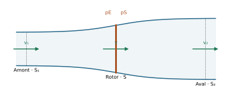
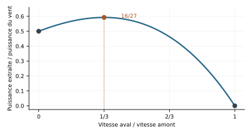
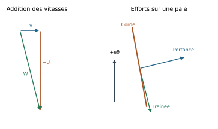
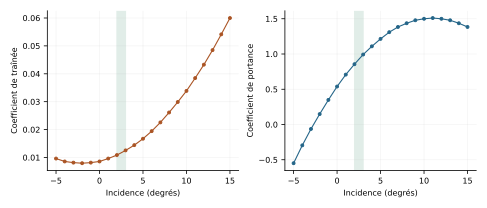
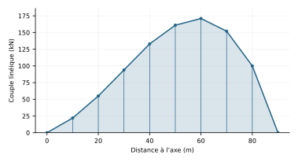
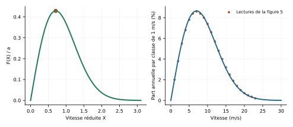
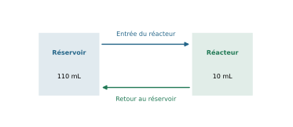
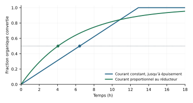

# ENS Lyon — PC, Physique-chimie 2016 · Corrigé guidé

*Corrigé rédigé par IA, non officiel.*

**Rédaction (tour 1)** · GPT-6.2 Astra Ultra · vitesse non renseignée

Le fascicule numérote séparément la physique (P1 à P18) et la chimie (C1 à C31). Les deux éditions résolvent entièrement 42 des 49 questions principales, dont toute la physique et la cinétique du compartiment organique. Trois questions sont traitées en partie : C10 pour la dénomination de la séparation, C15 pour le calcul des fractions et C17 pour les rôles des électrodes et le bilan de décharge. C5, C9, C14 et C16, consacrées à la production ou à la purification industrielle des halogènes, restent hors couverture.

## Physique I · Conversion de puissance et limite de Betz

### Question P1 — Une veine qui s’élargit

> [!INDICATION]
> Comparez les flux d’énergie cinétique aux deux extrémités, puis conservez le débit.

#### Solution

Aux sections lointaines la pression est identique et le débit volumique se conserve. Le travail net fourni par les pressions y est nul. Le rotor reçoit une puissance positive, donc l’air perd de l’énergie cinétique massique entre l’amont et l’aval. Ainsi $v_2<v_1$. La continuité impose $S_2v_2=S_1v_1$, d’où $S_2>S_1$. Le tube s’évase en traversant la machine.

### Question P2 — Un même débit massique

> [!INDICATION]
> Orientez les trois normales dans le sens de l’écoulement.

#### Solution

Sur une section ouverte $S_i$, le débit est l’intégrale de $\rho\vec v\cdot\vec n$ sur la section. La vitesse axiale uniforme permet de sortir sa valeur de l’intégrale. La paroi latérale est une surface de courant et le régime est stationnaire. Avec la même masse volumique partout, $q_m=\rho S_1v_1=\rho Sv=\rho S_2v_2$, en kilogrammes par seconde.

### Question P3 — Vitesse au disque et saut de pression

> [!INDICATION]
> Effectuez les deux applications de Bernoulli de chaque côté du disque. Pour trouver la force, isolez aussi une tranche d’air de très faible épaisseur.

#### Solution

**a.** Le flux sortant de quantité de mouvement moins le flux entrant a pour valeur $q_m(v_2-v_1)\vec e_x$. Dans le modèle du disque, les actions extérieures de pression ambiante se compensent sur la surface de contrôle fermée (on peut prolonger la surface de contrôle dans l’air extérieur au sillage). Il reste $\vec F_{r/a}=q_m(v_2-v_1)\vec e_x$, orientée en amont.

**b.** Bernoulli pour l’air sans échange de travail de part et d’autre donne $p_E=p_0+\rho(v_1^2-v^2)/2$ et $p_S=p_0+\rho(v_2^2-v^2)/2$.

**c.** Sur une tranche de part et d’autre du disque, les vitesses d’entrée et de sortie sont identiques. Le flux net de quantité de mouvement est nul. La force rotor sur air compense la poussée $(p_E-p_S)S\vec e_x$. Donc $\vec F_{r/a}=\tfrac12\rho S(v_2^2-v_1^2)\vec e_x$.

**d.** En remplaçant $q_m$ par $\rho Sv$, et en simplifiant par $v_2-v_1$ pour un rotor chargé, on obtient $v=(v_1+v_2)/2$. Le résultat se prolonge par continuité au cas sans prélèvement.

### Question P4 — Puissance et limite de Betz

> [!INDICATION]
> Gardez la surface balayée comme référence. Cherchez un maximum intérieur entre vent arrêté loin en aval et vent inchangé.

#### Solution

**a.** La puissance reçue par le rotor est la perte de flux cinétique $P=\tfrac12\rho(S_1v_1^3-S_2v_2^3)=\tfrac12 q_m(v_1^2-v_2^2)$. La pression ambiante travaille à des puissances opposées aux deux extrémités.

**b.** $P^\star=\rho Sv_1^3/2$ est la puissance cinétique qu’apporterait le vent amont uniforme à travers un disque *de surface balayée* $S$ placé dans le vent libre.

**c.** Avec $r=v_2/v_1$, le rapport est $\eta^\star=(v/v_1)(1-r^2)=(1+r)^2(1-r)/2$.

**d.** La dérivée vaut $(1+r)(1-3r)/2$. La courbe part de $1/2$ à $r=0$, croît jusqu’à $r=1/3$, puis décroît jusqu’à 0 à $r=1$.

**e.** Au maximum, $v_2=v_1/3$, $v=2v_1/3$ et $\eta^\star=16/27\simeq59,3\,\%$. Freiner davantage chaque kilogramme réduit aussi le débit reçu. La limite $r\to0$ du modèle implique une veine aval de section divergente. Pour $r=1$ le vent conserve son énergie.

### Question P5 — Hypothèses mécaniques

> [!INDICATION]
> Cherchez où l’écoulement subit un couple et où de la puissance mécanique change de système.

#### Solution

**a.** Les pales en rotation dévient le fluide et leur couple génère dans le sillage une composante orthoradiale. Une veine de largeur variable a également besoin de mouvements transverses dans ses zones de raccord. Le modèle axial est une moyenne idéalisée sur les sections.

**b.** Entre E et S le rotor prélève du travail. La charge mécanique de l’air chute alors que la vitesse moyenne reste continue sur le disque. L’égalité de Bernoulli utilisée dans les parties libres ne traverse donc pas le rotor.

**c.** À vent amont donné, le couple aérodynamique dépend du calage, de la géométrie et de la vitesse de rotation. Le point de fonctionnement résulte de son équilibre avec le couple résistant du générateur et les pertes. Il fixe la puissance prélevée et, dans le modèle, le ralentissement relatif $r$.

## Physique II · Aérodynamique d’une pale

### Question P6 — Inertie et traînée

> [!INDICATION]
> Évaluez la vitesse relative et la corde sur une section intermédiaire de la pale. Comparez ensuite la traînée au flux de quantité de mouvement intercepté.

#### Solution

**a.** Vers $r=45$ m, la corde vaut environ 4 m si elle décroît linéairement de 8,1 m à zéro. À 9 tours par minute la vitesse tangentielle y vaut 42 m/s. Un vent de 13 m/s donne $W\simeq44$ m/s. Ainsi $\mathrm{Re}=\rho W\ell/\eta\simeq1,1\times10^7$. L’inertie domine à l’échelle du profil. Des couches limites et un sillage avec transition ou turbulence peuvent coexister avec l’écoulement extérieur.

**b.** À grand Reynolds la norme de la traînée d’une sphère s’écrit $T=\rho C_D A W^2/2$, où $A$ est le disque frontal. Une masse d’ordre $\rho AW$ est déviée par seconde avec une variation de vitesse d’ordre $W$. On attend donc un coefficient sans dimension d’ordre unité, variable avec le régime de sillage.

### Question P7 — Coefficients de profil

> [!INDICATION]
> Déterminez l’unité de la pression dynamique, puis les paramètres sans dimension décrivant l’écoulement.

#### Solution

La pression dynamique $\rho W^2/2$ s’exprime en pascals et son produit par la surface de référence $A$ en newtons. $C_T$ et $C_P$ sont donc sans dimension. Pour le profil et la convention de surface fixés par le sujet, ils dépendent de l’incidence et du nombre de Reynolds. La forme, la rugosité relative et, si la compressibilité devient sensible, le nombre de Mach peuvent aussi intervenir.

### Question P8 — Vent relatif et corde

> [!INDICATION]
> Soustrayez la vitesse de la pale à celle du vent dans le repère du sol.

#### Solution

$\vec W=v\vec e_x-U\vec e_\theta$. Lorsque $U=4v$, ses composantes en unités de $v$ sont $(1,-4)$ et $W=\sqrt{17}v$. La flèche se dirige vers l’aval et vers le bas du dessin. La corde est presque parallèle à cette flèche, avec une faible incidence positive. Le schéma fixe les axes du repère local, la corde et l’origine des vecteurs.

### Question P9 — Orienter la portance

> [!INDICATION]
> Choisissez parmi les normales au vent relatif celle dont la projection sur le mouvement de la pale est positive.

#### Solution

La traînée est orientée suivant $(v,-U)/W$. La normale $(U,v)/W$ donne une portance qui entraîne la pale vers $+\vec e_\theta$. Les forces sont perpendiculaires. La traînée a une composante tangentielle résistante, la portance une composante tangentielle motrice.

### Question P10 — Effort moteur surfacique

> [!INDICATION]
> Projetez les deux forces sur l’axe tangent, puis divisez par la surface de référence.

#### Solution

On obtient $f_u=(Pv-TU)/(AW)$. En y portant les forces définies dans l’énoncé, $f_u=\rho W(C_Pv-C_TU)/2$, en pascals. Pour $U>0$, la puissance surfacique motrice est $Uf_u$. Le signe tient donc aux deux contributions et au rapport de vitesses.

### Question P11 — Lire la polaire et choisir l’incidence

> [!INDICATION]
> Numérotez les 21 points dans l’ordre des incidences. La pente d’une droite issue de l’origine est un rapport de coefficients.

#### Solution

**a.** Sur la figure 3 originale, de $-5°$ à $15°$, $C_T$ passe d’environ 0,010 à un minimum de 0,008 près de $-2°$, puis monte à 0,060. $C_P$ passe de $-0,55$ à zéro vers $-3°$, atteint environ 1,50 près de 10 à 11° et revient vers 1,38. Les deux tracés séparés reprennent les points lus à la précision du graphique.

**b.** Quand l’incidence augmente, le gradient de pression défavorable sur l’extrados peut décoller la couche limite. La zone décollée s’étend, la dépression qui entretenait la portance diminue et le sillage s’élargit.

**c.** La droite issue de l’origine de plus grande pente touche la polaire près des points à $2°$ et $3°$. Les lectures discrètes donnent vers $3°$ les valeurs $C_P\simeq0,99$, $C_T\simeq0,0125$ et une finesse proche de 79. Au point à $2°$ on lit environ $0,86/0,011$, très voisin. La précision du tracé justifie une incidence optimale voisine de 2 à 3°.

**d.** La composante tangentielle $\Omega r$ croît le long de la pale, ce qui fait tourner la direction du vent relatif. Le vrillage modifie l’angle de corde avec le rayon afin de maintenir l’incidence recherchée.

### Question P12 — Intégrer le couple des trois pales

> [!INDICATION]
> L’ordonnée de la figure 4 est un couple par unité de longueur. L’aire sous la courbe donne déjà le couple du rotor entier.

#### Solution

Pour $r=0,10,\ldots,90$ m, on lit environ $0,22,55,94,133,161,171,152,100,0$ kN pour $\mathrm dM/\mathrm dr$. L’unité kN correspond à des kN·m par mètre de pale. La somme des trapèzes de largeur 10 m donne environ $8,88\times10^6$ N·m. Avec $\Omega=9(2\pi)/60=0,942$ rad/s, la puissance mécanique $M\Omega$ vaut environ **8,4 MW**, compatible avec le nom de la machine. Les lectures et le pas de 10 m limitent la précision.

### Question P13 — Rendement à treize mètres par seconde

> [!INDICATION]
> Calculez le flux du vent libre à travers tout le disque de rayon 90 mètres.

#### Solution

Le vent apporte $P^\star=\rho\pi R^2v^3/2$, soit environ $33,5$ MW avec $\rho=1,20$ kg/m³, $R=90$ m et $v=13$ m/s. Ainsi $\eta_{\rm conv}=P/P^\star\simeq0,25$. Cette valeur reste inférieure à la limite idéale $16/27$. La rotation du sillage, la traînée et le nombre fini de pales affectent le rotor réel. La puissance calculée au couple est mécanique.

## Physique III · Distribution de la vitesse du vent

### Question P14 — Normaliser les durées annuelles

> [!INDICATION]
> La somme des durées de toutes les classes reconstitue une année.

#### Solution

Les proportions vérifient $\sum_i\tau_i=1$, ou 100 % sur l’échelle verticale de la figure 5. Le terme continu correspondant est $\int_0^\infty f(v)\,\mathrm dv=1$. Pour comparer hauteurs et densité, il faut tenir compte du pas des classes, ici 1 m/s.

### Question P15 — Ajuster la distribution de Rayleigh

> [!INDICATION]
> Dérivez le profil réduit, identifiez son maximum sur l’histogramme et normalisez l’aire.

#### Solution

**a.** Pour $X\ge0$, $g(X)=F(X)/a=X\exp(-X^2)$ part de zéro, croît avec une pente initiale unité, atteint un sommet à $X=1/\sqrt2$ puis décroît vers zéro. En effet $g'(X)=(1-2X^2)\exp(-X^2)$. Son maximum vaut $1/\sqrt{2e}\simeq0,429$. La dissymétrie et la queue vers les grandes valeurs correspondent aux données.

**b.** Un point $(X,g(X))$ devient $(cX,g(X))$ dans le graphe de $f/a$. Les hauteurs sont conservées, les abscisses multipliées par $c$, vitesse caractéristique du site.

**c.** Par changement de variable $\int f\,\mathrm dv=ac\int_0^\infty X\exp(-X^2)\,\mathrm dX=ac/2$. Donc $a=2/c$ pour une densité en inverse de vitesse. La probabilité d’une classe est l’aire correspondante.

**d.** La plus haute barre est centrée près de 7 m/s. Le mode théorique est $c/\sqrt2$, d’où $c\simeq9,9$ m/s. Compte tenu de la largeur des classes, 10 m/s convient.

**e.** Pour chaque classe, intégrer $f$ entre ses bords afin d’obtenir $p_i$, puis calculer l’erreur quadratique moyenne $N^{-1}\sum_i(p_i-\tau_i)^2$ sur les $N$ classes. On peut en prendre la racine et l’exprimer en points de pourcentage. Les écarts de signes opposés contribuent tous au résultat.

### Question P16 — Vitesse équivalente pour la puissance

> [!INDICATION]
> Quelle moyenne de la vitesse reproduit exactement le flux cinétique moyen, proportionnel au cube de la vitesse ?

#### Solution

Par définition $(v^\star)^3=\int_0^\infty v^3 f(v)\,\mathrm dv$. Poser $X=v/c$ donne $(v^\star)^3=2c^3 I_4$. La récurrence du sujet donne $I_4=(3/2)I_2=3\sqrt\pi/8$. Ainsi $v^\star=c(3\sqrt\pi/4)^{1/3}\simeq1,100c$, soit environ **11 m/s** pour le site de la figure 5.

### Question P17 — Échelle de vitesse du site offshore

> [!INDICATION]
> Inversez la relation entre la vitesse représentative et le paramètre d’échelle.

#### Solution

En interprétant les 13 m/s du calcul nominal comme vitesse énergétiquement représentative, on trouve $c=13/(3\sqrt\pi/4)^{1/3}\simeq11,8$ m/s. C’est une estimation conditionnelle. La seule vitesse nominale d’une machine ne détermine pas expérimentalement la distribution météorologique de son site.

### Question P18 — Mesurer une distribution de vent

> [!INDICATION]
> Choisissez un capteur utilisable longtemps, puis expliquez comment les mesures donnent une durée relative.

#### Solution

Un anémomètre à coupelles placé sur un mât dégagé, à hauteur représentative du rotor, tourne sous l’effet de la différence de traînée des coupelles. Un capteur compte les impulsions par tour. Une courbe d’étalonnage convertit la fréquence en vitesse et fixe le seuil de démarrage. Enregistrer à pas constant sur une année, associer les mesures valides aux classes de vitesse et diviser les durées par la durée effectivement observée. Il faut signaler les périodes manquantes et l’effet de la résolution temporelle. Ce dispositif fournit une série automatique de vitesse horizontale adaptée aux statistiques demandées.

## Chimie I · Solubilité, espèces et diagrammes d’équilibre

### Question C1 — Hydratation d’un dérivé disulfonique

> [!INDICATION]
> Écrivez la forme acido-basique majoritaire dans l’eau et orientez le dipôle d’une molécule d’eau à proximité.

#### Solution

Les deux fonctions sulfoniques sont des acides forts dans l’eau. La molécule porte donc deux groupes sulfonate chargés négativement. Ils s’hydratent par interaction **ion–dipôle**, les hydrogènes partiellement positifs des molécules d’eau orientés vers leurs oxygènes. Cette stabilisation aqueuse s’ajoute aux interactions possibles des carbonyles. L’anthraquinone neutre conserve un grand squelette aromatique hydrophobe et se dissout moins bien.

### Question C2 — La famille des halogènes

> [!INDICATION]
> Repérez la colonne dont la couche de valence comporte sept électrons.

#### Solution

Les halogènes appartiennent au groupe 17, avant les gaz nobles. Les trois autres halogènes usuels visés avec le brome sont le fluor F ($Z=9$), le chlore Cl ($Z=17$) et l’iode I ($Z=53$). La colonne comprend aussi l’astate At ($Z=85$) et, dans le tableau actuel, le tennesse Ts ($Z=117$).

### Question C3 — Configuration et degrés d’oxydation

> [!INDICATION]
> Partez du cœur argon et comptez les électrons de la couche de valence.

#### Solution

Le brome possède la configuration $[\mathrm{Ar}]\,3d^{10}4s^24p^5$. Les sept électrons de valence conduisent aux degrés formels extrêmes $-\mathrm I$ (bromure) et $+\mathrm{VII}$ (par exemple dans $\mathrm{BrO_4^-}$, puisque $x+4(-2)=-1$). Un nombre d’oxydation est une attribution formelle des électrons.

### Question C4 — Complexation et pouvoir oxydant

> [!INDICATION]
> Ajoutez le cycle de complexation à la demi-réaction de réduction. Suivez le signe de l’énergie libre standard.

#### Solution

Notons $E_2^\circ$ et $E_3^\circ$ les potentiels des couples du dibrome et du tribromure avec le bromure. Pour réduire le tribromure en trois ions bromure, on peut dissocier le complexe, puis réduire le dibrome par deux électrons. Ainsi $-2FE_3^\circ=RT\ln K-2FE_2^\circ$. La différence $E_2^\circ-E_3^\circ=(RT/2F)\ln K$ est positive et vaut environ $0,036$ V à température ambiante pour $K=16,8$. La forme complexée a un pouvoir oxydant standard plus faible.

*Question C5 hors couverture.*

### Question C6 — Fraction molaire d’un soluté minoritaire

> [!INDICATION]
> Prenez 100 grammes de solution et convertissez les deux masses en quantités de matière.

#### Solution

La masse d’eau est 0,034 g, donc $n_e=0,034/18,015\simeq1,89\times10^{-3}$ mol. Les 99,966 g de solvant représentent environ $99,966/159,808=0,626$ mol. La fraction molaire de l’eau vaut $x_l=n_e/(n_e+n_s)\simeq3,0\times10^{-3}$. Utiliser 100 g de solvant comme base donnerait le même arrondi.

### Question C7 — Potentiel chimique d’un solvant presque pur

> [!INDICATION]
> Écrivez l’activité du solvant avec la loi idéale de Raoult et développez son logarithme.

#### Solution

Le solvant a pour fraction molaire $1-x_l$. Dans l’approximation idéale, la différence recherchée est $\Delta\mu=RT\ln(1-x_l)\simeq-RTx_l$. Vers 298 K on trouve environ $-7,5$ J/mol. Le signe négatif traduit l’abaissement du potentiel chimique par dilution. La valeur absolue est voisine de $0,25\,\%$ des 3,0 kJ/mol de vaporisation fournis.

### Question C8 — Lire les domaines d’un corps pur

> [!INDICATION]
> Identifiez les deux courbes qui se raccordent à la frontière de fusion et observez quelle phase occupe les basses pressions.

#### Solution

Le domaine gazeux est sous les courbes de sublimation et de vaporisation. Au-dessus, le solide occupe le côté froid de la frontière de fusion presque verticale et le liquide son côté chaud. La jonction des trois courbes est le point triple, lisible vers $-7$ °C et quelques kPa. Le point critique, qui termine la ligne liquide–vapeur à haute température, est en dehors du cadre représenté.

*Question C9 hors couverture.*

### Question C10 — Nom de la séparation

> [!INDICATION]
> Classez l’opération d’après la coexistence de deux couches liquides.

#### Solution

Deux liquides non miscibles séparés par gravité se séparent par **décantation**. Cette réponse couvre la dénomination de l’opération. Le dispositif d’isolement demandé dans le contexte industriel reste hors couverture.

### Question C11 — Choisir une composition conservée

> [!INDICATION]
> Comptez les atomes avant et après un avancement élémentaire et vérifiez le nombre total de molécules.

#### Solution

Un avancement $\xi$ de la réaction écrite fait varier les quantités des deux molécules homonucléaires de $-\xi$ chacune et celle du composé mixte de $+2\xi$. La quantité totale de molécules reste constante, de même que $n_{\rm Br_2}+n_{\rm BrCl}/2$. Leur rapport $z_{\rm Br_2}$ est donc invariant pour le système fermé. La fraction $x_{\rm Br_2}$ change avec l’avancement. L’abscisse en composition atomique identifie ainsi le mélange global quel que soit le partage entre espèces chimiques.

### Question C12 — Frontières de bulle et de rosée

> [!INDICATION]
> Partez de la région froide à composition totale fixée et montez en température.

#### Solution

Dans le diagramme isobare, le liquide homogène occupe le domaine sous la courbe inférieure. Cette courbe de bulle marque l’apparition de la première vapeur au chauffage. Entre les courbes coexistent liquide et vapeur. La courbe supérieure est la courbe de rosée, apparition de la première goutte au refroidissement de la vapeur. Au-dessus, le mélange est entièrement gazeux. Les deux branches se rejoignent aux corps purs.

### Question C13 — Variance d’un système réactif

> [!INDICATION]
> Comptez les espèces indépendantes après avoir pris en compte la relation d’équilibre.

#### Solution

Trois espèces liées par une réaction indépendante laissent deux composants indépendants. Le système a par conséquent la même variance qu’un mélange binaire. Sous pression fixée et avec $\phi$ phases en équilibre, $v=2-\phi+1=3-\phi$. Elle vaut deux dans un domaine monophasé et un dans le domaine biphasé.

*Question C14 hors couverture.*

### Question C15 — Fractions à égalité des deux espèces homonucléaires

> [!INDICATION]
> Posez la même fraction pour les deux espèces et employez l’expression de la constante avec les exposants du document.

#### Solution

Pour les trois fractions gazeuses, écrivons $x_1=x_2=x$ et $y=1-2x$. Avec la convention de la demi-équation imprimée, $K=y/\sqrt{x_1x_2}=y/x=3$. Donc $x=1/5$ et $y=x_{\rm BrCl}=3/5$. Ce calcul traite la composition relative prescrite. L’interprétation pour le fonctionnement de la colonne demeure hors couverture.

*Question C16 hors couverture.*

## Chimie II · Lecture des courbes électrochimiques

### Question C17 — Électrodes et énergie en décharge

> [!INDICATION]
> Repérez le compartiment où la forme hydroquinone cède des électrons au circuit externe.

#### Solution

En décharge, $\mathrm{AH_2}$ s’oxyde en $\mathrm A$ dans le compartiment 1, anode, et le dibrome capte des électrons dans le compartiment 2, cathode. Le bilan spontané est $\mathrm{AH_2+Br_2\rightarrow A+2H^++2Br^-}$. En charge, les désignations s’inversent, 1 est cathode et 2 est anode. La réponse développe le bilan de la décharge. Le volet de formation de l’halogène en charge reste hors couverture.

### Question C18 — Lire les plateaux de transport

> [!INDICATION]
> Distinguez les quatre branches des solutés sur la figure 3 et les branches extérieures attribuées au milieu aqueux.

#### Solution

Les deux formes du couple organique, ainsi que celles du couple halogéné, sont apportées à la surface par transport. Quand le réactif s’épuise au voisinage de l’électrode, le courant devient plafonné par son flux d’arrivée. Les quatre branches correspondantes présentent des paliers de signe anodique ou cathodique. Le module d’un courant limite est proportionnel à la surface, au nombre d’électrons et à la concentration du réactif, et dépend du coefficient de transport, donc de la diffusion et de l’hydrodynamique. Aux extrêmes du tracé, les branches du milieu aqueux croissent fortement sans plateau visible dans la fenêtre dessinée. Le solvant est abondant et, du côté acide, les protons sont disponibles.

### Question C19 — Tension à vide et convention du courant

> [!INDICATION]
> Lisez sur l’axe horizontal les deux interceptions à courant nul. Puis examinez si l’écart de potentiel augmente ou diminue lorsque le courant circule.

#### Solution

La tension à vide correspond au segment horizontal entre les zéros des deux courbes, $U_0=E_B(0)-E_A(0)$. La lecture du document donne environ $1,00-0,22\simeq0,8$ V. En décharge, la polarisation de la cathode diminue son potentiel et celle de l’anode relève le sien. L’écart devient inférieur à $U_0$ et l’accumulateur fournit de l’énergie. C’est la branche droite à courant positif dans la convention de la figure 2. À gauche un générateur fournit de l’énergie et la tension dépasse $U_0$.

### Question C20 — Potentiels de repos et activités

> [!INDICATION]
> Écrivez les deux quotients de réaction pour les réductions et utilisez le même nombre d’électrons.

#### Solution

À courant nul et à l’équilibre interfacial, chaque interception donne le potentiel de Nernst du couple. Pour l’électrode organique, $E_A=E_A^\circ+(RT/2F)\ln(a_{\rm A}a_{\rm H^+}^2/a_{\rm AH_2})$. Pour l’autre électrode, $E_B=E_B^\circ+(RT/2F)\ln(a_{\rm Br_2}/a_{\rm Br^-}^2)$. Les activités sont sans dimension et se rapportent aux espèces accessibles dans la même phase que celle choisie pour le potentiel standard.

### Question C21 — Déplacement de la tension à vide

> [!INDICATION]
> Suivez séparément la forme réduite stockée à l’électrode organique et la forme oxydante à l’autre électrode.

#### Solution

Quand l’état de charge augmente, le rapport d’activité de la forme organique réduite à la forme oxydée augmente. À acidité donnée, $E_A$ baisse. L’autre compartiment s’enrichit en forme oxydante relativement au réducteur et $E_B$ monte. La différence $E_B-E_A$ augmente, ce qui explique le décalage vers le haut de la famille de courbes. À intensité non nulle peuvent s’y ajouter des variations de polarisation.

### Question C22 — Reconnaître une surcharge sur les courbes

> [!INDICATION]
> Comparez l’existence de la branche de réduction du composé organique à mi-charge et en fin de charge.

#### Solution

À l’épuisement de la forme organique à réduire, la branche correspondante du document 3 disparaît dans le document 4. Maintenir le courant force alors des réactions parasites du milieu aqueux, avec dégagement gazeux, perte d’énergie et risque de surpression. Un changement brusque de tension à courant fixé marque la fin du domaine de charge utile. La surveillance de cette rupture permet l’arrêt de la charge.

## Chimie III · Cinétique de la demi-cellule organique

### Question C23 — Temps de séjour hydrauliques

> [!INDICATION]
> Divisez individuellement les volumes du réacteur et du réservoir par le débit qui les traverse.

#### Solution

Dans la boucle organique, $\tau_{\rm reac}=V_{\rm reac}/D=10/200=0,050$ min, soit 3,0 s. De même $\tau_{\rm res}=110/200=0,550$ min, soit 33 s. Un tour du volume total correspond à 36 s.

### Question C24 — Inventaire électronique du compartiment organique

> [!INDICATION]
> Comptez les électrons nécessaires à la conversion d’une mole d’hydroanthraquinone.

#### Solution

Chaque mole de $\mathrm{AH_2}$ initialement présente fournit deux moles d’électrons lors de son oxydation en A. L’inventaire organique vaut $c_0V_{\rm tot}$ moles et la charge électrique correspondante $2Fc_0V_{\rm tot}$. À courant de module constant, $\tau_{\rm el}=2Fc_0V_{\rm tot}/I$. Avec le volume de 0,120 L, la concentration de 1,0 mol/L et le courant indiqué en partie III, la durée vaut $4,63\times10^4$ s, soit 12,9 h. La partie III suit la conversion oxydante de la demi-cellule organique, même si certaines questions emploient le mot « charge ».

### Question C25 — Bilan dans le réacteur parfaitement agité

> [!INDICATION]
> L’entrée a la concentration du réservoir et la sortie celle du réacteur. Soustrayez les flux sortants.

#### Solution

Le bilan quasi stationnaire sur A est $0=D c_A^{\rm res}-D c_A^{\rm reac}+V_{\rm reac}v_f$. Avec $\tau_{\rm reac}=V_{\rm reac}/D$, il donne $v_f=(c_A^{\rm reac}-c_A^{\rm res})/\tau_{\rm reac}$. Le signe est positif lorsque le réacteur enrichit le liquide en A.

### Question C26 — Relier vitesse locale et inventaire total

> [!INDICATION]
> Distinguez le volume où la réaction se déroule et celui qui contient le stock initial.

#### Solution

La relation faradique dans le réacteur donne $v_f=I/(2FV_{\rm reac})$. La définition de la durée totale donne $I/(2F)=c_0V_{\rm tot}/\tau_{\rm el}$. Donc $v_f=(c_0/\tau_{\rm el})(V_{\rm tot}/V_{\rm reac})$. Les deux volumes de la boucle étant traversés par le même débit, le rapport de volumes vaut $(\tau_{\rm reac}+\tau_{\rm res})/\tau_{\rm reac}$.

### Question C27 — Écart de concentration entre les deux volumes

> [!INDICATION]
> Éliminez la vitesse de formation entre les bilans local et global.

#### Solution

En multipliant la réponse précédente par $\tau_{\rm reac}/c_0$, on obtient $(c_A^{\rm reac}-c_A^{\rm res})/c_0=(\tau_{\rm reac}+\tau_{\rm res})/\tau_{\rm el}$. La valeur est $36/46313\simeq7,8\times10^{-4}$. L’écart ne représente qu’environ 0,08 % de la concentration initiale, ce qui justifie le modèle homogène à cette échelle.

### Question C28 — Courant constant et cinétique d’ordre zéro

> [!INDICATION]
> Sur le volume total, combien de moles de A apparaissent chaque seconde ?

#### Solution

La formation de A avance à vitesse constante $\mathrm dc_A/\mathrm dt=I/(2FV_{\rm tot})=c_0/\tau_{\rm el}$. C’est une cinétique apparente d’ordre zéro imposée par le courant. Comme $c_A(0)=0$, on trouve $c_A(t)=c_0t/\tau_{\rm el}$ et $c_R(t)=c_0(1-t/\tau_{\rm el})$ jusqu’à épuisement du réducteur.

### Question C29 — Demi-conversion et capacité d’une batterie à circulation

> [!INDICATION]
> Cherchez le temps correspondant à la moitié de la concentration finale et distinguez le rôle du réservoir de celui de la cellule.

#### Solution

La moitié du stock organique a réagi à $\tau_{1/2}=\tau_{\rm el}/2\simeq6,4$ h. Une intensité trop importante accentue polarisation et pertes ohmiques et peut dépasser le flux d’espèce active disponible à l’électrode. Un accumulateur à circulation permet de choisir le volume de liquide pour stocker de l’énergie et de dimensionner séparément la cellule pour la puissance. Dans un accumulateur solide ces choix sont plus étroitement couplés.

### Question C30 — Courant proportionnel à la concentration

> [!INDICATION]
> Écrivez l’équation différentielle du réducteur avec le coefficient de proportionnalité donné dans l’énoncé.

#### Solution

Dans le modèle organique, $I=R_tc_R$ donne $-\mathrm dc_R/\mathrm dt=R_tc_R/(2FV_{\rm tot})=kc_R$. L’ordre apparent est un. Ainsi $c_R=c_0\exp(-kt)$ et $t_{1/2}=(2FV_{\rm tot}/R_t)\ln2$. Avec $V_{\rm tot}=0,120$ L et $R_t=1,1$ A·L/mol, $k\simeq4,75\times10^{-5}$ s$^{-1}$ et $t_{1/2}\simeq1,46\times10^4$ s, soit **4,1 h**.

### Question C31 — Comparer deux lois temporelles

> [!INDICATION]
> Regardez le courant initial et la forme de la fin de conversion avant de conclure sur les demi-temps.

#### Solution

Avec les valeurs particulières du sujet, la demi-conversion à potentiel imposé prend environ 4,1 h, contre 6,4 h à intensité imposée. Le premier modèle commence à $R_tc_0=1,1$ A et son courant décroît ensuite, tandis que le second utilise 0,5 A. L’écart de demi-temps dépend donc des conditions choisies. Le courant imposé rend la quantité convertie proportionnelle au temps et prévisible tant que le rendement faradique est unité. À potentiel imposé le courant tend vers zéro et la fin de conversion devient asymptotique.

