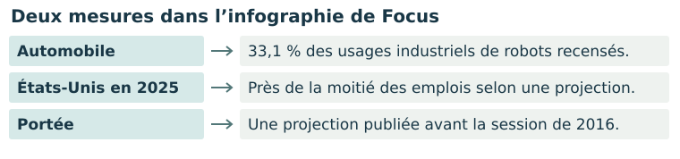
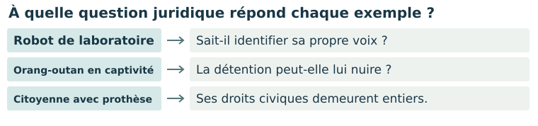

# X-ENS · MP-PC-PSI · Anglais 2016 — Corrigé guidé

*Corrigé rédigé par IA, non officiel. Signalez toute erreur.*

**Rédaction** · GPT-6.2 Astra Ultra · vitesse non renseignée

Le cahier XEULCR prévoit quatre heures pour les deux parties. Aucun document autorisé. La partie A demande une synthèse en anglais de 600 à 675 mots, précédée d’un titre, qui croise les documents 1 à 4 dans leur contexte géographique, sans commentaire personnel. La partie B demande un texte d’opinion en anglais de 500 à 600 mots en réaction au document de la seconde partie. Les décomptes portent sur le corps du texte, hors titre.

Le rapport distingue la variété des intelligences et la place du travail dans la société. Associer chaque réussite technique à ce qu’elle permet effectivement d’inférer. Pour l’éditorial, relever dans la marge les analogies du Washington Times puis choisir lesquelles résistent à l’examen.

## A. Synthèse de documents

**Organiser la confrontation.** Watson gagne à un jeu télévisé. Domingos avance une hypothèse beaucoup plus ambitieuse dans le livre dont Ananthaswamy rend compte. Attribuer à chacun sa proposition, puis comparer leurs conséquences pour les travailleurs. La figure de Focus juxtapose la répartition sectorielle des robots et une projection américaine à l’horizon 2025. Les 33,1 % de l’automobile concernent la première mesure. Le conditionnel convient à la seconde.

**Choisir les exemples.** L’image de bandes prise pour un bus fournit chez Lohn et ses coauteurs un cas où la confiance numérique et l’exactitude divergent. Le rapprocher de Watson permet de passer d’une limite cognitive à une question de responsabilité.

**A Machine Can Win the Quiz. Who Makes the Rules?**

A machine that beats American quiz champions can look remarkably like a knowledgeable person. Whether it could apply its knowledge beyond the studio is another matter. Writing in the Guardian, Nigel Shadbolt questions the leap from a spectacular performance to general intelligence. In New Scientist, Anil Ananthaswamy reviews Pedro Domingos's case for a universal learning algorithm. A Time article by Andrew Lohn and colleagues and an infographic in Focus consider what happens when machines enter workplaces and acquire authority. Together they shift attention from a machine's resemblance to a person to the decisions people are already handing over.

Much of this delegation is scarcely visible. As Ananthaswamy explains, customers choosing films or looking for partners supply information that services use to predict what they will want next. Time sees Apple's interest in voice technology as another step towards making such assistance routine. Industrial robots are a more conspicuous presence. In the Focus breakdown, the automotive sector alone accounts for 33.1 per cent of industrial robot use. The machines already have a considerable role without requiring a single form of intelligence common to the assembly line, the search engine and the conversation. Shadbolt's quiz champion illustrates the point. A change from answering general knowledge questions to playing Monopoly would require fresh training.

For Domingos, the present diversity of algorithms inspires a search for a common learning principle that might extract knowledge from data across domains. The possibility that different regions of the brain learn in comparable ways encourages that ambition. Shadbolt sees little evidence that additional computing power or the assembly of specialised systems will by itself yield a reflective mind. Yet both positions make room for profound change. A prediction system needs no understanding of the meaning of a job to transform the prospects of the person doing it. Nor does a recommender need a theory of human desire to influence what its customers encounter.

That distinction complicates the promise of greater efficiency. Focus presents the estimate that by 2025 robots might take over nearly half of American jobs, with striking differences between industries. Its figures describe a projection, whereas its chart of industrial use describes an existing distribution. In Ananthaswamy's account, Domingos envisages machines relieving people of routine work and a government income supporting those without an occupation. His reviewer asks who will control the gains in a society where a small employed group might grow immensely wealthy. Material provision, meaningful work and a share in the decisions that shape employment emerge as separate issues.

Technical performance poses a related problem of authority. Time describes a system identifying horizontal stripes as a school bus with overwhelming confidence. An error that sounds comic in a demonstration takes on another significance when machines inform decisions about health or finance. Even an algorithm that consistently passes a prescribed test may only have learned how to meet the test. Shadbolt's concerns about surveillance and critical infrastructure similarly arise from the scale and position of specialised programs. Neither a hostile intention nor a machine's awareness of its own acts is necessary for a mistake to affect thousands of people.

Responsibility therefore reaches beyond the research laboratory. The Time authors call for testing appropriate to individual industries and for sustained discussion between policymakers and technical specialists. Shadbolt raises the further possibility that some activities warrant strict limits on delegation. The economic scenarios reviewed by Ananthaswamy add workers and the distribution of benefits to that conversation. British and American debates may draw their most vivid images from Hollywood, but their immediate subject is a succession of human decisions about which tasks to automate, whose judgement to trust and who will answer when a machine performs exactly as designed.

*613 mots hors titre.*

## B. Texte d’opinion

**Répondre à un procédé polémique.** Distinguer les trois niveaux que rapproche le Washington Times. Le résultat du test établit une capacité limitée d’identification. La sensibilité éventuelle pourrait justifier une protection. L’inscription sur les listes électorales répond à une autre logique. Le contre-exemple de la prothèse permet de défendre l’égalité des citoyens et de discuter, sur le fond, le parallèle historique de l’éditorial.

**Before a Robot Gets a Vote, Give the Patient a Hearing**

A citizen with an artificial knee has an excellent answer to anyone who questions her right to vote. Ask which candidate she supports. The Washington Times invites us to imagine a future courthouse baffled by people with mechanical parts. I find the courthouse easier to understand than the editorial. A replacement joint changes how someone walks. It gives a registrar no reason to inquire whether she belongs to the political community. The genuinely difficult question concerns an entirely artificial being that might someday have interests of its own.

I enjoyed the experiment in which a robot worked out that it was the one in a group still able to speak. It recognised its voice and corrected its answer. That is an achievement a researcher can test. It leaves open whether there was anybody there to feel embarrassment at the first answer or satisfaction at the second. Alan Turing invited readers to consider what behaviour might persuade an interlocutor to describe a machine as intelligent. A convincing performance deserves intellectual respect. It does not settle what treatment could harm the performer. A legal duty towards a being should have some relation to what that being stands to lose.

On this point the newspaper's own orangutan example does more work than its jokes. Asking whether confinement harms Sandra directs attention to a particular animal's capacity to suffer and to the relief a court might order. No electoral register is involved. We already recognise protections with different purposes and beneficiaries. Children have a claim to care before they acquire a vote. A company can enter a contract without becoming eligible to serve on a jury. Even if an artificial system eventually deserves protection against suffering, deciding what protects it would take evidence and argument for each proposed right.

The editorial raises a harder objection when it imagines a voting machine able to multiply itself. I agree that counting each identical copy as another citizen would invite someone with a large computing budget to manufacture a majority. Yet no experiment in self-recognition has compelled a country to adopt such a franchise. Democracies can debate representation on its own terms. More urgently, when a machine takes a decision about a real person's benefits or medical care, I want that person to be able to challenge a named institution. Calling the software a person must never give its owners a convenient defendant with empty pockets.

I object most strongly to the newspaper's use of civil rights struggles as comic scenery. Americans denied the ballot had voices, interests and a history of being governed against their wishes. The lesson I draw is to listen carefully to people whose testimony is being discounted. That includes patients with prostheses who might reasonably resent a stranger treating their bodies as a philosophical border dispute.

I would keep the door open to evidence of machine suffering and demand remedies proportionate to that evidence. Meanwhile people subjected to automated decisions have interests we can establish today. Giving them a hearing would be a practical advance in rights, and the registrar could get on with registering the patient.

*515 mots hors titre.*

Le sujet et le rapport du jury distinguent la synthèse, qui exclut le document 5, et l’éditorial personnel en réponse au Washington Times.

[Sujet officiel](https://banques-ecoles.fr/cms/wp-content/uploads/2016/06/16_mp_pc_LV_Anglais_XEULCR.pdf) · [Rapport du jury](https://banques-ecoles.fr/cms/wp-content/uploads/2017/03/16_MP-PC_rap_Eang.pdf) · [Sujet publié par l’ENS](https://www.ens.psl.eu/IMG/file/concours/2016/sujets/MPI/16_mppc_sujet_lve_ang.pdf) · [Autre publication du rapport](https://www.ens.psl.eu/IMG/file/concours/2016/rapports/16_mppc_rap_eang.pdf)
