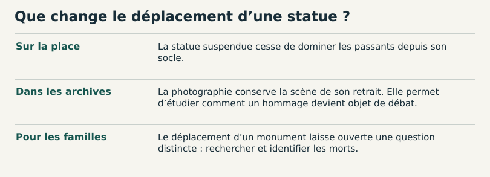

# X-ENS MP-PC-PSI — Espagnol 2016 · Corrigé brut

*Corrigé rédigé par IA, non officiel. Signalez toute erreur.*

**Rédaction** · GPT-6.2 Astra Ultra · vitesse non renseignée

Le cahier XEULCR des filières MP, PC et PSI prévoit quatre heures sans document. La partie A demande une synthèse en espagnol de 600 à 675 mots, précédée d’un titre et fondée sur les documents 1 à 4. La partie B est un texte d’opinion en espagnol de 500 à 600 mots qui répond au document 5.

## A. Synthèse de documents

**Los lugares y los silencios de la memoria franquista**

En noviembre de 2015, a los cuarenta años de la muerte de Franco, España vive en democracia y sigue decidiendo qué hacer con las huellas públicas de la dictadura. Martín Rodríguez Yebra describe la incomodidad de la conmemoración en La Nación. José Rodríguez de la Borbolla propone en Diario de Sevilla una lectura generacional de esas cuatro décadas. En La Vanguardia, Carles Castro examina opiniones que parecen contradictorias. La fotografía publicada por Eldiario.es muestra una decisión concreta, la retirada de una estatua ecuestre en Santander. ¿Cómo conviven el deseo de pasar página y la necesidad de actuar sobre una herencia que permanece a la vista? Las prioridades de las generaciones y las actitudes que miden los sondeos ayudan a entender los conflictos en torno a los monumentos.

En el relato de Rodríguez de la Borbolla, quienes vivieron la muerte del dictador pensaban ante todo en abrir un futuro democrático. Algunos temieron ser detenidos aquella misma noche. Conseguir una Constitución, descentralizar el Estado, ampliar la protección social e integrarse en Europa representaba para ellos una tarea más urgente que ajustar cuentas con el pasado. En el reportaje de La Nación, el historiador José Álvarez Junco recuerda que el aparato franquista seguía en pie durante la Transición. Valora el paso a la democracia y entiende que quedaba trabajo por hacer. Esa observación permite relacionar el éxito institucional celebrado por unos con las demandas de las familias que siguen esperando la localización de sus allegados. El corresponsal cita la vía judicial emprendida en Argentina y la falta de respuesta favorable del Gobierno español a las peticiones de la jueza. Una decisión tomada durante la Transición tiene así consecuencias fuera del país.

Las prioridades cambian con la experiencia. Para Rodríguez de la Borbolla, quienes alcanzaron la madurez hacia el cambio de siglo percibieron deficiencias en la construcción anterior y recuperaron la cuestión de la memoria histórica. Una tercera generación mira hacia un pasado mucho más próximo y debate la organización territorial y el acceso al poder. El autor critica en algunos de sus portavoces el uso inmediato del descontento y reclama proyectos de futuro. Castro muestra que tampoco existe una actitud uniforme entre la población. El reconocimiento ampliamente mayoritario de las violaciones de derechos humanos bajo Franco coexiste con las reticencias a investigar lo sucedido. El temor a reabrir conflictos atraviesa las respuestas.

Los sondeos que recoge La Vanguardia distinguen además el juicio sobre la dictadura de la preferencia por la democracia. Hay ciudadanos que ven aspectos positivos y negativos en el régimen pasado, mientras que tres de cada cuatro encuestados prefieren el régimen de libertades. Una mayoría apoya retirar los símbolos que homenajean al dictador. La fotografía de Santander da forma material a esa posibilidad. Una grúa levanta la figura de Franco a caballo ante decenas de espectadores. La operación modifica quién ocupa un lugar de honor en la ciudad. El documento no permite deducir qué siente cada uno de los presentes ante la escena.

El Valle de los Caídos ofrece en el reportaje de Rodríguez Yebra el contrapunto a la estatua en movimiento. El Estado mantiene un monumento en el que la tumba de Franco recibe flores, mientras que muchas familias encuentran dificultades para exhumar a sus muertos. Unos reclaman trasladar los restos del dictador y dar al lugar una función de memoria; la fundación que lleva su nombre invoca el respeto a la historia para oponerse. Entre esas posiciones, también se plantea qué aprenden los jóvenes sobre la Guerra Civil y la dictadura. La distancia temporal ha permitido consolidar unas libertades que Franco combatió. Los cuatro documentos muestran, sin embargo, que ni el cambio generacional ni el deseo de cerrar una etapa resuelven por sí solos qué deben enseñar las instituciones, a quién deben reconocimiento y qué significa conservar un símbolo en una plaza pública.

## B. Texte d’opinion

En «Historia, memoria», Antonio Soler aprueba que los alumnos andaluces conozcan la República, la Guerra Civil, la dictadura y la Transición. Le preocupa que una materia obligatoria, aunque carezca de asignatura propia, acabe aislada del resto de la historia y convertida en un medio para distribuir culpas entre los ciudadanos de hoy. Me parece una objeción seria. Precisamente por eso defendería enseñar estos asuntos con garantías explícitas sobre los documentos que se utilizan y sobre las respuestas que se esperan de un alumno.

La ventaja de situar el periodo dentro de la historia general se aprecia en un ejemplo sencillo. Una familia que busca a un pariente desaparecido moviliza recuerdos privados, pero su búsqueda se desarrolla bajo normas aprobadas en democracia y tropieza con documentos producidos durante la represión. Para comprender su situación hacen falta una cronología y un conocimiento de las instituciones. Pedir a una clase que compare un testimonio, una partida del registro civil y una petición posterior de exhumación permite preguntar qué acredita cada fuente. La respuesta puede cambiar al aparecer otro documento. No depende de que el alumno comparta las convicciones de aquella familia. Incluso una contradicción entre dos testimonios puede servir para investigar las condiciones en que se produjo cada uno.

Sin embargo, el argumento de que las injusticias quedan fijadas en el pasado me parece insuficiente. La persona que aún ignora dónde está enterrado su abuelo se enfrenta a una consecuencia presente. También pertenece al presente el dinero que una administración decide dedicar al mantenimiento de un monumento o a la apertura de archivos. Discutir esa decisión implica una cuestión política en el sentido más ordinario del término: cómo empleamos recursos comunes. Un profesor puede explicar qué alternativas se plantearon, quién las defendió y qué pruebas había disponibles sin convertir la nota del alumno en un premio a la opinión que prefiera.

Entiendo la preocupación de Soler por quienes reciben la etiqueta de herederos de un bando. Nadie elige a sus abuelos ni debe responder por sus actos. Pero esa cautela vale igualmente para quien teme contar lo que le ocurrió a su familia por miedo a que se le atribuya una intención partidista. Un criterio de evaluación que pida identificar al autor de una carta, fecharla, reconstruir a su destinatario y argumentar sus límites protege la libertad de todos. Admite conclusiones diferentes cuando se sostienen con pruebas y permite corregir una afirmación falsa aunque resulte cómoda para la mayoría.

La Transición ayuda a entender por qué muchos optaron por mirar hacia delante. Estudiar las presiones de aquel momento permite apreciar lo que consiguieron sin convertir su prudencia en una prohibición permanente de formular preguntas. Si la escuela deja esas preguntas enteramente en manos de las disputas familiares o electorales, los jóvenes con menos acceso a fuentes contrastadas serán quienes más dependan de ellas. Yo pediría a la enseñanza pública que ofreciera a todos la oportunidad de examinar el pasado con el mismo cuidado. La señal de que lo ha conseguido sería que dos alumnos pudieran discrepar sobre un homenaje y explicar con precisión qué hechos reconocen ambos y por qué extraen de ellos conclusiones distintas.

[Cahier du concours](https://banques-ecoles.fr/cms/wp-content/uploads/2016/06/16_mp_pc_LV_Espagnol_XEULCR.pdf) · [Rapport de l’écrit](https://banques-ecoles.fr/cms/wp-content/uploads/2017/03/16_MP-PC_rap_Eesp.pdf)
