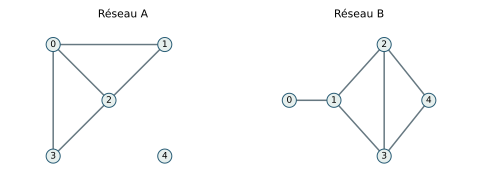
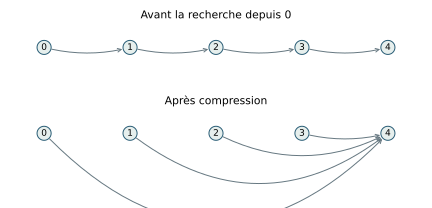

# X-ENS MP-PC · Informatique B 2016 · Corrigé brut

*Corrigé rédigé par IA, non officiel. Signalez toute erreur.*

**Rédaction** · GPT-6.2 Astra Ultra · vitesse non renseignée · 24 novembre 2026

## A.I · Réseaux sociaux

### Question 1 · Représenter les deux réseaux

Le réseau A peut être écrit $[5,[[0,1],[0,2],[1,2],[0,3],[2,3]]]$. Le sommet 4 n'a pas d'ami déclaré et fait partie des cinq individus. Le réseau B peut être écrit $[5,[[0,1],[1,2],[1,3],[2,3],[2,4],[3,4]]]$. L'ordre des paires et celui des extrémités sont libres.



### Question 2 · Réseau sans lien

Le premier champ conserve les $n$ individus. Un appel crée une nouvelle liste vide dans le deuxième champ, donc deux réseaux construits séparément peuvent évoluer indépendamment.

```python
def creerReseauVide(n):
    return [n, []]
```

### Question 3 · Lien non orienté

Le test est vrai dans l'ordre $(i,j)$ ou $(j,i)$. Il compare un nombre borné de valeurs et ne modifie pas la paire.

```python
def estUnLienEntre(paire, i, j):
    return ((paire[0] == i and paire[1] == j)
            or (paire[0] == j and paire[1] == i))
```

### Question 4 · Rechercher une amitié

Si aucun témoin n'est trouvé, il faut examiner les $m$ liens. Un test de paire ayant un coût constant, le pire cas est $\Theta(1+m)$.

```python
def sontAmis(reseau, i, j):
    for lien in reseau[1]:
        if estUnLienEntre(lien, i, j):
            return True
    return False
```

### Question 5 · Déclarer l'amitié une seule fois

La procédure ajoute une paire seulement en l'absence de lien existant. Le coût du test domine celui de l'ajout, soit $\Theta(1+m)$ dans le pire cas.

```python
def declareAmis(reseau, i, j):
    if not sontAmis(reseau, i, j):
        reseau[1].append([i, j])
```

### Question 6 · Liste des amis d'un individu

Le parcours examine les $m$ liens en $\Theta(1+m)$. Comme chacun est stocké une seule fois dans cette partie, on émet exactement une fois chaque ami et on obtient une liste vide pour un individu isolé.

```python
def listeDesAmisDe(reseau, i):
    resultat = []
    for a, b in reseau[1]:
        if a == i:
            resultat.append(b)
        elif b == i:
            resultat.append(a)
    return resultat
```

## A.II · Partitions

### Question 7 · Lire deux forêts de parents

Par ordre d'indice de 0 à 9, **A** donne $[5,1,1,3,4,5,1,5,5,7]$. Ses groupes sont $\{0,5,7,8,9\}$ de racine 5, $\{1,2,6\}$ de racine 1 et les singletons de racines 3 et 4. **B** donne $[3,9,0,3,9,4,4,7,1,9]$. Les racines sont 9 pour $\{1,4,5,6,8,9\}$, 7 pour $\{7\}$ et 3 pour $\{0,2,3\}$.

### Question 8 · Partition initiale

Il suffit d'écrire l'identité dans le tableau de parents. Cela donne $n$ racines et demande $\Theta(n)$ initialisations.

```python
def creerPartitionEnSingletons(n):
    parent = []
    for i in range(n):
        parent.append(i)
    return parent
```

### Question 9 · Remonter à la racine

Chaque itération suit une arête vers la racine. Dans une forêt valide, la profondeur est au plus $n-1$, soit un temps $O(n)$. Pour $n\ge1$, le tableau $[1,2,\ldots,n-1,n-1]$ avec départ à 0 oblige à remonter toute la chaîne. Le pire coût est donc $\Theta(n)$.

```python
def representant(parent, i):
    while parent[i] != i:
        i = parent[i]
    return i
```

### Question 10 · Fusionner par les représentants

Seul un lien entre racines distinctes peut réunir deux arbres entiers sans en détacher une branche. Lorsque les racines coïncident, l'affectation laisse la racine inchangée.

```python
def fusion(parent, i, j):
    a = representant(parent, i)
    b = representant(parent, j)
    parent[a] = b
```

### Question 11 · Construire un coût quadratique

Sans compression, appeler successivement $\mathrm{fusion}(parent,0,j)$ pour $j=1,\ldots,n-1$. Avant le $j$-ième appel, le chemin depuis 0 est $0\to1\to\cdots\to j-1$, et $j$ est encore isolé. L'appel coûte $\Theta(j)$ et accroche $j-1$ à $j$. Les $n-1$ fusions coûtent ainsi $\Theta(\sum_{j=1}^{n-1}j)=\Theta(n^2)$.

### Question 12 · Compression de chemin

La deuxième boucle rattache chaque sommet du chemin directement à la même racine, sans changer la partition. Si le chemin comportait $h$ arêtes, les deux passages prennent $\Theta(1+h)$ au total. La compression ne change donc pas l'ordre de grandeur du coût de cet appel et peut raccourcir les appels suivants.

```python
def representant(parent, i):
    r = i
    while parent[r] != r:
        r = parent[r]
    while i != r:
        suivant = parent[i]
        parent[i] = r
        i = suivant
    return r
```



### Question 13 · Extraire les groupes

Chaque individu est envoyé dans la liste de son unique représentant. Seules les listes non vides contiennent un groupe. L'initialisation crée des listes indépendantes, ce qui évite de mélanger les groupes. Le temps est $O(n(1+\alpha(n)))$ en désignant par $\alpha(n)$ le coût de recherche adopté dans le sujet.

```python
def listeDesGroupes(parent):
    cases = []
    for i in range(len(parent)):
        cases.append([])
    for i in range(len(parent)):
        cases[representant(parent, i)].append(i)
    groupes = []
    for g in cases:
        if len(g) != 0:
            groupes.append(g)
    return groupes
```

## A.III · Coupe aléatoire

### Question 14 · Contraction aléatoire et composantes isolées

Une arête uniforme du préfixe est échangée avec sa dernière arête puis définitivement exclue du tirage. Les permutations modifient seulement l'ordre de la liste non ordonnée du réseau. On ne décrémente le compteur de groupes que si deux racines distinctes ont été réunies. Si toutes les arêtes sont épuisées avec $g>2$ groupes, il faut **$g-2$ fusions** pour en obtenir deux. Le $g-1$ imprimé à l'étape 4 n'en laisserait qu'un. À ce stade les racines sont déjà des composantes sans arête entre elles ; les réunir arbitrairement garde une coupe de taille zéro. Pour $n\ge2$, le résultat contient toujours deux groupes non vides. Le coût est $O(n+m(1+\alpha(n)))$, car on traite au plus $m$ liens et le dernier parcours des racines est linéaire. Une seule exécution produit un candidat à la coupe minimum.

```python
import random

def coupeMinimumRandomisee(reseau):
    n, liens = reseau
    if n < 2:
        raise ValueError("deux groupes non vides sont requis")
    parent = creerPartitionEnSingletons(n)
    groupes = n
    possibles = len(liens)
    while groupes > 2 and possibles > 0:
        j = random.randint(0, possibles-1)
        a, b = liens[j]
        possibles -= 1
        liens[j], liens[possibles] = liens[possibles], liens[j]
        ra = representant(parent, a)
        rb = representant(parent, b)
        if ra != rb:
            parent[ra] = rb
            groupes -= 1
    if groupes > 2:
        premier = -1
        for i in range(n):
            if groupes > 2 and parent[i] == i:
                if premier == -1:
                    premier = i
                else:
                    parent[i] = premier
                    groupes -= 1
    return parent
```

### Question 15 · Taille de la coupe proposée

Chaque lien étant stocké une seule fois dans la représentation Python, il suffit d'incrémenter un compteur pour chaque paire de représentants différents. Le coût est $O(1+m(1+\alpha(n)))$. Cette quantité permet de comparer les résultats d'exécutions indépendantes.

```python
def tailleCoupe(reseau, parent):
    total = 0
    for i, j in reseau[1]:
        if representant(parent, i) != representant(parent, j):
            total += 1
    return total
```

## B · Requêtes SQL

### Question 16 · Identifiants des amis en SQL

En sélectionnant les lignes commençant par $x$, leurs secondes composantes sont déjà tous les amis recherchés. Le paramètre lié représente l'identifiant fourni.

```sql
SELECT DISTINCT id2
FROM LIENS
WHERE id1 = :x;
```

### Question 17 · Nom et prénom des amis

Le sous-test d'existence conserve une ligne par individu ami. Ainsi, deux amis homonymes restent deux personnes, et une répétition accidentelle du même lien ne multiplie pas les résultats.

```sql
SELECT p.nom, p.prenom
FROM INDIVIDUS AS p
WHERE EXISTS (
    SELECT 1 FROM LIENS AS l
    WHERE l.id1 = :x AND l.id2 = p.id
);
```

### Question 18 · Amis d'au moins un ami

L'alias « un » mène de $x$ à son ami, l'alias « deux » mène de cet ami à un individu recherché. DISTINCT élimine les répétitions si plusieurs chemins aboutissent au même individu. Dans la formulation littérale, $x$ apparaît lui-même dès qu'il possède un ami.

```sql
SELECT DISTINCT deux.id2
FROM LIENS AS un
JOIN LIENS AS deux ON deux.id1 = un.id2
WHERE un.id1 = :x;
```
