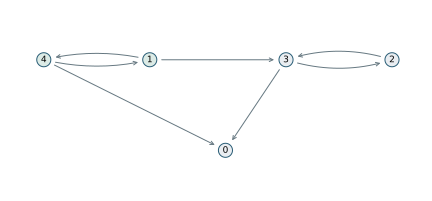
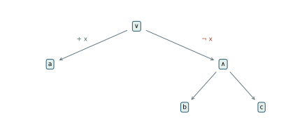

# X-ENS MP · Informatique A 2016 · Corrigé guidé

*Corrigé rédigé par IA, non officiel. Signalez toute erreur.*

**Rédaction** · GPT-6.2 Astra Ultra · vitesse non renseignée · 24 novembre 2026

**Révision** · GPT-6.2 Astra Ultra · vitesse non renseignée · 26 novembre 2026

## Repères

Pour une variable donnée, les deux sommets consécutifs codent ses signes opposés. Les temps individuels de fin de DFS diffèrent des maxima pris sur les composantes. Les programmes emploient Caml Light et les types fournis par le sujet.

## Préliminaires

### Question 1 · Quatre tests de satisfiabilité

**Indication.** Pour b et c, essayer les valuations constantes. Pour d, associer à chaque valuation le couple de littéraux qu'elle rend faux.

#### Solution

**a)** Insatisfiable. **b)** Satisfiable, par exemple si les trois variables valent faux. **c)** Satisfiable si les trois variables valent vrai. **d)** Insatisfiable.

### Question 2 · Plus grand indice d'une FNC

**Indication.** Accéder à l'indice avec le même filtrage pour les deux signes. Employer −1 comme valeur initiale.

#### Solution

Le premier parcours replie chaque clause sur le maximum déjà trouvé. Le second poursuit le même calcul sur les clauses suivantes. Le résultat reste $-1$ en l'absence de littéral, notamment pour la FNC vide. Le coût est linéaire dans le nombre de clauses et d'occurrences.

```ocaml
let indice = function V i -> i | NV i -> i;;

let var_max f =
  let lit maximum l = max maximum (indice l) in
  it_list (fun maximum c -> it_list lit maximum c) (-1) f;;
```

## I · Clauses unitaires

### Question 3 · Clauses unitaires

**Indication.** Mémoriser, pour chaque variable, la valeur imposée par sa première occurrence.

#### Solution

Après chaque clause acceptée, le tableau contient exactement les contraintes déjà lues. Une nouvelle valeur opposée crée une contradiction. Si le parcours aboutit, les valeurs mémorisées s'étendent en une valuation satisfaisante en affectant librement les variables restantes. Une disjonction vide vaut faux et la conjonction vide vaut vrai. L'initialisation coûte $O(r)$ et chaque clause s'examine en temps constant. Avec les indices contigus du sujet, $r\le n$ et le coût total est linéaire.

```ocaml
let un_sat f =
  let valeurs = make_vect (var_max f + 1) Indetermine in
  let impose i b =
    if valeurs.(i) = Indetermine then (valeurs.(i) <- b; true)
    else valeurs.(i) = b in
  let rec traite = function
    | [] -> true
    | [] :: suite -> false
    | [V i] :: suite -> impose i Vrai && traite suite
    | [NV i] :: suite -> impose i Faux && traite suite
    | _ -> failwith "1-FNC attendue"
  in traite f;;
```

## II · 2-SAT et composantes fortement connexes

### Question 4 · Coût du premier parcours

**Indication.** Distinguer les appels qui découvrent un sommet des simples tests sur un sommet déjà vu.

#### Solution

La boucle effectue $|V|$ appels initiaux. Le marquage précède toute descente récursive, donc chaque sommet parcourt sa liste de successeurs et entre dans la liste des fins exactement une fois. Les appels lancés par ces parcours sont exactement $\sum_{u\in V}\deg^+(u)=|E|$, y compris ceux qui rencontrent un sommet marqué. Chaque appel paie un test de marquage en temps constant. Les appels qui découvrent un sommet $u$ paient aussi $O(1+\deg^+(u))$ pour le marquage, le parcours de sa liste et l’insertion finale. La somme des degrés sortants vaut $|E|$. Compte tenu de l'initialisation, le temps total est $\Theta(|V|+|E|)$.

### Question 5 · Transposée du graphe

**Indication.** Pour chaque flèche lue dans la case i, insérer i en tête de la case du sommet d'arrivée.

#### Solution

L'arc $i\to j$ est présent dans l'entrée exactement autant de fois que $j\to i$ dans la sortie. Les sommets isolés conservent leur case. Chaque insertion en tête coûte $O(1)$ et le total $O(|V|+|E|)$.

```ocaml
let renverser_graphe g =
  let inverse = make_vect (vect_length g) [] in
  for i = 0 to vect_length g - 1 do
    do_list (fun j -> inverse.(j) <- i :: inverse.(j)) g.(i)
  done;
  inverse;;
```

### Question 6 · Composantes au second passage

**Indication.** Conserver un marquage commun à tous les départs et une liste courante propre à chaque nouveau départ.

#### Solution

Le parcours enregistre chaque sommet au moment de sa découverte. Les départs déjà marqués sont ignorés. L'inversion finale remet les composantes dans l'ordre d'extraction. Le travail de parcours est linéaire par le même comptage qu'en Q4 et l'inversion coûte au plus $O(|V|)$.

```ocaml
let dfs_cfc inverse ordre =
  let vu = make_vect (vect_length inverse) false in
  let composantes = ref [] in
  let rec visite courante i =
    if not vu.(i) then begin
      vu.(i) <- true;
      courante := i :: !courante;
      do_list (visite courante) inverse.(i)
    end in
  let commence i =
    if not vu.(i) then begin
      let courante = ref [] in
      visite courante i;
      composantes := !courante :: !composantes
    end in
  do_list commence ordre;
  rev !composantes;;
```

### Question 7 · Assembler les deux parcours

**Indication.** Calculer l'ordre sur le graphe initial et l'utiliser sur son transposé.

#### Solution

Les deux parcours et la transposition coûtent chacun $O(|V|+|E|)$. Les listes obtenues forment la partition dont la justification est donnée en Q11.

```ocaml
let cfc g = dfs_cfc (renverser_graphe g) (dfs_tri g);;
```

### Question 8 · Ordre de subordination

**Indication.** Écrire le sens du chemin pour chaque comparaison avant de vérifier les trois propriétés.

#### Solution

Notons $C\preceq D$ si un chemin va de $D$ à $C$. Le chemin de longueur zéro à partir d'un sommet de $C$ donne $C\preceq C$. Si $C\preceq D$ et $D\preceq F$, les chemins $F\to D$ et $D\to C$ se raccordent à l'intérieur de $D$, qui est fortement connexe. Ainsi $C\preceq F$. Enfin, si $C\preceq D$ et $D\preceq C$, tous les sommets de leur union se rejoignent dans les deux sens. La maximalité de chacune des composantes force $C=D$. Deux sommets isolés distincts montrent que l'ordre peut être partiel.

### Question 9 · Contre-exemple à l'inégalité sur les sommets

**Indication.** Dans la figure 2, suivre le parcours partant de 1. Le sommet 4 termine avant que le sommet 3 soit découvert.

#### Solution

La version distribuée demandait de déduire $t_i>t_j$ d'un chemin de $v_i$ vers $v_j$ en l'absence de chemin retour. Cette affirmation est **fausse**. Dans la figure 2, $v_4\to v_1\to v_3$ existe. À partir de $v_3$, seuls $v_3,v_2,v_0$ sont accessibles, donc aucun retour vers $v_4$ n'existe. Le parcours commence par 0, puis par 1. Depuis 1, il termine d’abord 4, dont les deux successeurs 0 et 1 sont déjà marqués. Il visite ensuite 3, puis 2, et termine 2 avant 3. Les premières fins sont donc $t_0<t_4<t_2<t_3<t_1$, comme dans l’ordre (2) du sujet. Le rapport du jury relève l'erreur. L'archive ENS saute ce numéro, reproduit dans le fac-similé du sujet distribué. [Fac-similé, p. 8](https://www.doc-solus.fr/prepa/sci/adc/pdf/enonces.pdf/2016/MP_INFO_X_1_2016.enonce.pdf) · [Rapport du jury, p. 3](https://www.ens.psl.eu/IMG/file/concours/2016/rapports/mpi-i/16_mp_rap_einfo_a.pdf)



### Question 10 · Ordre des maxima de fin

**Indication.** Pour un arc entre deux composantes, distinguer laquelle des deux est découverte la première.

#### Solution

Considérons un arc de $D$ vers $C$, avec $D\ne C$. Si le premier sommet découvert de leur union est dans $D$, son appel atteint tout $D$ puis tout $C$ avant de terminer. En effet, chaque sommet est accessible par un chemin dans l'union, dont les autres sommets étaient alors blancs. La fin de cet appel donne $t_D>t_C$. Si le premier sommet est dans $C$, son appel visite tout $C$. Il ne peut atteindre aucun sommet de $D$, car un retour de $C$ vers $D$ réunirait les deux composantes. Tout $C$ est donc terminé avant la découverte de $D$, et là encore $t_D>t_C$. En enchaînant le raisonnement sur les arcs d'un chemin de composantes on obtient $C\preceq D\Rightarrow t_C\le t_D$, avec égalité seulement si $C=D$.

### Question 11 · Pourquoi le second parcours isole chaque composante

**Indication.** Dans le graphe transposé, déterminer où pourrait conduire un premier arc quittant la composante en cours.

#### Solution

Supposons extraites les composantes des plus grands temps, sans recouvrement. Le premier sommet encore libre dans la liste appartient à la composante restante $C$ de plus grand $t_C$, car une composante libre possède encore son sommet de fin maximale. Un arc sortant de $C$ vers $D\ne C$ dans le transposé correspond à $D\to C$ dans $G$. D'après Q10, $t_D>t_C$ et $D$ est donc déjà marquée. Le DFS visite ainsi exclusivement des sommets libres de $C$. Il les visite tous par forte connexité dans le transposé. Cette récurrence s'initialise avec toutes les composantes libres et finit avec la partition de $V$ dans l'ordre annoncé.

### Question 12 · Graphe de l'exemple

**Indication.** Numéroter les positifs par les indices pairs et supprimer la clause tautologique.

#### Solution

Les sommets sont $v_0,\ldots,v_5$. La première clause donne $(v_3,v_4)$ et $(v_5,v_2)$. La clause $x_0$ donne $(v_1,v_0)$. La troisième est toujours vraie. La dernière donne $(v_4,v_0)$ et $(v_1,v_5)$. Il y a donc cinq arcs.

### Question 13 · Construire le graphe des implications

**Indication.** Employer une seule opération qui change le signe du littéral codé par un sommet.

#### Solution

La clause $a\lor b$ donne $\neg a\to b$ et $\neg b\to a$. Pour une unité, ces deux arcs coïncident et on l'insère une fois. Le code traite aussi une répétition de littéral et une tautologie. L'énoncé décrit le graphe des clauses de taille 1 ou 2. Si une clause vide se présente, la décision est immédiate et Q16 la traite en amont. La construction coûte $O(r+n)=O(n)$.

```ocaml
let sommet = function V i -> 2*i | NV i -> 2*i+1;;
let oppose s = if s mod 2 = 0 then s+1 else s-1;;

let deux_sat_vers_graphe f =
  let g = make_vect (2*(var_max f+1)) [] in
  let arc i j = g.(i) <- j :: g.(i) in
  let clause = function
    | [a] -> let s = sommet a in arc (oppose s) s
    | [a;b] ->
        let s = sommet a and t = sommet b in
        if t = s then arc (oppose s) s
        else if t <> oppose s then
          (arc (oppose s) t; arc (oppose t) s)
    | [] -> failwith "clause vide : formule insatisfiable"
    | _ -> failwith "2-FNC attendue"
  in do_list clause f; g;;
```

### Question 14 · Valeurs des littéraux d'une composante

**Indication.** Composer les implications le long d'un chemin, puis utiliser le chemin retour.

#### Solution

Écrivons $L_i=x_{\lfloor i/2\rfloor}$ pour $i$ pair et $L_i=\neg x_{\lfloor i/2\rfloor}$ pour $i$ impair. Toute valuation satisfaisante vérifie les implications de tous les arcs. Deux sommets d'une même composante fournissent les deux implications entre $L_i$ et $L_j$. Leurs valeurs sont donc égales. Si $i-j$ est pair, les deux signes sont égaux et les valeurs des variables sont égales. Si $i-j$ est impair, les signes diffèrent et les valeurs des variables sont opposées.

### Question 15 · Obstruction à la satisfiabilité

**Indication.** Appliquer Q14 aux deux représentations d'une même variable.

#### Solution

Si $v_{2i}$ et $v_{2i+1}$ appartenaient à la même composante, Q14 imposerait $\sigma(x_i)=\neg\sigma(x_i)$, impossible pour une valeur booléenne. Une formule satisfiable sépare donc ces deux sommets pour chaque $i$.

### Question 16 · Décider 2-SAT en temps linéaire

**Indication.** Étiqueter une fois chaque sommet par le numéro de sa composante. Deux consultations suffisent alors par variable.

#### Solution

Le critère de Q15 et sa réciproque admise donnent exactement la condition testée. La FNC vide est acceptée et une clause vide suffit à la rejeter. Le graphe possède $2r$ sommets et au plus deux arcs par clause. Chaque sommet reçoit une seule étiquette et chaque paire de signes est comparée une fois, d'où $O(n)$.

```ocaml
let deux_sat f =
  let rec contient_vide = function
    | [] -> false | [] :: suite -> true
    | _ :: suite -> contient_vide suite in
  if contient_vide f then false else
    let g = deux_sat_vers_graphe f in
    let numero = make_vect (vect_length g) (-1) in
    let etiquette = ref 0 in
    do_list (fun c ->
      do_list (fun s -> numero.(s) <- !etiquette) c;
      incr etiquette) (cfc g);
    let rec separes i =
      i >= vect_length g ||
      (numero.(i) <> numero.(i+1) && separes (i+2)) in
    separes 0;;
```

## III · Recherche exhaustive

### Question 17 · Connecteurs de Kleene

**Indication.** Pour chaque opération binaire, tester d'abord sa valeur absorbante.

#### Solution

Pour le « et », une seule valeur fausse impose faux et deux vraies imposent vrai. Pour le « ou », une seule vraie impose vrai et deux fausses imposent faux. Tous les cas résiduels restent indéterminés. La négation échange les deux valeurs déterminées. Chaque filtrage est de taille constante.

```ocaml
let et a b = match a,b with
  | Faux,_ -> Faux | _,Faux -> Faux | Vrai,Vrai -> Vrai
  | _ -> Indetermine;;
let ou a b = match a,b with
  | Vrai,_ -> Vrai | _,Vrai -> Vrai | Faux,Faux -> Faux
  | _ -> Indetermine;;
let non = function
  | Vrai -> Faux | Faux -> Vrai | Indetermine -> Indetermine;;
```

### Question 18 · Évaluer une FNC partiellement affectée

**Indication.** Réduire chaque clause à partir de faux, puis les résultats de clauses à partir de vrai.

#### Solution

Les deux réductions suivent respectivement les tables de la disjonction et de la conjonction, en tenant compte du signe dès la lecture du littéral. Les valeurs initiales donnent aussi les bonnes conventions pour une disjonction ou une conjonction vide. Chaque cellule de liste demande un travail constant, soit $O(n)$.

```ocaml
let eval f t =
  let valeur = function V i -> t.(i) | NV i -> non t.(i) in
  let clause c = it_list (fun b l -> ou b (valeur l)) Faux c in
  it_list (fun b c -> et b (clause c)) Vrai f;;
```

### Question 19 · Recherche avec arrêt anticipé

**Indication.** Au niveau i, seules les cases 0 à i−1 sont affectées. Restaurer la case i en quittant ce niveau.

#### Solution

Une évaluation déterminée garde la même valeur après toute extension de la valuation partielle, par les tables de Kleene. Si elle reste indéterminée, les deux sous-arbres correspondent aux deux valeurs possibles de $x_i$. Une valuation complète est toujours déterminée, donc le cas d'écriture dans le tableau suppose $i<r$. Par induction sur le nombre de cases libres, la fonction accepte exactement lorsqu'une extension satisfaisante existe. L'arbre a au plus $2^{r+1}-1$ appels de coût $O(n)$ chacun, soit $O(n2^r)\subseteq O(n2^n)$.

```ocaml
let k_sat f =
  let t = make_vect (var_max f+1) Indetermine in
  let rec explore i =
    (* Les cases a partir de i sont indeterminees. *)
    match eval f t with
      | Vrai -> true
      | Faux -> false
      | Indetermine ->
          t.(i) <- Vrai;
          let succes =
            explore (i+1) || (t.(i) <- Faux; explore (i+1)) in
          (* Retablir la valuation partielle du parent. *)
          t.(i) <- Indetermine;
          succes
  in explore 0;;
```

## IV · De SAT à une forme normale conjonctive

### Question 20 · Deux mises en forme normale conjonctive

**Indication.** Pour b, choisir un littéral dans chacun des trois couples et former toutes les clauses ainsi obtenues.

#### Solution

**a)** $(x_1\lor\neg x_0)\land(\neg x_4\lor x_3)\land(\neg x_4\lor x_2)$.

**b)** $\displaystyle\bigwedge_{i\in\{0,1\}}\ \bigwedge_{j\in\{2,3\}}\ \bigwedge_{k\in\{4,5\}}(x_i\lor x_j\lor x_k)$. Cette écriture représente huit clauses.

### Question 21 · Équisatisfiabilité avec des variables fraîches

**Indication.** Fixer d'abord les variables anciennes. Que demandent les deux familles de clauses lorsque le sélecteur vaut faux, puis vrai ?

#### Solution

Montrons la propriété plus précise suivante. Pour toute valuation des variables initiales, la sous-formule vaut vrai si et seulement si cette valuation admet une extension satisfaisant sa traduction. La descente des négations préserve toutes les valeurs par De Morgan et double négation. La propriété est immédiate sur un littéral. Pour une conjonction, les deux traductions doivent être vraies et leurs auxiliaires sont disjoints, donc leurs extensions peuvent se réunir. Pour une disjonction, si le sélecteur neuf $x$ est faux, les clauses de gauche gardent toutes leurs contraintes et celles de droite sont vraies. Si $x$ est vrai, les rôles s'inversent. Une extension existe donc exactement lorsqu'au moins un fils est vrai. La propriété se transmet à la racine et implique l'équisatisfiabilité demandée.

### Question 22 · Faire descendre les négations

**Indication.** Transmettre un booléen indiquant la parité du nombre de négations à appliquer au sous-arbre.

#### Solution

L'invariant de $\mathrm{descend}$ est de produire une formule équivalente à son argument en polarité positive, à sa négation en polarité négative. Une négation inverse la polarité et un connecteur binaire s'échange avec son dual en polarité négative. Seules les feuilles peuvent donc recevoir un constructeur de négation dans le résultat.

```ocaml
let negs_en_bas f =
  let rec descend negatif = function
    | Var i -> if negatif then Non (Var i) else Var i
    | Non g -> descend (not negatif) g
    | Et (a,b) ->
        let u = descend negatif a and v = descend negatif b in
        if negatif then Ou (u,v) else Et (u,v)
    | Ou (a,b) ->
        let u = descend negatif a and v = descend negatif b in
        if negatif then Et (u,v) else Ou (u,v)
  in descend false f;;
```

### Question 23 · Construire les clauses sans collision d'indices

**Indication.** En descendant vers une feuille, garder les sélecteurs qui doivent figurer dans sa clause.

#### Solution

On emploie ici la nouvelle fonction fournie $\mathrm{var\_max}$ sur les arbres de type formule. Le compteur commence au-delà du dernier indice initial et avance à chaque disjonction. Une feuille produit une clause composée de son littéral et des sélecteurs hérités. La branche gauche d'un « ou » reçoit le sélecteur positif et la droite son opposé, conformément à Q21. Les branches d'un « et » conservent les mêmes gardes. L'argument final « suite » est la liste de clauses à placer après celles du sous-arbre, ce qui évite les concaténations.

```ocaml
let formule_vers_fnc f =
  let prochaine = ref (var_max f+1) in
  let rec clauses gardes g suite = match g with
    | Var i -> (V i :: gardes) :: suite
    | Non (Var i) -> (NV i :: gardes) :: suite
    | Et (a,b) ->
        let droite = clauses gardes b suite in
        clauses gardes a droite
    | Ou (a,b) ->
        let i = !prochaine in
        incr prochaine;
        let droite = clauses (NV i :: gardes) b suite in
        clauses (V i :: gardes) a droite
    | Non _ -> failwith "negations attendues sur les feuilles"
  in clauses [] f [];;
```



### Question 24 · Bornes de temps et taille de la FNC

**Indication.** Distinguer le nombre de clauses, leur longueur écrite et le temps de construction d'une liste à queues partagées.

#### Solution

En Q22, chaque nœud de l'arbre initial est visité une fois, avec un travail propre borné. On obtient $O(n)$ opérations et $O(n)$ nœuds de sortie. Pour Q23, une feuille produit exactement une clause. Chaque nœud binaire réunit les clauses de ses deux fils, donc le nombre total de clauses est le nombre d'occurrences de littéraux, au plus $n$. Chaque clause contient son littéral et au plus un sélecteur par disjonction sur le chemin depuis la racine, donc au plus $n+1$ littéraux. La taille développée est $O(n^2)$ et l'écriture intégrale est polynomiale. En Caml, ajouter en tête partage la queue immuable déjà construite. Dans le code proposé, chaque nœud effectue un travail propre constant, même aux disjonctions. Avec l'appel initial à $\mathrm{var\_max}$, le temps de construction de cette représentation partagée et le nombre de cellules allouées sont ainsi $O(n)$.
