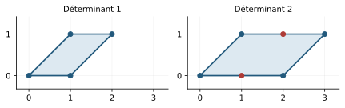
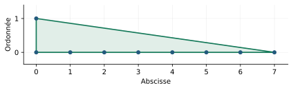
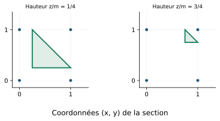
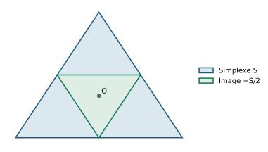
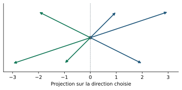
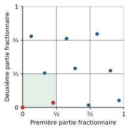
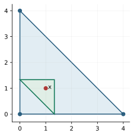

# X-ENS MP — Mathématiques A 2016 · Corrigé guidé

*Corrigé rédigé par IA, non officiel. Signalez toute erreur.*

**Rédaction** · modèle exact non renseigné (famille GPT-6) · effort non renseigné · vitesse non renseignée

**Révision** · modèle exact non renseigné (famille GPT-6) · effort non renseigné · vitesse non renseignée

**Révision (tour 2)** · GPT-6.2 Astra Ultra · vitesse non renseignée

**Révision (tour 3)** · GPT-6.2 Astra Ultra · vitesse non renseignée · 26 novembre 2026

## Présentation du sujet

Ce problème de quatre heures porte sur les matrices entières et les simplexes du réseau. Les 14 numéros donnés au concours établissent une finitude à équivalence entière près. Le PDF officiel ajoute cinq numéros hors concours démontrant les théorèmes admis. Les deux ensembles sont traités ici, soit 40 questions et sous-questions. [Sujet officiel](https://banques-ecoles.fr/cms/wp-content/uploads/2016/05/16_mp_sujet_maths_a.pdf)

> [!JURY]
> Le jury attire l’attention sur le signe du déterminant en 4a, sur le corps des relations de dépendance en 5a et sur une erreur d’inégalité dans la question 6 donnée le jour du concours. Le PDF d’archive utilisé ici contient l’inégalité issue de la transposition. [Rapport officiel](https://banques-ecoles.fr/cms/wp-content/uploads/2017/03/16_MP_rap_EmathA.pdf)

## I — Matrices entières et réduction triangulaire

Le groupe $\mathrm{GL}_n(\mathbb Z)$ est constitué des matrices entières de déterminant $\pm1$. Ces matrices sont dites unimodulaires.

### Question 1a

> [!INDICATION]
> Comment exprimer chaque coefficient d’une matrice inverse à partir de mineurs ?

> [!INDICATION]
> Les mineurs sont des déterminants entiers, et le déterminant de la matrice ne s’annule pas.

#### Solution

La formule $M^{-1}=\operatorname{adj}(M)/\det M$ fait intervenir des mineurs entiers au numérateur et un entier non nul au dénominateur. Chaque coefficient de l’inverse est donc rationnel.

### Question 1b

> [!INDICATION]
> Prenez les déterminants de la matrice et de son inverse.

> [!INDICATION]
> Quels sont les entiers dont l’inverse est encore entier ?

#### Solution

Si $M^{-1}$ est entière, $\det M$ et $\det(M^{-1})$ sont deux entiers de produit un. Ils valent donc tous deux $1$ ou tous deux $-1$. Réciproquement, si $\det M=\pm1$, la formule de 1a ne fait perdre aucune intégralité.

### Question 2a

> [!INDICATION]
> Testez l’image du réseau sur les vecteurs de la base canonique.

> [!INDICATION]
> L’égalité des réseaux donne aussi une propriété de l’inverse.

#### Solution

Si $M\in\mathrm{GL}_n(\mathbb Z)$, elle envoie le réseau dans lui-même et son inverse également, donc $M(\mathbb Z^n)=\mathbb Z^n$. Réciproquement, cette égalité impose que les images des vecteurs de base par $M$ et par $M^{-1}$ soient entières. Les deux matrices sont donc entières, et 1b conclut.

### Question 2b

> [!INDICATION]
> Le parallélépipède est l’image du cube par la matrice des colonnes.

> [!INDICATION]
> Dans la réciproque, réduisez les coordonnées d’un antécédent modulo un et cherchez son image dans le parallélépipède.

#### Solution

Si $M$ est unimodulaire, $M$ réalise une bijection du réseau sur lui-même et envoie $[0,1]^n$ sur $P$. Or les seuls points entiers du cube unité fermé ont toutes leurs coordonnées dans $\{0,1\}$. Cela donne exactement les sommets indiqués. Réciproquement, l’hypothèse rend chaque sommet $x_i$ entier, donc $M$ est entière. Pour $z\in\mathbb Z^n$, écrivons $M^{-1}z=m+t$ en prenant les parties entières coordonnée par coordonnée, avec $m\in\mathbb Z^n$ et $t\in[0,1[^n$. Le point $Mt=z-Mm$ est entier et dans $P$. Par hypothèse c’est un sommet, donc par injectivité $t$ a toutes ses coordonnées dans $\{0,1\}$. Comme elles sont strictement inférieures à un, $t=0$. Ainsi $z=Mm$, ce qui donne la surjectivité sur le réseau. Appliquons 2a.

### Question 3

> [!INDICATION]
> Calculez séparément le produit par la matrice élémentaire seule.

> [!INDICATION]
> Les indices échangent leur rôle lorsqu’on passe d’une multiplication à gauche à une multiplication à droite.

#### Solution

À gauche, $(I+\alpha E_{ij})M$ ajoute $\alpha$ fois la ligne $j$ à la ligne $i$ de $M$ et conserve les autres lignes. À droite, $M(I+\alpha E_{ij})$ ajoute $\alpha$ fois la colonne $i$ à la colonne $j$ et conserve les autres colonnes. Ces descriptions résultent directement de l’unique coefficient non nul de $E_{ij}$.

### Question 4a

> [!INDICATION]
> Comparez la dernière colonne à un multiple de la première.

> [!INDICATION]
> Une opération élémentaire permet de développer le déterminant selon une colonne presque nulle.

#### Solution

Soustrayons $v$ fois la première colonne à la dernière. Il reste en haut de cette dernière $u-va_1$, et toutes ses autres entrées s’annulent. Le mineur obtenu en supprimant première ligne et dernière colonne vaut $N$. D’où $\det M=(-1)^{n+1}(u-va_1)\det N$.

### Question 4b

> [!INDICATION]
> Écrivez Bézout entre la première coordonnée et le pgcd des coordonnées restantes.

> [!INDICATION]
> Le coefficient rationnel est autorisé si son dénominateur divise toutes les coordonnées qu’il multiplie.

#### Solution

Posons $d=\gcd(a_2,\ldots,a_n)>0$, $g=\gcd(a_1,d)$. Par Bézout, prenons des entiers $r,s$ tels que $rd+sa_1=g$. Posons $u=(-1)^{n+1}r$ et $v=(-1)^n s/d$. Les produits $va_i$ pour $i\geq2$ sont entiers puisque $d$ divise tous ces $a_i$. Ainsi la matrice est entière, et la formule de 4a donne $\det M=rd+sa_1=g$.

### Question 4c

> [!INDICATION]
> Traitez la taille deux directement par Bézout.

> [!INDICATION]
> Dans l’hérédité, isolez le cas où toutes les coordonnées après la première sont nulles.

#### Solution

Pour $n=2$, si $a_1,a_2$ ne sont pas tous nuls, choisissons $r,s$ avec $a_1r+a_2s=g$. La seconde colonne $(-s,r)^{\mathsf T}$ convient. Supposons le résultat acquis à l’ordre $n-1\geq2$. Si $(a_2,\ldots,a_n)\ne0$, il fournit $N$ et 4b achève la construction. Si cette famille est nulle, $a_1\ne0$. La matrice diagonale de diagonale $(a_1,\operatorname{sgn}(a_1),1,\ldots,1)$ a la première colonne voulue et son déterminant vaut $|a_1|$. Cela termine la récurrence.

### Question 5a

> [!INDICATION]
> Dans quel espace vectoriel sur les rationnels vivent les colonnes tronquées ?

> [!INDICATION]
> Éliminez les dénominateurs d’une relation puis son facteur commun.

#### Solution

Les $n$ colonnes tronquées appartiennent à $\mathbb Q^{n-1}$ et sont donc liées sur $\mathbb Q$. Multiplier une relation non triviale par un dénominateur commun donne des coefficients entiers. Divisons-les tous par leur pgcd positif pour obtenir les coefficients entiers premiers entre eux dans leur ensemble.

### Question 5b

> [!INDICATION]
> Quelle forme a l’image du vecteur de la relation précédente ?

> [!INDICATION]
> Après avoir réglé le signe, complétez sa colonne primitive à l’aide de la question 4.

#### Solution

Notons $a$ la colonne primitive trouvée en 5a. Les dernières coordonnées de $Ma$ sont nulles et la première ne l’est pas, puisque $a\ne0$ et $M$ est inversible. Changeons le signe de $a$ si nécessaire. En dimension $n\geq2$, la question 4 complète cette colonne en $A_1$ de déterminant un. La première colonne de $MA_1$ a donc la forme voulue. En dimension un, il suffit de prendre le signe de l’unique coefficient.

### Question 5c

> [!INDICATION]
> Utilisez le quotient de la division euclidienne pour modifier une colonne.

> [!INDICATION]
> La première colonne a tous ses coefficients nuls sous le pivot.

#### Solution

Pour chaque $j>1$, soustrayons $q_j$ fois la première colonne à la colonne $j$. Il s’agit de multiplier à droite par $I-q_jE_{1j}\in\mathrm{GL}_n(\mathbb Z)$. Seul le premier coefficient de chaque colonne visée change car la première colonne est nulle sous le pivot. Le nouveau premier coefficient vaut le reste $r_j$, donc $0\leq r_j<\widetilde c_{11}$.

### Question 5d

> [!INDICATION]
> Repérez le bloc carré restant sous la première ligne et à droite de la première colonne.

> [!INDICATION]
> Réduisez d’abord ce bloc, puis rétablissez les restes de la première ligne.

#### Solution

En taille un, choisir un signe pour obtenir un pivot positif. Supposons la conclusion vraie en taille $n-1$. Après 5b, le bloc inférieur droit est entier et inversible sur $\mathbb R$ puisque le déterminant total est non nul. Multiplions à droite par $\operatorname{diag}(1,B)$, où $B$ le réduit suivant l’hypothèse de récurrence. La première colonne reste fixée. Cette opération peut modifier les restes de la première ligne : appliquons 5c **après** la réduction du bloc. Elle ne touche plus les lignes du bas. On obtient la forme annoncée, avec tous ses pivots strictement positifs.

### Question 6

> [!INDICATION]
> Appliquez le résultat précédent à la transposée.

> [!INDICATION]
> Suivez séparément la position de l’entrée et celle de son pivot dans la transposition.

#### Solution

Appliquons 5 à $M^{\mathsf T}$ : il existe $B\in\mathrm{GL}_n(\mathbb Z)$ tel que $D=M^{\mathsf T}B$ soit triangulaire supérieure et $0\leq d_{ji}<d_{jj}$ pour $j<i$. Alors $A=B^{\mathsf T}$ est unimodulaire, $C=AM=D^{\mathsf T}$ est triangulaire inférieure, et $0\leq c_{ij}=d_{ji}<d_{jj}=c_{jj}$ pour $j<i$. C’est l’inégalité figurant dans le PDF officiel publié. Le rapport du jury signale que la version donnée le jour du concours comportait une erreur à cet endroit.

## II — Simplexes, volume et points entiers

Le simplexe $S$ de sommets affinement indépendants $s_0,\ldots,s_n$ est leur enveloppe convexe. Son volume vaut $|\det(s_1-s_0,\ldots,s_n-s_0)|/n!$. Son intérieur est noté $\mathring S$.

### Question 7a

> [!INDICATION]
> Utilisez le simplexe des coordonnées barycentriques, dans lequel les inégalités sont linéaires.

> [!INDICATION]
> L’image affine d’un compact convexe reste compacte et convexe.

#### Solution

L’ensemble des $(t_1,\ldots,t_n)$ vérifiant $t_i\geq0$ et $\sum_i t_i\leq1$ est fermé et borné, donc compact. Il est convexe comme intersection de demi-espaces. Son image par l’application affine continue $t\mapsto s_0+\sum_i t_i(s_i-s_0)$ est le simplexe $S$. Cette image est compacte et convexe.

### Question 7b

> [!INDICATION]
> Les coordonnées d’arêtes donnent un changement affine inversible.

> [!INDICATION]
> Décrivez quand une petite perturbation quitte le domaine, puis calculez les poids d’une combinaison avec un point intérieur.

#### Solution

L’application affine de 7a est un homéomorphisme de $\mathbb R^n$ par indépendance des $s_i-s_0$. Dans les coordonnées $t_1,\ldots,t_n$, les inégalités strictes $t_i>0$ et $\sum_i t_i<1$ définissent un ouvert du simplexe. Une égalité donne un point de bord, car une perturbation arbitrairement petite vers le demi-espace exclu sort du simplexe. Avec $t_0=1-\sum_i t_i$, l’intérieur est donc l’ensemble des points dont tous les poids barycentriques sont strictement positifs. Si $0$ a des poids $b_i>0$ et si $y\in S$ a des poids $t_i\geq0$, ceux de $\lambda y=(1-\lambda)0+\lambda y$ sont $(1-\lambda)b_i+\lambda t_i>0$ pour $0\leq\lambda<1$.

### Question 7c

> [!INDICATION]
> Travaillez sur le déterminant homogène de taille supérieure.

> [!INDICATION]
> Soustrayez la première colonne à toutes les autres et développez selon la première ligne.

#### Solution

Soustrayons la première colonne à toutes les autres dans le déterminant des $\widehat s_i$. La première ligne devient $(1,0,\ldots,0)$ et le mineur restant a colonnes $s_i-s_0$. Ainsi $|\det(\widehat s_0,\ldots,\widehat s_n)|=n!\operatorname{Vol}(S)$. Toute permutation des sommets ne change que le signe du déterminant. Le volume est donc indépendant de leur ordre.

### Question 8a

> [!INDICATION]
> Une bande entière de largeur un peut être très longue.

> [!INDICATION]
> Placez une base horizontale de longueur entière arbitraire et le sommet une unité plus haut.

#### Solution

Prenons le triangle de sommets $(0,0),(m,0),(0,1)$ pour un entier $m\geq\max(1,2V)$. Son aire est $m/2\geq V$ et l’ordonnée de tout point intérieur est strictement comprise entre zéro et un. Aucun point intérieur n’est entier.

### Question 8b

> [!INDICATION]
> Un tétraèdre de Reeve élève son quatrième sommet au-dessus du point $(1,1)$.

> [!INDICATION]
> À une hauteur intermédiaire, comparez les bornes inférieures de $x,y$ à la borne supérieure de leur somme.

#### Solution

Prenons le tétraèdre de sommets $0,e_1,e_2,(1,1,m)$, où $m\geq\max(1,6V)$ est entier. Son volume est $m/6$. Pour un point de hauteur $z$, écrivons $c=z/m$. Les conditions barycentriques sont $0\leq c\leq1$, $x\geq c$, $y\geq c$, $x+y\leq1+c$. Si $0<c<1$ et $x,y$ sont entiers, les deux premières bornes donnent $x+y\geq2>1+c$, impossible. À $c=0$, le triangle unité contient uniquement $0,e_1,e_2$ comme points entiers. À $c=1$ il reste seulement le sommet $(1,1,m)$. Ce sont donc tous les points entiers.

Pour un corps convexe compact contenant zéro à l’intérieur, $a(K)=\sup\{\lambda\geq0:-\lambda K\subset K\}$.

### Question 9a

> [!INDICATION]
> Quelle valeur de dilatation est toujours admissible ?

> [!INDICATION]
> Utilisez les segments joignant l’origine aux points déjà connus dans le convexe.

#### Solution

Zéro est admissible. Si $-\lambda K\subset K$ pour un $\lambda>0$, alors, pour $0\leq\mu\leq\lambda$, chaque point de $-\mu K$ est un multiple par $\mu/\lambda$ d’un point de $K$. Il appartient à $K$ par convexité avec zéro. Les valeurs admissibles forment donc un intervalle commençant en zéro.

### Question 9b

> [!INDICATION]
> Un point de norme maximale borne tous les rapports admissibles.

> [!INDICATION]
> Passez à la limite pour chaque point fixé en utilisant la fermeture du compact.

#### Solution

Comme $K$ est compact, $R=\max_{x\in K}\|x\|$ est fini et réalisé. De plus $R>0$ car zéro est intérieur. Pour un point réalisant ce maximum, son image dans $-\lambda K\subset K$ impose $\lambda R\leq R$. Toute valeur admissible est donc au plus un. Enfin, si $\lambda_j\to\lambda$ avec chaque $\lambda_j$ admissible, pour tout $x\in K$, $-\lambda_jx\in K$ et $K$ est fermé, donc $-\lambda x\in K$. L’ensemble admissible est fermé, non vide et borné, donc son supremum est atteint.

### Question 9c

> [!INDICATION]
> Inscrivez une boule autour de l’origine et circonscrivez le compact dans une autre.

> [!INDICATION]
> Pour la symétrie, prenez les opposés dans l’inclusion au rapport maximal.

#### Solution

Prenons $r>0$ assez petit pour que la boule fermée de centre zéro et rayon $r$ soit incluse dans $K$. Comme $K$ est contenu dans la boule de rayon $R$ de 9b, $-(r/R)K\subset K$, donc $a(K)\geq r/R>0$. La borne $a(K)\leq1$ vient de 9b. Si $a(K)=1$, la valeur est atteinte et $-K\subset K$. En prenant les opposés on obtient l’autre inclusion. Réciproquement, la symétrie rend la valeur un admissible.

On admet que tout simplexe de volume au moins $k$ contient $k+1$ points distincts dont toutes les différences sont entières. Le nombre $k$ choisi dans la question 10 est le plus grand entier strictement inférieur à $\operatorname{Vol}(S)(a/(a+1))^n$.

### Question 10a

> [!INDICATION]
> Suivez la matrice des arêtes sous translation et sous homothétie.

> [!INDICATION]
> Le symbole particulier du sujet désigne le plus grand entier strictement inférieur.

#### Solution

L’homothétie multiplie chaque colonne de la matrice des arêtes par $\beta$, donc $\operatorname{Vol}(\beta S)=|\beta|^n\operatorname{Vol}(S)$. Une translation ne change aucune différence de sommets, donc $\operatorname{Vol}(S-x)=\operatorname{Vol}(S)$. Posons $L=\operatorname{Vol}(S)(a/(a+1))^n$. Par définition de la partie entière **strictement** inférieure, $k<L$, même si $L$ est entier. Le volume cherché vaut $\lambda^n L$, donc dépasse $k$ pour $\lambda<1$ assez proche de un.

### Question 10b

> [!INDICATION]
> Écrivez chaque point dans le petit simplexe comme multiple d’un point du grand.

> [!INDICATION]
> Utilisez la définition de l’asymétrie pour exprimer une différence comme combinaison convexe suivie d’une homothétie.

#### Solution

Écrivons $v_i=\lambda a x_i/(a+1)$ avec $x_i\in S$. Comme $-aS\subset S$, on a $-ax_j\in S$. Alors
$$v_i-v_j=\lambda\left(\frac{a}{a+1}x_i+\frac1{a+1}(-a x_j)\right)\in\lambda S$$
par convexité. Comme $0$ est intérieur et $\lambda<1$, 7b donne $v_i-v_j\in\mathring S$.

### Question 10c

> [!INDICATION]
> Choisissez une direction qui sépare tous les points par leurs projections.

> [!INDICATION]
> Prenez le point d’indice minimal dans cette direction pour distinguer les différences de leurs opposées.

#### Solution

Choisissons une forme linéaire prenant des valeurs distinctes sur les $v_i$. C’est possible en évitant l’union finie des hyperplans orthogonaux aux différences non nulles (par exemple évaluer les produits avec $(1,t,\ldots,t^{n-1})$ en évitant les racines d’un nombre fini de polynômes). Au point $v_j$ de valeur minimale, tous les $v_i-v_j$ pour $i\ne j$ ont une valeur strictement positive ; leurs opposés ont une valeur négative. Les différences dans chaque famille sont distinctes et aucune n’est zéro. Ainsi on obtient $2k+1$ points entiers intérieurs distincts, en utilisant aussi 10b avec les indices intervertis. Cela prouve la première borne, $2\lceil L\rceil-1$. Puis $L\leq k+1\leq 2k+1$, et $a/(a+1)\geq a/2$ par 9c. D’où $\operatorname{Card}(\mathring S\cap\mathbb Z^n)\geq \operatorname{Vol}(S)(a/2)^n$.

## III — Équivalence et finitude

Deux simplexes sont équivalents si, avec une énumération convenable de leurs sommets, une matrice unimodulaire envoie les arêtes issues du premier sommet sur les arêtes correspondantes de l’autre simplexe.

### Question 11

> [!INDICATION]
> Une égalité sur les vecteurs d’arêtes devient affine sur les sommets.

> [!INDICATION]
> Dans l’autre sens, une application affine bijective transporte les points extrémaux.

#### Solution

Si les vecteurs d’arêtes se correspondent par $A$, les sommets satisfont $s'_i=As_i-b$ avec $b=As_0-s'_0\in\mathbb Z^n$. L’application affine envoie alors leurs enveloppes convexes l’une sur l’autre. Réciproquement, une bijection affine envoyant $S$ sur $S'$ envoie les points extrémaux sur les points extrémaux, puisque toute écriture en combinaison convexe se transporte dans les deux sens. Les points extrémaux d’un simplexe sont ses sommets par unicité des coordonnées barycentriques. En ordonnant les sommets selon cette correspondance et en prenant les différences, on obtient l’équivalence demandée.

### Question 12

> [!INDICATION]
> Regardez les effets séparés sur le déterminant, le réseau et les ouverts.

> [!INDICATION]
> La transformation affine et son inverse conservent les points entiers.

#### Solution

La valeur absolue du déterminant d’une matrice unimodulaire est un. En appliquant la formule des arêtes, le volume est donc conservé. L’application affine de 11 est une bijection du réseau sur lui-même par 2a et l’intégralité de la translation. Elle est aussi un homéomorphisme et envoie l’intérieur sur l’intérieur. Elle donne ainsi deux bijections, entre tous les points entiers puis entre tous les points entiers intérieurs.

### Question 13

> [!INDICATION]
> Formez la matrice qui contient toutes les arêtes issues d’un sommet.

> [!INDICATION]
> Chaque pivot positif divise le déterminant en valeur absolue. Que cela implique-t-il aussi pour les coefficients de sa colonne ?

#### Solution

Translatons $s_0$ à l’origine et formons la matrice entière $M$ de colonnes $s_i-s_0$. La question 6 donne un $A$ unimodulaire et une forme triangulaire inférieure $AM$ avec pivots entiers strictement positifs $d_j$. Leur produit vaut $|\det M|=n!\operatorname{Vol}(S)$. Chaque pivot est donc au plus ce produit, et chaque coefficient sous le pivot de sa colonne est compris entre zéro et ce pivot. Les colonnes de $AM$ et l’origine appartiennent au cube annoncé, donc aussi le simplexe qu’elles engendrent par convexité. Il est équivalent à $S$ par 11.

### Question 14

> [!INDICATION]
> Placez un représentant de chaque classe dans le cube de 13.

> [!INDICATION]
> Combien de familles de sommets entiers peut-on choisir dans un cube borné ?

#### Solution

Pour un nombre fixé $k>0$ de points entiers intérieurs, le théorème 2 donne $\operatorname{Vol}(S)\leq C(n,k)$. D’après 13, chaque classe possède un représentant dont les sommets sont des points entiers du cube $[0,n!C(n,k)]^n$. Cet ensemble de points est fini, donc il n’y a qu’un nombre fini de choix de $n+1$ sommets, et a fortiori un nombre fini de classes. L’hypothèse $k>0$ intervient réellement. Les tétraèdres de 8b n’ont aucun point entier intérieur, alors que leurs volumes $m/6$ sont distincts quand $m$ varie. Une équivalence a un déterminant de valeur absolue un et conserve le volume. Ces tétraèdres appartiennent donc à une infinité de classes pour $k=0$.

## IV — Complément publié hors concours

Les questions 15 à 19 ne faisaient pas partie de l’épreuve de quatre heures. Elles établissent les deux théorèmes admis aux parties II et III : la présence de points dans une même classe modulo le réseau, puis la borne de volume à nombre de points intérieurs fixé.

### Question 15a

> [!INDICATION]
> Découpez le simplexe par les cubes entiers semi-ouverts, puis ramenez les morceaux dans le cube unité.

> [!INDICATION]
> L’intégrale du nombre de recouvrements mesure le volume total de départ.

#### Solution

Soit $Q=[0,1[^n$. Puisque $S$ est borné, seuls un nombre fini de cubes $u+Q$, $u\in\mathbb Z^n$, le rencontrent. Ils pavent l’espace sans recouvrement. En translatant les morceaux ramenés dans $Q$, on obtient
$$\int_Q\sum_{u\in\mathbb Z^n}\mathbf 1_{S-u}(x)\,\mathrm dx=\sum_u\operatorname{Vol}(S\cap(u+Q))=\operatorname{Vol}(S)>k.$$
Si en tout point la somme était au plus $k$, son intégrale serait au plus $k\operatorname{Vol}(Q)=k$. Il existe donc $x\in Q$ appartenant à au moins $k+1$ translatés distincts $S-u_i$.

### Question 15b

> [!INDICATION]
> Un point appartenant à plusieurs translatés fournit plusieurs points dans le simplexe initial.

> [!INDICATION]
> Quelle est la différence entre deux de ces points ?

#### Solution

Posons $v_i=x+u_i$. Ils appartiennent à $S$, sont distincts car les $u_i$ le sont, et vérifient $v_i-v_j=u_i-u_j\in\mathbb Z^n$.

### Question 15c

> [!INDICATION]
> Approchez le simplexe de volume égal au seuil par des homothétiques de volume supérieur.

> [!INDICATION]
> Les points obtenus sont bornés et leurs différences entières non nulles ont norme au moins un.

#### Solution

Pour $k=0$ il suffit d’un point de $S$. Pour $k>0$ et $\operatorname{Vol}(S)=k$, prenons $S_m=(1+1/m)S$. Par 10a son volume est strictement supérieur à $k$. Les questions précédentes donnent $k+1$ points $v_{i,m}\in S_m$ dont les différences sont entières. Tous ces points restent bornés. Par extraction simultanée, ils tendent vers $v_i\in S$ car $v_{i,m}/(1+1/m)\in S$ et $S$ est fermé. Les différences ont des limites entières car le réseau est fermé. Pour $i\ne j$, leur norme était au moins un à chaque étape, donc la limite reste non nulle. Le cas d’égalité est ainsi couvert.

### Question 16a

> [!INDICATION]
> Répartissez les vecteurs des parties fractionnaires dans des cubes de côté $1/N$.

> [!INDICATION]
> Deux indices dans le même cube donnent un dénominateur commun en prenant leur différence.

#### Solution

Découpons $[0,1[^{n-1}$ en $N^{n-1}$ cubes semi-ouverts de côté $1/N$. Parmi les $N^{n-1}+1$ vecteurs de parties fractionnaires, deux appartiennent au même cube, d’indices $a<b$. Posons $q=b-a$ et, pour $i\geq2$, $p_i=\lfloor bt_i\rfloor-\lfloor at_i\rfloor\geq0$. Alors $1\leq q\leq N^{n-1}$ et $|qt_i-p_i|=|\{bt_i\}-\{at_i\}|<1/N$. En dimension un, où cette famille de coordonnées est vide, on peut directement prendre $q=1$.

### Question 16b

> [!INDICATION]
> Utilisez la condition de somme pour définir l’entier restant.

> [!INDICATION]
> La somme des erreurs donne une borne strictement inférieure à un, ce qui force la positivité au sens large.

#### Solution

Posons $p_1=q-\sum_{i=2}^n p_i$ afin d’avoir la somme demandée. Puisque $\sum_i t_i=1$,
$$|qt_1-p_1|\leq\sum_{i=2}^n|qt_i-p_i|\leq(n-1)/N\leq n/N.$$
Comme $(n-1)/N<1$ et $qt_1>0$, l’entier $p_1$ est supérieur à $-1$, donc positif ou nul. En dimension un on obtient simplement $p_1=q=1$.

### Question 17a

> [!INDICATION]
> En dimension un, essayez les deux plus petits entiers autorisés.

> [!INDICATION]
> La borne donnée à la coordonnée permet de vérifier directement l’unique inégalité.

#### Solution

Avec $\alpha(k,1)=1/(k+1)$, la condition donne $t_1>k/(k+1)$. Choisir $q=p_1=1$ assure alors $(kq+1)t_1>kp_1$, ainsi que la somme requise.

### Question 17b

> [!INDICATION]
> Supprimez provisoirement la plus petite coordonnée.

> [!INDICATION]
> Les autres sont encore dans l’intervalle de récurrence. Comment compléter la famille d’entiers obtenue ?

#### Solution

Si $t_n<\alpha(k,n-1)-\alpha$, on a $1>\sum_{i<n}t_i=1-\alpha-t_n>1-\alpha(k,n-1)$. Appliquons l’hypothèse de récurrence aux $n-1$ premiers coefficients et complétons par $p_n=0$. La somme des $p_i$ reste $q>0$ et l’inégalité pour l’indice $n$ est stricte puisque $t_n>0$.

### Question 17c

> [!INDICATION]
> Normalisez les coordonnées pour que leur somme vaille un, puis appliquez 16.

> [!INDICATION]
> Contrôlez séparément l’erreur de la plus grande coordonnée et les erreurs des autres. Servez-vous des deux termes dans la définition de $N$.

#### Solution

Notons $A=\alpha(k,n-1)$, $B=\alpha(k,n)=1/(4kN^{n-1})$ et $N=1+\max(4k/A,2kn(n+1))$. Ces $N$ sont bien entiers par récurrence car $1/\alpha(k,1)=k+1$ est entier, puis $1/B=4kN^{n-1}$ l’est aussi. Puisque $n\geq2$, $N^{n-1}\geq N$. Les deux bornes sur $N$ donnent $B<\min(1/(n+1),A/2)$. La question 16 pour $t_i/(1-\alpha)$ fournit $q\leq N^{n-1}$ et $p_i$ de somme $q$. Comme $\alpha<B$ et $1-\alpha>1/2$, on a $kq\alpha/(1-\alpha)<1/2$.

Écrivons $p_i=q t_i/(1-\alpha)+e_i$. Alors $|e_i|\leq1/N$ pour $i\geq2$ et $|e_1|\leq n/N$. Par suite
$$(kq+1)t_i-kp_i=t_i\left(1-\frac{kq\alpha}{1-\alpha}\right)-ke_i\geq t_i/2-k|e_i|.$$
Pour $i\geq2$, $t_i\geq t_n\geq A-\alpha>A/2$, et $k/N<A/4$. Pour $i=1$, le plus grand coefficient est au moins $(1-\alpha)/n>1/(n+1)$ et $kn/N<1/(2(n+1))$. Les différences sont donc toutes strictement positives, ce qui conclut la récurrence.

### Question 18a

> [!INDICATION]
> Si la somme est trop proche de un, appliquez 17 et prenez un pas entier à partir du point intérieur.

> [!INDICATION]
> Suivez les coefficients barycentriques le long des $k+1$ points équidistants. Il suffit de vérifier leur positivité aux deux extrémités.

#### Solution

Supposons $1>\sum_i t_i>1-\alpha(k,n)$. Pour appliquer la construction de 17, on peut réordonner les sommets non nuls et leurs coefficients ensemble, de manière à obtenir $t_1\geq\cdots\geq t_n$. Cette permutation conserve $x$ et le simplexe. La question 17 fournit $p_i,q$ et nous posons $s=\sum_i p_i s_i$. Pour $j=0,\ldots,k$, le point $x_j=(jq+1)x-js$ est entier. Ses coefficients sur les $s_i$ sont $t_i+j(qt_i-p_i)$, strictement positifs en $j=0$ et $j=k$ par 17, donc tout au long de cet intervalle par affinité. Leur somme vaut $(jq+1)\sum_i t_i-jq<1$. Les points sont ainsi intérieurs par 7b. Ils sont distincts : le pas $qx-s$ ne peut être nul, car l’indépendance des $s_i$ imposerait $qt_i=p_i$ pour tous, puis $q\sum_i t_i=q$, impossible. On aurait $k+1$ points entiers intérieurs pour un simplexe qui en possède exactement $k$. D’où $\sum_i t_i\leq1-\alpha(k,n)$.

### Question 18b

> [!INDICATION]
> L’appartenance après translation équivaut à l’appartenance d’un multiple de $x$ au simplexe initial.

> [!INDICATION]
> Utilisez la somme bornée des coefficients de 18a pour ce nouveau multiple.

#### Solution

Écrivons $B=\alpha(k,n)$ et $\delta=B/(1-B)$. Comme $1+\delta=1/(1-B)$, la somme des coefficients de $(1+\delta)x$ sur les $s_i$ est au plus un par 18a, et ceux-ci sont positifs. Donc $(1+\delta)x\in S$, ce qui équivaut à $\delta x\in S-x$.

### Question 18c

> [!INDICATION]
> Il suffit de prouver l’inclusion cherchée pour les sommets du simplexe homothétique.

> [!INDICATION]
> Réappliquez 18b en plaçant successivement chaque sommet à l’origine.

#### Solution

Il faut vérifier que $-\delta(S-x)\subset S-x$. Pour chaque sommet $s_j$, translatons $s_j$ à l’origine, avec $s_0=0$. Le simplexe translaté est encore entier avec les mêmes $k$ points intérieurs entiers et $x-s_j$ est l’un d’eux. La question 18b appliquée dans cette configuration donne $\delta(x-s_j)\in(S-s_j)-(x-s_j)=S-x$. Ainsi les images des sommets de $S-x$ par la multiplication par $-\delta$ appartiennent à $S-x$. Par convexité, toute leur enveloppe y appartient. On obtient $a(S-x)\geq\delta$. On peut aussi calculer ce coefficient exactement. Soient $b_0,\ldots,b_n$ les poids barycentriques du point intérieur $x$. Pour que $-\lambda(S-x)\subset S-x$, il suffit et il faut que chaque sommet $s_i$ ait son image $(1+\lambda)x-\lambda s_i$ dans $S$. Ses poids valent $(1+\lambda)b_j$ pour $j\ne i$ et $(1+\lambda)b_i-\lambda$ pour $j=i$. Le dernier est le seul susceptible de devenir négatif. Par conséquent,
$$a(S-x)=\min_{0\le i\le n}\frac{b_i}{1-b_i}.$$
Au barycentre, tous les poids valent $1/(n+1)$ et le coefficient exact est $1/n$.

### Question 19

> [!INDICATION]
> Centrez le simplexe sur un de ses points entiers intérieurs.

> [!INDICATION]
> Combinez le comptage de 10c avec la minoration uniforme de l’asymétrie.

#### Solution

Prenons un point intérieur entier $x$ d’un simplexe entier possédant exactement $k>0$ tels points. Après translation d’un sommet entier, 18c s’applique. Le simplexe $S-x$ contient zéro dans son intérieur et possède encore $k$ points intérieurs entiers. Les questions 10c et 18c donnent
$$k\geq\operatorname{Vol}(S)\left(\frac{a(S-x)}{2}\right)^n\geq\operatorname{Vol}(S)\left(\frac{\alpha(k,n)}{2(1-\alpha(k,n))}\right)^n.$$
Il suffit donc de choisir $C(n,k)=k[2(1-\alpha(k,n))/\alpha(k,n)]^n$, qui dépend uniquement de $n$ et de $k$. En dimension un, tout segment à extrémités entières ayant exactement $k$ points entiers intérieurs a pour longueur $k+1$. C’est la constante optimale dans cette dimension. La formule obtenue, avec $\alpha(k,1)=1/(k+1)$, donne $2k^2$, qui majore bien $k+1$ pour tout entier $k\geq1$.

## Bilan

Les transformations unimodulaires conservent le réseau et le volume. La forme triangulaire borne les coordonnées d’un représentant par son volume normalisé. Le complément relie ensuite ce volume au nombre de points entiers intérieurs à l’aide de l’asymétrie du simplexe recentré.
