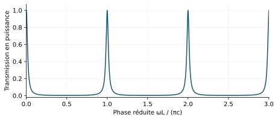
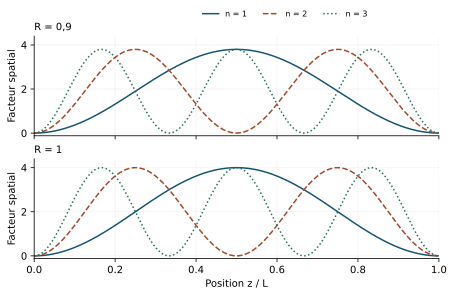
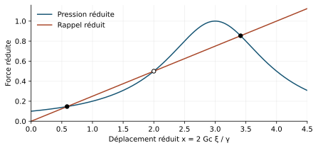
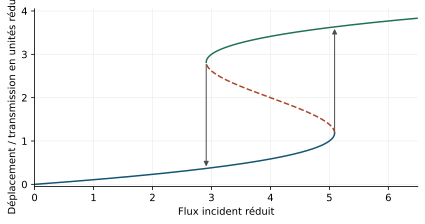

# X-ENS MP 2016 — Physique · Corrigé brut

*Corrigé rédigé par IA, non officiel. Signalez toute erreur.*

**Lecture du rapport du jury** · GPT-6.2 Astra Ultra · vitesse non renseignée

**Rédaction** · GPT-6.2 Astra Ultra · vitesse non renseignée

## Optomécanique en cavité

## I — Cavité de longueur fixe

### Question 1 — Réflexion et transmission en puissance

$R=P_{\rm réfl}/P_{\rm inc}=\rho^2$ et $T=P_{\rm trans}/P_{\rm inc}=\tau^2$ sont les fractions de puissance réfléchie et transmise par un miroir isolé. Les deux ondes se propagent dans le même milieu de part et d’autre, d’où le carré des coefficients en amplitude. L’égalité $R+T=1$ exprime le bilan de puissance pour un miroir sans absorption ni autre perte.

### Question 2 — Onde sortante au-delà du miroir

La source se trouve à gauche. Dans la cavité, les deux miroirs renvoient des ondes en sens opposés. En aval de $M_2$, aucune source ni surface ne renvoie d’onde de la droite vers la gauche. La solution physique contient donc la seule onde progressive sortante $E_t e^{i\omega(t-z/c)}$.

### Question 3 — Raccordement sur les deux faces internes

Posons $k=\omega/c$. Au premier miroir, le champ partant vers la droite est la somme du champ incident transmis et du champ de retour réfléchi. Au second miroir, l’onde qui arrive porte la phase $e^{-ikL}$. Les coefficients sont définis pour les champs au même point. En omettant $e^{i\omega t}$, il vient
$$
E_+=\tau E_i-\rho E_-,\qquad
E_-e^{ikL}=-\rho E_+e^{-ikL},\qquad
E_te^{-ikL}=\tau E_+e^{-ikL}.
$$

### Question 4 — Fonction de transmission complexe

La deuxième relation donne $E_-=-\rho e^{-2ikL}E_+$, la troisième $E_t=\tau E_+$. En les portant dans la première, $(1-Re^{-2ikL})E_+=\sqrt T E_i$. Avec $\Theta=T/(1-Re^{-2ikL})$ on obtient
$$
E_+=\frac{\Theta}{\sqrt T}E_i,\qquad
E_-=-\Theta\sqrt{\frac RT}\,e^{-2ikL}E_i,\qquad
E_t=\Theta E_i .
$$
Le facteur $Re^{-2ikL}$ est le facteur complexe acquis en un aller-retour.

### Question 5 — Transmission en intensité

Écrivons $u=\omega L/c$. Le module carré du dénominateur vaut $1+R^2-2R\cos(2u)=(1-R)^2+4R\sin^2u$. Ainsi
$$
|\Theta|^2=\frac{1}{1+(4R/T^2)\sin^2u}.
$$
Pour $R=0{,}9$, le facteur devant $\sin^2u$ est $360$. La fonction, de période $\pi$ en $u$, présente des pics étroits de hauteur $1$ et des minima de valeur $1/361$.

### Question 6 — Pulsations propres de résonance

La transmission atteint son maximum lorsque $\sin(\omega L/c)=0$. Les résonances de pulsation positive sont donc $\omega_n=n\pi c/L$, $n=1,2,\ldots$. À ces pulsations les champs issus d’allers-retours successifs sont en phase. La transmission en intensité vaut un, donc $I_t=I_i$ pour ces deux miroirs identiques. La longueur contient $n$ demi-longueurs d’onde.

### Question 7 — Interférences dans la cavité

Le champ complexe intérieur se factorise en $E_+e^{-ikz}[1-\sqrt R\,e^{2ik(z-L)}]$. En prenant le module carré pour l’intensité électrique locale, avec la même constante de proportionnalité que pour l’onde incidente, on obtient
$$
I_{\rm II}(z)=\frac{|\Theta|^2}{T}I_i\,\mathcal L(\omega,z),\qquad
\mathcal L=1+R-2\sqrt R\cos[2k(z-L)] .
$$
La modulation spatiale provient de l’interférence des deux ondes contrapropagatives. Le flux énergétique longitudinal moyen, qui fait intervenir aussi le champ magnétique, est uniforme.

### Question 8 — Forme des modes

À résonance la phase dans le cosinus se réduit modulo $2\pi$ à $2n\pi z/L$. Les minima de $\mathcal L$ se trouvent en $z=jL/n$ pour $j=0,\ldots,n$ et valent $(1-\sqrt R)^2$. Les maxima sont à mi-distance et valent $(1+\sqrt R)^2$. Pour $R=0{,}9$, les extrêmes sont voisins de $0{,}0026$ et $3{,}8$. Pour $R=1$ on a $\mathcal L=4\sin^2(n\pi z/L)$, avec des nœuds fixes et des ventres de valeur $4$. Il s’agit d’une onde stationnaire, superposition de deux ondes de même amplitude. La limite décrit la forme d’un mode propre de la cavité fermée, dont le couplage à l’onde incidente s’annule pour $T=0$.

### Question 9 — Approximation près d’une résonance

Posons $s=(\omega-\omega_n)L/c$. Le déphasage total est $2n\pi+2s$. À $|s|\ll1$, le développement du dénominateur complexe donne $\Theta\simeq T/(T+2iRs)$. Pour calculer la largeur de l’intensité à $R$ quelconque, partons de son expression exacte et utilisons $\sin^2s\simeq s^2$. Il vient
$$
|\Theta|^2\simeq\frac{1}{1+4[(\omega-\omega_n)/\Delta\omega_{1/2}]^2},\qquad
\Delta\omega_{1/2}\simeq\frac{cT}{L\sqrt R}.
$$
C’est la largeur totale entre les deux pulsations à mi-hauteur. Quand les deux points à mi-hauteur existent, la largeur exacte est $(2c/L)\arcsin[T/(2\sqrt R)]$. Une troncature au seul premier ordre de l’amplitude complexe omet un terme réel d’ordre $s^2$ qui compte dans son module carré à $R$ fixé. Dans la limite des pics étroits, $R\simeq1$ et les deux approches donnent $\Delta\omega_{1/2}\simeq cT/L$.

### Question 10 — Sélectivité du résonateur

Comme un circuit RLC série excité près de sa résonance ou un oscillateur mécanique forcé faiblement amorti, la cavité donne un pic fin de réponse. Le facteur de qualité de ce pic est $Q_n=\omega_n/\Delta\omega_{1/2}\simeq n\pi\sqrt R/T$. Une valeur élevée correspond à une bonne discrimination relative des fréquences et à un stockage de l’énergie pendant de nombreuses oscillations. Pour de petites pertes, $Q_n\simeq 2\pi$ fois le rapport énergie stockée sur énergie perdue par période.

## I — Pertes et évolution temporelle du champ

### Question 11 — Temps d’un trajet simple

Le photon parcourt la distance $L$ à la vitesse $c$. Un trajet d’un miroir à l’autre dure $\Delta t=L/c$. Un aller-retour durerait $2L/c$.

### Question 12 — Nombre de rencontres

Pendant un intervalle $L/c$, un photon encore présent rencontre l’un des miroirs une fois. Ce choc est une tentative de réflexion. Il donne un rebond si le photon reste, ou une transmission si le photon sort.

### Question 13 — Probabilité de sortie

Lors de l’unique rencontre dans $\Delta t$, la probabilité de transmission est $T=1-R$. Les deux miroirs ayant les mêmes propriétés, le résultat est indépendant du miroir atteint.

### Question 14 — Flux de fuite d’une population

Parmi $n_{\rm ph}(t)$ photons, le nombre moyen de sortants est $Tn_{\rm ph}(t)$. En l’absence d’injection, il en reste en moyenne $Rn_{\rm ph}(t)$ à $t+\Delta t$. Cette description porte sur des moyennes, que l’on peut assimiler à l’évolution macroscopique pour une population suffisamment grande.

### Question 15 — Temps de stockage de l’énergie

Les photons ont l’énergie $\hbar\omega$, donc $E_{\rm em}=n_{\rm ph}\hbar\omega$ et $(\Delta E_{\rm em})_{\rm pertes}=-T E_{\rm em}$. Pour $T\ll1$, la variation en un trajet est faible. En divisant par $L/c$, on obtient $dE_{\rm em}/dt=-\gamma E_{\rm em}$ avec $\gamma=cT/L\simeq\Delta\omega_{1/2}$. L’énergie libre décroît comme $e^{-\gamma t}$. La loi discrète exacte donne aux instants de collision le taux $-(c/L)\ln R$, qui retrouve le même résultat au premier ordre en $T$.

### Question 16 — Superposition de fréquences

Dans le vide les équations de Maxwell sont linéaires. Chaque onde progressive monochromatique intervenant dans l’intégrale est solution avec son champ magnétique associé. Le paquet obtenu en intégrant leurs champs avec les poids spectraux donnés est donc lui-même solution. La faible largeur spectrale intervient ensuite pour isoler une seule résonance.

### Question 17 — Relation entre amplitudes spectrales

Dans la bande proche de $\omega_c$, pour $R\simeq1$, $\Theta\simeq[1+2i(\omega-\omega_c)/\gamma]^{-1}$. La relation spectrale $E_+=\Theta E_i/\sqrt T$ peut donc s’écrire
$$
\big[i(\omega-\omega_c)+\gamma/2\big]E_+(\omega)
\simeq \frac{\gamma}{2\sqrt T}E_i(\omega)
=\sqrt{\frac{\gamma c}{4L}}E_i(\omega).
$$
Les fréquences hors de cette bande ont un poids négligeable dans le paquet.

### Question 18 — Équation temporelle du champ

Multiplions la relation précédente par $e^{i\omega(t-z/c)}d\omega/\sigma$ et intégrons. Avec cette convention, $i\omega$ dans le spectre correspond à $\partial_t$ à $z$ fixé. Les autres coefficients sont constants sur la bande, ce qui donne
$$
\partial_tE_+(z,t)=(-\gamma/2+i\omega_c)E_+(z,t)+\sqrt{\frac{\gamma c}{4L}}E_i(z,t).
$$
Sans injection, l’amplitude décroît comme $e^{-\gamma t/2}$ et son module carré comme $e^{-\gamma t}$, conformément au bilan d’énergie.

### Question 19 — Mode optique d’ordre 3000

Pour $L=9\times10^{-4}\,\mathrm m$, $\omega_{3000}=3000\pi c/L\simeq3\times10^{15}\,\mathrm{rad\,s^{-1}}$. La longueur d’onde est $2L/3000=6\times10^{-7}\,\mathrm m$, dans le visible orangé. Avec $T=10^{-2}$ on trouve $\Delta\omega_{1/2}\simeq3\times10^9\,\mathrm{rad\,s^{-1}}$ et $Q_{3000}=3000\pi\sqrt R/T\simeq9\times10^5$. La largeur relative est ainsi proche d’un millionième, bien plus fine que celle de nombreux résonateurs RLC de travaux pratiques.

## II — Couplage à un miroir mobile

### Question 20 — Longueur instantanée

Le miroir d’entrée reste en $z=0$. Celui de sortie est à $z=L+\xi(t)$, avec $\xi>0$ pour un éloignement. La longueur est donc $\ell(t)=L+\xi(t)$.

### Question 21 — Accord de la fréquence de cavité

À numéro de mode $n$ fixé, $\omega_c(t)=n\pi c/[L+\xi(t)]$. Pour $|\xi|\ll L$, on développe l’inverse et l’on obtient $\omega_c(t)\simeq\bar\omega_c-G_c\xi(t)$, où $\bar\omega_c=n\pi c/L$ et $G_c=\bar\omega_c/L>0$. L’allongement de la cavité abaisse sa pulsation.

### Question 22 — Échelle de variation mécanique

La réflexion sur des miroirs considérés comme pratiquement fixes pendant la propagation reste une bonne approximation si la géométrie varie très peu pendant un aller-retour $2L/c$ et pendant une période optique. Pour un déplacement variant sur un temps $\tau_m$, une condition suffisante est $2L/c\ll\tau_m$, avec $|\dot\xi|\ll c$. Le mode doit rester isolé des autres résonances. On peut alors utiliser ses paramètres instantanés dans l’équation dynamique. À la question 33, le suivi quasi statique de l’amplitude exigera en plus une évolution lente devant son temps de relaxation.

### Question 23 — Enveloppe intracavité

Le laser impose une porteuse à pulsation fixe $\omega_L$. Le mouvement du miroir déplace la résonance et modifie donc l’amplitude et la phase de l’onde accumulée, auxquelles peut s’ajouter un transitoire de mise en régime. L’enveloppe complexe $\mathcal E_+(t)$ évolue sur des temps mécaniques et de stockage longs devant $2\pi/\omega_L$. Le facteur oscillant rapide a déjà été extrait.

### Question 24 — Passage dans le repère tournant du laser

Posons $E_+(z,t)=\mathcal E_+(t)e^{i\omega_L(t-z/c)}$. En dérivant, on obtient $(\dot{\mathcal E}_++i\omega_L\mathcal E_+)e^{i\omega_L(t-z/c)}$. Insérons cette relation dans la question 18 et simplifions la phase commune avec le champ incident. Comme $\omega_L-\omega_c(t)\simeq\Delta+G_c\xi(t)$,
$$
\dot{\mathcal E}_+=-\left[\frac\gamma2+i(\Delta+G_c\xi)\right]\mathcal E_+
+\sqrt{\frac{\gamma c}{4L}}E_i .
$$
Les coefficients de perte et de couplage sont pris à la longueur de référence, à l’ordre retenu.

### Question 25 — Impulsion d’un photon réfléchi

Avant la rencontre, la quantité de mouvement vaut $+(\hbar\omega_L/c)\vec e_z$, après réflexion son opposée. Sa variation est donc $-2(\hbar\omega_L/c)\vec e_z$. Le miroir reçoit par conservation l’impulsion $+2(\hbar\omega_L/c)\vec e_z$.

### Question 26 — Force due au flux arrivant

Si $\pi_{\rm ph}(t)\,dt$ photons frappent la surface, $R\pi_{\rm ph}\,dt$ sont réfléchis en moyenne. Les photons transmis gardent leur impulsion dans le modèle. En divisant l’impulsion moyenne reçue par $dt$, on obtient $\vec F_{\rm pr}=2R\pi_{\rm ph}\hbar\omega_L\vec e_z/c$.

### Question 27 — Puissance réfléchie

Chaque photon réfléchi transporte $\hbar\omega_L$. Ainsi $P_{\rm réfl}=R\pi_{\rm ph}\hbar\omega_L$ en moyenne sur les oscillations optiques, et $\pi_{\rm ph}=P_{\rm réfl}/(R\hbar\omega_L)$. La force précédente devient $\vec F_{\rm pr}=(2P_{\rm réfl}/c)\vec e_z$.

### Question 28 — Force et champ circulant

Pour la seule onde incidente sur $M_2$, $B_+=E_+/c$ en norme instantanée. Le flux de Poynting moyenné transporte la puissance $P_+=S\varepsilon_0 c|\mathcal E_+|^2/2$. Le miroir en réfléchit $R P_+$. Ainsi $F_{\rm pr}=2RP_+/c=R\varepsilon_0 S|\mathcal E_+|^2\simeq\varepsilon_0 S|\mathcal E_+|^2$ pour $R\simeq1$. Le résultat suit l’enveloppe, qui est quasi constante sur une période optique.

### Question 29 — Normalisation en nombre de photons

Le champ total comprend deux ondes d’intensités presque égales. Leurs densités d’énergie moyennes s’additionnent, les termes croisés électriques et magnétiques se compensant. Une seule onde contribue $\varepsilon_0|\mathcal E_+|^2/2$. Dans le volume $SL$, $E_{\rm em}\simeq\varepsilon_0 SL|\mathcal E_+|^2=\hbar\omega_L|a|^2$. Ainsi $a$ est sans dimension et $|a|^2$ est le nombre moyen de photons stockés. À l’entrée $P_i=\varepsilon_0 cS |E_i|^2/2=\hbar\omega_L|a_i|^2$. Par conséquent $|a_i|^2$ est le flux incident en photons par seconde et $[a_i]=\mathrm{s^{-1/2}}$.

### Question 30 — Équation optique normalisée

Les facteurs de normalisation de $\mathcal E_+$ et de $E_i$ sont constants. Leur rapport dans le terme source de la question 24 donne $\sqrt{\gamma c/(4L)}\sqrt{2L/c}=\sqrt{\gamma/2}$. Ainsi
$$
\dot a=-[\gamma/2+i(\Delta+G_c\xi)]a+\sqrt{\gamma/2}\,a_i .
$$

### Question 31 — Équation mécanique

Suivant $+z$ le miroir reçoit la pression de radiation et la force du ressort $-K\xi$. En utilisant la question 29, $F_{\rm pr}\simeq(\hbar\omega_L/L)|a|^2$. Le principe fondamental donne
$$
\ddot\xi+\Omega^2\xi=\frac{\hbar\omega_L}{mL}|a|^2,\qquad \Omega=\sqrt{K/m}.
$$
L’équilibre de référence est celui en l’absence de champ.

### Question 32 — Réponse optique rapide

Le temps de relaxation en amplitude est $2/\gamma$, tandis que l’évolution mécanique se déroule sur un temps de l’ordre de $1/\Omega$. Sous $\gamma\gg\Omega$, le champ a le temps de s’ajuster avant que le miroir ne change sensiblement de position. Cette séparation rend possible l’élimination de la dynamique rapide dans le régime envisagé.

### Question 33 — Champ qui suit le miroir

Écrivons $b=\gamma/2$ et $d(t)=\Delta+G_c\xi(t)$. À $\xi$ fixé, la solution de l’équation du champ est la somme d’un terme stationnaire $\sqrt b\,a_i/(b+i d)$ et d’un terme décroissant comme $e^{-(b+i d)t}$. Pour $t\gg1/\gamma$ le transitoire a disparu. Si le déplacement est assez lent pour que le désaccord change peu à l’échelle de la largeur de la raie pendant $1/b$, le champ suit sa valeur stationnaire locale. On obtient $a(t)\simeq\sqrt b\,a_i/[b+i(\Delta+G_c\xi(t))]$. Plus précisément, près du pic cela suppose $|\dot d|\ll b^2$.

### Question 34 — Pression et désaccord

Le module carré de l’amplitude donne $|a|^2=b|a_i|^2/[b^2+(\Delta+G_c\xi)^2]$. Avec $b=\gamma/2$, la force orientée vers $+z$ a donc pour valeur
$$
F_{\rm pr}(\xi)=\frac{\hbar\omega_L}{L}\,\frac{b|a_i|^2}{b^2+(\Delta+G_c\xi)^2}.
$$
Elle est maximale lorsque le déplacement accorde la cavité au laser.

## II — Équilibres, bistabilité et hystérésis

### Question 35 — Équation des positions d’équilibre

À l’équilibre statique, $K\xi=F_{\rm pr}(\xi)$. On peut en particulier exprimer le flux incident en fonction de la position,
$$
|a_i|^2=H(\xi),\qquad H(\xi)=\frac{KL}{\hbar\omega_L b}\,\xi[b^2+(\Delta+G_c\xi)^2] .
$$
Le crochet est strictement positif. Un flux incident positif déplace donc le miroir vers les $z$ croissants.

### Question 36 — Équilibre sans lumière

Pour $|a_i|^2=0$, la pression est nulle et la seule position d’équilibre est $\xi=0$. L’énergie mécanique potentielle $K\xi^2/2$ y est minimale. Le miroir effectue de petites oscillations stables à la pulsation $\Omega$ autour de cette position.

### Question 37 — Construction par intersection

Définissons la force maximale $F_0=\hbar\omega_L|a_i|^2/(Lb)>0$. L’équation s’écrit
$$
A\xi=F(\xi),\qquad A=K/F_0,\qquad
F(\xi)=\frac{1}{1+[(\Delta+G_c\xi)/b]^2}.
$$
$F$ est une lorentzienne sans dimension de maximum un en $\xi=-\Delta/G_c$, et $A$ a la dimension de l’inverse d’une longueur. On trace cette courbe et la droite passant par l’origine de pente $A$. Les abscisses positives de leurs intersections sont les positions d’équilibre. En augmentant le flux incident, on diminue la pente.

### Question 38 — Alternance des stabilités

Après multiplication par le dénominateur positif de $F$, l’équation est cubique, d’où au plus trois solutions réelles. À $\xi=0$, la force totale $F_0(F-A\xi)$ est positive, et elle est négative pour les grandes valeurs de $\xi$. Avec trois intersections simples, elle change donc successivement de signe de $+$ à $-$, de $-$ à $+$, puis de $+$ à $-$. La première et la troisième position sont stables et celle du milieu instable. Une seule intersection simple est stable. À une tangence la force garde le même signe de part et d’autre et l’équilibre double est le seuil de disparition d’une branche. Deux positions stables distinctes pour une même excitation constituent la bistabilité.

### Question 39 — Condition portant sur le désaccord

Pour avoir plusieurs solutions positives de $H(\xi)=|a_i|^2$, la courbe du flux doit se replier. À la constante positive $KL/(\hbar\omega_L b)$ près, sa dérivée est
$$
3G_c^2\xi^2+4\Delta G_c\xi+(\Delta^2+b^2).
$$
Elle a deux racines distinctes pour $\Delta^2>3b^2$. Leur produit est positif et leur somme vaut $-4\Delta/(3G_c)$, de sorte que toutes deux sont positives seulement si $\Delta<0$. La condition nécessaire est donc $\Delta<-\sqrt3\,b=-\sqrt3\,\gamma/2$. À égalité, la dérivée s’annule en un point double et $H$ reste croissante.

### Question 40 — Seuils du flux incident

Pour $\Delta<-\sqrt3\,b$, posons
$$
\xi_\pm=\frac{-2\Delta\pm\sqrt{\Delta^2-3b^2}}{3G_c}.
$$
Comme $\xi_-<\xi_+$, $H$ croît jusqu’à $\xi_-$ (maximum local), décroît jusqu’à $\xi_+$ (minimum local), puis croît indéfiniment. Ainsi l’intervalle des flux donnant plusieurs positions **distinctes** est
$$
H(\xi_+)\ \leq\ |a_i|^2\ \leq\ H(\xi_-),\qquad
H(x)=\frac{KLx}{\hbar\omega_L b}[b^2+(\Delta+G_cx)^2].
$$
À l’intérieur on compte trois équilibres dont deux stables. À chacune des bornes il reste deux positions distinctes, dont l’une est une racine double. Hors de cet intervalle on trouve une seule position.

### Question 41 — Puissance transmise et position

À la sortie, $P_t=T P_+=T\,\varepsilon_0cS|\mathcal E_+|^2/2$. Compte tenu de $Tc/L\simeq\gamma$ et de $P_i=\hbar\omega_L|a_i|^2$, on obtient $P_t\simeq b\hbar\omega_L|a|^2$, puis
$$
P_t\simeq P_i\,\frac{b^2}{b^2+(\Delta+G_c\xi)^2}=P_i F(\xi).
$$
En particulier, à l’équilibre mécanique les questions 31 et 35 donnent aussi $P_t\simeq bLK\xi$. La mesure de puissance suit alors directement la position du miroir.

### Question 42 — Origine de l’hystérésis

Lorsqu’on augmente lentement $P_i$, le miroir reste sur la branche stable de petit déplacement. La transmission est faible jusqu’au maximum local $H(\xi_-)$. La branche inférieure et la branche instable fusionnent et disparaissent. Le miroir saute alors sur la branche stable de grand déplacement, où $P_t$ est plus élevée. Lorsqu’on diminue $P_i$, il suit cette seconde branche jusqu’au minimum $H(\xi_+)$. La disparition de cet équilibre déclenche le saut inverse. Entre les deux seuils, l’histoire du balayage sélectionne donc l’un des deux niveaux de puissance. Le document expérimental les situe autour de $0{,}2$ et $5\,\mathrm{mW}$. Les plateaux correspondent à des branches de faible variation sur le balayage observé.

