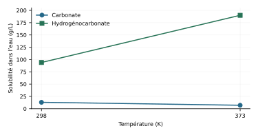
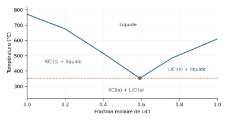
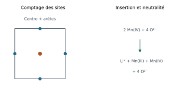
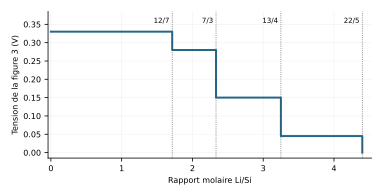
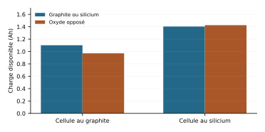
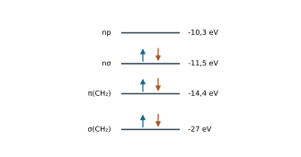
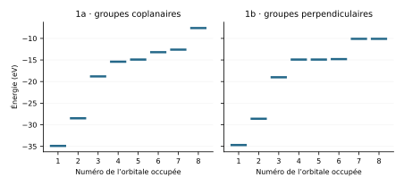
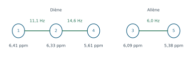

# X–ENS — PC, Chimie A 2016 · Corrigé guidé

*Corrigé rédigé par IA, non officiel.*

**Rédaction (tour 1)** · GPT-6.2 Astra Ultra · vitesse non renseignée

Les deux éditions corrigent entièrement 39 des 63 questions et apportent des réponses partielles à sept autres. Q11 traite pression et température, Q18 le diagramme de phases, Q27 la sécurité des dendrites, Q46 l’interaction des orbitales, Q48 l’attribution IR et le rôle de la base, Q52 les deux bandes IR et Q61 la relation E/Z. Les 17 autres questions sont signalées hors couverture. Les figures des électrodes et des orbitales ont été relues dans le fascicule officiel, avec le rapport de chimie A 2016.

## 1.1 · Saumures et propriétés des sels de lithium

### Question 1 — Concentration massique et fraction massique

> [!INDICATION]
> Convertissez d’abord les 2 grammes par litre en fraction de la masse totale d’un litre initial.

#### Solution

Un litre initial pèse 1250 g et contient 2 g de Li, soit une fraction massique de 0,16 %. Après évaporation le document annonce 6,0 à 6,1 % en masse. La teneur par unité de masse a donc été multipliée par 37,5 à 38,1, soit une augmentation relative d’environ **3650 à 3710 %**. L’évaporation solaire concentre le lithium et réduit les volumes à transporter. Pour la concentration en g/L au sens strict, la masse volumique finale est nécessaire. Les mêmes pourcentages d’augmentation de la concentration par litre supposeraient une densité inchangée.

### Question 2 — Ordre de précipitation dans le salar

> [!INDICATION]
> Les produits de solubilité comparent-ils directement des saumures dont les concentrations ioniques initiales sont différentes ?

#### Solution

Le sulfate de calcium hydraté est éliminé en amont. Le premier grand dépôt est la halite NaCl, puis apparaît la sylvinite, solution solide de halite et de sylvine KCl. Viennent ensuite la bischofite et la carnallite. Un dépôt débute quand le produit d’activités atteint le produit de solubilité du solide. Le sodium étant initialement plus abondant que le potassium, l’ordre halite puis sylvine est possible même avec les logarithmes de $K_s$ respectifs 1,6 et 0,9. Pour les sels mixtes et hydratés, stœchiométrie et composition résiduelle interviennent aussi.

### Question 3 — Anions de la saumure

> [!INDICATION]
> Regardez les contre-ions des sels déposés dans les premières étapes.

#### Solution

Les principaux anions identifiables sont les ions **chlorure** $\mathrm{Cl^-}$ et **sulfate** $\mathrm{SO_4^{2-}}$. La fraction de bore sous forme borate dépend du pH, tandis que le document décrit le bore principalement comme acide borique.

### Question 4 — Chélation du bore par un diol

> [!INDICATION]
> Un même ligand peut utiliser les deux oxygènes du diol. Combien faut-il de ligands pour une coordination quatre ?

#### Solution

Un diol est bidentate. En notant $\mathrm{H_2L}$ l’éthane-1,2-diol et $\mathrm L^{2-}$ son fragment déprotoné, un bilan formel possible est $\mathrm{B(OH)_3+2H_2L\rightleftharpoons [BL_2]^-+H^++3H_2O}$. Le bore est entouré de quatre oxygènes et deux cycles chélates se forment. Les polyols de la séparation réelle ont un caractère organophile qui, avec les équilibres de protonation et d’association, favorise le transfert du bore hors de la saumure. L’éthylène glycol illustre ici la denticité.

### Question 5 — Élimination du magnésium

> [!INDICATION]
> Quel hydroxide peu soluble est expressément indiqué dans les solides du schéma ?

#### Solution

Le cation éliminé est $\mathrm{Mg^{2+}}$. L’alcalinisation par la chaux permet la précipitation $\mathrm{Mg^{2+}+2OH^-\rightarrow Mg(OH)_2(s)}$. Une hausse du pH augmente le produit ionique correspondant. Les solides précipités, dont des sels calciques, peuvent ensuite être séparés de la solution enrichie en lithium.

### Question 6 — Solubilité rétrograde du carbonate

> [!INDICATION]
> Lisez les deux concentrations à saturation aux températures données.

#### Solution

La solubilité de $\mathrm{Li_2CO_3}$ passe de 13 g/L à 298 K à 7 g/L à 373 K. À concentration initiale identique, le chauffage diminue la quantité restant dissoute et favorise la précipitation du carbonate. Le comportement est inverse de celui de nombreux sels.

### Question 7 — Dissolution carbonatée et espèces aqueuses

> [!INDICATION]
> Faites intervenir le dioxyde de carbone et l’eau dans l’équation globale.

#### Solution

Le bilan est $\mathrm{Li_2CO_3(s)+CO_2(g)+H_2O(l)\rightleftharpoons 2Li^+(aq)+2HCO_3^-(aq)}$. Le transfert vers l’hydrogénocarbonate, plus soluble, favorise le passage du lithium en solution. Les impuretés solides peu solubles, notamment le sulfate de calcium hydraté et le carbonate de magnésium résiduels, sont retenues à la filtration. Les sels très solubles ne sont pas séparés par ce seul mécanisme.

### Question 8 — Reformer le carbonate

> [!INDICATION]
> Inversez le bilan précédent et identifiez l’espèce qui quitte la solution lors du chauffage.

#### Solution

Le bilan est $\mathrm{2Li^+(aq)+2HCO_3^-(aq)\rightarrow Li_2CO_3(s)+CO_2(g)+H_2O(l)}$. Le dégazage du dioxyde de carbone et la moindre solubilité du carbonate à chaud favorisent cette évolution. L’hydrogénocarbonate reste une espèce aqueuse.

*Question 9 hors couverture.*

### Question 10 — Enthalpie à température différente

> [!INDICATION]
> Appliquez Hess à 298 K dans les états convenus, puis corrigez l’enthalpie à l’aide des capacités thermiques.

#### Solution

Sous forme générale, $\Delta_r H^\circ(T)=\sum_i
u_i\Delta_f H_i^\circ(298)+\int_{298}^{T}\sum_i
u_i C_{p,i}^\circ\,\mathrm dT$. Une éventuelle transition de phase entre les états de référence et finaux requiert son enthalpie de transition. En choisissant dès le départ la valeur tabulée de l’eau gazeuse et les solides dans leur phase pertinente, l’intégrale porte uniquement sur la différence des capacités thermiques. Ici $\Delta C_p=2C_p(\mathrm{LiCl,s})+C_p(\mathrm{CO_2,g})+C_p(\mathrm{H_2O,g})-C_p(\mathrm{Li_2CO_3,s})-2C_p(\mathrm{HCl,g})$ et les mêmes coefficients s’appliquent aux enthalpies de formation. Pour $T=473$ K, la valeur indiquée par le fascicule est proche de $-90$ kJ/mol. La réponse couvre le raisonnement thermochimique.

### Question 11 — Effets de pression et de température

> [!INDICATION]
> Comptez les coefficients gazeux des deux membres avant d’utiliser la loi de van ’t Hoff.

#### Solution

À proportions gazeuses fixées, le nombre total de moles gazeuses est identique de part et d’autre du bilan considéré, donc la pression totale n’apparaît pas dans le quotient idéal. La réaction est exothermique et une hausse de température diminue sa constante d’équilibre, avec $\mathrm d\ln K/\mathrm dT=\Delta_rH^\circ/(RT^2)<0$. Cette réponse traite les déplacements thermodynamiques. Le choix des conditions industrielles reste hors couverture.

## 1.1 · Électrolyse industrielle et diagramme binaire

*Question 12 hors couverture.*

*Question 13 hors couverture.*

*Question 14 hors couverture.*

*Question 15 hors couverture.*

*Question 16 hors couverture.*

*Question 17 hors couverture.*

### Question 18 — Domaines d’un diagramme eutectique

> [!INDICATION]
> Placez les deux corps purs aux extrémités et repérez le point où convergent les deux liquidus.

#### Solution

Sur l’axe $x_{\rm LiCl}$ de 0 à 1, les températures de fusion des corps purs sont 771 °C pour KCl et 610 °C pour LiCl. Les deux branches de liquidus rejoignent l’eutectique à $x=0,592$ et 353 °C. Au-dessus des deux branches se trouve un liquide homogène. Entre liquidus et horizontale eutectique, le liquide coexiste à gauche avec KCl(s), à droite avec LiCl(s). Sous l’eutectique coexistent les deux solides, en supposant leur miscibilité négligeable. Au point eutectique trois phases sont présentes. Le commentaire de réglage du procédé reste hors couverture.

*Question 19 hors couverture.*

*Question 20 hors couverture.*

## 1.2 · Batteries au lithium

### Question 21 — Bilan redox du manganèse et stabilité d’une phase

> [!INDICATION]
> Sans émission de dioxyde de carbone, consultez le couple organique que fournit la table.

#### Solution

Le couple organique impose l’oxydation du fumarate protoné en deux molécules d’acide oxalique. En milieu acide, le bilan est $\mathrm{8MnO_4^-+3C_4H_4O_4+8H^+\rightarrow8MnO_2(s)+6H_2C_2O_4+4H_2O}$. L’oxydation organique échange huit électrons par molécule et la réduction du permanganate en échange trois. La transformation irréversible à chaud de la phase β en phase λ est compatible avec une phase β **métastable**, retenue par une barrière cinétique. Le seul sens observé ne fixe pas toute la carte d’équilibre des polymorphes.

### Question 22 — Compter ions et sites du réseau cfc

> [!INDICATION]
> Comptez les contributions des sommets, des faces, du centre et des arêtes.

#### Solution

Une maille cubique conventionnelle du réseau d’oxygènes contient $8/8+6/2=4$ ions $\mathrm{O^{2-}}$. Les sites octaédriques comptent $1+12/4=4$ positions par maille. La moitié occupée donne deux ions $\mathrm{Mn^{4+}}$. La formule de maille est $\mathrm{Mn_2O_4}$, soit deux motifs $\mathrm{MnO_2}$. Les charges s’équilibrent.

### Question 23 — Décharge de la cellule au lithium

> [!INDICATION]
> Suivez les électrons dans le circuit extérieur et les ions à travers l’électrolyte.

#### Solution

À l’électrode négative, l’anode de décharge, $\mathrm{Li\rightarrow Li^++e^-}$. À l’électrode positive, cathode, l’oxyde accueille simultanément un lithium et un électron, soit $\mathrm{2MnO_2+Li^++e^-\rightarrow LiMn_2O_4}$ pour l’insertion d’un Li par deux Mn. Le bilan est $\mathrm{Li+2MnO_2\rightarrow LiMn_2O_4}$. Les électrons circulent à l’extérieur du lithium vers l’oxyde et le courant conventionnel en sens opposé. La tension à vide idéale avec les données est $1,2-(-3,0)=4,2$ V.

### Question 24 — Charge insérée et formule de l’oxyde

> [!INDICATION]
> Combinez la quantité de manganèse par maille et le nombre de réductions indiqué.

#### Solution

Sur les deux manganèses de la maille, un seul passe de +IV à +III. Le changement de charge du réseau est donc $-1$ par maille. Un ion $\mathrm{Li^+}$ occupe un site tétraédrique pour conserver l’électroneutralité. La formule est $\mathrm{LiMn_2O_4}$, également écrite $\mathrm{Li_{0,5}MnO_2}$.

### Question 25 — Dilatation de la maille d’oxyde

> [!INDICATION]
> La variation du volume d’un cube se déduit du cube du rapport des arêtes.

#### Solution

À teneur donnée, $\Delta V/V_i=(a_f/a_i)^3-1=(820/800)^3-1\simeq0,0769$, soit **+7,7 %**. L’approximation des petites déformations $3\Delta a/a_i$ donnerait 7,5 %.

### Question 26 — Capacité théorique d’un oxyde actif

> [!INDICATION]
> Combien de moles de MnO₂ correspondent à une mole d’électrons ? N’oubliez pas la conversion coulombs–ampères-heures.

#### Solution

Pour deux moles de $\mathrm{MnO_2}$ de masse totale 174 g, la quantité de charge vaut $F=96500$ C. La capacité spécifique est $F/(3600\times0,174)\simeq154$ Ah/kg d’oxyde initial. Elle est proche des 150 Ah/kg du tableau. À 4,2 V cela correspond à environ **647 Wh/kg** d’oxyde actif, ou 630 Wh/kg à partir de la valeur arrondie du tableau. La masse de cellule complète contient aussi d’autres composants.

### Question 27 — Risque de dendrites

> [!INDICATION]
> Quel effet aurait un filament conducteur qui traverserait la séparation physique des électrodes ?

#### Solution

Lors des cycles, des filaments métalliques peuvent franchir l’espace entre électrodes et créer un court-circuit interne. L’échauffement local peut dégrader davantage la cellule. Un électrolyte gélifié rend la croissance et la propagation des filaments plus difficiles tout en maintenant le transport ionique. Cela réduit le risque sans en assurer la suppression. La réponse couvre le volet de sécurité, le bilan de redépôt métallique n’est pas développé.

### Question 28 — Électrodes d’insertion en charge

> [!INDICATION]
> Suivez le lithium depuis l’oxyde jusqu’au graphite. L’anode est définie par l’oxydation.

#### Solution

En charge, à l’anode positive, $\mathrm{LiMn_2O_4\rightarrow 2MnO_2+Li^++e^-}$. À la cathode négative, $\mathrm{6C+Li^++e^-\rightarrow LiC_6}$. Le bilan est $\mathrm{6C+LiMn_2O_4\rightarrow LiC_6+2MnO_2}$. Les électrodes échangent des ions entre deux solides d’insertion. La différence des potentiels de repos est $1,2-(-2,5)=3,7$ V en valeur positive.

### Question 29 — Composition maximale de l’alliage

> [!INDICATION]
> L’axe de la figure 2 porte la fraction de silicium. Quelle formule d’intermétallique est la plus proche du lithium ?

#### Solution

Le composé le plus riche en Li repéré sur la figure est $\mathrm{Li_{22}Si_5}$. Il présente $x_{\rm Si}=5/27\simeq0,185$ et $x_{\rm Li}=22/27\simeq0,815$. Plus à gauche, un excès de Li peut coexister comme phase séparée. Ce lithium libre ne correspond plus à une augmentation du rapport Li/Si dans la phase alliée.

### Question 30 — Paliers et composés définis

> [!INDICATION]
> Traduisez un rapport y en formule entière de LiᵧSi, puis associez chaque intervalle à deux phases.

#### Solution

Les ruptures successives de la figure 3 sont vers $y=12/7=1,71$, $7/3=2,33$, $13/4=3,25$ et $22/5=4,40$. Elles correspondent à $\mathrm{Li_{12}Si_7}$, $\mathrm{Li_7Si_3}$, $\mathrm{Li_{13}Si_4}$ puis $\mathrm{Li_{22}Si_5}$. Entre deux compositions successives, deux phases coexistent et leurs proportions évoluent. À température fixée le potentiel chimique du lithium y est fixé, d’où le palier électrochimique. La première coexistence réunit le silicium et le premier composé.

### Question 31 — Composition globale entre deux phases

> [!INDICATION]
> Convertissez le rapport 15/4 en fraction molaire et localisez-le par rapport aux deux composés voisins.

#### Solution

$x_{\rm Si}=4/19\simeq0,211$, soit $y=3,75$. Cette composition se situe entre $\mathrm{Li_{13}Si_4}$ et $\mathrm{Li_{22}Si_5}$. Sur le **diagramme d’équilibre**, la composition globale correspond donc à un mélange de ces deux solides. La phase $\mathrm{Li_{15}Si_4}$ réellement observée par insertion à température ambiante peut être métastable, ce qui explique la distinction.

### Question 32 — L’insertion dans le diamant peut-elle conserver son réseau ?

> [!INDICATION]
> Combien d’interstices vides reste-t-il pour huit siliciums dans la maille diamant ?

#### Solution

La maille cfc conventionnelle présente quatre positions du réseau, huit sites tétraédriques et quatre octaédriques. Quatre sites tétraédriques étant déjà occupés par Si, le diamant contient huit Si et laisse quatre sites tétraédriques et quatre octaédriques disponibles dans ce comptage. Une insertion dans tous ces sites ne donnerait que Li/Si = 1, loin des 3,75 requis. L’alliage demande donc une profonde reconstruction, éventuellement décrite à ce niveau comme comportant une composante de substitution. La stœchiométrie ne fixe pas à elle seule les occupations atomiques réelles d’un intermétallique reconstruit.

### Question 33 — Comparer deux volumes de maille

> [!INDICATION]
> Employez les arêtes données et distinguez le volume de la maille du volume d’une quantité fixe de silicium.

#### Solution

Le quotient des volumes des mailles mentionnées vaut $(1070/540)^3\simeq7,78$, soit **+678 %** pour les mailles comparées, bien davantage que les +7,7 % de l’oxyde. La structure et le nombre de Si par maille peuvent changer. Ce quotient de mailles ne mesure donc pas sans autre donnée la dilatation d’une même mole de silicium. Les grandes variations structurales peuvent imposer des contraintes mécaniques à l’électrode.

### Question 34 — Capacité d’une cellule limitée par son électrode la plus faible

> [!INDICATION]
> Calculez séparément les deux inventaires de charge dans chaque cellule. Ils sont en série.

#### Solution

Au graphite, $0,00296\times372=1,10$ Ah pour C et $0,00647\times150=0,971$ Ah pour l’oxyde. La cellule est limitée à environ **0,97 Ah** et le graphite est en excès d’environ 13 %. Au silicium, $0,00039\times3600=1,40$ Ah et $0,00950\times150=1,425$ Ah, donc **1,40 Ah** avec un bon équilibrage. Les tensions idéales sont respectivement 3,7 et $1,2-(-2,6)=3,8$ V. Les énergies valent environ **3,6 Wh et 5,3 Wh**, gain voisin de 49 % dans le même volume de 16,5 cm³. On utilise ici les potentiels et capacités du tableau et on néglige la variation de tension en décharge.

### Question 35 — Comparer les technologies d’électrode

> [!INDICATION]
> Mettez en regard tension, capacité réelle de la cellule et contraintes au cyclage.

#### Solution

L’insertion évite en fonctionnement nominal le redépôt direct de lithium métallique associé au risque de dendrites. Le graphite conserve une tension élevée et le calcul sur les cellules montre qu’un matériau d’alliage peut accroître l’énergie stockée dans un même format. Le silicium subit cependant une forte réorganisation, avec des risques de fissuration ou de perte de contact. Le choix doit donc tenir compte de la durée de vie et de la sécurité aussi bien que de la capacité spécifique d’un matériau isolé.

## 2.1 · Orbitales des allènes

### Question 36 — Occupation des orbitales du fragment méthylène

> [!INDICATION]
> Combien d’électrons de valence apportent un atome de carbone et deux hydrogènes ?

#### Solution

Le fragment neutre possède $4+2=6$ électrons de valence. Dans le diagramme fourni on remplit les niveaux de bas en haut à raison de deux électrons de spins opposés. Les orbitales $\sigma_{\rm CH_2}$ à $-27,0$ eV, $\pi_{\rm CH_2}$ à $-14,4$ eV et $n_\sigma$ à $-11,5$ eV sont doublées. L’orbitale $n_p$ à $-10,3$ eV est vide dans cette construction de fragment. Ce remplissage de la figure ne fixe pas à lui seul les états de spin du méthylène isolé.

### Question 37 — Caractère des orbitales de fragment

> [!INDICATION]
> Distinguez le recouvrement C–H en phase des orbitales localisées sur le carbone.

#### Solution

Les deux orbitales les plus basses $\sigma_{\rm CH_2}$ et $\pi_{\rm CH_2}$ ont des combinaisons en phase de lobes carbonés et des 1s de H et sont liantes pour C–H. Les orbitales $n_\sigma$ et $n_p$ sont essentiellement centrées sur C, sans recouvrement net avec H. Ce sont des orbitales non liantes. Quatre OA de valence de C et deux OA de H donnent six OM. Les deux orbitales antiliantes correspondantes manquent sur le dessin. Par exemple, pour $\sigma^*$, les lobes dirigés vers les deux H portent un signe opposé à celui des deux 1s de H, d’où des nœuds dans les régions C–H.

### Question 38 — Construire une combinaison de deux fragments

> [!INDICATION]
> Choisissez deux orbitales de même symétrie qui se font face et comparez les deux combinaisons de signes.

#### Solution

Prenons les deux orbitales non liantes dirigées vers l’intérieur, une sur chaque carbone de l’éthène étiré. La combinaison dont les lobes en vis-à-vis ont le même signe renforce la densité entre les deux C. Elle fournit une orbitale $\sigma_{\rm CC}$ liante, abaissée par rapport aux orbitales initiales. La combinaison de signe opposé est orthogonale, présente un nœud intercalaire et donne $\sigma_{\rm CC}^*$. La symétrie, la proximité énergétique et un recouvrement non nul gouvernent le mélange.

### Question 39 — Symétries des orbitales du carbone central

> [!INDICATION]
> Une réflexion change le signe de la coordonnée perpendiculaire au plan et conserve les deux autres.

#### Solution

L’atome C isolé possède $2s^22p^2$. Le niveau 2s, plus bas, est doublé et deux orbitales 2p dégénérées sont occupées chacune par un électron à spins parallèles dans le terme fondamental. Dans l’ordre des réflexions $(yz,xz,xy)$, les signatures sont $2s=(S,S,S)$, $2p_x=(A,S,S)$, $2p_y=(S,A,S)$ et $2p_z=(S,S,A)$. Une réflexion conserve une orbitale paire et inverse le signe d’une orbitale impaire.

### Question 40 — Apparier les symétries du tableau 3

> [!INDICATION]
> Seules les combinaisons de même parité pour les trois réflexions peuvent avoir un recouvrement non nul.

#### Solution

Dans l’ordre des lignes du tableau, $\sigma^*_{a,\rm CC}$ (SSA) peut interagir avec $2p_z$, $\pi^*_{a,\rm CC}$ (ASA) n’a pas de partenaire central, $\pi_{a,\rm CC}$ (ASS) interagit avec $2p_x$, et $\sigma_{a,\rm CC}$ (SSS) avec 2s. De même, $\pi^*_{a,\rm CH_2}$ (SAA) n’a pas de partenaire, $\pi_{a,\rm CH_2}$ (SAS) interagit avec $2p_y$, $\sigma^*_{a,\rm CH_2}$ (SSA) avec $2p_z$, et $\sigma_{a,\rm CH_2}$ (SSS) avec 2s. Les recouvrements permis des deux orbitales $\pi$ citées se font latéralement, dans deux orientations transverses différentes. Leur intensité dépend des amplitudes et de l’écart d’énergie.

### Question 41 — Comparer toutes les orbitales occupées

> [!INDICATION]
> Le propa-1,2-diène possède seize électrons de valence. Additionnez les huit niveaux doublés dans chaque colonne.

#### Solution

Dans l’approximation d’énergie électronique du diagramme, $E_{\rm occ}=2\sum_{i=1}^8\epsilon_i$. Pour 1a, les énergies en eV sont $-34,9$, $-28,5$, $-18,8$, $-15,4$, $-14,9$, $-13,2$, $-12,6$, $-7,6$, soit **$-291,8$ eV**. Pour 1b, elles sont $-34,7$, $-28,6$, $-19,0$, deux fois $-14,9$, $-14,8$ et deux fois $-10,1$, soit **$-294,2$ eV**. Le bilan orbital favorise donc l’allène à groupes terminaux perpendiculaires d’environ 2,4 eV dans ce modèle. Le carbone central met deux orbitales p orthogonales au service des deux liaisons $\pi$.

### Question 42 — Identifier deux surfaces orbitalaires

> [!INDICATION]
> Comptez les inversions de signe le long de l’axe et recherchez le carbone central dans chaque représentation.

#### Solution

OMi comporte deux ensembles de lobes de part et d’autre d’un plan contenant l’axe, avec recouvrement latéral sur une liaison C=C. C’est une des orbitales $\pi$ occupées dégénérées 7 ou 8 de 1b, à **$-10,1$ eV**. OMk présente une répartition le long de l’axe avec amplitudes importantes aux extrémités et trois changements de signe sur la représentation. Le carbone central ne présente pas un lobe important à son centre. C’est l’orbitale de symétrie axiale impaire avec contributions des fragments $\sigma^*_{b,\rm CC}$ et $\sigma^*_{b,\rm CH_2}$, le niveau **6**, à **$-14,8$ eV** sur le schéma. La comparaison avec les niveaux 4, 5, 7 et 8 écarte les paires transverses dégénérées.

### Question 43 — Décomposer l’orbitale 3

> [!INDICATION]
> Repérez les termes du carbone central et les combinaisons communes des deux fragments terminaux, puis comparez les phases en vis-à-vis.

#### Solution

Le seul terme central non nul dans l’expansion fournie est $+0,43\,2s(\mathrm C2)$. Les deux extrémités portent des combinaisons symétriques des 2s, des 2p axiales de signes opposés du fait de la réflexion, et des quatre 1s d’hydrogène. Les parties terminales s’écrivent donc sur les deux orbitales de fragment de symétrie axiale paire, $\sigma_{b,\rm CH_2}$ et $\sigma_{b,\rm CC}$. La figure 7 montre bien un mélange à trois orbitales de même symétrie avec la 2s centrale. Le signe global d’une OM est arbitraire. Les signes relatifs doivent se lire sur les lobes dirigés l’un vers l’autre. Les coefficients négatifs des 2s terminales et de H sont cohérents avec une combinaison de fonction C–H liante en opposition de signe à la 2s centrale, tandis que des lobes axiaux vers le centre permettent une contribution liante.

### Question 44 — Une compétition entre deux cycloadditions

> [!INDICATION]
> Comparez les écarts HO du diène–BV du diénophile pour l’allène et pour une autre molécule de diène.

#### Solution

Le cyclopentadiène attaquant une seule double liaison de l’allène donnerait un bicyclo[2.2.1]hept-2-ène portant un **méthylène exocyclique** sur le carbone central de l’allène devenu un carbone trigonal du nouveau cycle (5-méthylènebicyclo[2.2.1]hept-2-ène). Dans le dimère réellement observé, une double liaison du second cyclopentadiène sert de diénophile. Le produit est le dicyclopentadiène, majoritairement endo dans le régime usuel, avec une double liaison résiduelle sur chacun des deux systèmes d’origine.

La HO du cyclopentadiène vaut $-9,1$ eV. L’écart vers la BV de l’allène est $1,2-(-9,1)=10,3$ eV, contre $0,5-(-9,1)=9,6$ eV vers la BV du cyclopentadiène. Le deuxième couple est mieux accordé. L’interaction inverse entre HO de l’allène et BV du diène donnerait encore 10,6 eV.

### Question 45 — Effet électroattracteur d’un sulfonyle

> [!INDICATION]
> Dessinez les doublets des oxygènes puis comparez les énergies frontières des deux allènes.

#### Solution

Le groupement carboné porte $\mathrm{-S(=O)_2-CH_3}$ avec deux doublets non liants sur chaque oxygène dans cette représentation classique. Les formes polarisées comportent des charges négatives sur O et positives sur S. Le groupe exerce un effet inductif attracteur et peut accepter de la densité du système $\pi$ conjugué. Le diagramme montre une levée de dégénérescence et une baisse des niveaux frontières. La HO passe d’environ $-10,1$ à $-10,9$ eV, et la BV de $+1,2$ à $-0,6$ eV. Le dérivé est un meilleur accepteur vis-à-vis d’un diène.

### Question 46 — Reconnaître le partenaire accepteur

> [!INDICATION]
> Comparez l’écart HO–BV après introduction du substituant sulfonyle et regardez la localisation de la BV.

#### Solution

Le couple dominant associe la HO du diène à la BV de l’allène sulfonylé. Avec le cyclopentadiène ou le méthoxydiène, l’écart est d’environ $-0,6-(-9,1)=8,5$ eV. Les lobes de la BV sélectionnent la double liaison et les extrémités ayant les plus grands coefficients contribuent le plus fortement au recouvrement. La réponse couvre l’argument orbital. Le dessin détaillé des stéréoisomères et la régiochimie de la deuxième cycloaddition restent hors couverture.

## 2.2 · Caractérisation et structure des composés organiques

*Question 47 hors couverture.*

### Question 48 — Attribution IR d’une fonction alcool

> [!INDICATION]
> Une absorption large vers 3300 cm⁻¹ correspond à quelle vibration ?

#### Solution

La bande très large observée à 3276 cm$^{-1}$ dans B est cohérente avec une élongation O–H d’alcool engagé dans des liaisons hydrogène. La pyridine peut accepter le proton libéré lors de la transformation d’un alcool en ester sulfonique. Ces réponses traitent l’attribution spectroscopique et le rôle acido-basique. Les dessins préparatifs de B et C restent hors couverture.

*Question 49 hors couverture.*

### Question 50 — Symétrie des signaux du composé E

> [!INDICATION]
> Une formule C₄H₆O₂ comporte deux insaturations. Que suggèrent l’absence de carbonyle et les trois intégrations égales ?

#### Solution

La formule et l’absence de bande carbonyle sont compatibles avec un bis-époxyde à deux cycles, où deux oxiranes sont reliés par une liaison entre leurs carbones CH. Un axe de symétrie échange les deux moitiés. Les deux CH forment une famille de deux H et les méthylènes terminaux présentent deux familles diastéréotopiques de deux H chacune. On attend donc trois intégrations égales. Au tartrate initial, l’ordre au centre considéré est O, carbone du carboxylate (O,O,O), carbone voisin (O,C,H), H. Dans le bis-époxyde, l’oxygène reste premier, le carbone de l’autre centre (O,C,H) précède le méthylène terminal (O,H,H) et H reste dernier. La fermeture se fait sur les méthylènes terminaux. L’orientation du centre est conservée mais les priorités 2 et 3 s’échangent. Les centres initialement R sont donc tous deux **S** dans E.

*Question 51 hors couverture.*

### Question 52 — Lire les bandes du monoester

> [!INDICATION]
> Les deux absorptions signalent-elles une estérification complète des deux fonctions ?

#### Solution

La bande intense à 1730 cm$^{-1}$ correspond à l’élongation C=O d’un ester. La large bande à 3440 cm$^{-1}$ correspond à une liaison O–H d’alcool. Ces observations concordent avec la présence simultanée d’une fonction acétate et d’une fonction alcool libre. La réponse couvre les deux bandes. La structure développée, le bilan de formation et le mécanisme restent hors couverture.

### Question 53 — Désymétrisation et différenciation fonctionnelle

> [!INDICATION]
> Examinez si les deux extrémités de F restent équivalentes après la modification d’un seul OH.

#### Solution

Les deux moitiés de F étaient reliées par une opération de symétrie. Après transformation d’un seul OH en acétate, l’autre reste libre et l’opération n’échange plus deux moitiés identiques. Il s’agit bien d’une désymétrisation. Elle permet de distinguer deux fonctions initialement équivalentes pour les reconnaître ou les transformer indépendamment.

### Question 54 — Comptabilité électronique du cobalt

> [!INDICATION]
> Attribuez −1 à chacun des deux ligands X et distinguez superoxo et hydroperoxo.

#### Solution

Avec deux ligands $X^-$, le complexe neutre initial $\mathrm{X_2Co}$ contient Co(II). En (1), l’attachement de $\mathrm{O_2}$ sous forme superoxo $\mathrm{O_2^{\bullet-}}$ correspond à une coordination oxydante, Co(II) vers Co(III). En (2), le schéma montre l’alcool encore protoné, lié au métal en pointillés par son oxygène. La coordination de ce ligand neutre laisse Co(III) inchangé et le superoxo reste radicalaire. Le transfert de H et la fermeture sont représentés par les flèches de l’étape suivante. En (6), le complexe à deux X, un isopropoxyde anionique et une eau neutre porte Co(III). Le retour à $\mathrm{X_2Co}$ est réducteur, Co(III) vers Co(II), avec oxydation du fragment organique. Ces nombres suivent la convention d’attribution des électrons aux ligands dans le schéma.

### Question 55 — Étape qui fixe la stéréochimie

> [!INDICATION]
> À quel passage apparaît l’orientation de la nouvelle liaison dans le cycle formé ?

#### Solution

L’étape **(3)** est la fermeture cyclisante au cours de laquelle la géométrie du produit est fixée sur le nouveau centre. Le substrat porte déjà des centres configurés et les deux approches possibles donnent des produits de configuration relative différente. Il s’agit d’une **diastéréosélectivité**.

### Question 56 — Rôle du propan-2-ol

> [!INDICATION]
> Reliez la cétone figurant dans le cycle à l’alcool à trois carbones et regardez l’hydrogène reçu par le produit organique.

#### Solution

Le couple est **propanone/propan-2-ol**. Le propan-2-ol est le donneur réducteur d’un équivalent d’hydrogène dans l’étape (4). Le fragment organique reçoit l’hydrogène nécessaire pour aboutir au produit alcoolique, et le cycle fait apparaître la propanone comme forme oxydée correspondante.

*Question 57 hors couverture.*

*Question 58 hors couverture.*

*Question 59 hors couverture.*

*Question 60 hors couverture.*

### Question 61 — Relation entre N et N′

> [!INDICATION]
> L’oléfination crée une nouvelle double liaison avec deux arrangements possibles des substituants.

#### Solution

N et N′ diffèrent par la géométrie E/Z d’une double liaison nouvellement créée, avec le même squelette et la même formule brute. Ce sont des diastéréoisomères géométriques. La réponse couvre l’identification de cette relation. La séquence de recyclage de l’isomère reste hors couverture.

*Question 62 hors couverture.*

### Question 63 — Reconstituer les couplages du diène et du bromoallène

> [!INDICATION]
> Associez d’abord les grandes constantes communes, puis cherchez le couplage à quatre liaisons entre les deux extrémités de l’allène.

#### Solution

Dans le diène du côté éthyle–Br, notons les trois CH successifs $\mathrm{C(Br)=CH_a-CH_b=CH_c}$ en allant vers le cycle. H$_a$ est le doublet 1 à 6,41 ppm. Il partage 11,1 Hz avec H$_b$, entrée 2 à 6,33 ppm, qui partage aussi 14,6 Hz avec H$_c$, entrée 4 à 5,61 ppm. Cette dernière constante vicinale établit la géométrie trans de la double liaison $b=c$. H$_c$ se couple au CH voisin du cycle à 6,7 Hz. Le petit 1,2 Hz du signal 2 est compatible avec un couplage allylique à plus longue portée vers ce voisin.

Du côté $\mathrm{cycle-CH_d=C=CH_eBr}$, H$_e$ est l’entrée 3 à 6,09 ppm, proche du déplacement de CHBr dans le document 6. H$_d$ est l’entrée 5 à 5,38 ppm. Ils ont le même couplage allénique à quatre liaisons de 6,0 Hz. H$_d$ présente en plus 6,1 Hz vers le CH du cycle, et H$_e$ montre un petit couplage de 2 Hz compatible avec une transmission plus longue vers le même voisin. Les deux signaux 3 et 5, avec leur couplage commun et la formule à deux bromes, appuient la présence du bromoallène dans la structure proposée.

