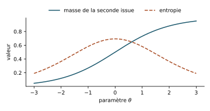

# X–ENS–ESPCI · PC · Mathématiques 2016 · Corrigé guidé

*Corrigé rédigé par IA, non officiel. Signalez toute erreur.*

**Rédaction** · GPT-6.2 Astra Ultra · vitesse non renseignée

**Révision** · GPT-6.2 Astra Ultra · vitesse non renseignée

L’épreuve passe de l’entropie sur le simplexe aux lois exponentielles puis à l’optimisation sous contraintes de moments. Les probabilités peuvent s’annuler au bord du simplexe. La stricte positivité des masses d’un maximiseur est donc démontrée avant toute dérivation de leur logarithme.

## I. Entropie sur le simplexe

### Question 1

> [!INDICATION]
> Traiter la limite de la fonction et celle de sa dérivée séparément au bord.

#### Solution

Pour $t>0$, $\phi(t)=-t\ln t$ est lisse. En posant $t=e^{-s}$, $-t\ln t=se^{-s}\to0$ quand $t\downarrow0$, ce qui assure la continuité du prolongement. La dérivée $\phi'(t)=-1-\ln t$ tend vers $+\infty$ en zéro à droite.

### Question 2

> [!INDICATION]
> Écrire les conditions définissant le simplexe comme intersections d’ensembles fermés.

#### Solution

Le simplexe $\Sigma_N$ est l’intersection de l’hyperplan fermé $\sum_i p_i=1$ et des demi-espaces fermés $p_i\ge0$. Il est borné car $0\le p_i\le1$. Toutes ces conditions sont conservées par combinaison convexe, donc il est convexe.

### Question 3

> [!INDICATION]
> Déterminer le signe de la fonction sur l’intervalle où vivent les masses.

#### Solution

Sur $[0,1]$, $\phi$ est positive ou nulle. Leur somme $H_N(p)=\sum_i\phi(p_i)$ est donc positive ou nulle et continue par 1. Pour la loi uniforme, $H_N=N[-(1/N)\ln(1/N)]=\ln N$.

### Question 4a

> [!INDICATION]
> Transférer une petite quantité de la grande masse vers la petite et dériver après le transfert.

#### Solution

Soit $F(t)=\phi(a+t)+\phi(b-t)$, continue sur $[0,b]$. Pour $0<t<(b-a)/2$, $F'(t)=\ln((b-t)/(a+t))>0$. Ce calcul intérieur est également valable pour $a=0$. En prenant par exemple $\varepsilon=(b-a)/4$, on obtient $F(t)>F(0)$ pour $0<t\le\varepsilon$ par stricte croissance et continuité.

### Question 4b

> [!INDICATION]
> Utiliser l’existence sur le compact, puis exclure un couple de coordonnées distinctes.

#### Solution

Le simplexe est compact non vide par 2 et $H_N$ continu, donc son maximum y est atteint. Si $p_i<p_j$ en un maximum, le transfert de 4a conserve somme et positivité et augmente strictement $H_N$, contradiction. Toutes les coordonnées valent donc $1/N$. Cette loi est le seul maximum et sa valeur est $\ln N$.

### Question 5a

> [!INDICATION]
> Séparer le logarithme de la masse géométrique en une constante et un terme linéaire en l’indice.

#### Solution

Avec $r=1-a$, la loi géométrique donne $H_\infty=-\ln a-\frac{1-a}{a}\ln(1-a)$, en utilisant $\sum_{i\ge1}a r^{i-1}(i-1)=r/a$. Sa dérivée vaut $\ln(1-a)/a^2<0$ sur $]0,1[$. L’entropie décroît strictement de $+\infty$ (car $-\ln a\to+\infty$ et le second terme tend vers un) à zéro lorsque $a\uparrow1$.

### Question 5b

> [!INDICATION]
> Normaliser une série convergente qui perd une puissance de logarithme dans l’entropie.

#### Solution

Posons $p_1=0$ et $p_i=C/(i(\ln i)^2)$ pour $i\ge2$, où $C$ est l’inverse de la somme des poids, finie et non nulle. Alors $p\in\Sigma_\infty$. À l’infini $-p_i\ln p_i\sim C/(i\ln i)$, de série divergente. L’entropie est donc infinie.

### Question 6

> [!INDICATION]
> Transformer le logarithme du produit en moyenne de variables dont les covariances se calculent.

#### Solution

Posons $Y_k=\ln p_{X_k}$. Toutes les masses étant strictement positives et en nombre fini, $Y_k$ est bornée. Ces variables sont deux à deux indépendantes, de moyenne $\sum_i p_i\ln p_i=-H_N(p)$ et de variance commune $v$. La moyenne $n^{-1}\sum_kY_k$ a donc variance $v/n$. Par Bienaymé–Tchebychev, la probabilité que son écart à $-H_N(p)$ soit en valeur absolue au moins $\varepsilon$ est au plus $v/(n\varepsilon^2)\to0$. C’est l’expression du sujet.

En effet, $n^{-1}\ln(\prod_{k=1}^n p_{X_k})=n^{-1}\sum_{k=1}^nY_k$. L’indépendance deux à deux suffit pour annuler les covariances croisées dans la variance de cette moyenne. Aucune hypothèse sur l’indépendance mutuelle d’une famille entière n’est utilisée.

## II. Optimisation de l’entropie avec un terme linéaire

### Question 7

> [!INDICATION]
> Appliquer le théorème du maximum sur le simplexe.

#### Solution

La fonction $J_f(p)=H_N(p)+\sum_ip_if_i$ est continue sur le compact non vide $\Sigma_N$. Elle atteint sa borne supérieure, donc $\Sigma_N(f)$ est non vide.

### Question 8a

> [!INDICATION]
> Le gain de pente en une masse nulle domine toute variation linéaire finie.

#### Solution

Remplaçons $p_1=0,p_2>0$ par $t,p_2-t$ avec $0<t<p_2$. Le nouveau vecteur reste dans le simplexe. La dérivée en $t$ pour $t>0$ du gain de $J_f$ est $\ln((p_2-t)/t)+f_1-f_2$, qui tend vers $+\infty$ lorsque $t\downarrow0$. Le gain est donc strictement croissant au voisinage de zéro et y part de zéro par continuité. Il est positif pour tout petit $t>0$.

### Question 8b

> [!INDICATION]
> Une loi ayant une masse nulle possède aussi au moins une masse positive.

#### Solution

Si une composante était nulle en un maximiseur, on pourrait transférer vers elle une petite quantité venant d’une composante strictement positive, qui existe puisque la somme vaut un. L’argument de 8a après permutation augmenterait $J_f$. Tous les $p_i$ du maximiseur sont donc strictement positifs.

### Question 9a

> [!INDICATION]
> Identifier le noyau de la somme des coordonnées.

#### Solution

La forme linéaire non nulle $a\mapsto\sum_i a_i$ a pour noyau l’hyperplan $E_0$, de dimension $N-1$. Son orthogonal est la droite engendrée par $\mathbf1=(1,\ldots,1)^t$.

### Question 9b

> [!INDICATION]
> Exploiter la positivité stricte de toutes les masses pour se déplacer dans les deux sens.

#### Solution

La somme des coordonnées de $p+ta$ vaut toujours un. Si $a\ne0$, prendre $\varepsilon=\min_{a_i\ne0}p_i/(2|a_i|)>0$ assure leur stricte positivité pour $|t|<\varepsilon$. Si $a=0$ tout rayon convient. La courbe $\widetilde p(t)=p+ta$ a dérivée $a$ en zéro.

### Question 9c

> [!INDICATION]
> Dériver le long de toute direction admissible dans l’hyperplan du simplexe.

#### Solution

En un maximiseur, $t\mapsto J_f(p+ta)$ a un maximum intérieur en zéro pour chaque $a\in E_0$. Sa dérivée $\sum_i a_i(f_i-\ln p_i-1)$ est nulle. Comme $\sum_i a_i=0$, le vecteur $(f_i-\ln p_i)_i$ est orthogonal à $E_0$. Par 9a, c’est un vecteur constant, donc il existe $c$ avec $\ln p_i=f_i+c$ pour tout $i$.

### Question 10

> [!INDICATION]
> Normaliser les masses exponentielles et les réintroduire dans le critère à maximiser.

#### Solution

En sommant $p_i=e^ce^{f_i}$, on obtient $p_i=e^{f_i}/Z$ avec $Z=\sum_j e^{f_j}$. Tout maximiseur a cette forme et il en existe au moins un par 7. Donc $\Sigma_N(f)$ est le singleton formé par ce vecteur. Avec $\ln p_i=f_i-\ln Z$, la valeur de $J_f$ est $\sum_i p_i(f_i-\ln p_i)=\ln Z$.

### Question 11

> [!INDICATION]
> Dériver le logarithme de la somme exponentielle et comparer à l’entropie des poids normalisés.

#### Solution

Notons $Z_\beta=\sum_i e^{\beta f_i}$ et $p_i(\beta)=e^{\beta f_i}/Z_\beta$, l’unique élément de $\Sigma_N(\beta f)$ par 10. Pour $\beta>0$, $F=(\ln Z_\beta)/\beta$ est lisse et
$$F'(\beta)=\frac{\beta\sum_i p_i(\beta)f_i-\ln Z_\beta}{\beta^2}=-\frac{H_N(p(\beta))}{\beta^2},$$
car $\ln p_i(\beta)=\beta f_i-\ln Z_\beta$.

### Question 12

> [!INDICATION]
> À grande valeur du paramètre, factoriser le plus grand terme de la somme.

#### Solution

Quand $\beta\downarrow0$, $\ln Z_\beta\to\ln N>0$, donc $F\to+\infty$. Si $m=\max_i f_i$, alors $e^{\beta m}\le Z_\beta\le Ne^{\beta m}$. Ainsi $m\le F(\beta)\le m+(\ln N)/\beta$ et $F\to m$ quand $\beta\to\infty$.

## III. Maximum d’entropie sous contraintes de moments

### Question 13

> [!INDICATION]
> Écrire la somme définissant chaque coefficient comme une espérance puis tester sur un vecteur.

#### Solution

La loi de $Y$ donne $A_{lk}=\mathbb E[(g_l(Y)-m_l)(g_k(Y)-m_k)]$. La symétrie découle de celle du produit, et $\theta^tA\theta=\mathbb E[(\sum_l\theta_l(g_l(Y)-m_l))^2]\ge0$. Cet argument vaut même si les $m_l$ ne sont pas les moyennes.

### Question 14a

> [!INDICATION]
> Une moyenne de carrés avec des poids strictement positifs ne peut être nulle que terme à terme.

#### Solution

D’après 13, $0=\sum_ip_i((M\theta)_i-m^t\theta)^2$. Comme tous les $p_i>0$, chaque carré est nul. Donc $\sum_l M_{il}\theta_l=c$ pour chaque $i$, avec $c=m^t\theta$.

### Question 14b

> [!INDICATION]
> Adjoindre la constante comme une coordonnée vectorielle supplémentaire.

#### Solution

L’égalité précédente devient $\widetilde M(\theta,-c)^t=0$, où $\widetilde M=(M\mid\mathbf1)$ et le vecteur est la colonne obtenue en ajoutant $-c$ à $\theta$. Si le noyau est trivial, toutes ses composantes sont nulles, donc $\theta=0$.

### Question 15

> [!INDICATION]
> Dériver chaque facteur de la fonction de partition.

#### Solution

Les fonctions $Z(\theta)=\sum_i e^{(M\theta)_i}$ et $L=\ln Z-q^tM\theta$ sont lisses car $Z>0$. Pour chaque $k$, $\partial_k\ln Z=Z^{-1}\sum_i e^{(M\theta)_i}M_{ik}=(M^tp(\theta))_k$. Ainsi $\nabla L=M^t(p(\theta)-q)$.

### Question 16

> [!INDICATION]
> Interpréter chaque coordonnée du gradient comme différence de deux moyennes.

#### Solution

Au point critique on a $M^tp(\theta)=M^tq$. La $k$-ième coordonnée de ce vecteur est la moyenne de $g_k$ sous la loi correspondante, et $q$ respecte les moments observés. Comme $p(\theta)$ est déjà une loi, elle appartient à $\Sigma_N(g,\bar g)$.

### Question 17

> [!INDICATION]
> Dériver les probabilités normalisées plutôt que le quotient entier à chaque fois.

#### Solution

Posons $m=M^tp(\theta)$. Par dérivation, $\partial_kp_i=p_i(M_{ik}-m_k)$. Ainsi $\partial_k\partial_l L=\sum_i p_i M_{il}(M_{ik}-m_k)$. Comme $\sum_i p_i(M_{ik}-m_k)=0$, on peut soustraire $m_l$ au premier facteur. On obtient la formule $\sum_i p_i(M_{il}-m_l)(M_{ik}-m_k)$. Les dérivées sont continues par la régularité déjà établie.

### Question 18a

> [!INDICATION]
> Restreindre la Hessienne à la direction du segment entre les deux paramètres.

#### Solution

Les paramètres sont dans $\mathbb R^d$, domaine de $L$ (la mention $\mathbb R^N$ dans cette question est une coquille). Par 13, 14 et 17, la Hessienne est définie positive partout car $p_i(\theta)>0$ et $\ker\widetilde M=0$. Pour $v=\theta-\theta'\ne0$, $h(t)=L(\theta'+tv)$ satisfait $h''(t)=v^t\nabla^2L(\theta'+tv)v>0$. Ainsi $h'$ est strictement croissante. Si $\theta$ est critique, $h'(1)=\nabla L(\theta)^tv=0$.

### Question 18b

> [!INDICATION]
> Comparer la valeur au point critique à celle de chaque autre point à l’aide du segment.

#### Solution

En 18a, $h'(t)<0$ pour $t<1$, donc $h(1)<h(0)$. Tout point critique est donc le strict minimum global, et il ne peut y en avoir deux. Réciproquement, un minimum atteint à l’intérieur de $\mathbb R^d$ est critique. Il y a donc zéro ou un point de minimum. L’existence ne découle pas de la seule Hessienne positive.

Par exemple, pour deux issues, une contrainte de moyenne $0$ avec $g_1(1)=0$, $g_1(2)=1$ et $q=(1,0)$ donne $L(\theta)=\ln(1+e^\theta)$. Les colonnes de la matrice augmentée sont indépendantes. Pourtant l’infimum zéro n’est atteint à aucun $\theta$ fini. Cet exemple justifie la précaution de la question 19.

### Question 19a

> [!INDICATION]
> Ajouter aux entropies le même terme linéaire grâce aux contraintes de moments.

#### Solution

Posons $p^*=p(\theta^*)$ et $f=M\theta^*$. Par 16, $p^*$ est admissible, et par 10 il maximise $J_f$ sur tout le simplexe. Pour chaque $p$ admissible, $p^tf=p^tM\theta^*=q^tM\theta^*=(p^*)^tf$. De $J_f(p^*)\ge J_f(p)$ on déduit $H_N(p^*)\ge H_N(p)$, en particulier pour $p=q$. C’est la valeur maximale demandée.

### Question 19b

> [!INDICATION]
> Transformer un éventuel deuxième maximum d’entropie en un deuxième maximum sur le simplexe entier.

#### Solution

Si $p$ admissible vérifie $H_N(p)=H_N(p^*)$, le terme linéaire étant commun, $J_f(p)=J_f(p^*)$. Or 10 a établi que $J_f$ a un unique maximiseur sur $\Sigma_N$, précisément $p^*$. D’où $p=p^*$ et l’unicité du maximum d’entropie sous contraintes.

Pour la figure, les deux scores $(0,\theta)$ donnent $p_2=e^\theta/(1+e^\theta)$. Lorsque $\theta=0$ les deux probabilités valent $1/2$ et l’entropie vaut $\ln 2$. À mesure que $\theta$ tend vers l’un ou l’autre infini, la loi se concentre sur une seule issue et son entropie tend vers zéro.

