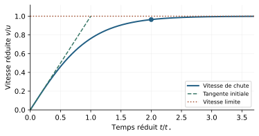
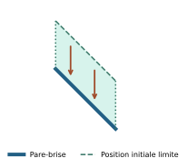
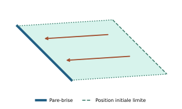
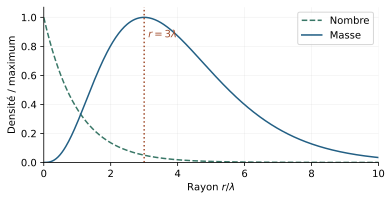
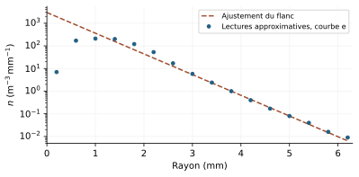
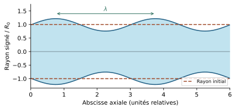
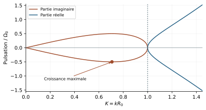

# X, ESPCI et ENS PC 2016 — Physique B · Corrigé brut

*Corrigé rédigé par IA, non officiel. Signalez toute erreur.*

**Lecture du rapport du jury** · GPT-6.2 Astra Ultra · vitesse non renseignée

**Rédaction** · GPT-6.2 Astra Ultra · vitesse non renseignée

## Histoires d’eau ou quelques aspects de la physique des gouttes

## Chute d’une goutte de pluie

### Question 1a — Échelle de taille et de vitesse

Une goutte de pluie ordinaire a un diamètre de l’ordre du millimètre. On peut prendre $r=0,5\,\mathrm{mm}$, rayon retenu ensuite dans le sujet, et une vitesse de chute de quelques mètres par seconde, par exemple $5\,\mathrm{m\,s^{-1}}$. Ces estimations serviront à choisir une loi de traînée.

### Question 1b — Régime d’écoulement de l’air

Avec le diamètre comme longueur caractéristique, $\mathrm{Re}=\rho_a v(2r)/\eta_a$. Les estimations précédentes donnent $1,20\times5\times10^{-3}/(1,85\times10^{-5})\simeq3\times10^2$. L’inertie de l’air compte fortement devant les contraintes visqueuses à l’échelle de la goutte. Le sujet adopte une traînée quadratique avec $C_x$ constant. Au tout premier instant d’un départ au repos, cette hypothèse est un prolongement du modèle.

### Question 1c — Poids, poussée et traînée

Avec $V=4\pi r^3/3$, $A=\pi r^2$ et $\mathbf e_x$ vers le bas, les forces sont le poids $\rho_e Vg\mathbf e_x$, la poussée d’Archimède $-\rho_a Vg\mathbf e_x$ et la traînée $-\tfrac12 C_x\rho_a A|\mathbf v|\mathbf v$. La poussée représente $\rho_a/\rho_e\simeq10^{-3}$ du poids, on peut donc la négliger à la précision demandée.

### Question 1d — Équilibre des forces et vitesse limite

La masse vaut $m=\rho_e V$. Pour $v\ge0$ et en négligeant la poussée, la projection de la deuxième loi de Newton donne $\dot v=g-3C_x\rho_av^2/(8\rho_e r)$. En posant $u=\sqrt{8\rho_e rg/(3C_x\rho_a)}$, il vient $\dot v/g=1-v^2/u^2$. À $v=u$, la traînée équilibre le poids. Pour $0\le v<u$, l’accélération est positive et pour $v>u$ elle est négative. La vitesse $u$ est donc une vitesse limite stable.

### Question 2a — Intégration à partir du repos

Posons $s=v/u$ et $t_\star=u/g$. Pour $0\le s<1$, $dt/t_\star=ds/(1-s^2)$. La primitive nulle en $s=0$ est $\tfrac12\ln[(1+s)/(1-s)]=\operatorname{artanh}s$. Avec $v(0)=0$, on obtient $v(t)=u\tanh(t/t_\star)$.

### Question 2b — Évolution réduite

Avec $T=t/t_\star$, la courbe $v/u=\tanh T$ part de zéro, de pente unité. Pour $T\ll1$, $v\simeq gt$. Aux grands temps, $1-v/u\simeq2e^{-2T}$ et l’accélération s’annule progressivement. À $T=2$, la vitesse vaut déjà environ $0,96u$.

### Question 2c — Hauteur de mise en régime

Le seul produit d’une vitesse et d’un temps caractéristiques est $H_\star=ut_\star=u^2/g$. L’intégration de la vitesse donne précisément $x(t)=H_\star\ln\cosh(t/t_\star)$ depuis le départ. À $t=2t_\star$, la goutte a parcouru $1,33H_\star$ et sa vitesse diffère de $u$ de moins de $4\,\%$. Le facteur numérique dépend du seuil choisi.

### Question 2d — Valeurs pour une goutte millimétrique

Avec $r=0,5\,\mathrm{mm}$, $\rho_e/\rho_a\simeq830$ et $C_x=0,4$, on trouve $u\simeq5\,\mathrm{m\,s^{-1}}$, $t_\star=u/g\simeq0,5\,\mathrm{s}$ et $H_\star=u^2/g\simeq3\,\mathrm m$. Une chute de quelques mètres suffit donc pour approcher la vitesse limite, sur une hauteur très inférieure à celle d’un nuage de pluie.

## Effort de la pluie sur un pare-brise

### Question 3a — Densité de gouttes et intensité de pluie

Pendant $dt$, les gouttes d’une colonne verticale de base $A$ et de hauteur $u\,dt$ franchissent le sol. Le volume recueilli est $N_0Au\,dt\,(4\pi r_0^3/3)$. L’intensité en hauteur par unité de temps satisfait donc $I=N_0u(4\pi r_0^3/3)$, soit $N_0=3I/(4\pi r_0^3u)$.

### Question 3b — Application à l’averse extrême

La valeur $300\,\mathrm{mm\,h^{-1}}$ correspond à $0,300/3600\simeq8,3\times10^{-5}\,\mathrm{m\,s^{-1}}$. Avec $r_0=5\times10^{-4}\,\mathrm m$ et $u\simeq5,2\,\mathrm{m\,s^{-1}}$, on trouve $N_0\simeq3\times10^4\,\mathrm{m^{-3}}$. La concentration compte ici des gouttes par volume d’atmosphère.

### Question 3c — Espacement caractéristique

Le volume moyen disponible par goutte est $1/N_0$. En lui associant un cube de côté $d_0$, $d_0=N_0^{-1/3}\simeq3\times10^{-2}\,\mathrm m$, soit environ $3\,\mathrm{cm}$. Cette échelle est bien supérieure au diamètre d’une goutte.

### Question 4a — Volume intercepté à l’arrêt

Une goutte se déplace de $u\,dt\,\mathbf e_x$. Toutes celles qui heurtent le pare-brise durant $dt$ se trouvaient dans le prisme délimité par le vitrage et sa copie translatée verticalement vers le haut de $u\,dt$. La section perpendiculaire au mouvement vaut $S\cos\alpha$, d’où un volume $Su\cos\alpha\,dt$.

### Question 4b — Flux de quantité de mouvement

Le nombre d’impacts vaut $N_0Su\cos\alpha\,dt$. Chaque goutte immobilisée transmet à la vitre $m u\mathbf e_x$ avec $m=\rho_e4\pi r_0^3/3$. D’où $\mathbf F_0=S\rho_e k u^2\cos\alpha\,\mathbf e_x$, où $k=N_0\,4\pi r_0^3/3=I/u$. Ce facteur sans dimension est la fraction de volume occupée par l’eau liquide. La direction verticale découle de l’arrêt de la quantité de mouvement relative tout entière.

### Question 4c — Force sur la vitre immobile

Avec $S=0,5\times1=0,5\,\mathrm{m^2}$, $\cos45^\circ=1/\sqrt2$, on obtient $F_0=\rho_e S Iu\cos45^\circ\simeq0,15\,\mathrm N$, soit $0,2\,\mathrm N$ à un chiffre significatif. Cette valeur tient compte de la faible fraction liquide de l’atmosphère.

### Question 5a — Vitesse de croisière

Un avion de ligne se déplace en croisière à quelques centaines de mètres par seconde. Pour chiffrer les forces, prenons $W=250\,\mathrm{m\,s^{-1}}$, soit $900\,\mathrm{km\,h^{-1}}$. Ici $u/W\simeq0,02$.

### Question 5b — Pluie vue depuis l’avion

Dans le référentiel de l’avion en translation uniforme, $\mathbf v_{\rm rel}=u\mathbf e_x-W\mathbf e_y$. Le prisme intercepté s’obtient en translatant le vitrage de $-\mathbf v_{\rm rel}dt$ en amont. Pour la vitre inclinée comme sur la figure 1, sa normale tournée vers l’intérieur est $\mathbf n=\cos\alpha\,\mathbf e_x-\sin\alpha\,\mathbf e_y$. Le volume est donc $S(u\cos\alpha+W\sin\alpha)\,dt$. Pour $W\gg u$ à $45^\circ$, ce prisme est presque horizontal.

### Question 5c — Effort transmis en vol

Le flux de masse est $k\rho_e S(\mathbf v_{\rm rel}\cdot\mathbf n)$. Comme les gouttes incidentes sont immobilisées dans ce repère, la force exercée sur la vitre est $\mathbf F=k\rho_e S(u\cos\alpha+W\sin\alpha)(u\mathbf e_x-W\mathbf e_y)$. Au premier ordre dominant pour $W\gg u$ et $\alpha=45^\circ$, $\mathbf F\simeq-k\rho_e SW^2\sin\alpha\,\mathbf e_y$. Ce dernier résultat est celui utilisé en Q8.

### Question 5d — Ordre de grandeur en vol

Avec $k=I/u\simeq1,6\times10^{-5}$ et $W=250\,\mathrm{m\,s^{-1}}$, le terme dominant donne $F\simeq(1,6\times10^{-5})\times998\times0,5\times250^2/\sqrt2\simeq3,5\times10^2\,\mathrm N$, soit quelques centaines de newtons, environ $4\times10^2\,\mathrm N$ à un chiffre significatif.

## Distribution des rayons

### Question 6a — Nombre total de gouttes

Intégrons la loi $n(r)=n_0e^{-r/\lambda}$ pour tous les rayons positifs. Avec $x=r/\lambda$, $N_0=\int_0^\infty n(r)\,dr=n_0\lambda\int_0^\infty e^{-x}dx=n_0\lambda$. Le paramètre $n_0$ compte des gouttes par unité de volume et par unité de rayon.

### Question 6b — Comparer deux probabilités

La densité de probabilité du rayon vaut $p(r)=e^{-r/\lambda}/\lambda$. Son intégration jusqu’à $\lambda$ donne $P(r\le\lambda)=1-e^{-1}\simeq0,63$. Par complément, $P(r>\lambda)=e^{-1}\simeq0,37$. En nombre, les gouttes de rayon inférieur à $\lambda$ sont majoritaires.

### Question 6c — Rayon moyen

Le changement de variable $x=r/\lambda$ donne $\langle r\rangle=\int_0^\infty r p(r)\,dr=\lambda\int_0^\infty xe^{-x}dx=\lambda$. Le rayon moyen sépare donc ici une majorité de petites gouttes d’une minorité de grosses. La queue à grand rayon tire la moyenne vers le haut. La médiane vaut $\lambda\ln2<\lambda$.

### Question 7a — Masse liquide par classe de rayon

Le facteur $\rho_e4\pi r^3/3$ est la masse d’une goutte de rayon $r$. Le produit par $n(r)\,dr$ donne la masse d’eau liquide, par mètre cube d’atmosphère, contenue dans la classe $[r,r+dr]$. Ainsi $dM$ s’exprime en $\mathrm{kg\,m^{-3}}$.

### Question 7b — Spectre en masse

On a $\mu(r)=(4\pi/3)\rho_e n_0r^3e^{-r/\lambda}$. Près de zéro elle croît comme $r^3$, avec tangente horizontale. Elle présente ensuite un maximum et décroît vers zéro avec une longue queue à droite. L’échelle horizontale naturelle est $r/\lambda$.

### Question 7c — Rayon qui pèse le plus

Pour $r>0$, $\mu'(r)/\mu(r)=3/r-1/\lambda$. La dérivée passe de positive à négative pour $r=3\lambda$. Parmi des intervalles de rayon de même largeur, c’est celui centré sur $3\lambda$ qui apporte le plus de masse par unité de volume.

### Question 7d — Masse moyenne d’une goutte

L’intégrale de $\mu(r)$ donne la masse liquide par unité de volume. En la divisant par $N_0$, $\langle m\rangle=(4\pi/3)\rho_e\langle r^3\rangle$. Or $\langle r^3\rangle=\lambda^3\int_0^\infty x^3e^{-x}dx=6\lambda^3$. On obtient donc $\langle m\rangle=8\pi\rho_e\lambda^3$.

### Question 7e — Rôle de la dispersion des tailles

Une goutte ayant le rayon moyen aurait une masse $(4\pi/3)\rho_e\lambda^3$. La masse moyenne calculée est six fois plus élevée. La masse croît comme le cube du rayon et les grosses gouttes, moins fréquentes, relèvent fortement la moyenne. C’est aussi le sens de l’inégalité de convexité $\langle r^3\rangle\ge\langle r\rangle^3$ pour $r\ge0$.

### Question 8a — Addition des efforts de chaque classe

À $W\gg u$, le facteur $Q=(4\pi/3)\rho_eSW^2\sin\alpha$ est commun aux rayons. La classe $[r,r+dr]$ exerce $d\mathbf F=-Qr^3 n(r)dr\,\mathbf e_y$. En sommant, $\mathbf F_D=-6Qn_0\lambda^4\mathbf e_y=-6QN_0\lambda^3\mathbf e_y$.

### Question 8b — Comparaison à population fixée

Les deux forces sont colinéaires et orientées vers $-\mathbf e_y$. À $N_0$ fixé, le rapport de leurs normes vaut $\phi=6\lambda^3/r_0^3$. La contrainte du sujet est $\langle r\rangle=\lambda=r_0$, d’où $\phi=6$. Les deux pluies ainsi comparées peuvent avoir des intensités $I$ différentes.

### Question 8c — Échelle de la force de pressurisation

Avec les paramètres de Q5d, la distribution donne $F_D\sim2\times10^3\,\mathrm N$. Un exemple de différence de pression entre cabine et extérieur en croisière est $\Delta p\sim5\times10^4\,\mathrm{Pa}$, d’où une force normale de norme $\Delta p S\sim 2,5\times10^4\,\mathrm N$. Même pour cette pluie extrême, l’effort moyen estimé reste inférieur d’environ un ordre de grandeur à celui de la pressurisation. Cette comparaison porte sur les forces totales, dont les directions diffèrent.

### Question 9a — Comparer l’exponentielle aux relevés

Sur le papier semi-logarithmique de la figure 2, la loi exponentielle produirait une droite décroissante, de pente constante $-1/(\lambda\ln10)$ si le logarithme est décimal. Les points décroissent de manière à peu près rectiligne sur une portion intermédiaire des grandes tailles, avec des pentes qui dépendent du régime. À petit rayon, les relevés montent jusqu’à un maximum vers $1$ à $1,5\,\mathrm{mm}$, alors que le modèle extrapolé atteint son maximum en zéro. La queue la plus éloignée présente aussi des fluctuations lorsque les gouttes deviennent rares.

### Question 9b — Ajustement de la pluie la plus faible

La courbe e est en dessous des autres pour presque tous les rayons, notamment les gros qui transportent le plus d’eau. Elle correspond à la plus faible pluie. Sur sa portion décroissante on lit par exemple $n(3,8\,\mathrm{mm})\simeq1$ et $n(5,0\,\mathrm{mm})\simeq0,08$, en $\mathrm{m^{-3}\,mm^{-1}}$. Alors $\lambda=(5,0-3,8)/\ln(1/0,08)\simeq0,48\,\mathrm{mm}$. En ramenant la droite à zéro, $n_0\simeq1\times e^{3,8/0,48}\sim3\times10^3\,\mathrm{m^{-3}\,mm^{-1}}$. Les points choisis font varier ces ordres de grandeur.

### Question 9c — Interprétation de l’ajustement

Pour la courbe e, $\langle r\rangle=\lambda\simeq0,5\,\mathrm{mm}$. Si le rayon est exprimé en millimètres comme sur le graphe, $N_0=n_0\lambda\sim10^3\,\mathrm{m^{-3}}$. Cette concentration est nettement inférieure aux $3\times10^4\,\mathrm{m^{-3}}$ de l’exemple de pluie extrême. L’extrapolation exponentielle surestime ici la population des plus petites gouttes et fragilise l’estimation du nombre total.

### Question 9d — Estimation la moins sensible au défaut du modèle

Le nombre $N_0$ est l’intégrale de $n(r)$ sans atténuation de l’écart à petit rayon. Le rayon moyen est le quotient $\int rn\,dr/\int n\,dr$ dont le dénominateur subit directement cet écart. La force en vol est proportionnelle à $\int r^3n(r)\,dr$. Le facteur $r^3$ réduit fortement le poids des tailles auxquelles le modèle surestime la densité. Parmi ces trois grandeurs, c’est donc la force qui est la moins sensible à ce défaut de l’extrapolation. Une erreur sur la queue des grandes tailles affecterait en revanche son estimation.

## Instabilité de Rayleigh-Plateau et énergie de surface

### Question 10a — Énergie du cylindre initial

L’énergie de l’interface est $\gamma$ fois son aire. Pour une portion de jet continue, seule l’aire latérale $2\pi R_0L$ sépare l’eau de l’air. Ainsi $E_0=2\pi\gamma R_0L$. Même si l’on ajoutait deux disques d’extrémité, leur contribution relative serait d’ordre $R_0/L\ll1$.

### Question 10b — Énergie des gouttes sphériques

Une sphère de rayon $r$ présente l’aire $4\pi r^2$. Pour $N$ gouttes disjointes de même rayon, les aires s’ajoutent et l’énergie finale vaut $E_N=4\pi\gamma Nr^2$.

### Question 10c — Contrainte de volume

L’eau est conservée, donc $\pi R_0^2L=N(4\pi r^3/3)$. En éliminant $N$, $E_N/E_0=3R_0/(2r)$. La fragmentation réduit l’énergie si $r>3R_0/2$. De très nombreuses petites gouttes exposeraient trop de surface. À volume donné, quelques grosses gouttes peuvent au contraire réduire l’interface initiale. Cette comparaison d’états finaux seule ne fixe pas le rayon effectivement sélectionné.

### Question 11a — La moyenne du rayon se déplace

Sur une longueur d’onde, $\langle R^2\rangle=\langle R\rangle^2+a^2/2$ car $\langle\sin kx\rangle=0$ et $\langle\sin^2kx\rangle=1/2$. La conservation du volume impose $\langle R^2\rangle=R_0^2$. Par conséquent $\langle R\rangle=R_0\sqrt{1-a^2/(2R_0^2)}=R_0[1-a^2/(4R_0^2)+O((a/R_0)^4)]$. Le rayon moyen diminue légèrement pour compenser les renflements.

### Question 11b — Variation d’aire à l’ordre deux

L’élément de surface de révolution est $2\pi R(x)\sqrt{1+[R'(x)]^2}\,dx$, avec $R'=ak\cos kx$. Au second ordre, $\sqrt{1+R'^2}\simeq1+\tfrac12a^2k^2\cos^2kx$. Sur une période, les termes linéaires en sinus s’annulent et la moyenne de $\cos^2$ vaut $1/2$. Il vient $S_\lambda\simeq2\pi\lambda\langle R\rangle(1+a^2k^2/4)$. En insérant la moyenne de Q11a et en ne gardant que l’ordre deux, $S_\lambda(a)=2\pi R_0\lambda[1+(a^2/(4R_0^2))(k^2R_0^2-1)]$ à cet ordre.

### Question 11c — Seuil géométrique de l’instabilité

À volume fixé, $\Delta E=\gamma\Delta S$ a le signe de $k^2R_0^2-1$. Si $\lambda>2\pi R_0$, la modulation réduit l’aire et peut croître spontanément. Si $\lambda<2\pi R_0$, elle coûte de l’énergie et le cylindre est stable vis-à-vis de cette modulation. Au seuil $\lambda=2\pi R_0$, le terme quadratique est nul. Cette approche donne la bande instable, sans donner de taux de croissance.

## Croissance des perturbations

### Question 12a — Fréquence réelle ou imaginaire

Posons $K=kR_0=2\pi R_0/\lambda>0$. Puisque $\Omega_0^2>0$, $\omega^2=\Omega_0^2 K^2(K^2-1)$ est positive pour $K>1$, soit $0<\lambda<2\pi R_0$. La pulsation est alors réelle. Pour $\lambda>2\pi R_0$ elle est imaginaire pure. Elle s’annule à la longueur d’onde seuil.

### Question 12b — Oscillation ou croissance

Avec la convention $e^{i(\omega t-kx)}$, une pulsation réelle non nulle donne une onde se propageant à amplitude constante dans le modèle non visqueux. Pour $0<K<1$, écrivons $\omega=\pm i\sigma$ où $\sigma=\Omega_0K\sqrt{1-K^2}>0$. Les deux facteurs temporels sont $e^{-\sigma t}$ et $e^{+\sigma t}$. Une perturbation générique contient la branche croissante, qui conduit à la rupture lorsque l’amplitude devient comparable au rayon et que la linéarisation cesse de s’appliquer.

### Question 13a — Branches du diagramme de dispersion

De $K=0$ à $K=1$, le diagramme porte $\operatorname{Im}\omega/\Omega_0=\pm K\sqrt{1-K^2}$. Les deux courbes se rejoignent en zéro aux deux extrémités. Pour $K>1$, il porte $\operatorname{Re}\omega/\Omega_0=\pm K\sqrt{K^2-1}$. Les deux branches propagatives partent de zéro en $K=1$ et leur valeur absolue augmente. La branche imaginaire inférieure est celle de la croissance avec la convention temporelle choisie.

### Question 13b — Mode le plus rapide

Le taux de croissance est $\sigma=-\operatorname{Im}\omega$. Maximiser son carré revient à maximiser $K^2-K^4$ sur $[0,1]$. Sa dérivée $2K(1-2K^2)$ s’annule au maximum intérieur $K_c=1/\sqrt2$. On a $\sigma_c=\Omega_0/2$ et le temps d’amplification d’un facteur $e$ vaut $\tau_c=2/\Omega_0=\sqrt{8\rho_eR_0^3/\gamma}$.

### Question 13c — Origine du temps de croissance

La tension superficielle entraîne le déplacement du liquide des étranglements vers les renflements lorsqu’il réduit l’aire totale. Pour modifier le rayon il faut accélérer une masse d’eau, dont l’inertie limite la rapidité de la redistribution. L’échelle inertio-capillaire $\sqrt{\rho_e R_0^3/\gamma}$ s’allonge avec la densité ou le rayon et diminue lorsque la tension superficielle augmente. La viscosité est absente de cette relation de dispersion.

### Question 13d — Échelles numériques du jet

La longueur d’onde la plus instable est $\lambda_c=2\pi R_0/K_c=2\pi\sqrt2R_0$. Avec $R_0=10^{-3}\,\mathrm m$, $\lambda_c\simeq9\,\mathrm{mm}$. Avec $\rho_e\simeq10^3\,\mathrm{kg\,m^{-3}}$ et $\gamma=0,0728\,\mathrm{N\,m^{-1}}$, $\tau_c=\sqrt{8\rho_eR_0^3/\gamma}\simeq1\times10^{-2}\,\mathrm s$.

### Question 13e — Vitesse de phase sur le graphe

Pour $K>1$, la pente de la droite reliant l’origine au point de la branche réelle est $(\omega/\Omega_0)/K$. La vitesse de phase est donc $c_\phi=\omega/k=\pm\Omega_0R_0\sqrt{K^2-1}$. Pour $K^2\gg1$, $c_\phi\simeq\pm\Omega_0R_0K=\pm k\sqrt{\gamma R_0/(2\rho_e)}$. La tangente locale servirait à lire la vitesse de groupe, qui est une autre grandeur.

## Mesures sur un filet d’eau en chute libre

### Question 14a — Vitesse moyenne à la sortie du tube

Le débit donné est massique. L’égalité $Q=\rho_e\pi R_0^2 U_0$ donne pour $Q=2\times10^{-3}\,\mathrm{kg\,s^{-1}}$, $R_0=10^{-3}\,\mathrm m$, $U_0=2\times10^{-3}/(998\pi\,10^{-6})\simeq0,6\,\mathrm{m\,s^{-1}}$.

### Question 14b — Amplitude initiale de la perturbation

Sur la photographie 5a, la distance entre la sortie du tube et le premier étranglement très marqué représente environ $3,5$ à $4$ fois la barre de $1\,\mathrm{cm}$. Dans le modèle uniforme le temps de transport est donc $t_b=L_b/U_0\simeq0,06\,\mathrm s$. Supposons que la croissance est dominée par le mode le plus rapide. Au voisinage de la rupture $a_0e^{t_b/\tau_c}\sim R_0$. Ainsi $a_0\sim R_0e^{-L_b/(U_0\tau_c)}\sim(2\text{ à }5)\times10^{-6}\,\mathrm m$. L’ordre de grandeur est de quelques micromètres. Le repérage exact du début de rupture a une influence forte car la distance apparaît dans une exponentielle.

### Question 15a — Onde figée par le courant

La photographie 5b montre plusieurs ondulations régulières en amont d’un obstacle fixe. Pour qu’une phase se maintienne au même endroit alors que l’eau s’écoule, elle doit se propager vers l’amont relativement à l’eau. Cela demande une pulsation réelle dans le référentiel du fluide. Une branche imaginaire y décrirait une croissance ou une décroissance dans le temps, sans cette propagation de phase.

### Question 15b — Compensation des vitesses

Prenons la coordonnée longitudinale positive vers le bas. Une crête se déplace dans le laboratoire à la vitesse $U_0+c_\phi$, où $c_\phi$ est signée dans le référentiel du fluide. L’onde figée impose $U_0+c_\phi=0$, donc $c_\phi=-U_0$. Son module est la vitesse du courant.

### Question 15c — Longueur d’onde sur la photographie

Près de la bille dans 5b, quatre à cinq espacements entre motifs semblables occupent environ $0,5$ à $0,65\,\mathrm{cm}$ par comparaison à la graduation. On lit $\lambda_b\simeq1,3\,\mathrm{mm}$, à quelques dixièmes de millimètre près. Avec $R_0=1\,\mathrm{mm}$, $K=2\pi R_0/\lambda_b\simeq5$, dans la bande propagative. Compter plusieurs motifs réduit l’erreur de lecture.

### Question 15d — Vitesse déduite de la dispersion

En reprenant la valeur avant arrondi $K\simeq4,8$ et $\Omega_0R_0=\sqrt{\gamma/(2\rho_eR_0)}\simeq0,19\,\mathrm{m\,s^{-1}}$, la branche amont donne $|c_\phi|\simeq0,19\sqrt{4,8^2-1}\simeq0,9\,\mathrm{m\,s^{-1}}$. L’estimation de Q14a, environ $0,6\,\mathrm{m\,s^{-1}}$, a le même ordre de grandeur. L’écart est compatible avec une accélération du jet pendant sa chute et avec les limites de lecture et du modèle à rayon constant.

### Question 15e — Effet de la hauteur de chute

Dans 5c, la bille est plus proche de la sortie. Si la gravité accélère le jet, $U(z)^2\simeq U_0^2+2gz$ et la conservation du débit impose $R(z)^2U(z)=R_0^2U_0$. Plus bas, l’eau est donc plus rapide et le jet est plus mince. La condition locale $|c_\phi|=U$ se traduit par $\lambda=2\pi R/\sqrt{1+2\rho_e R U^2/\gamma}$. En utilisant le débit constant, $RU^2$ croît lorsque $R$ diminue. La plus faible hauteur de 5c conduit ainsi à une longueur d’onde plus grande que dans 5b, comme sur les photographies.

### Question 15f — Diminution de l’amplitude

La viscosité de l’eau dissipe une partie de l’énergie mécanique des déformations. L’obstacle impose en permanence l’ondulation près de la bille. À mesure que la perturbation se propage vers l’amont, cette dissipation peut en réduire l’amplitude, en accord avec la décroissance visible à distance de l’obstacle.
