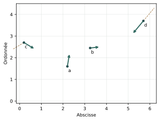
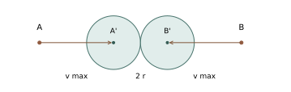
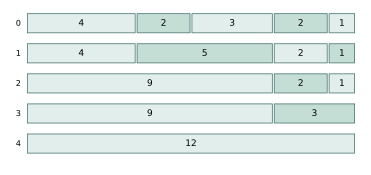

# X-ENS · PSI et PT · Informatique 2016 · Corrigé brut

*Corrigé rédigé par IA, non officiel. Signalez toute erreur.*

**Rédaction** · GPT-6.2 Astra Ultra · vitesse non renseignée · 25 novembre 2026

**Détection de collisions entre particules.** Le code est en Python. Les constantes globales `rayon` et `vMax` sont celles de l’énoncé.

## I · Mouvement discret

### Question 1 · Déplacer une particule

```python
def deplacerParticule(particule, largeur, hauteur):
    x, y, vx, vy = particule
    if x + vx <= 0 or x + vx >= largeur:
        vx = -vx
    if y + vy <= 0 or y + vy >= hauteur:
        vy = -vy
    return (x + vx, y + vy, vx, vy)
```

Le changement de signe a lieu au point de départ du pas, y compris en cas d’égalité avec une paroi. Ainsi, dans le rectangle de dimensions 6 et 4, la particule $(5.7,3.7,0.5,0.6)$ devient $(5.2,3.1,-0.5,-0.6)$. La norme de la vitesse est conservée. Si le rebond a lieu à gauche, alors $0<x\leqslant |v_x|$ et l’abscisse atteinte vaut $x+|v_x|\leqslant 2v_{\max}<L$, où $L$ désigne la largeur. Les autres parois se traitent de même. Le coût est constant.



## II · Représentation par grille

### Question 2 · Construire une grille vide

```python
def nouvelleGrille(largeur, hauteur):
    grille = []
    for i in range(largeur):
        colonne = []
        for j in range(hauteur):
            colonne.append(None)
        grille.append(colonne)
    return grille
```

Le premier indice est l’abscisse. Chaque colonne possède son propre tableau de hauteur cases. Répéter une référence vers une même colonne ferait apparaître une particule dans plusieurs colonnes à la fois.

### Question 3 · Avancer la grille ou détecter une collision

```python
def majGrilleOuCollision(grille):
    largeur, hauteur = len(grille), len(grille[0])
    suivante = nouvelleGrille(largeur, hauteur)
    for colonne in grille:
        for p in colonne:
            if p is not None:
                q = deplacerParticule(p, largeur, hauteur)
                i, j = int(q[0]), int(q[1])
                if suivante[i][j] is not None:
                    return None
                suivante[i][j] = q
    return suivante
```

Après chaque insertion, la nouvelle grille contient exactement les particules déjà traitées à leur position finale. Les coordonnées restant strictement dans le rectangle, leurs parties entières sont des indices valides. Deux particules qui échangent leurs cases pendant un pas peuvent donc terminer sans collision dans ce modèle discret.

### Question 4 · Dater la première collision sur la grille

```python
def attendreCollisionGrille(grille, tMax):
    for t in range(1, tMax + 1):
        grille = majGrilleOuCollision(grille)
        if grille is None:
            return t
    return None
```

On prend pour convention que $t_{\max}$ est le dernier instant observé. Si l’expression « avant le temps tMax » est prise au sens strict, la seule modification est la borne supérieure de la boucle, qui devient `tMax`. Avec un horizon nul, la simulation n’effectue aucun pas. À chaque tour, tous les instants précédents ont été contrôlés.

### Question 5 · Coût de la simulation par grille

Écrivons $L$ pour la largeur, $H$ pour la hauteur et $T$ pour l’horizon. À chaque pas, l'initialisation de la nouvelle grille occupe $LH$ cases et coûte $\Theta(LH)$. Vient ensuite un parcours d’au plus $LH$ cases avec un traitement constant pour chacune. Pour $T\geqslant 1$, le pire temps est donc $\Theta(TLH)$, atteint par exemple lorsque la grille reste vide. Pour une première collision au temps $t$, il est de $\Theta(tLH)$. Deux grilles coexistent pendant un pas, soit $O(LH)$ d’espace auxiliaire.

## III · Détection sur une liste

### Question 6 · Décider le contact de deux disques

```python
def detecterCollisionEntreParticules(p1, p2):
    dx = p1[0] - p2[0]
    dy = p1[1] - p2[1]
    return dx * dx + dy * dy <= (2 * rayon) ** 2
```

Le carré conserve l’ordre des distances positives et évite une racine carrée. La tangence et la superposition comptent comme une collision. Les vitesses n’interviennent pas dans ce test à un instant donné.

### Question 7 · Mettre à jour la liste

```python
def maj(particules):
    largeur, hauteur, anciennes = particules
    nouvelles = []
    for p in anciennes:
        nouvelles.append(deplacerParticule(p, largeur, hauteur))
    return (largeur, hauteur, nouvelles)
```

Les dimensions sont transmises avec la liste. Celle-ci est indépendante de la précédente et conserve l’ordre initial des étiquettes des particules. Le temps et l’espace supplémentaire sont $O(n)$.

### Question 8 · Contrôler toutes les paires

```python
def majOuCollision(particules):
    etat = maj(particules)
    positions = etat[2]
    for i in range(len(positions)):
        for j in range(i + 1, len(positions)):
            if detecterCollisionEntreParticules(positions[i], positions[j]):
                return None
    return etat
```

On compare les centres après le déplacement des deux particules. Sans collision, les boucles examinent $n(n-1)/2$ paires. Une liste de zéro ou une particule ne déclenche jamais ce test.

### Question 9 · Dater la première collision et chiffrer le coût

```python
def attendreCollision(particules, tMax):
    for t in range(1, tMax + 1):
        particules = majOuCollision(particules)
        if particules is None:
            return t
    return None
```

La convention de la question 4 s’applique. Les positions initiales sont supposées admissibles et l’on surveille les instants après mise à jour. Si l’on souhaite également observer une collision initiale, il faut tester séparément les paires à $t=0$. Pour $n\geqslant 2$ et $T\geqslant 1$, le temps maximal est $\Theta(Tn^2)$, atteint pour des particules immobiles suffisamment éloignées. L’espace supplémentaire est $O(n)$.

### Question 10 · Distance initiale nécessaire

Notons $A,B$ les centres à l’instant $t$ et $A',B'$ à l’instant suivant. En cas de contact, $A'B'\leqslant 2r$, tandis que $AA'\leqslant v_{\max}$ et $B'B\leqslant v_{\max}$. L’inégalité triangulaire donne

$$
AB\leqslant AA'+A'B'+B'B\leqslant 2(r+v_{\max}).
$$

Cette borne est atteinte par deux centres alignés qui se rapprochent chacun de $v_{\max}$ et finissent à distance $2r$. Une faible distance initiale rend le contact possible. Les directions de déplacement déterminent s’il a réellement lieu.



### Question 11 · Exploiter le tri ancien en abscisse

```python
def majOuCollisionX(particules):
    anciennes = particules[2]
    etat = maj(particules)
    nouvelles = etat[2]
    limite = 2 * (rayon + vMax)
    n = len(anciennes)
    for i in range(n):
        j = i + 1
        while j < n and anciennes[j][0] - anciennes[i][0] <= limite:
            if detecterCollisionEntreParticules(nouvelles[i], nouvelles[j]):
                return None
            j += 1
    return etat
```

L’écart horizontal initial minore la distance initiale entre les centres. Dès qu’il dépasse la borne de la question 10, il la dépasse aussi pour les indices suivants. L’égalité garde la paire candidate, car un contact tangent reste possible. La décision finale utilise les deux positions nouvelles. Le temps est $O(n+m)$ pour $m$ paires candidates, jusqu’à $O(n^2)$ si, par exemple, toutes les anciennes abscisses coïncident. La liste retournée conserve ses étiquettes et devra être retriée avant une nouvelle application de cette fonction.

## IV · Tri de séquences déjà ordonnées

### Question 12 · Découper en séquences croissantes maximales

```python
def scm(s):
    morceaux = []
    if len(s) == 0:
        return morceaux
    debut = 0
    for i in range(1, len(s)):
        if s[i - 1] > s[i]:
            morceaux.append((debut, i - 1))
            debut = i
    morceaux.append((debut, len(s) - 1))
    return morceaux
```

Toutes les coupures sont imposées par une descente et chacune est indispensable. Les égalités restent dans le même morceau. Sur les douze valeurs de l’exemple, les couples sont $(0,3),(4,5),(6,8),(9,10),(11,11)$, soit **cinq** séquences. Le nombre $k=4$ imprimé à côté du dessin est une coquille. Le parcours est linéaire.

### Question 13 · Fusionner deux intervalles consécutifs

```python
def fusionner(s, r1, r2):
    debut, fin_gauche = r1
    droite, fin_droite = r2
    gauche = []
    for k in range(debut, fin_gauche + 1):
        gauche.append(s[k])
    i, k = 0, debut
    while i < len(gauche) and droite <= fin_droite:
        if gauche[i] <= s[droite]:
            s[k] = gauche[i]
            i += 1
        else:
            s[k] = s[droite]
            droite += 1
        k += 1
    while i < len(gauche):
        s[k] = gauche[i]
        k += 1
        i += 1
```

Au début d’un tour, `droite - k == len(gauche) - i`. L’écriture préserve donc l’entrée de droite encore à lire. Quand le tampon gauche est épuisé, le reste du bloc droit est déjà à la bonne place. Le segment final contient les mêmes éléments en ordre croissant, et l’égalité donne priorité à l’ancien bloc gauche, ce qui assure la stabilité. Les autres indices de `s` restent intacts. Pour deux blocs de longueurs $a,b$, le temps est $O(a+b)$ et le tampon contient $a$ éléments.

### Question 14 · Fusionner au sommet de la pile

```python
def depileFusionneRemplace(s, pile):
    droite = pile.pop()
    gauche = pile.pop()
    fusionner(s, gauche, droite)
    pile.append((gauche[0], droite[1]))
```

Les deux intervalles étaient consécutifs. La pile contient à présent leur union à la place des deux anciens segments et sa taille a diminué de un. La procédure agit en place sur la liste et sur la pile.

### Question 15 · Programmer les deux phases de l’alpha-tri

```python
def longueur(intervalle):
    return intervalle[1] - intervalle[0] + 1

def alphaTri(s):
    pile = []
    for morceau in scm(s):
        pile.append(morceau)
        while (len(pile) >= 2
               and longueur(pile[-2]) < 2 * longueur(pile[-1])):
            depileFusionneRemplace(s, pile)
    while len(pile) >= 2:
        depileFusionneRemplace(s, pile)
```

Après chaque ajout et les fusions qu’il déclenche, la pile représente une partition ordonnée du préfixe lu en blocs triés. Les deux derniers sont les seuls susceptibles d’enfreindre la condition de longueur, d’où la répétition du test au sommet. Chaque fusion conserve le multiensemble des valeurs, la contiguïté des intervalles et leur ordre de gauche à droite. La phase finale laisse un seul bloc pour toute entrée non vide. Les listes vide et singleton conviennent également. Dans l’exemple, les longueurs 2 et 3 fusionnent, puis 4 et 5. La phase finale fusionne 2 et 1, puis 9 et 3. Le résultat est $[0,0,1,2,3,4,5,7,8,9,10,11]$.


