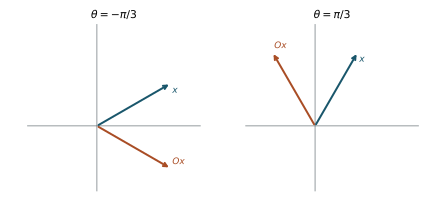
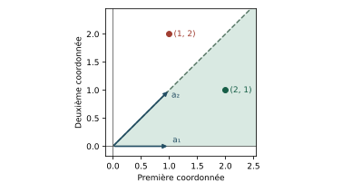

# X–ENS · PSI · Mathématiques 2016 · Corrigé brut

*Corrigé rédigé par IA, non officiel. Signalez toute erreur.*

**Rédaction** · GPT-6.2 Astra Ultra · vitesse non renseignée

**Révision (tour 1)** · GPT-6.2 Astra Ultra · vitesse non renseignée

Le problème démontre le théorème de Broyden, son équivalence avec le théorème de Tucker, puis l’alternative de Farkas. La positivité est prise coordonnée par coordonnée. Les deux signes du relèvement de la question 17 sont vérifiés directement sur la matrice par blocs.

[Sujet officiel](https://ens-paris-saclay.fr/sites/default/files/CONCOURS/ANNALES_1C/1C_PSI/2016_Sujet_1C_PSI_Maths.pdf)

Une diagonale de signes a ses coefficients diagonaux dans $\{-1,1\}$. Pour l’alternative finale, le cône des seconds membres admissibles est $\{Aw\mid w\ge0\}$. La vérification suit les questions du sujet officiel. Le rapport écrit de mathématiques de cette session reste introuvable dans les archives consultées.

## Préliminaire. Comparer les signes

### Question 1a

Si les diagonales de $S,R$ sont $(s_i),(r_i)$, alors
$$
\langle x,y\rangle-\langle Sx,Ry\rangle=2\sum_{i:s_i\ne r_i}x_i y_i.
$$
Tous les produits sont strictement positifs. La différence est donc positive ou nulle et ne s’annule que pour $S=R$.

### Question 1b

Si $Ox=Sx$ et $Oy=Ry$, l’orthogonalité donne $\langle Sx,Ry\rangle=\langle Ox,Oy\rangle=\langle x,y\rangle$. D’après 1a, $S=R$. Le vecteur lui-même peut être multiplié par toute constante strictement positive.

### Question 1c

Les termes $\|x\|^2+\|y\|^2$ coïncident dans les deux développements. La comparaison se réduit à 1a pour les termes croisés. Les normes étant positives ou nulles, l’inégalité passe aux racines carrées avec le même cas d’égalité.

### Question 2

Si $Ox=Sx$ et $x>0$, alors $x\pm Ox=(I\pm S)x\ge0$. Réciproquement, le système donne $|(Ox)_i|\le x_i$ et l’orthogonalité impose $\sum_i(x_i^2-(Ox)_i^2)=0$. Tous les termes sont positifs ou nuls, donc $|(Ox)_i|=x_i$ pour tout $i$. On obtient $Ox=Sx$ en prenant $s_i=(Ox)_i/x_i$. Cette équivalence porte sur **l’existence** de $S$ dans le sens réciproque. Une diagonale fixée à l’avance, comme pourrait le suggérer la formulation imprimée, ne découle pas du système qui ne la mentionne pas.

Pour voir concrètement le rôle du quantificateur, prenons $O=I$ et $x=(1,1)^t$. Le système $(*)$ est satisfait. Avec la diagonale prescrite $S=-I$, l’égalité $Ox=Sx$ est pourtant fausse. La diagonale déterminée par ce $x$ est $S=I$.

## A. Réflexions et rotations du plan

### Question 3

Pour une réflexion d’axe horizontal ou vertical, sa matrice est déjà diagonale de signes et $x=(1,1)^t$ convient. Dans les autres cas, l’axe ou sa perpendiculaire a une pente strictement positive. Prendre sur cette droite le vecteur $x=(1,m)^t$, avec $m>0$ sa pente. Si c’est l’axe, $Ox=x$ et $S=I$. Si c’est sa perpendiculaire, $Ox=-x$ et $S=-I$.

### Question 4

Si $v(a)=(\cos a,\sin a)^t$, la rotation donne $v(a+\theta)$ et les deux réflexions donnent $v(-a)$ et $v(\pi-a)$. Choisissons $x_+=v(-\theta/2)$ et $x_-=v((\pi-\theta)/2)$. Ils satisfont les deux égalités demandées. Pour $-\pi<\theta<0$, seul $x_+$ est strictement positif. Pour $0<\theta<\pi$, seul $x_-$ l’est. Le demi-tour $\theta=\pi$ appartient aussi à l’intervalle imprimé. Les deux directions trouvées sont alors des axes, sans vecteur strictement positif. Comme $O=-I$, le couple $x=(1,1)^t$, $S=-I$ donne directement le théorème.

## B. Équivalence des théorèmes de Tucker et de Broyden

### Question 5

La matrice par blocs est antisymétrique. Appliquons Tucker à $u=(z_1,z_2,x)^t\ge0$. Avec $a=(I+O)x$, $b=(I-O)x$ et $c=-(I+O^t)z_1-(I-O^t)z_2$, le produit $Mu$ est le vecteur-bloc $(a,b,c)^t$. Ainsi $a,b,c\ge0$ et $z_1+a,z_2+b,x+c>0$. Ce sont exactement les six inégalités.

### Question 6

De $c\ge0$ on tire $0\le z_1+z_2\le -O^t(z_1-z_2)$ composante par composante. Ainsi
$$
\|z_1+z_2\|\le \|O^t(z_1-z_2)\|=\|z_1-z_2\|\le\|z_1+z_2\|.
$$
La dernière inégalité résulte de $\langle z_1,z_2\rangle\ge0$. Toutes sont donc des égalités. Dans la première comparaison, deux vecteurs positifs ordonnés de même norme sont égaux, par sommation des différences de carrés. Il en résulte $c=0$.

On peut aussi lire l’égalité des deux dernières normes sur leurs carrés. Leur différence vaut $4\langle z_1,z_2\rangle$. Ainsi $\langle z_1,z_2\rangle=0$ et, puisque les coefficients de ces deux vecteurs sont tous positifs ou nuls, ils ne possèdent aucun indice où ils seraient tous deux strictement positifs.

### Question 7

On a $x+c>0$ et $c=0$, donc $x>0$. Les deux premiers blocs de $Mu$ donnent $x\pm Ox\ge0$. La question 2 construit la diagonale voulue et 1b assure son unicité. Tucker implique Broyden.

### Question 8

Si $(I+M)v=0$, alors $0=\|v\|^2+\langle Mv,v\rangle=\|v\|^2$, car $M^t=-M$. Le noyau est trivial. Une matrice carrée injective est inversible. Le même raisonnement s’applique à $I-M$.

### Question 9

Les matrices $I\pm M$ commutent, ainsi que leurs inverses. Comme $(I+M)^t=I-M$, on a $O^t=(I+M)(I-M)^{-1}=(I-M)^{-1}(I+M)=O^{-1}$. Donc $O$ est orthogonale.

### Question 10

Broyden donne $x>0$ et $Ox=Sx$. Multiplier par $I+M$ donne $(I-M)x=(I+M)Sx$, donc $M(x+Sx)=x-Sx$. Avec $u=x+Sx\ge0$, on a $Mu=x-Sx\ge0$ et $u+Mu=2x>0$. C’est Tucker.

## C. Preuve par récurrence

### Question 11

La dernière ligne $(q^t,\alpha)$ et la dernière colonne $(r^t,\alpha)^t$ de $O$ ont chacune une norme euclidienne égale à un, car $OO^t=O^tO=I$. Ainsi $\|q\|^2=\|r\|^2=1-\alpha^2$. En particulier $|\alpha|\le1$, avec égalité exactement quand $q=r=0$.

### Question 12

On a $O=\operatorname{diag}(P,\alpha)$ avec $P$ orthogonale. La récurrence fournit $y>0$ et $D$ tels que $Py=Dy$. Prendre $x=(y,1)^t$ et $S=\operatorname{diag}(D,\alpha)$. La dimension un, qui initialise la récurrence, relève de $O=[1]$ ou $[-1]$.

### Question 13

Le bloc supérieur gauche de $O^tO=I$ donne $P^tP+qq^t=I$. Le bloc supérieur droit donne $P^tr+\alpha q=0$ et le bloc inférieur droit $r^tr+\alpha^2=1$.

### Question 14

Écrivons $Q=P-rq^t/d$, avec $d=\alpha\pm1$. Par 13,
$$
Q^tQ=I+\left(-1+\frac{2\alpha}{d}+\frac{1-\alpha^2}{d^2}\right)qq^t.
$$
Le numérateur du coefficient est $1-(d-\alpha)^2=0$. Les deux matrices sont orthogonales.

### Question 15

Pour $a=\alpha+1$ et $b=\alpha-1$, le coefficient de $qq^t$ dans $Q_+^tQ_--I$ vaut $-1+\alpha/a+\alpha/b+(1-\alpha^2)/(ab)=-2/(1-\alpha^2)$. Multiplier $Q_+^tQ_-=I-2qq^t/(1-\alpha^2)$ à gauche par $Q_+$ donne la formule pour $Q_-$. Le facteur de droite est la réflexion orthogonale de normale $q$, puisque $q^tq=1-\alpha^2$.

Posons $H=I-2qq^t/\|q\|^2$. Si $v\perp q$, alors $Hv=v$. En revanche $Hq=-q$. Ainsi $Q_+^tQ_-$ modifie exactement le signe de la composante selon $q$, et $Q_-=Q_+H$.

### Question 16

Par définition, $\langle S_+x_+,S_-x_-\rangle=x_+^tQ_+^tQ_-x_-$. La question 15 donne
$$
\langle x_+,x_-\rangle-\frac{2}{1-\alpha^2}\langle x_+,q\rangle\langle x_-,q\rangle.
$$

### Question 17

Posons $a_\pm=\langle x_\pm,q\rangle$. Si $S_+\ne S_-$, alors 1a et 16 donnent $a_+a_->0$. Les quantités $\eta_+=-a_+/(\alpha+1)$ et $\eta_-=-a_-/(\alpha-1)$ sont donc de signes contraires et l’une est strictement positive. Les premiers blocs de $Oz_\pm$ valent $Q_\pm x_\pm=S_\pm x_\pm$. Mais le dernier bloc vaut
$$
a_\pm+\alpha\eta_\pm=\mp\eta_\pm .
$$
**Les deux derniers signes sont inversés dans le sujet imprimé.** Les diagonales correctes sont $\operatorname{diag}(S_+,-1)$ et $\operatorname{diag}(S_-,+1)$. Avec la diagonale corrigée, le vecteur dont la dernière coordonnée est positive fournit la solution. Par exemple, pour le quart de tour direct, $q=1$, $r=-1$, $\alpha=P=0$. Avec $x_+=x_-=1$, on a $S_+=1$, $S_-=-1$ et le seul candidat positif est $z_-=(1,1)^t$. Son image est $(-1,1)^t$, ce qui exige bien le dernier signe $+1$.

### Question 18a

Avec $z=(x_+,0)^t$ et $q^tx_+=0$, on a $Px_+=Q_+x_+=S_+x_+$ et le dernier bloc de $Oz$ est nul. Les deux diagonales $R_+,R_-$ agissent donc identiquement sur $z$ et donnent $Oz$. Si seule la relation $q^tx_-=0$ est connue, utiliser $x_-$ de la même façon. Pour $S_+=S_-$, la question 16 impose précisément $a_+a_-=0$.

### Question 18b

Conjuguons $O$ par une permutation qui envoie le premier axe sur le dernier. La récurrence en dimension $n-1$ s’applique à ses blocs réduits. Si $|\alpha'|=1$, la construction de 12 donne un vecteur entièrement positif. Sinon, si les signes réduits diffèrent, 17 corrigée donne le même résultat. S’ils coïncident, 16 annule l’un des deux produits scalaires et 18a donne un vecteur positif sauf sur la dernière coordonnée où il vaut zéro. En annulant la permutation, on obtient $z'=(\eta',x')^t$ avec $\eta'\ge0$, $x'>0$ et une diagonale $R'$ telle que $Oz'=R'z'$.

### Question 18c

Si $\eta'>0$ on a fini. Sinon $z$ ne s’annule qu’au dernier indice et $z'$ seulement au premier, donc $z+z'>0$. Choisissons l’une des diagonales $R$ de 18a. L’orthogonalité donne $\|Rz+R'z'\|=\|O(z+z')\|=\|z+z'\|$. Le calcul de 1c reste valable pour des coordonnées nulles et force $R_i=R'_i$ dès que $z_i z'_i>0$. Choisissons à chaque indice le signe du vecteur dont la coordonnée est positive. Ce choix concorde en cas de recouvrement et produit $S(z+z')=Rz+R'z'=O(z+z')$. La récurrence est achevée, et 1b fournit l’unicité.

Le cas d’égalité utilisé ici se vérifie sans exiger d’emblée des coordonnées strictement positives. Si $s_i,s'_i$ sont les signes des deux diagonales, alors
$$\|z+z'\|^2-\|Rz+R'z'\|^2=4\sum_{i:s_i\ne s'_i}z_i z'_i.$$
Chaque terme est positif ou nul. Les indices où les signes diffèrent ne peuvent donc porter deux coordonnées positives. Le signe de la somme s’y choisit sans ambiguïté.

## D. Alternative de Farkas

### Question 19

La matrice $B$ est antisymétrique. Pour $z=z_1-z_2$, les blocs de $By$ sont $Ax-tb$, $-Ax+tb$, $-A^tz$, $b^tz$. Si $t=0$, le dernier bloc de $y+By>0$ donne $b^tz>0$, tandis que $By\ge0$ donne $-A^tz\ge0$. On est dans le cas (II).

### Question 20

Comme $Ax-tb$ et son opposé sont positifs, $Ax=tb$. Si $t>0$, alors $w=x/t\ge0$ vérifie $Aw=b$, d’où (I). Tucker assure que l’un des deux cas se produit. Si (I) et (II) étaient simultanés, on aurait $0< b^tz=w^tA^tz\le0$. Ils s’excluent donc.

Prenons les colonnes $a_1=(1,0)^t$, $a_2=(1,1)^t$. Le point $(2,1)^t=a_1+a_2$ réalise (I). Pour $b=(1,2)^t$, le vecteur $z=(-1,1)^t$ vérifie $A^tz=(-1,0)^t\le0$ et $b^tz=1>0$. Il donne le certificat de (II) et explique la séparation sur la figure.

