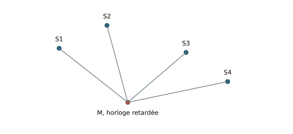
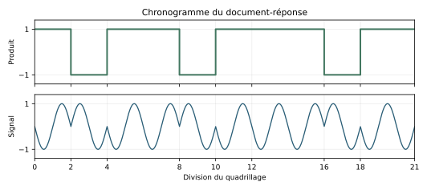
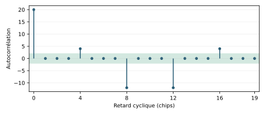
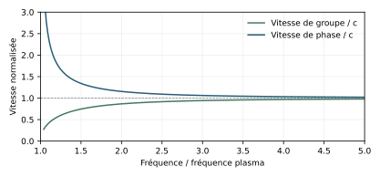

# X-ENS PSI · Modélisation 2016 · Corrigé guidé

*Corrigé rédigé par IA, non officiel. Signalez toute erreur.*

**Rédaction** · GPT-6.2 Astra Ultra · vitesse non renseignée · 24 novembre 2026

## Repères

L’horloge du récepteur est en retard dans le modèle de la partie 2. Pour les codes, distinguer la période réelle de 1 023 chips de la séquence pédagogique de 20 cases et travailler modulo la période retenue.

## 1 · Usages

### Question 1 · Deux usages du récepteur

**Indication.** Associer chacune des grandeurs PVT à une opération concrète.

#### Solution

Un équipage de secours transmet les coordonnées d'un randonneur pour rejoindre le bon lieu. Un opérateur de télécommunications utilise le temps de référence GNSS pour synchroniser ses stations.

## 2 · Position et temps

### Question 2 · Distance vraie

**Indication.** Comparer l'heure d'émission transmise et l'heure de réception, avec des horloges synchrones.

#### Solution

En négligeant les retards atmosphériques, la durée de propagation est $T_i=t_{\rm rec}-t_{{\rm ém},i}$. Ainsi $\rho_i=cT_i=\sqrt{(x-x_i)^2+(y-y_i)^2+(z-z_i)^2}$. Les coordonnées de $S_i$ sont celles de l'instant d'émission.

### Question 3 · Géométrie avec horloge connue

**Indication.** Les distances imposent des sphères. Trois sphères peuvent avoir deux points communs.

#### Solution

Il faut recevoir au moins trois satellites dont les positions sont connues et dont les directions de visée depuis $M$ engendrent l'espace, pour déterminer localement les trois coordonnées. Géométriquement, trois centres non alignés donnent en général deux solutions symétriques de part et d'autre de leur plan. Une information physique, par exemple la proximité de la surface terrestre dans la configuration usuelle, permet de choisir. Sans une telle information, une quatrième distance de centre hors du plan lève l'ambiguïté.

### Question 4 · Signe du biais d'horloge

**Indication.** Une horloge en retard affiche une heure de réception plus petite que l'heure GPS.

#### Solution

Avec $\Delta t=t_{\rm GPS}-t_{\rm récepteur}>0$, l'intervalle chronométré vaut $\rho_i/c-\Delta t$. La mesure est donc $PD_i=\rho_i-c\Delta t$. La convention de signe dépend ici de la définition explicite du retard.

### Question 5 · Nombre de satellites avec biais

**Indication.** À trois coordonnées de position s'ajoute une inconnue commune aux horodatages.

#### Solution

Il faut au moins quatre satellites reçus et une géométrie fournissant quatre équations localement indépendantes. En notant $\mathbf u_i=(M-S_i)/\rho_i$, la matrice de lignes $(\mathbf u_i^{\mathsf T},-c)$ doit être de rang quatre. Les extrémités des vecteurs unitaires $\mathbf u_i$ ne doivent donc pas toutes appartenir à un même plan affine. Les solutions physiquement admissibles doivent encore être distinguées en présence d'une ambiguïté globale.



### Question 6 · Système normal local

**Indication.** Isoler la matrice, le vecteur inconnu à l'itération suivante et le second membre.

#### Solution

Pour le schéma imprimé, $A=J_k^{\mathsf T}J_k$, $x=q_{k+1}$ et $b=Aq_k+J_k^{\mathsf T}R_{PD}$. Une précision est nécessaire pour mettre effectivement en œuvre les moindres carrés. Si $R_{PD}$ désigne le vecteur des **mesures brutes**, comme à la page 3, la linéarisation de $h(q_k+\delta q)$ donne comme innovation $r_k=R_{PD}-h(q_k)$. Le second membre correct pour ce calcul est alors $Aq_k+J_k^{\mathsf T}r_k$.

### Question 7 · Unicité de la correction

**Indication.** Calculer la forme quadratique associée à la matrice normale.

#### Solution

Pour toute colonne $z$, $z^{\mathsf T}J^{\mathsf T}Jz=\|Jz\|^2$. Ainsi $\ker(J^{\mathsf T}J)=\ker J$. La solution est unique si et seulement si le rang en colonnes de $J$ vaut quatre, ou encore si $\det(J^{\mathsf T}J)\ne 0$.

### Question 8 · Réduction par pivot partiel

**Indication.** Travailler sur la matrice augmentée pour appliquer la même opération au second membre.

#### Solution

Dans la colonne $k$, choisir la ligne $p\ge k$ maximisant $|a_{pk}|$, échanger les lignes $k,p$ de la matrice augmentée $[A\mid b]$, puis diviser la nouvelle ligne $k$ par son pivot. Pour tout $i\ne k$, conserver d'abord $s=a_{ik}$ puis faire $L_i\leftarrow L_i-sL_k$, dernier coefficient du second membre inclus. Recommencer dans la sous-matrice suivante. Chaque opération est inversible et préserve l'ensemble des solutions. Un pivot nul après recherche signale l'absence de rang plein. Pour le système carré inversible de Q7, la forme réduite par lignes vaut $I_4$.

### Question 9 · Résoudre le système déjà réduit

**Indication.** Sur une matrice carrée de rang plein, chaque colonne contient un unique pivot égal à 1.

#### Solution

La précondition donnée et Q7 impliquent $\widetilde A=I_{n_p}$, donc $x=\widetilde b$. Il suffit de rendre la liste existante, sans la modifier. Toute réduction ou remontée supplémentaire serait ici superflue.

```python
def solution_reduite(a_tilde, b_tilde):
    # Precondition : matrice carree inversible, deja reduite.
    return b_tilde
```

### Question 10 · Coût du retour de solution

**Indication.** Distinguer transmettre une référence et recopier tous les coefficients de la liste.

#### Solution

La fonction lit la référence à $\widetilde b$ et la renvoie. Le temps de ce passage de référence est $\Theta(1)$, indépendamment de $n_p$, pour un nombre constant d'UT. Si l'on impose une sortie indépendante, la recopie de la liste représente $\Theta(n_p)$ et coûte de l'ordre de $5n_p$ UT pour le seul parcours dans le modèle donné.

### Question 11 · Coût de la résolution locale

**Indication.** Additionner le pivot et la récupération de sa solution.

#### Solution

Le pivot demande environ $15{,}6\ \mu{\rm s}$, soit $1\,560$ UT à $10$ ns l'UT. Le retour de la référence y ajoute seulement quelques nanosecondes. La résolution linéaire locale prend donc environ $15{,}6\ \mu{\rm s}$. Le coût global dépend en outre du nombre d'itérations et de la formation de la matrice et du résidu.

### Question 12 · Arrêt de l'itération

**Indication.** Comparer les corrections de temps et de position dans des unités cohérentes.

#### Solution

On peut arrêter lorsque $\|\mathbf r_{k+1}-\mathbf r_k\|\le\varepsilon_{\rm pos}$ et $c|\Delta t_{k+1}-\Delta t_k|\le\varepsilon_{\rm horloge}$, les deux seuils étant exprimés en mètres. Une vérification du résidu au regard de la précision des mesures et un plafond d'itérations permettent de distinguer convergence et stagnation.

## 3 · Segment spatial

### Question 13 · Plan orbital

**Indication.** Calculer le moment de la seule force autour du centre de la Terre.

#### Solution

La gravitation est centrale. Le théorème du moment cinétique fournit $\dot{\mathbf L}_{O_T}=\mathbf r\times(-GM_Tm\,\mathbf r/r^3)=0$. Lorsque $\mathbf L\ne 0$, le vecteur $\mathbf r$ reste dans le plan fixe orthogonal à $\mathbf L$ passant par $O_T$. Pour $\mathbf L=0$, le mouvement est radial et donc également plan.

### Question 14 · Moment cinétique et dérivée de l'inverse du rayon

**Indication.** Une vitesse de norme imposée doit aussi avoir une direction connue pour fixer le moment cinétique.

#### Solution

Posons $r_0=r_T+h$ et notons $\beta$ l'angle entre $\mathbf r_0$ et $\mathbf V_0$. Alors $L=mr_0V_0|\sin\beta|$. La formule usuelle $L=m(r_T+h)V_0$ suppose une vitesse initiale tangentielle, direction que la seule donnée de sa norme ne fixe pas. En orientant le plan dans le sens du mouvement, $L=mr^2\dot\theta$. Ainsi $\dot r=(dr/d\theta)L/(mr^2)=-(L/m)d(1/r)/d\theta$ pour $L\ne0$.

### Question 15 · Équation orbitale de Binet

**Indication.** Poser u=1/r puis remplacer la vitesse angulaire par sa valeur issue de Q14.

#### Solution

Avec $H=L/m$ et $u=1/r$, on a $\dot\theta=Hu^2$, $\dot r=-Hu'$ et $\ddot r=-H^2u^2u''$. La projection radiale du PFD donne $\ddot r-r\dot\theta^2=-GM_T/r^2$. Il vient $u''+u=GM_T/H^2=1/p$, avec $p=H^2/(GM_T)$. Pour une vitesse initiale tangentielle, $p=(r_T+h)^2V_0^2/(GM_T)$, et dans le cas général cette expression est multipliée par $\sin^2\beta$.

### Question 16 · Condition pour rester lié à la Terre

**Indication.** Comparer l'énergie mécanique initiale au potentiel à l'infini.

#### Solution

L'énergie mécanique spécifique est $\mathcal E=V_0^2/2-GM_T/(r_T+h)$. Une trajectoire non radiale est liée si $\mathcal E<0$, donc si $V_0<\sqrt{2GM_T/(r_T+h)}$. L'égalité est la limite parabolique et une énergie positive permet l'échappement. Pour rester effectivement en orbite sans heurter le sol, il faut en outre que le périgée soit au-dessus de la surface.

### Question 17 · Altitude et vitesse orbitales

**Indication.** Utiliser une période de révolution égale à la moitié du jour sidéral.

#### Solution

Sur une orbite circulaire de rayon $r$, $v^2=GM_T/r$ et $2\pi r/v=T_j/2$. Il vient $r=(GM_TT_j^2/(16\pi^2))^{1/3}$, $h=r-r_T$ et $v=(4\pi GM_T/T_j)^{1/3}$. Aux valeurs terrestres usuelles, on retrouve un rayon d'environ $26\,600$ km et une vitesse de $3{,}87$ km/s.

### Question 18 · Changement de référentiel

**Indication.** Distinguer le référentiel géocentrique de celui qui tourne avec la surface terrestre.

#### Solution

Par construction les directions des axes de $R_G$ et $R_0$ restent parallèles. Le mouvement relatif de $R_G$ est donc une translation, en général accélérée, de vitesse $\mathbf v(O_T/R_0)$. Par dérivation de $\overrightarrow{OS_i}=\overrightarrow{OO_T}+\overrightarrow{O_TS_i}$, $\mathbf v(S_i/R_0)=\mathbf v(O_T/R_0)+\mathbf v(S_i/R_G)$.

### Question 19 · Accélération du géocentre

**Indication.** Écrire l'accélération gravitationnelle due à chacun des deux autres astres au centre de la Terre.

#### Solution

Le centre de la Terre subit les attractions solaire et lunaire. Avec les vecteurs unitaires du sujet, $\mathbf a(O_T/R_0)=G M_S\mathbf u_S/D_S^2+G M_L\mathbf u_L/D_L^2$.

### Question 20 · Accélération absolue du satellite

**Indication.** Dériver la composition de vitesses, sachant que les axes restent parallèles.

#### Solution

$\mathbf a(S_i/R_0)=\mathbf a(S_i/R_G)+GM_S\mathbf u_S/D_S^2+GM_L\mathbf u_L/D_L^2$. La translation pure exclut tout terme de Coriolis ou de rotation des axes.

### Question 21 · Forces gravitationnelles

**Indication.** Former le vecteur allant du satellite vers chaque centre attracteur.

#### Solution

Posons $\mathbf r=r_i\mathbf e_r$ et $\mathbf D_A=D_A\mathbf u_A$ pour $A=S,L$. La Terre exerce $-GmM_T\mathbf r/r_i^3$. Chaque astre extérieur exerce $\mathbf F_A=GmM_A(\mathbf D_A-\mathbf r)/|\mathbf D_A-\mathbf r|^3$. La somme de ces trois forces entre dans le PFD en $R_0$.

### Question 22 · Perturbations de marée

**Indication.** Retrancher du champ subi par le satellite le champ qui entraîne déjà la Terre.

#### Solution

Pour $A=S,L$, $\Delta\mathbf F_A=GmM_A[(\mathbf D_A-\mathbf r)/|\mathbf D_A-\mathbf r|^3-\mathbf u_A/D_A^2]$. En effet la dérivation en $R_G$ retranche $m\mathbf a(O_T/R_0)$. L'équation relative devient $m\mathbf a(S_i/R_G)=\mathbf F_T+\Delta\mathbf F_S+\Delta\mathbf F_L$.

### Question 23 · Maximum de chaque perturbation extérieure

**Indication.** Le gradient du champ varie comme l'inverse du cube de la distance à l'astre. L'alignement du satellite du côté de l'astre donne le maximum.

#### Solution

Pour $A=S,L$ et $r_i<D_A$, le maximum exact vaut $GmM_A[(D_A-r_i)^{-2}-D_A^{-2}]$. En effet, la matrice dérivée du champ normalisé $\mathbf x/|\mathbf x|^3$ a pour norme $2/|\mathbf x|^3$. Le long du segment radial de longueur $r_i$, la distance à l'astre est au moins $D_A-s$. L'intégrale de $2/(D_A-s)^3$ entre 0 et $r_i$ donne la borne annoncée, atteinte dans l'alignement proche. Au premier ordre, les maxima sont donc $2GmM_Sr_i/D_S^3$ et $2GmM_Lr_i/D_L^3$.

### Question 24 · Champ terrestre zonal

**Indication.** Le potentiel dépend du rayon et de la colatitude. Dériver par rapport aux deux variables avant de changer le signe.

#### Solution

Soit $\mu=GM_T$ et $K=3m\mu J_2r_T^2/(2r_i^4)$. Comme $\mathbf F=-m\nabla V_2$, la force totale est $-m\mu\mathbf e_r/r_i^2+\Delta\mathbf F_{J_2}$, avec
$$\Delta\mathbf F_{J_2}=K\big[(3\cos^2\varphi-1)\mathbf e_r+2\sin\varphi\cos\varphi\,\mathbf e_\varphi\big].$$
Le potentiel est indépendant de l'azimut, d'où une composante azimutale nulle.

### Question 25 · Maximum du terme d'aplatissement

**Indication.** Écrire le carré de la norme comme un polynôme en cos²φ.

#### Solution

Avec $u=\cos^2\varphi$, on obtient $\|\Delta\mathbf F_{J_2}\|^2/K^2=(3u-1)^2+4u(1-u)=5u^2-2u+1$. Ce polynôme convexe atteint son maximum sur $[0,1]$ en $u=1$, où il vaut 4. La perturbation maximale vaut donc $2|K|=3GmM_T|J_2|r_T^2/r_i^4$, aux pôles.

### Question 26 · Signal émis en BPSK

**Indication.** Chaque multiplieur multiplie des amplitudes réelles, les signaux NRZ valant ±1.

#### Solution

Le produit des deux premiers signaux vaut $c_i(t)m_i(t)$. Le signal émis est donc $s_i(t)=A\,c_i(t)m_i(t)\sin(2\pi f_{L1}t)$. Un changement de signe du produit retourne la phase de la porteuse de $\pi$.

### Question 27 · Chronogramme de la modulation

**Indication.** Numéroter les petites divisions du document-réponse à partir de zéro et noter le changement simultané des deux signaux à la division 12.

#### Solution

Le produit vaut successivement $+1,-1,+1,-1,+1,-1,+1$ sur les intervalles de divisions $[0,2[$, $[2,4[$, $[4,8[$, $[8,10[$, $[10,16[$, $[16,18[$ et $[18,21]$. À 12, les deux signes changent simultanément et le produit se maintient. On dessine la sinusoïde de référence ou son opposée selon ce produit. Le graphique conserve la phase initiale du segment déjà tracé sur la feuille. [Document-réponse, figure A](https://wikiprepa.fr/concours/data/x-ens_modelisation_psi_2016.pdf)



### Question 28 · Puissance d'un code

**Indication.** Au retard nul, chaque bit NRZ est multiplié par lui-même.

#### Solution

$P_c=r_{ii}(0)=\sum_{\ell=0}^{1022}c_i(\ell)^2=1023$. Cette somme, ici non normalisée, est la même pour chaque satellite. Dans le modèle raccourci de Q31–32, elle devient 20.

### Question 29 · Compléter les deux registres

**Indication.** Prendre l'état à la ligne 14 du document-réponse et former le bit de rétroaction avant de décaler les neuf premiers bits.

#### Solution

Les bits sont rangés de 1 à 10 de gauche à droite. À la ligne 14 figurent $G_1=0010101111$ et $G_2=1010101111$. Ainsi les nouveaux bits de tête sont respectivement $1\oplus1=0$ et $0\oplus1\oplus0\oplus1\oplus1\oplus1=0$. D'où les six lignes à inscrire dans la figure B.

| Ligne | $G_1$ | $G_2$ |
|---:|:---:|:---:|
| 15 | 0001010111 | 0101010111 |
| 16 | 1000101011 | 1010101011 |
| 17 | 1100010101 | 1101010101 |
| 18 | 1110001010 | 0110101010 |
| 19 | 1111000101 | 1011010101 |
| 20 | 0111100010 | 0101101010 |

### Question 30 · Séquence NRZ de vingt bits

**Indication.** Le bit de sortie de la ligne k se calcule avec les registres de la ligne précédente.

#### Solution

Calculer $b_{10}^{G1}\oplus b_2^{G2}\oplus b_6^{G2}$ sur l'état précédent, puis transformer $0$ en $-1$. Les six cases vides de la figure C, numéros 5 à 10, valent $(-1,+1,-1,+1,-1,-1)$. La séquence complète, par blocs de cinq pour la lecture, est
$$ (+,+,+,-,-)\quad (+,-,+,-,-)\quad (-,+,-,-,+)\quad (+,+,+,+,-). $$

### Question 31 · Autocorrélation périodique du code court

**Indication.** Ramener les indices modulo 20 et compter les accords et désaccords. La périodicité réduit le nombre de décalages à vérifier à vingt.

#### Solution

Pour les décalages 1 et 2 on compte chaque fois dix accords et dix désaccords, soit $r_{11}(1)=r_{11}(2)=0$. En revanche, les vingt valeurs, par décalages de 0 à 19, sont
$$ (20,0,0,0,4,0,0,0,-12,0,0,0,-12,0,0,0,4,0,0,0). $$
Avec $P_c=20$, la borne annoncée aux retards non congrus à zéro est 2. Elle est dépassée, notamment au retard 8. La vérification globale demandée de P5 échoue pour **l'extrait de vingt bits répété périodiquement**. Le découpage d'une séquence de longueur 1023 n'en préserve pas en général les propriétés de corrélation.



### Question 32 · Choix du second code

**Indication.** Commencer par le décalage nul, puis contrôler tous les autres car P4 est une propriété uniforme en retard.

#### Solution

Pour les candidats a, b et c de la figure 10, $r_{1j}(0)$ vaut respectivement $8$, $4$ et $-2$. **c** est donc le seul candidat compatible avec la borne 2 au décalage nul. Mais pour c, $r_{1c}(1)=-6$ et $r_{1c}(4)=-10$. Les maxima de $|r_{1j}(p)|$ sur les vingt retards sont respectivement $12,8,10$. Pris littéralement, le critère P4 n'est satisfait par **aucun** des trois candidats pour cette séquence raccourcie.

## 4 · Propagation ionosphérique

### Question 33 · Mouvement d'un électron

**Indication.** Comparer les termes électrique et magnétique de la force de Lorentz.

#### Solution

L'équation est $m_e\mathbf a=-e(\mathbf E+\mathbf v\times\mathbf B)$. Pour l'onde considérée, le terme magnétique est d'ordre $v/v_\phi$ relativement au terme électrique. Dans la limite de faible vitesse, $\mathbf a\simeq-(e/m_e)\mathbf E$.

### Question 34 · Conductivité complexe du plasma

**Indication.** Avec la convention temporelle exp(+iωt), remplacer la dérivée temporelle par iω.

#### Solution

Le champ varie peu sur l'excursion de l'électron. Pour sa réponse harmonique, $i\omega m_e\mathbf v=-e\mathbf E$ et $\mathbf j=-n_0e\mathbf v$. Ainsi $\gamma=n_0e^2/(i m_e\omega)=-i n_0e^2/(m_e\omega)$. Le courant est en quadrature avec le champ dans ce modèle sans collisions.

### Question 35 · Maxwell et relation de dispersion

**Indication.** Insérer le courant de conduction dans Maxwell-Ampère puis éliminer le champ magnétique de l'onde transverse.

#### Solution

Pour l'onde transverse dans le plasma neutre, $\nabla\cdot\mathbf E=0$, $\nabla\cdot\mathbf B=0$, $\nabla\times\mathbf E=-\partial_t\mathbf B$ et $\nabla\times\mathbf B=\mu_0(\mathbf j+\epsilon_0\partial_t\mathbf E)$. Avec la phase $\omega t-\mathbf k\cdot\mathbf r$, $\mathbf k\times\mathbf E=\omega\mathbf B$ et $\mathbf k\cdot\mathbf E=0$. En éliminant $\mathbf B$ et en utilisant Q34 on obtient
$$ k^2=\frac{\omega^2-\omega_p^2}{c^2},\qquad \omega_p^2=\frac{n_0e^2}{\epsilon_0m_e},\qquad f_p=\frac{\omega_p}{2\pi}. $$
En régime propagatif, $\mathbf k=(\sqrt{\omega^2-\omega_p^2}/c)\,\mathbf u$ pour la direction d'avance $\mathbf u$.

### Question 36 · Passage à travers l'ionosphère

**Indication.** Comparer la bande du GPS à la fréquence plasma, dans les mêmes unités.

#### Solution

Les porteuses de 1 000 à 1 600 MHz ont des fréquences très supérieures à $2{,}009$ MHz. Leur nombre d'onde est réel et proche de celui du vide. Au-dessous de $f_p$, le mode de ce modèle serait évanescent. Cette bande assure donc une propagation avec une faible correction dispersive.

### Question 37 · Vitesses de phase et de groupe

**Indication.** Calculer ω/k, puis la dérivée de ω par rapport à k.

#### Solution

$n_p=ck/\omega=\sqrt{1-f_p^2/f^2}$. Sa dépendance en $f$ entraîne la dispersion. La vitesse de phase est $v_\phi=c/n_p$ et la vitesse de groupe vaut $v_g=d\omega/dk=c^2k/\omega=c n_p<c$. L'enveloppe du signal acquiert ainsi un retard.



### Question 38 · Retard ionosphérique

**Indication.** Utiliser la longueur oblique de la traversée et développer en (fₚ/f)².

#### Solution

L'angle du sujet est mesuré depuis la normale. Dans son modèle plan, $\ell=\Delta h/\cos\theta_{\rm el}$. Le retard exact est $\tau_{\rm ion}=\ell[(1-f_p^2/f^2)^{-1/2}-1]/c$. Au premier ordre demandé,
$$\tau_{\rm ion}\simeq K_{\rm ion}/f^2,\qquad K_{\rm ion}=\frac{\Delta h\,f_p^2}{2c\cos\theta_{\rm el}}.$$
Le retard croît pour une traversée plus oblique ou à fréquence plus basse.

### Question 39 · Correction bifréquence

**Indication.** Former une combinaison linéaire dont le coefficient du terme ionosphérique est nul.

#### Solution

Pour un même trajet sur les deux porteuses, $t_a=T+K_{\rm ion}/f_a^2$ et $t_b=T+K_{\rm ion}/f_b^2$. En soustrayant les observables pondérées on trouve $T=(f_a^2t_a-f_b^2t_b)/(f_a^2-f_b^2)$. La même combinaison de pseudo-distances élimine le terme en $1/f^2$ après multiplication par $c$, à l'ordre du modèle.

## 5 · Traitements du récepteur

### Question 40 · Puissance du bruit

**Indication.** Ajouter à la densité en dBW par hertz le gain logarithmique correspondant à la largeur de bande.

#### Solution

$P_N=-200+10\log_{10}(2\times10^6)=-200+3+60=-137\ {\rm dBW}$, soit environ $2\times10^{-14}\ {\rm W}$.

### Question 41 · Rapport signal sur bruit

**Indication.** La soustraction des puissances logarithmiques donne un rapport en dB.

#### Solution

$10\log_{10}\alpha=-159-(-137)=-22$ dB, soit $\alpha=10^{-2,2}\simeq6{,}3\times10^{-3}$. Avant corrélation le bruit a environ 158 fois la puissance du signal utile dans la bande. La sommation cohérente sur le code permet ensuite de faire ressortir le signal.

### Question 42 · Démoduler la porteuse

**Indication.** Développer le produit de deux sinus. Un terme est en bande de base et l'autre centré sur deux fois la porteuse.

#### Solution

On choisit une fréquence de coupure qui couvre la bande utile du code et rejette le terme autour de $2f_{L1}$, par exemple $f_{C/A}\lesssim f_{\rm pb}\ll 2f_{L1}$. C'est possible avec environ 1,023 MHz et 1 575,42 MHz. L'identité $\sin a\sin b=[\cos(a-b)-\cos(a+b)]/2$ donne ensuite $h_i(t)=\widetilde Bm_i(t-T_p)c_i(t-T_p)$, où $\widetilde B=(B/2)\cos(2\pi f_{L1}T_p)$. L'expression suppose le modèle de passe-bas idéal sur la bande utile.

### Question 43 · Accumuler les produits sur une période de code

**Indication.** Comparer la milliseconde de code à la durée d'un bit de navigation et convertir le retard en nombre de chips.

#### Solution

Un bit du message dure 20 ms et la période de code $1023/f_{C/A}=1$ ms. Sur une fenêtre qui ne traverse pas un front de donnée, $m_i(t-T_p)$ est donc constant. En posant $T_c=1/f_{C/A}$, $p=(T_p-\Delta\tau)/T_c$ et en utilisant la convention $r_{ij}(p)=\sum_\ell c_i(\ell)c_j(\ell+p)$, on trouve $w_i=\widetilde B\,m_i(t-T_p)\,r_{ij}(p)$ pour des décalages entiers de chip. Une interpolation traite les retards fractionnaires.

### Question 44 · Maximum de corrélation

**Indication.** Prendre le même code et l'aligner chip pour chip à une période entière près.

#### Solution

Le maximum positif de $r_{ij}$ vaut $P_c$ pour $j=i$ et $\Delta\tau\equiv T_p\pmod{1023T_c}$. En particulier, pour $\Delta\tau=T_p$, $w_i=\widetilde B\,m_i(t-T_p)P_c$. Le signe de $w_i$ dépend du bit de navigation et de la phase de porteuse.

### Question 45 · Identifier le satellite et mesurer le délai

**Indication.** Détecter le pic en valeur absolue puis lever l'ambiguïté liée à la répétition du code.

#### Solution

Le récepteur compare les codes connus à différentes phases et relève les maxima de $|w_i|$. Le code du pic fournit l'identifiant et sa phase fournit le retard modulo 1 ms. Les repères temporels du message de navigation et l'estimation grossière de l'époque de réception lèvent le nombre entier de périodes pour obtenir $T_p$, puis la pseudo-distance. En pratique les composantes en phase et en quadrature évitent l'annulation d'une seule voie lorsque le cosinus de Q42 est nul.

## 6 · Synthèse

### Question 46 · Du signal reçu à la solution PVT

**Indication.** Relier les informations nécessaires à chaque étage et les principales causes d'erreur.

#### Solution

Les satellites diffusent l'heure GPS, leurs éphémérides et des corrections sur une porteuse modulée par un message et un code d'identification. Un modèle d'orbite incluant l'aplatissement terrestre et les perturbations luni-solaires permet de prévoir les positions d'émission. Le récepteur démodule, identifie chaque satellite par corrélation et estime ses pseudo-distances. La correction bifréquence réduit le retard ionosphérique et les autres données corrigent notamment l'horloge et la propagation. Au moins quatre satellites de géométrie non dégénérée permettent alors d'ajuster les trois coordonnées et le biais d'horloge par moindres carrés itérés. Les pseudo-vitesses, issues notamment des fréquences Doppler, permettent d'estimer la vitesse et la dérive de l'horloge. L'ensemble fournit position, vitesse et temps.
