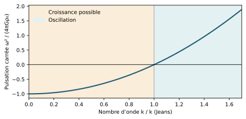
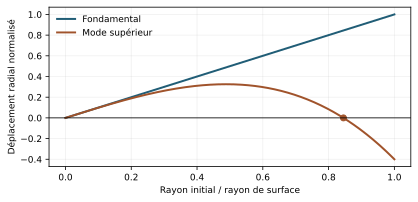

# X–ENS PSI 2016 — Physique (Banque commune X–InterENS) · Corrigé brut

*Corrigé rédigé par IA, non officiel. Signalez toute erreur.*

**Rédaction** · GPT-6.2 Astra Ultra · vitesse non renseignée

## La vie d’une étoile : un long fleuve tranquille ?

## I. Déclenchement de la contraction gravitationnelle

### Question 1 — Conservation de la masse et fermeture du système

L’équation (2) exprime la conservation locale de la masse. Une divergence positive du flux $\rho\mathbf v$ entraîne une diminution de la densité. L’équation (4) est la loi des gaz parfaits $P=\rho\mathcal RT/\mu$. À température imposée, $(\partial P/\partial\rho)_T=v_s^2=\mathcal RT/\mu$.

### Question 2 — Masses molaires moyennes

Pour des fractions massiques $X,Y$, $1/\mu=X/\mu_{\rm espèce~H}+Y/\mu_{\rm He}$. Avec $\mathrm H_2$ et He on trouve $\mu=[0{,}73/2+0{,}27/4]^{-1}=2{,}31\ \mathrm{g\,mol^{-1}}$. Pour l’hydrogène atomique et l’hélium neutre, $\mu_\odot=[0{,}73+0{,}27/4]^{-1}=1{,}25\ \mathrm{g\,mol^{-1}}$. On suit ici la convention de gaz atomique donnée. Compter les électrons libres d’un plasma pleinement ionisé abaisserait encore cette masse.

### Question 3 — Linéarisation locale

Le terme convectif en $\mathbf v_1$ est quadratique et $\nabla P_0=0$. Les produits $\rho_1\nabla P_1$ et $\rho_1\mathbf v_1$ sont également du second ordre. D’où $\partial_t\mathbf v_1=-\nabla P_1/\rho_0-\nabla\Phi_1$, $\partial_t\rho_1+\rho_0\nabla\cdot\mathbf v_1=0$, $\Delta\Phi_1=4\pi G\rho_1$ et $P_1=v_s^2\rho_1$. Comme dans le modèle de Jeans, on retient la gravité des fluctuations autour du fond.

### Question 4 — Direction de la perturbation

Pour une perturbation en $e^{i(\omega t-kx)}$, $\nabla P_1$ et $\nabla\Phi_1$ sont parallèles à $x$. L’équation d’Euler impose la même direction à la vitesse oscillante. C’est une onde longitudinale de compression du gaz, modifiée par sa gravité.

### Question 5 — Système pour les amplitudes

En désignant les amplitudes par des chapeaux, $\omega\hat v=k(\hat P/\rho_0+\hat\Phi)$, $\omega\hat\rho=k\rho_0\hat v$, $-k^2\hat\Phi=4\pi G\hat\rho$ et $\hat P=v_s^2\hat\rho$. Le signe négatif du laplacien détermine le rôle déstabilisateur de la gravité.

### Question 6 — Dispersion de Jeans

La continuité et Euler donnent $\omega^2\hat\rho=k^2(\hat P+\rho_0\hat\Phi)$. Avec l’équation d’état et Poisson, une perturbation non nulle vérifie $\omega^2=v_s^2k^2-4\pi G\rho_0$.

### Question 7 — Longueur critique

Pour $k<\sqrt{4\pi G\rho_0}/v_s$, $\omega$ est imaginaire et l’une des deux solutions temporelles croît exponentiellement. Le seuil équivalent est $\lambda>\lambda_J=\sqrt{\pi v_s^2/(G\rho_0)}$. Les perturbations plus courtes oscillent et le seuil est marginal.

### Question 8 — Taille du nuage solaire initial

À $10\ \mathrm K$, $v_s=\sqrt{\mathcal RT/\mu}\simeq190\ \mathrm{m\,s^{-1}}$. Avec un diamètre $D=\lambda_J$ et $\rho_0=6M_\odot/(\pi D^3)$, on trouve $D=6GM_\odot/(\pi^2v_s^2)\simeq2{,}3\times10^{15}\ \mathrm m$, soit $1{,}5\times10^4\ \mathrm{UA}$ ou $0{,}24$ année-lumière. C’est environ 150 fois la taille de 100 UA donnée. Le coefficient dépend de la convention géométrique retenue.

## II. Pression et température dans une étoile

### Question 9 — Échelle de pression centrale

On a $P_C/R\sim(M/R^3)(GM/R^2)$, donc $P_C\sim GM^2/R^4$. Pour le Soleil cette combinaison vaut $1{,}1\times10^{15}\ \mathrm{Pa}$. Le coefficient dépend du profil de densité et du choix des longueurs caractéristiques.

### Question 10 — Échelle de température centrale

Le rapport $P_C/\rho$ est de l’ordre de $GM/R$, donc $T_C\sim\mu_\odot GM/(\mathcal RR)$. On obtient quelques $10^7\ \mathrm K$ pour le Soleil. L’ionisation et la stratification affectent les coefficients de cette estimation.

### Question 11 — Théorème de Gauss gravitationnel

Le champ d’une charge $q$ est $q\mathbf e_r/(4\pi\epsilon_0r^2)$ et celui d’une masse $m$ est $-Gm\mathbf e_r/r^2$. Leur dépendance géométrique et leur superposition sont identiques. Pour toute surface fermée orientée vers l’extérieur, $\oint\mathbf g\cdot d\mathbf S=-4\pi Gm_{\rm intérieur}$.

### Question 12 — Champ d’une étoile sphérique

Par symétrie le champ est radial et de norme constante sur cette sphère. De $4\pi r^2 g_r=-4\pi Gm(r)$ on tire $\mathbf g(r)=-Gm(r)\mathbf e_r/r^2$. À l’extérieur on remplace $m(r)$ par la masse totale.

### Question 13 — Équilibre du fluide

La résultante des pressions est $-\nabla P\,dV$ et celle de la gravité $\rho\mathbf g\,dV$. Leur somme nulle donne $\nabla P=\rho\mathbf g$. La pression augmente vers l’intérieur de l’étoile.

### Question 14 — Équation radiale

Comme $P=P(r)$, $dP/dr=\rho(r)g_r(r)=-\rho(r)Gm(r)/r^2$. Cette équation est couplée à $dm/dr=4\pi r^2\rho$ et à la loi d’état.

### Question 15 — Condition superficielle

On prend $P(R)\simeq0$ comme condition de bord. La photosphère réelle possède une pression faible mais finie, négligeable à l’échelle du cœur.

### Question 16 — Sphère homogène

On obtient $P(r)=(2\pi/3)G\rho^2(R^2-r^2)$. Donc $P_C=3GM^2/(8\pi R^4)\simeq1{,}3\times10^{14}\ \mathrm{Pa}$ et $T_C=\mu_\odot GM/(2\mathcal RR)\simeq1{,}4\times10^7\ \mathrm K$ avec la composition neutre du modèle.

### Question 17 — Comparaison au modèle solaire numérique

La figure indique une température centrale de l’ordre de $10^7\ \mathrm K$ et une pression vers $10^{16}$ à $10^{17}\ \mathrm{Pa}$. Le modèle grossier donne la bonne échelle de température mais sous-estime fortement la pression. Une sphère de densité uniforme manque la concentration de masse au centre, où la densité réelle dépasse nettement la densité moyenne.

## III. Viriel et stabilité globale

### Question 18 — Satellite en orbite circulaire

Dans le référentiel galiléen l’accélération centripète est $v^2/r=GM/r^2$, donc $v=\sqrt{GM/r}$. Avec l’énergie potentielle nulle à l’infini, $E=mv^2/2-GMm/r=-GMm/(2r)$.

### Question 19 — Partage des énergies

On trouve $K=GMm/(2r)$ et $U_g=-GMm/r=-2K$. Il s’ensuit $E=-K=U_g/2$.

### Question 20 — Dissipation lente sur une orbite

Une diminution de $E=-GMm/(2r)$ rend l’énergie plus négative et réduit $r$. La vitesse circulaire $\sqrt{GM/r}$ augmente. La baisse d’énergie potentielle finance à la fois les pertes et la hausse d’énergie cinétique.

### Question 21 — Analogie thermique

Le système perd de l’énergie alors que son énergie cinétique augmente. Pour un ensemble de particules, l’énergie d’agitation est liée à la température. Une évolution comparable donnerait donc $dE/dT<0$, la signature d’une capacité thermique globale négative.

### Question 22 — Énergie de liaison d’une étoile

Lorsque la masse déjà assemblée vaut $m$, une coquille de masse $dm$ arrivée en $r$ apporte $dE_g=-Gm\,dm/r$. L’intégration donne $E_g=-\int_0^M(Gm/r)\,dm$. Chaque interaction est comptée au moment où l’élément extérieur est ajouté.

### Question 23 — Énergie interne massique

L’équipartition donne $u=(3/2)\mathcal RT/\mu=(3/2)P/\rho$. À haute température les molécules sont dissociées et les particules libres ne portent pas de degrés de rotation ou de vibration moléculaires. Ce modèle omet entre autres rayonnement et énergie d’ionisation.

### Question 24 — Démonstration du viriel

Comme $dm=4\pi r^2\rho\,dr$, l’intégrale du membre droit vaut $E_g$. À gauche $\int_0^R4\pi r^3P' dr=[4\pi r^3P]_0^R-3\int P\,dV=-3\int P\,dV$. Or $U=(3/2)\int P\,dV$. Donc $E_g+2U=0$ et $\zeta=2$.

### Question 25 — Contraction et échauffement

Le viriel donne $E_{\rm tot}=-U=E_g/2$. Une étoile qui rayonne avec une luminosité positive $L_{\rm sortante}$ satisfait $dE_{\rm tot}/dt=-L_{\rm sortante}$. Elle se contracte, son énergie potentielle devient plus négative et sa température moyenne augmente. Le signe plus de la formule imprimée suppose un flux algébrique entrant négatif. Pour $U\propto\langle T\rangle$, la dérivée $dE_{\rm tot}/d\langle T\rangle$ est négative.

### Question 26 — Thermostat gravitationnel

Si la production dépasse les pertes, l’énergie totale croît, l’étoile se dilate et son cœur refroidit. Les réactions thermosensibles ralentissent. Si la production est insuffisante, la contraction élève la température et relance la production. Cette rétroaction stabilise un équilibre de séquence principale dans le modèle.

### Question 27 — Pourquoi les étoiles massives vivent moins longtemps

Pour des étoiles comparables sur la séquence principale, la gravité plus intense exige un cœur généralement plus chaud. La production nucléaire croît fortement avec la température, et la luminosité croît plus vite que la masse. Le temps caractéristique est proportionnel à la réserve utilisable divisée par la puissance, approximativement $M/L$, et diminue donc avec $M$.

## IV. Marche aléatoire du rayonnement

### Question 28 — Libre parcours moyen solaire

L’opacité $1\ \mathrm{cm^2\,g^{-1}}$ vaut $0{,}1\ \mathrm{m^2\,kg^{-1}}$. Avec $\bar\rho=3M/(4\pi R^3)\simeq1{,}4\times10^3\ \mathrm{kg\,m^{-3}}$, $\ell=1/(\kappa\bar\rho)\simeq7\times10^{-3}\ \mathrm m$.

### Question 29 — Nombre de pas pour atteindre la surface

La marche est isotrope et les contributions croisées à la distance carrée moyenne s’annulent, donnant $\langle r^2\rangle=N\ell^2$. L’allure du graphe confirme pour les grands rayons $N\sim(R/\ell)^2$. Extrapoler jusqu’à $R/\ell\sim10^{11}$ donne $N\sim10^{22}$ étapes dans ce modèle.

### Question 30 — Temps de diffusion sans attente

Le temps vaut $t=N\ell/c\sim R^2/(c\ell)\simeq2{,}3\times10^{11}\ \mathrm s$, soit environ sept mille ans. Une trajectoire rectiligne demanderait seulement $R/c\simeq2{,}3\ \mathrm s$. Les directions successives désordonnées allongent le trajet total.

### Question 31 — Temps associé à l’absorption et à la réémission

Le trajet libre prend $\ell/c\simeq2{,}4\times10^{-11}\ \mathrm s$, inférieur à $10^{-9}\ \mathrm s$ d’un facteur voisin de 40. La durée d’attente ajoute environ $10^{13}\ \mathrm s$, soit trois cent mille ans pour l’ensemble des étapes. Elle domine dans le modèle proposé.

## V. Modes radiaux et observations

### Question 32 — Coefficient adiabatique

Les capacités sont $C_{V,m}=3\mathcal R/2$ et $C_{P,m}=5\mathcal R/2$. Leur rapport vaut $\gamma=5/3$.

### Question 33 — Équation du mouvement d’une couche

La variation de vitesse de la couche est son accélération $\partial_t^2r$ à étiquette matérielle $r_0$ fixée. La pression exerce par unité de masse $-\partial_rP/\rho$ et la masse intérieure $m$ exerce $-Gm/r^2$. Leur somme donne l’équation radiale. Un passage exact en coordonnées matérielles introduit $\partial_rP=(\partial r_0/\partial r)\partial_{r_0}P$. La notation de (5) présente directement une dérivée en $r_0$, alors que la force locale est un gradient en rayon physique.

### Question 34 — Conservation locale de masse

La conservation élémentaire impose $\rho r^2(\partial r/\partial r_0)=\rho_0r_0^2$. Au premier ordre le facteur de volume varie de $2\varepsilon_r+(\varepsilon_r+r_0\varepsilon_r')$. En ajoutant la variation relative de densité, on trouve $r_0\varepsilon_r'+3\varepsilon_r+\varepsilon_\rho=0$.

### Question 35 — Perturbations adiabatiques

La variation logarithmique donne $\delta P/P_0=\gamma\delta\rho/\rho_0$. Les amplitudes complexes satisfont donc $\varepsilon_P=\gamma\varepsilon_\rho$.

### Question 36 — Mode homologue

Si $\varepsilon_r$ est constant, tous les rayons se multiplient au même instant par le même facteur. L’étoile se dilate et se contracte sans déformer son profil réduit, et le déplacement absolu est proportionnel au rayon initial. Ce mode ne possède pas de nœud interne.

### Question 37 — Valeur du paramètre propre

Les deux dérivées s’annulent. Sur $0<\xi<1$, l’équation se réduit à $A\varepsilon_r/(1-\xi^2)=0$, donc $A=0$.

### Question 38 — Période du mode fondamental

On obtient $\omega_0^2=(4\pi G\rho_0/3)(3\gamma-4)$. Pour $\gamma=5/3$, $\omega_0=\sqrt{GM/R^3}$. La période solaire correspondante vaut $2\pi\sqrt{R^3/(GM)}\simeq1{,}0\times10^4\ \mathrm s$, soit environ $2{,}8$ heures dans la sphère homogène.

### Question 39 — Relation période–densité

Pour un mode et une structure fixés, la période est proportionnelle à $(G\bar\rho)^{-1/2}$. Ainsi $P_{\rm osc}\sqrt{\bar\rho}$ reste constant dans cette famille de modèles. Une étoile plus diffuse oscille plus lentement.

### Question 40 — Premier mode supérieur

L’accroissement vaut $\omega_1^2-\omega_0^2=28\pi G\rho_0\gamma/3$. Pour $\gamma=5/3$ le rapport $\omega_1^2/\omega_0^2=1+7\gamma/(3\gamma-4)=38/3$, donc $\omega_1\simeq3{,}56\omega_0$. Le profil $1-7\xi^2/5$ change de signe à $\xi=\sqrt{5/7}$, ce qui donne un nœud interne.

### Question 41 — Lecture de la simulation MESA

La simulation donne environ $1400R_\odot$ pour $21M_\odot$. La loi homogène prédit $P\simeq2{,}8\ \mathrm h\sqrt{1400^3/21}\simeq3{,}6$ ans. Le pic spectral dominant vers $0{,}26\ \mathrm{an^{-1}}$ correspond à près de quatre ans, en accord d’ordre de grandeur avec la courbe temporelle.

### Question 42 — Croissance de la variation

Les excursions du rayon croissent, deviennent comparables au rayon initial et le modèle quitte le régime linéaire. C’est le sens descriptif de « cataclysmique » dans la question. En nomenclature astronomique, une variable cataclysmique désigne usuellement une binaire en accrétion contenant une naine blanche. La figure seule montre ici une instabilité pulsationnelle.

### Question 43 — Pente du diagramme de Payne

La relation s’écrit $\log_{10}\bar\rho=-2\log_{10}P_{\rm osc}+\mathrm{constante}$. La droite de la figure descend d’environ deux unités de densité logarithmique pour une unité de période logarithmique. La dispersion des points autour de cette pente est compatible avec des structures stellaires et des mesures différentes.

### Question 44 — Unités plausibles des axes

Avec $\gamma=5/3$, $\bar\rho=3\pi/(G P_{\rm osc}^2)$. Pour $P_{\rm osc}=1$ jour cela donne $1{,}9\times10^{-2}\ \mathrm{g\,cm^{-3}}$, donc un logarithme proche de $-2$, comme l’interception lue. Les jours et les $\mathrm{g\,cm^{-3}}$ sont plausibles. Une densité en unités de densité solaire déplacerait peu la droite, si bien que le graphique seul ne fixe pas la convention de manière unique.

## VI. Opacité et entretien des oscillations

### Question 45 — Maxwell dans un plasma

Les équations sont $\nabla\cdot\mathbf E=\rho_e/\epsilon_0$, $\nabla\cdot\mathbf B=0$, $\nabla\times\mathbf E=-\partial_t\mathbf B$ et $\nabla\times\mathbf B=\mu_0\mathbf j+c^{-2}\partial_t\mathbf E$. Pour l’onde transverse d’un plasma froid uniforme et quasi neutre, on néglige le mouvement ionique à cette fréquence, les collisions et la force magnétique sur les petites vitesses perturbées. On garde le courant de déplacement pour décrire la propagation électromagnétique.

### Question 46 — Onde transverse et courant électronique

Comme $\nabla\cdot\mathbf E=0$ dans le mode transverse, il vient $\Delta\mathbf E-c^{-2}\partial_t^2\mathbf E=\mu_0\partial_t\mathbf j$. La relation $m_e\partial_t\mathbf v=-e\mathbf E$ et $\mathbf j=-ne\mathbf v$ donnent $\partial_t\mathbf j=ne^2\mathbf E/m_e$. Donc $\partial_t^2\mathbf E-c^2\Delta\mathbf E+\omega_p^2\mathbf E=0$.

### Question 47 — Condition de propagation

On obtient $k^2=(\omega^2-\omega_p^2)/c^2$. Le nombre d’onde est réel pour $\omega>\omega_p$ et l’onde se propage. Pour $\omega<\omega_p$ il est imaginaire et le champ est évanescent. À la coupure la vitesse de groupe s’annule dans ce modèle.

### Question 48 — Ionisation de l’hélium et opacité

À densité de noyaux d’hélium fixée, la seconde ionisation peut doubler leur contribution à $n$, donc multiplier par $\sqrt2$ leur contribution en pulsation plasma si l’hélium domine. Une bande de fréquences auparavant propagatives peut devenir évanescente. Dans une zone d’ionisation réelle, les processus d’absorption et de diffusion participent également à l’opacité.

### Question 49 — Sort du rayonnement empêché de progresser

Dans le modèle idéal non dissipatif, l’onde est réfléchie à la zone opaque et le champ pénétrant décroît exponentiellement, sans chauffage irréversible par ce seul mécanisme. Dans la couche stellaire réelle, absorption, diffusion et réémission retardent la fuite du flux lumineux. L’énergie retenue pendant la compression peut augmenter l’énergie interne et la pression de la couche.

### Question 50 — Le mécanisme d’opacité

Lors de la compression, la zone d’ionisation devient plus opaque, retient davantage de flux et gagne de la pression. Ce supplément de pression peut fournir du travail pendant la dilatation. Quand la zone se refroidit et se recombine, l’opacité baisse et l’énergie s’échappe. Si le déphasage donne un travail net positif sur un cycle du mode propre, l’oscillation croît. Une pulsation durable s’établit lorsque l’apport compense les pertes, avec saturation non linéaire à grande amplitude.
