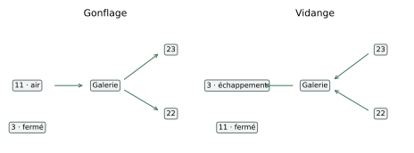
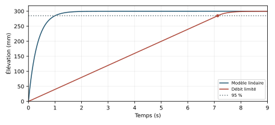
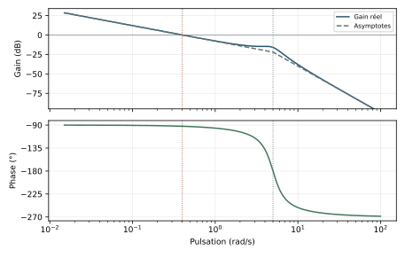
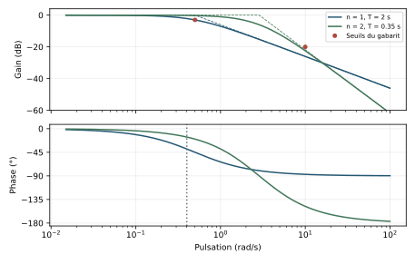
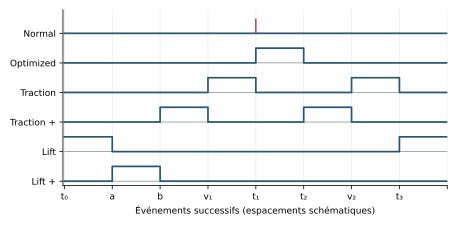

# X-ENS PSI · Sciences industrielles 2016 · Corrigé brut

*Corrigé rédigé par IA, non officiel. Signalez toute erreur.*

**Rédaction** · GPT-6.2 Astra Ultra · vitesse non renseignée · 25 novembre 2026

**Révision** · GPT-6.2 Astra Ultra · vitesse non renseignée · 26 novembre 2026

## 1 · Asservissement de la hauteur

### Question 1 · Du débit à la hauteur

Pour six cylindres identiques qui montent ensemble, une course $dy$ nécessite $dV_{\rm tot}=6S\,dy$. En prenant les écarts à la position initiale, $Q(p)=6SpY(p)$ et $H(p)=1/(6Sp)$. En assimilant le diamètre actif au diamètre maximal coté 325 mm sur la fiche constructeur, $S=\pi(0{,}325)^2/4=0{,}0830\ \mathrm{m^2}$, donc $H(p)\simeq2{,}01/p$. La partie mécanique emploie ensuite la section effective donnée en annexe 3, $0{,}07\ \mathrm{m^2}$. Ces deux approximations n'ont pas le même coefficient numérique.

### Question 2 · Gain du capteur rotatif

À $0°$ la sortie est voisine de $2{,}50$ V, à $+20°$ de $1{,}87$ V. Sur la portion rectiligne, en négligeant tolérances et dynamique, $u\simeq2{,}50-0{,}0315\varphi$ en volts, angle exprimé en degrés dans le sens de la fiche. Entre **variations**, $G(p)\simeq-0{,}0315\ \mathrm{V/°}$. La droite extrapolée coupe la tension nulle vers $80°$, soit le gain nominal $-2{,}5/80=-1/32$ V/°. Inverser le sens de montage inverse le signe du gain.

### Question 3 · Fermeture de l’embiellage

Le dessin oriente $\vec x_4$ de N vers M. On a $\overrightarrow{AN}=\overrightarrow{AM}-l_2\vec x_4$. Ainsi

$$
(b-l_2\cos\varphi)^2+(\lambda-a-l_2\sin\varphi)^2=l_1^2.
$$

Sur la branche où N est au-dessus de A, $\lambda-a=l_2\sin\varphi+\sqrt{l_1^2-(b-l_2\cos\varphi)^2}$. Cette loi est géométrique et non linéaire. Une pente locale définit un gain de petits déplacements lorsque la branche est inversible.

### Question 4 · Gain cinématique voisin du point de montage

À l'origine angulaire, $\lambda-a\simeq0{,}40$ m. Vers $-60°$, on lit environ $0{,}14$ m et vers $+20°$, environ $0{,}48$ m. La pente moyenne est de l'ordre de $4$ à $4{,}5\ \mathrm{mm/°}$. Avec $y=\lambda-\lambda(0)$, un modèle local est donc $\varphi\simeq K_{\rm cin} y$, $M(p)\simeq K_{\rm cin}\simeq230$ à $250\ \mathrm{°/m}$ selon les points de lecture. L'angle proche du maximum de la courbe ne convient pas à cette inversion.

### Question 5 · Calage de la plage de mesure

Le potentiomètre accepte une excursion de $120°$ autour de son zéro. Une possibilité consiste à faire coïncider ce zéro avec $\varphi\simeq-30°$ sur l'embiellage. Les extrêmes correspondent alors environ à $-90°$ et $+30°$, sur la partie croissante presque linéaire. Vérifier à vide et en charge que la course autorisée ne dépasse pas ces bornes, puis enregistrer l'offset de hauteur.

### Question 6 · Conversion en code de dix bits

Les codes vont de 0 à $2^{10}-1=1023$. Pour l'étalonnage qui associe les deux extrémités à 0 et 1023, $u_M=\operatorname{arrondi}(1023u/5)$, écrêté à ces bornes. Approché par un gain, le bloc vaut $N(p)=204{,}6$ codes/V. Avec la convention de quantification uniforme de pas $5/1024$ V et saturation au code 1023, la pente du modèle continu vaut $204{,}8$ codes/V. Le sens tension vers entier décrit une conversion analogique-numérique.

### Question 7 · Positions des trois distributeurs

Les deux distributeurs latéraux sont ouverts dans les deux phases pour relier les sorties 23 et 22 à la galerie commune. Au gonflage, le distributeur central relie 11 à la galerie et obture 3. À la vidange, il relie la galerie à 3 et obture 11. Sur le symbole imprimé, les deux latéraux prennent la case passante du haut. Pour le distributeur central, la case haute correspond au gonflage et la case basse à la vidange. Le schéma ci-dessous représente les connexions actives.

### Question 8 · Réponse linéaire à une marche de hauteur

Posons $K_m=K_{\rm cin}K_{\rm pot}A$ avec la polarité réalisant le retour négatif. La boucle donne $\dot y=C K_vK_m(y_c-y)$, donc $Y/Y_c=1/(1+\tau p)$, $\tau=1/(C K_v K_m)$. Pour une consigne de $0{,}300$ m depuis le repos, $y=0{,}300(1-e^{-t/\tau})$ est croissante, concave et sans dépassement. Le premier passage à $0{,}285$ m est $t_{5\%}=\tau\ln20$. Avec les données de la question suivante, $\tau=1/3$ s et $t_{5\%}\simeq1{,}00$ s.

### Question 9 · Limitation de débit

Insérer une saturation entre $K_v$ et l'intégrateur, $q=\max(-q_{\max},\min(q_{\max},K_vK_m(y_c-y)))$. Au départ, la commande réclame $0{,}45\ \mathrm{m^3/s}$, pour $0{,}02$ disponible. La vitesse est d'abord $Cq_{\max}=0{,}040\ \mathrm{m/s}$. Le raccord a lieu pour $y_s=0{,}300-0{,}020/1{,}5=0{,}28667$ m, à $t_s=7{,}167$ s. On obtient $y=0{,}040t$ jusqu'à $t_s$, puis $y=0{,}300-(0{,}300-y_s)e^{-3(t-t_s)}$. La hauteur à 95 % est atteinte **sur la rampe**, à $0{,}285/0{,}040=7{,}125$ s. Les deux morceaux ont même valeur et même pente au raccord.

### Question 10 · Équation de translation verticale

En variations autour de l'équilibre, la poussée est $SP$ et la surcharge agit vers le bas. Le frottement visqueux vaut $-f\dot y$. Le bilan est $m\ddot y+f\dot y=SP-F_{\rm ext}$. Sous conditions initiales nulles, le transfert entre effort résultant appliqué et déplacement est $1/(mp^2+fp)$, en m/N.

### Question 11 · Deux entrées, un dénominateur

On a $K_2pP=K_1(Y_c-Y)-SpY$. En remplaçant dans $(mp^2+fp)Y=SP-F_{\rm ext}$, on trouve $D(p)Y=SK_1Y_c-K_2pF_{\rm ext}$ avec $D=mK_2p^3+fK_2p^2+S^2p+SK_1$. Ainsi $H_1=SK_1/D$ et $H_2=-K_2p/D$. Le signe de $H_2$ traduit l'enfoncement initial sous une surcharge positive.

### Question 12 · Erreur permanente sous charge constante

Pour des marches de consigne et de surcharge et une boucle stable, $H_1(0)=1$, $H_2(0)=0$. La position finale est la consigne, d'où $e_\infty=0$ m dans les deux cas. La surcharge $P_0$ impose une augmentation permanente de pression $P_0/S$ après un déplacement transitoire. Ce résultat suppose que l'alimentation peut fournir cette pression.

Pour $m,K_2,S,f,K_1>0$, le critère de Routh appliqué au dénominateur cubique donne la condition supplémentaire $fK_2 S^2>mK_2 SK_1$, soit $fS>mK_1$. À l’égalité, le modèle admet une paire de pôles imaginaires et le théorème de la valeur finale ne permet plus de conclure.

### Question 13 · Boucle de régulation en roulage

Posons $D_0=p(mK_2p^2+fK_2p+S^2)$. Avant fermeture de la boucle, $Y=(S/D_0)(Q-K_2p F_{\rm ext}/S)$. Avec $Y_c=0$ et mesure filtrée, le schéma demandé comporte successivement $K_2p/(SK_1)$ sur l'entrée perturbatrice, un sommateur à deux signes négatifs, $K_1$, puis $S/D_0$. Le retour est $F(p)Y$. Les valeurs affichées correspondent aux blocs $2\cdot10^{-6}p$, $0{,}2$ et $2/[p(1+0{,}1p+0{,}04p^2)]$.

### Question 14 · Bode en boucle ouverte

Le transfert de boucle vaut $L_0=0{,}4/[p(1+0{,}1p+0{,}04p^2)]$. La pente du gain passe de $-20$ à $-60$ dB/décade en $\omega_0=5\ \mathrm{rad/s}$. Le premier segment coupe 0 dB à $0{,}4\ \mathrm{rad/s}$ et vaut $20\log_{10}(0{,}4/5)=-21{,}94$ dB au coude. Le facteur du second ordre a $\zeta=0{,}25$, donc le gain réel au coude est supérieur de $20\log_{10}(1/(2\zeta))=6{,}02$ dB. La phase réelle est $-90°-\arg(1-0{,}04\omega^2+j0{,}1\omega)$, de $-90°$ à $-270°$ en passant par $-180°$ au coude. L'argument se lit dans le bon quadrant après la pulsation propre.

### Question 15 · Marge de phase sans filtre

À $\omega_c=0{,}4\ \mathrm{rad/s}$, le second ordre ajoute $-\arctan[0{,}04/(1-0{,}0064)]\simeq-2{,}31°$. Ainsi $M_\varphi=180°-90°-2{,}31°=87{,}7°$. Cette marge dépasse les $70°$ exigés.

### Question 16 · Filtre de constante de temps deux secondes

Pour $F=1/(1+2p)$, le gain asymptotique est nul en dB jusqu'à $0{,}5\ \mathrm{rad/s}$, puis décroît à $-20$ dB/décade. La phase réelle est $-\arctan(2\omega)$, avec $-45°$ au coude. À 10 rad/s, l'atténuation est $10\log_{10}(401)\simeq26$ dB. Au coude réel elle vaut $3{,}010$ dB et la bande passante se termine au voisinage de $0{,}5$. En lecture asymptotique demandée le filtrage respecte le gabarit. Si « 3 dB » est appliqué au centième près, le seuil réel est $0{,}4988$ rad/s.

### Question 17 · Marge de phase avec un seul pôle

La coupure asymptotique reste $0{,}4\ \mathrm{rad/s}$. Le retard supplémentaire est $\arctan(2\times0{,}4)\simeq38{,}66°$, donc la marge vaut environ $49°$. La boucle est stable dans ce modèle, mais sa marge est inférieure aux $70°$ prescrits.

En conservant le module exact de la boucle filtrée, la coupure se déplace à $0{,}334$ rad/s et la marge calculée à cette fréquence vaut $54{,}3°$. Les $49°$ se rapportent à la coupure asymptotique prescrite dans l’énoncé. Les deux lectures restent sous $70°$.

### Question 18 · Contraintes de conception du passe-bas

Le filtre d'ordre $n$ perd $20n$ dB par décade au-delà de $1/T$ et apporte $-n\arctan(\omega T)$ de phase. Déplacer la cassure vers les hautes fréquences réduit le retard sur la boucle et réduit aussi l'atténuation du bruit à 10 rad/s. Avec $1/T\ge0{,}5$, la coupure asymptotique reste à 0,4. On demande alors $20n\log_{10}(10T)\ge20$ et $n\arctan(0{,}4T)<17{,}7°$. Pour contrôler le gabarit réel d'amplitude indépendamment de l'asymptote, vérifier aussi $10n\log_{10}(1+0{,}25T^2)\le3$ et $10n\log_{10}(1+100T^2)\ge20$. L'atténuation est monotone et ces deux bords suffisent.

### Question 19 · Choix d’ordre minimal

Pour $n=1$, le gain asymptotique impose $T\ge1$ s, alors que la phase exige $T<\tan(17{,}7°)/0{,}4\simeq0{,}80$ s. Pour $n=2$ il suffit en lecture asymptotique de prendre $0{,}316\le T<\tan(8{,}85°)/0{,}4\simeq0{,}389$ s. Par exemple $T=0{,}35$ s donne une marge voisine de $71{,}8°$, une atténuation exacte de $0{,}26$ dB à $0{,}5$ rad/s et $22{,}4$ dB à $10$ rad/s. C'est le plus petit ordre admissible.

## 2 · Répartition de charge

### Question 20 · Effort vertical d’une roue

Isolons la roue, le bras mobile et le coussin. En négligeant les masses non suspendues et les actions tangentielles, l'équilibre en moment en O donne $eY=fSP$, où $f=1{,}2$ m et $e=0{,}7$ m sont ici des longueurs. La pression relative varie de 0 à $8\cdot10^5$ Pa, pour $S=0{,}07\ \mathrm{m^2}$. L'effort admissible par roue est donc $0\le Y\le96\,000$ N. La poussée maximale du coussin lui-même est de 56 kN, amplifiée par le levier.

### Question 21 · Degrés de liberté dans la répartition

Sur le véhicule posé à plat, la résultante verticale fixe la somme des six efforts. Les moments suivant les deux axes du plan de la route fixent deux autres combinaisons de ces efforts. Le rang vaut trois parce que les points d'appui ne sont pas alignés. Il reste **trois réglages de répartition indépendants**. On peut fixer trois pressions compatibles et calculer les trois autres si leurs appuis sont non alignés. La positivité, les limites de pression et le maintien d'une assise sûre restreignent les choix. Un constructeur peut n'exploiter qu'une partie de cette liberté, par exemple en pilotant ensemble des roues d'un même essieu.

### Question 22 · Répartition longitudinale sur route horizontale

Notons $a,b,u$ les charges des essieux A, B, C en tonnes équivalentes, un poids d'une tonne valant 10 kN. Les équilibres donnent $a+b+u=13$ et $4{,}8b+6u=13\times4$. Ainsi $b=65/6-5u/4$, $a=13/6+u/4$. Relever complètement C imposerait $10{,}83$ t au pont. En chargeant le pont moteur à sa limite légale, on obtient **$Y_A\simeq23{,}33$ kN, $Y_B=100$ kN, $Y_C\simeq6{,}67$ kN**. Cette répartition concentre la charge sur B, conserve la motricité et décharge au maximum l'essieu porteur C.

Pour des pneus identiques et $0<\beta<1$, la somme des résistances est concave en $u$. Son minimum sur un intervalle de charges admissibles est donc à une extrémité. Si l'on impose seulement $0\le a,b,u\le10$, l'autre extrémité est $(13/3,0,26/3)$ t. Elle déleste entièrement **le seul essieu moteur** et ne permet plus d'entretenir le mouvement contre la résistance au roulement. Une optimisation globale réaliste devrait fixer l'effort de traction minimum, l'adhérence et les caractéristiques de chaque monte. Les données permettent de proposer la stratégie pont chargé ci-dessus, sans garantir son optimalité pour tous les pneus et toutes les contraintes de traction.

### Question 23 · Charge minimale sur l’essieu porteur

Une roue presque déchargée freine peu avant de glisser et perd facilement le contact sur une irrégularité. Lui laisser environ 1,6 t par essieu maintient une contribution au freinage et une capacité de guidage latéral en virage. Cette réserve réduit également le risque de rebond de l'essieu sur chaussée inégale.

### Question 24 · Cas du camion-citerne

À chaque déplacement du liquide, le centre de masse et les pressions apparentes évoluent. Une correction de hauteur à retard pneumatique peut réagir à un transfert déjà inversé, entretenir le roulis et accroître le risque de perte d'appui. Une répartition équilibrée dans les limites des équilibres statiques conserve de l'adhérence et une réserve de charge sur chaque roue. La désactivation des compensations rapides et du relevage évite de coupler un asservissement retardé aux oscillations de la surface libre.

### Question 25 · Égalisation pneumatique

Relier les coussins d'un même essieu à un collecteur commun, avec vannes ouvertes vers les deux coussins et alimentation et échappement isolés après réglage. Après l'égalisation des pressions, les efforts sont égaux si sections et rapports de bras sont identiques. Un collecteur à quatre branches fait de même pour deux essieux. Les différences de niveaux et les échanges transitoires nécessitent des conduites convenablement dimensionnées.

### Question 26 · Charges sur une pente

Le camion monte à vitesse constante, en ligne droite. On néglige les inerties des roues, les efforts aérodynamiques et la résistance au roulement. À $\theta=0$ par rapport à la route, $W_n=mg\cos\gamma$, $D=mg(l_G\cos\gamma+h\sin\gamma)$, et l'équilibre donne $Y_A+Y_B+Y_C=W_n$, $cY_B+(c+d)Y_C=D$. Lorsque C est posé, $Y_B=Y_C=D/(2c+d)$ et $Y_A=W_n-2D/(2c+d)$. Lorsque C est relevé, $Y_C=0$, $Y_B=D/c$ et $Y_A=W_n-D/c$. Ce sont les efforts totaux par essieu. Pour une roue d'un côté et un chargement symétrique, les diviser par deux. Ces formules supposent le maintien des autres contacts.

### Question 27 · Motricité du 6 × 2

Avec le même coefficient d'adhérence $\mu$ avant et après relevage, l'effort transmissible par le seul pont B est limité par $\mu Y_B$. Le gain relatif est $(D/c)/(D/(2c+d))-1=1+d/c=1{,}25$, soit **125 % supplémentaires**. L'effort limite final vaut donc 225 % de l'ancien. L'effort de pente requis reste $mg\sin\gamma$. L'augmentation utilisable dépend du couple moteur disponible, de l'adhérence réelle, de la charge autorisée sur B et du maintien de la direction par A.

### Question 28 · Motricité du 6 × 4

Avec un partage idéal du couple, le maximum passe de $2\mu D/(2c+d)$ à $\mu D/c$. Le gain relatif est $d/(2c)=0{,}125$, soit **12,5 %**. Il est bien plus faible que sur le 6 × 2 car les deux essieux arrière contribuaient déjà à la traction avant le relevage. Une transmission incapable de transférer le couple de l'essieu relevé au pont ne permettrait pas d'atteindre ce gain.

### Question 29 · Motricité du 6 × 6

Toutes les roues en appui sont motrices. À adhérence uniforme et répartition idéale, $X_{\max}=\mu(Y_A+Y_B+Y_C)=\mu mg\cos\gamma$, même lorsque $Y_C=0$. Le relevage n'augmente donc pas la borne de motricité et peut diminuer la capacité pratique sur un sol hétérogène. L'intérêt d'une réduction d'usure évoquée dans le sujet relève d'un autre critère.

### Question 30 · Raideur vue au contact

Autour du point de fonctionnement, la rotation du bras donne $\Delta L=(f/e)\Delta\lambda_A$. On prend $F_R=k_R(L-L_0)+F_{R0}$ comme effort signé du ressort en extension. Sur le bras, le moment en O donne $e\Delta Y_A+f\Delta F_R=0$, compte tenu du bras de levier vertical négligé pour l'effort de freinage. Alors $\Delta Y_A=K\Delta\lambda_A$, $K=-k_R(f/e)^2$. La raideur mécanique positive en compression vaut $-K$ : raccourcir la suspension augmente sa charge. Ici $k_R$ représente l'ensemble des coussins d'un essieu, comme l'indique l'énoncé.

### Question 31 · Compatibilité des trois hauteurs

Pour des points alignés sur le longeron de référence, $\lambda_A-\lambda_B=c\sin\theta$ et $\lambda_C-\lambda_B=-d\sin\theta$, les trois hauteurs initiales étant égales. D'où $\dot\lambda_A=\dot\lambda_B+c\cos\theta\,\dot\theta$, $\dot\lambda_C=\dot\lambda_B-d\cos\theta\,\dot\theta$. Au premier ordre, les différences de vitesse valent $c\dot\theta$ et $-d\dot\theta$, celles de hauteur $c\theta$ et $-d\theta$.

### Question 32 · Équations dynamiques du freinage

Dans le plan vertical, posons $X_\Sigma=X_A+X_B+X_C$, $Y_\Sigma=Y_A+Y_B+Y_C$. Le poids passe par G et les points A′, B′ et C′ sont sur la route. Leurs bras horizontaux depuis G valent respectivement $l_G\cos\theta+h\sin\theta$, cette valeur moins $c$, puis moins $c+d$. Leur bras vertical commun vaut $l_G\sin\theta-h\cos\theta$. Le bilan en projection donne

$$
X_\Sigma=ma_x,\qquad Y_\Sigma-mg=ma_y\simeq0,
$$

$$
C\ddot\theta=(h\cos\theta-l_G\sin\theta)X_\Sigma+(l_G\cos\theta+h\sin\theta)Y_\Sigma-cY_B-(c+d)Y_C.
$$

Ici $C$ est le moment d'inertie de tangage en G. Dans les bras ci-dessus on peut remplacer $\sin\theta$ par $\theta$ et $\cos\theta$ par 1.

### Question 33 · Variation de la charge du pont par la résultante

La résultante verticale et l'équilibre initial imposent $\Delta Y_A+\Delta Y_B+\Delta Y_C=0$. Par les Q30 et Q31, $\Delta Y_A=\Delta Y_B+Kc\sin\theta$ et $\Delta Y_C=\Delta Y_B-Kd\sin\theta$. Il vient

$$
\Delta Y_B=\frac{K(d-c)}3\sin\theta\simeq\frac{K(d-c)}3\theta.
$$

Comme $K<0$ et $d<c$, la plongée du nez ($\theta<0$) déleste le pont.

### Question 34 · Variation de la charge du pont par le moment

À l'arrêt $mgl_G=cY_{B0}+(c+d)Y_{C0}$. En remplaçant $X_\Sigma,Y_\Sigma$ et $\Delta Y_C=\Delta Y_B-Kd\sin\theta$ dans la Q32, il vient

$$
(2c+d)\Delta Y_B=ma_x(h\cos\theta-l_G\sin\theta)+mg[l_G(\cos\theta-1)+h\sin\theta]+K d(c+d)\sin\theta-C\ddot\theta.
$$

Au premier ordre pour un $a_x$ donné, le membre de droite vaut $ma_x(h-l_G\theta)+[mgh+K d(c+d)]\theta-C\ddot\theta$. Si $a_x$ et $\theta$ sont tous deux comptés comme des perturbations du premier ordre, omettre en outre leur produit.

### Question 35 · Évolution temporelle sous un échelon de freinage

En identifiant les Q33 et Q34 au premier ordre, on obtient $C\ddot\theta+\kappa\theta=ma_xh$ avec $\kappa=-\tfrac23 K(c^2+cd+d^2)-mgh+ma_xl_G$ pour un $a_x$ constant (supprimer le dernier terme dans la linéarisation conjointe). On part de $\theta=\dot\theta=0$. Si $\kappa>0$, $\omega=\sqrt{\kappa/C}$ et $\theta=(ma_xh/\kappa)(1-\cos\omega t)$. Reporter dans la Q33. L'effort du pont part de zéro avec pente nulle et oscille, sans amortissement dans ce modèle, autour d'une variation négative. Pour un profil $a_x(t)$ mesuré, on peut intégrer numériquement le système d'ordre deux des Q33–34 et reconstruire $\Delta Y_B$ à chaque pas.

### Question 36 · Ce que révèle la courbe simulée

Les oscillations décroissent alors que les seules raideurs et inerties de l'étude conservent l'énergie. La simulation a donc pris en compte une dissipation, que fournissent notamment les amortisseurs de suspension. On lit en régime établi un délestage du pont de l'ordre de 2 à 3 kN et de l'essieu arrière de l'ordre de 5 kN.

### Question 37 · Choix de ne pas compenser le freinage

Le transfert de charge avant découle de l'effort de freinage appliqué au niveau de la route, en dessous de G. Vouloir maintenir toutes les charges statiques serait incompatible avec ce moment en régime établi. De plus, le remplissage des coussins prend du temps. Une correction retardée pourrait continuer à agir après le relâchement du frein, augmenter les oscillations et consommer de l'air. La répartition du freinage peut être adaptée aux charges effectivement disponibles.

## 3 · Modes de pilotage

### Question 38 · Chronogrammes des six modes

Le livret de 23 pages renvoie ici à la feuille DR3. Ses axes de charge, de vitesse et de commande, visibles sur le document-réponse renseigné publié par l'UPSTI, permettent de noter $a$ et $b$ les premiers franchissements croissants de 100 % puis 130 % de la limite du pont. Notons $v_1,v_2$ les deux franchissements **croissants** de 30 km/h. Leur ordre est $t_0<a<b<v_1<t_1<t_2<v_2<t_3$.

| Intervalle | État maintenu | Événement qui ouvre l’intervalle |
|---|---|---|
| De $t_0$ à $a$ | Lift | À l'arrêt, interrupteur en haut, pont peu chargé |
| De $a$ à $b$ | Lift + | Charge au-dessus de la limite normale |
| De $b$ à $v_1$ | Traction + | Charge au-dessus de 130 %, essieu reposé |
| De $v_1$ à $t_1$ | Traction | Passage à 30 km/h |
| De $t_1$ à $t_2$ | Optimized | Passage par Auto puis impulsion basse |
| De $t_2$ à $v_2$ | Traction + | Seconde impulsion, à faible vitesse |
| De $v_2$ à $t_3$ | Traction | Nouveau passage à 30 km/h |
| À partir de $t_3$ | Lift | Retour en position haute avec faible charge |

Au passage par Auto à $t_1$, **Normal** est traversé avant l'impulsion qui sélectionne **Optimized**. À l'échelle du chronogramme ces deux événements sont au même instant. Une impulsion verticale indique ce passage transitoire, sans intervalle de maintien. Les baisses de charge ou de vitesse entre deux événements du tableau ne font pas remonter à elles seules vers Lift ou Traction +.

## 4 · Compensation du roulis

### Question 39 · Décentrage statique compensable

On regroupe en $F_1,F_2$ les forces verticales de l'ensemble des coussins de chaque côté, de bras $+l,-l$. À $\beta=0$, leur somme vaut $mg$ et $l(F_1-F_2)=mg e_G$. Ainsi $F_{1,2}=mg(1\pm e_G/l)/2$. Le côté chargé atteint sa force limite $F_{1\max}$ pour

$$
e_{G,\max}^{\rm pression}=l\left(\frac{2F_{1\max}}{mg}-1\right).
$$

Pour un modèle à un seul essieu, prendre les forces de cet essieu et sa part du poids. Pour trois coussins identiques sur le côté, l'effort maximal dans ce modèle direct est $3SP_{\max}$, et non celui d'un seul coussin. Il faut aussi que l'autre côté pousse encore, donc $|e_G|\le l$. Le déport effectivement admissible est la plus petite de ces bornes, à condition que la pression suffise déjà pour un chargement centré.

### Question 40 · Domaine d’emploi de la courbe

La courbe tracée est la limite imposée par la saturation en pression du côté chargé. Elle s'annule vers **35 t**. Au-delà, même à charge centrée la pression maximale ne permet plus de conserver la hauteur de consigne, les coussins s'affaissent et les butées peuvent entrer en contact. À **26 t** la lecture graphique donne environ **12 à 13 cm** (près de 12,5 cm). La charge maximale routière de ce camion reste 26 t.

Du côté des faibles masses, la courbe monte au-dessus de $l=37{,}5$ cm pour des masses inférieures à environ 17–18 t. Sa prolongation supposerait alors $F_2<0$, donc un coussin qui tire. Le modèle à deux poussées positives est limité par le délestage du côté opposé avant d'atteindre la pression maximale. Sur la figure, la portion physiquement exploitable comme limite de pression positive se situe donc approximativement entre 17–18 t et 35 t, et seulement jusqu'à 26 t en usage réglementaire.

### Question 41 · Inertie du châssis centré

La réflexion par le plan $(G,\vec x_1,\vec y_1)$ transforme $z_1$ en $-z_1$. Les intégrales de $x_1z_1$ et $y_1z_1$ s'annulent. Le produit de $x_1y_1$ peut subsister. Dans les notations de l'annexe,

$$
I_G=\begin{pmatrix}A&-F&0\\-F&B&0\\0&0&C\end{pmatrix}_{(\vec x_1,\vec y_1,\vec z_1)}.
$$

### Question 42 · Équilibre du roulis en virage

Prenons $\vec z_0$ radial vers l'extérieur, $\beta>0$ pour l'inclinaison vers l'extérieur, et $\Omega=\dot\psi=V_0/R_V$ avec $R_V$ le rayon de la trajectoire utilisé pour l'accélération de G. L'angle $\beta$ est constant. Dans les axes du châssis, $\vec\Omega=\Omega(\cos\beta\,\vec y_1-\sin\beta\,\vec z_1)$. Les composantes de $I_G\vec\Omega$ dans ce repère sont constantes. La projection de $\vec\Omega\times(I_G\vec\Omega)$ sur $\vec x_1$ donne $(B-C)\Omega^2\sin\beta\cos\beta$ car $\Omega_y H_z-\Omega_z H_y=(B-C)\Omega^2\sin\beta\cos\beta$. Le terme de transport est $[\overrightarrow{O_C G}\times m\vec a_G]\cdot\vec x_1=-m h'R_V\Omega^2\cos\beta$. Les moments extérieurs sont $-k_{\rm roll}\beta+mgh'\sin\beta$.

On obtient, avec la convention d'axes explicitée,

$$
-k_{\rm roll}\beta+mgh'\sin\beta=\Omega^2\big[(B-C)\sin\beta\cos\beta-m h'R_V\cos\beta\big].
$$

Le calcul du produit vectoriel fixe le signe de l'écart d'inertie. Si $R_V$ est défini strictement comme rayon du centre de roulis et non de G, remplacer le rayon du terme centripète ci-dessus par $R_V+h'\sin\beta$ et garder $\Omega$ défini par la trajectoire de référence. L'hypothèse $B=C$ de la suite supprime le terme gyroscopique.

### Question 43 · Déplacement latéral du centre de masse

Le déport géométrique du centre de masse consécutif au roulis est $e_{\rm éq}=h'\sin\beta$. Avec $B=C$, $\sin\beta\simeq\beta$, $\cos\beta\simeq1$, la Q42 donne $(k_{\rm roll}-mgh')\beta=m h' V_0^2/R_V$. Ainsi

$$
e_{\rm éq}\simeq\frac{m h'^2 V_0^2}{R_V(k_{\rm roll}-mgh')}.
$$

À $m=26\,000$ kg, $V_0=25$ m/s, $R_V=100$ m et $h'=1$ m, on trouve $\beta\simeq0{,}220$ rad, soit $e_{\rm éq}\simeq22$ cm. Cela dépasse les 12 à 13 cm lus à 26 t. La suspension pneumatique ne maintient donc pas le camion horizontal dans ce virage à pleine charge. Une autre longueur, $h'V_0^2/(gR_V)=0{,}625$ m, représente le bras de poids qui produirait le couple centrifuge à roulis nul. Elle ne mesure pas le déplacement du centre de masse calculé ici.

### Question 44 · Correction dynamique du roulis

Une barre antiroulis active en deux demi-barres, couplées par un actionneur électromécanique ou hydraulique, peut appliquer un couple commandé selon l'angle de roulis et l'accélération latérale. Les efforts opposés à droite et à gauche corrigent rapidement le roulis sans demander de changer les six volumes de suspension. La loi peut relâcher le couple sur une ligne droite irrégulière pour préserver le confort. En contrepartie, l'actionneur requiert puissance, capteurs et maintenance, et sa course et son couple restent limités. Une commande en défaut doit laisser une tenue de route acceptable.

## Documents consultés

Le livret institutionnel contient les questions et les quatre annexes. Le document-réponse renseigné, reproduit à la page 16 de la publication de l’UPSTI, donne les événements d’entrée de la question 38. [Sujet de l’ENS Paris-Saclay](https://ens-paris-saclay.fr/sites/default/files/CONCOURS/ANNALES_1C/1C_PSI/2016_Sujet_1C_PSI_Science-indurstrielle.pdf) · [Dossier de l’UPSTI](https://www.upsti.fr/corriges/67/x-ens/2016/psi/s2i-suspension-pneumatique-de-vehicule-de-transport-routier/)
