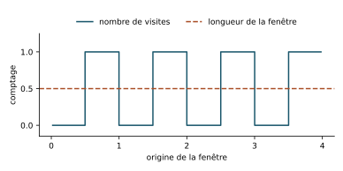

# École polytechnique · MP · Mathématiques B 2016 · Corrigé brut

*Corrigé rédigé par IA, non officiel. Signalez toute erreur.*

**Rédaction** · GPT-6.2 Astra Ultra · vitesse non renseignée · 24 novembre 2026

**Révision** · GPT-6.2 Astra Ultra · vitesse non renseignée · 26 novembre 2026

La composition démontre un théorème de renouvellement hors réseau pour des accroissements strictement positifs. À partir de 15, le sujet restreint leur loi à un nombre fini d’atomes. L’unicité utilisée dans la partie IV est celle de 7c, parmi les solutions bornées nulles sur la demi-droite négative.

## I. Nombre de renouvellements dans un intervalle

### Question 1a

À une intersection dénombrable d’événements de probabilité un près, $0=S_0<S_1<S_2<\cdots$. Les indices $k$ pour lesquels $S_k\le\ell$ forment donc un segment initial. Il contient exactement $n+1$ indices si et seulement si $S_n\le\ell<S_{n+1}$. De même, $S_n\le\ell$ équivaut à compter au moins $n+1$ indices. Si $S_n\ge\ell$, aucun des indices strictement supérieurs à $n$ n’est compté, d’où $N(0,\ell)\le n+1$.

### Question 1b

Par indépendance, $\mathbb E S_n=nm$ et $\operatorname{Var}S_n=nV$. De $S_n\le n(m-\varepsilon)$ il résulte $|S_n-nm|\ge n\varepsilon$. Ainsi la probabilité cherchée est au plus $nV/(n\varepsilon)^2=V/(n\varepsilon^2)$.

### Question 2

Presque sûrement, $Y=\sum_{k\ge1}\mathbf1_{\{Y\ge k\}}$. Les sommes partielles sont positives et croissent vers $Y$. Par convergence monotone, $\mathbb EY=\sum_{k\ge1}\mathbb P(Y\ge k)$, somme finie sous l’hypothèse.

### Question 3a

Point par point $\mathbf1_{\{S_n\le\ell\}}\le e^{\ell-S_n}$, ce qui donne la première borne par espérance. Par indépendance, $\mathbb E e^{-S_n}=q^n$ avec $q=\mathbb Ee^{-X}$, y compris pour $n=0$. La borne est donc $e^\ell q^n$.

### Question 3b

Comme $X>0$ presque sûrement, $0<q<1$. Donc $\mathbb P(S_n\le\ell)\le e^\ell q^n\to0$. Par convergence monotone, $\mathbb E N(0,\ell)=\sum_{n\ge0}\mathbb P(S_n\le\ell)\le e^\ell/(1-q)$. Cela établit aussi la finitude presque sûre du décompte.

### Question 3c

Fixons $n\ge1$ et $A_n=\{S_{n-1}<x\le S_n\}$. Sur $A_n$, si $N(x,x+\ell)\ge k$, les indices $n,\ldots,n+k-1$ sont tous comptés, donc $S_{n+k-1}-S_n\le\ell$. La différence a la loi de $S_{k-1}$ et est indépendante de $A_n$, même pour $k=1$ où elle est nulle. Cela donne la borne demandée par 1a. Pour $x>0$, les $A_n$ partitionnent presque sûrement l’espace car $S_n\to\infty$ presque sûrement, puisque pour tout entier $L$, $\mathbb P(\forall n,S_n\le L)=\lim_n\mathbb P(S_n\le L)=0$ par 3b. En sommant sur $n$ puis sur $k$ par 2, $\mathbb E N(x,x+\ell)\le\mathbb E N(0,\ell)\le e^\ell/(1-q)$. Pour $x\le0$, les visites dans $[x,x+\ell]$ sont incluses dans celles de $[0,\ell]$, et l’événement $A_n$ est vide.

## II. Équation de renouvellement

### Question 4a

Pour $f_n(x)=\sum_{k=0}^n\mathbb E g(x-S_k)$, l’écart $f_{n+1}(x)-f_n(x)=\mathbb E g(x-S_{n+1})$ est positif ou nul. Chaque suite est donc croissante et admet une limite dans $[0,+\infty]$.

### Question 4b

Avec $g=\mathbf1_{[0,K]}$, $g(x-S_k)=\mathbf1_{[x-K,x]}(S_k)$. La somme sur tous les $k$ est $N(x-K,x)$, et la convergence monotone donne $f(x)=\mathbb E N(x-K,x)$.

### Question 4c

Puisque $0\le g\le\|g\|_\infty\mathbf1_{[0,K]}$, la positivité et 3c donnent $0\le f_n(x)\le\|g\|_\infty\,\mathbb E N(x-K,x)\le\|g\|_\infty e^K/(1-q)$ uniformément en $n,x$.

### Question 4d

Les suites croissantes de 4a sont bornées par 4c, d’où convergence simple vers une fonction finie, positive et bornée par la même constante. Pour $x<0$, $x-S_k<0$ pour tout $k$, donc $f(x)=0$. Son support est inclus dans le fermé $[0,\infty[$.

### Question 5

Si les valeurs de $Y$ sont $y_j$ de masses $r_j$, l’indépendance donne les masses jointes $p_ir_j$. La somme double de $|\varphi(x_i,y_j)|p_ir_j$ est au plus $\|\varphi\|_\infty$. En sommant d’abord en $j$ on obtient $\mathbb E\varphi(X,Y)=\sum_i p_i\mathbb E\varphi(x_i,Y)$.

### Question 6a

Isolons le terme $S_0=0$. Pour $k\ge0$, $S_{k+1}=X_1+(X_2+\cdots+X_{k+1})$, où la parenthèse a loi $S_k$ et est indépendante de $X_1$. Par 5, $\mathbb E g(x-S_{k+1})=\sum_i p_i\mathbb E g(x-x_i-S_k)$. En sommant sur $0\le k\le n$ on obtient $f_{n+1}(x)=g(x)+\sum_i p_i f_n(x-x_i)$.

### Question 6b

À $x$ fixé, $p_i f_n(x-x_i)\uparrow p_i f(x-x_i)$. La convergence monotone pour la somme en $i$ dans 6a donne $f(x)=g(x)+\sum_i p_i f(x-x_i)$, ce qui est (E).

### Question 7a

L’égalité est immédiate en $n=0$. Supposons $h(x)=\mathbb Eh(x-S_n)$. Pour chaque valeur de $S_n$ appliquons l’équation homogène à $x-S_n$. La somme pondérée est l’espérance par rapport à $X_{n+1}$ indépendant. En intégrant on obtient $h(x)=\mathbb Eh(x-S_{n+1})$. La bornitude justifie les sommes.

### Question 7b

Pour $x\ge0$, $|h(x)|\le\|h\|_\infty\mathbb P(S_n\le x)\to0$ par 3b. Donc $h(x)=0$. Pour $x<0$ la conclusion était incluse dans l’hypothèse de support.

### Question 7c

Les questions 4d et 6b donnent une solution bornée à support dans $\mathbb R_+$. La différence de deux telles solutions est bornée, de même support au sens de l’inclusion, et vérifie l’équation homogène. Par 7b elle est nulle. La condition de support est essentielle car sans elle, on peut ajouter une constante à toute solution.

### Question 8a

Pour $n\ge1$, les valeurs de $S_n$ appartiennent aux sommes de $n$ points du support dénombrable de $X$, donc à un ensemble dénombrable de réels positifs. La réunion sur les entiers $n$ reste dénombrable et $S_0=0$ ajoute zéro. Elle est infinie car pour un atome $x_i$ de masse positive, tous les $nx_i$ ont une probabilité positive au rang $n$.

### Question 8b

Pour chaque $k$, sa loi est portée par l’énumération $(y_i)$ de $\Lambda_X$. Donc $\mathbb E g(x-S_k)=\sum_i\mathbb P(S_k=y_i)g(x-y_i)$. En sommant sur $0\le k\le n$ on obtient la formule imprimée.

### Question 8c

Posons $q_i=\sum_{k\ge0}\mathbb P(S_k=y_i)$. La stricte croissance des trajectoires rend ces événements disjoints à $i$ fixé, donc $0<q_i\le1$. Les termes étant positifs, l’échange des deux séries dans 8b donne $f(x)=\sum_iq_i g(x-y_i)$. En prenant $g=\mathbf1_{[0,K]}$, on retrouve $\sum_{y_i\in[x-K,x]}q_i=\mathbb EN(x-K,x)$ par 4b.

### Question 9a

Si $x\in[A,B]$, un terme non nul impose $y_i\in[A-K,B]$. Ainsi la somme des normes uniformes des termes sur ce segment est au plus $\|g\|_\infty\sum_{y_i\in[A-K,B]}q_i=\|g\|_\infty\mathbb EN(A-K,B)<\infty$ par 3c et 8c (valables pour toute longueur). C’est la convergence normale locale.

### Question 9b

La fonction $g$ continue à support compact est uniformément continue sur la droite. Notons $\omega_g(\delta)=\sup_{|t-s|\le\delta}|g(t)-g(s)|\to0$. Si $|x'-x|\le\delta\le1$, l’union des deux intervalles d’indices utiles est contenue dans un segment de longueur $K+1$ commençant à $\min(x,x')-K$. D’où par 8c et 3c, $|f(x)-f(x')|\le\omega_g(\delta)e^{K+1}/(1-q)$. Cette borne ne dépend pas des deux points.

### Question 9c

La dérivée $g'$ est continue, nulle hors de $[0,K]$, donc bornée et uniformément continue. Le raisonnement de 9a s’applique à la série des dérivées $\sum_iq_i g'(x-y_i)$ en la majorant en valeur absolue. On peut donc dériver terme à terme sur tout segment et $f\in C^1$. Par 3c et 8c, $\|f'\|_\infty\le \|g'\|_\infty e^K/(1-q)$ et le raisonnement de 9b appliqué à $g'$ donne l’uniforme continuité de $f'$. Dans (E), la série des dérivées $\sum_i p_i f'(x-x_i)$ converge normalement sur la droite car $\sum_i p_i=1$. La dérivation donne l’équation demandée pour $f'$.

## III. Ensembles additifs de temps de passage

### Question 10a

L’expression $nx+k(y-x)=(n-k)x+ky$ est une somme de $n\ge1$ termes de $\Lambda$, chacun égal à $x$ ou $y$. Elle appartient donc à $\Lambda$ par stabilité, y compris si $k=0$ ou $k=n$.

### Question 10b

Pour $\Lambda=\mathbb N^*$, les différences strictement positives ont minimum un et $r(\Lambda)=1$. Pour $\Lambda=]0,+\infty[$, les différences positives peuvent être arbitrairement petites et $r(\Lambda)=0$. Ces deux ensembles sont stables par addition.

### Question 11a

Notons $r=r(\Lambda)>0$. L’ensemble des différences positives est non vide, puisque $x$ et $2x$ appartiennent à $\Lambda$ pour $x\in\Lambda$. Par définition de l’infimum, il existe $d=b-a$ dans cet ensemble avec $r\le d<r+r$. Les deux extrémités $a,b$ appartiennent à $\Lambda$.

### Question 11b

Par 10a les points $na+kd$ et $na+(k+1)d$ appartiennent à $\Lambda$. Si un point de $\Lambda$ leur était strictement intermédiaire, chacune de ses distances aux extrémités serait une différence positive au moins $r$. Leur somme $d$ serait au moins $2r$, contradiction. D’où l’égalité d’ensembles.

### Question 11c

Prenons $n_0>a/d$. Alors $n_0a+n_0d>(n_0+1)a$. Le point $(n_0+1)a\in\Lambda$ appartient au bloc $[n_0a,n_0a+n_0d]$, qui contient comme seuls points de $\Lambda$ les $n_0a+kd$ par 11b. Pour un certain entier $k$, $(n_0+1)a=n_0a+kd$, soit $a=kd$.

### Question 11d

Si $z\in\Lambda$, choisissons $n$ avec $nd\ge z$. Alors $na+z\in\Lambda\cap[na,na+nd]$ par stabilité. D’après 11b, $na+z=na+kd$ pour un entier $k$, donc $z\in d\mathbb Z$. Cela prouve l’inclusion sur tout $\Lambda$.

### Question 12a

Pour $\eta>0$, choisissons $a,b\in\Lambda$ avec $0<d=b-a<\eta$. Les blocs $[na,nb]$ comportent tous les points $na+kd$ pour $0\le k\le n$ par 10a. Si $n\ge N$ avec $Nd\ge a$, on a $nb\ge(n+1)a$. Ainsi les blocs recouvrent $[Na,\infty[$. Tout $x$ assez grand appartient à un tel bloc et le premier point de son maillage au moins égal à $x$ est à distance au plus $d<\eta$. On peut prendre $A=Na$.

### Question 12b

Fixons $\varepsilon>0$. L’hypothèse séquentielle implique qu’il existe $B$ tel que $|f(y)|<\varepsilon$ pour tout $y\in\Lambda$ supérieur à $B$, sinon on construirait une suite contraire. Par uniforme continuité prenons $\eta>0$ tel que $|x-y|\le\eta$ entraîne $|f(x)-f(y)|<\varepsilon$. Par 12a tout $x$ assez grand admet $y\in\Lambda\cap[x,x+\eta]$ avec $y>B$. Alors $|f(x)|<2\varepsilon$, d’où la limite.

## IV. Théorème de renouvellement hors réseau

### Question 13a

D’après 7a, $h(0)=\mathbb Eh(-S_n)$ alors que $h(-S_n)\le h(0)$. La variable positive $h(0)-h(-S_n)$ est donc nulle presque sûrement. Sur chaque atome $\{S_n=x\}$ de probabilité positive on obtient $h(-x)=h(0)$.

### Question 13b

Si $y,z$ sont atteints aux rangs $k,l$ avec masses positives, l’indépendance du bloc des $l$ accroissements suivants donne $\mathbb P(S_{k+l}=y+z)\ge\mathbb P(S_k=y)\mathbb P(S_l=z)>0$. L’ensemble est additif. Comme $0\in\Lambda_X$ par $S_0$, on applique la partie III à sa partie strictement positive. Si son écart minimal était strictement positif, 11d la placerait dans $d\mathbb Z$ pour un $d>0$, donc aussi tous les atomes de $X=S_1$. Cela contredit l’hypothèse hors réseau. L’infimum des différences positives vaut donc zéro, également pour $\Lambda_X$.

### Question 13c

La fonction $u(x)=h(-x)-h(0)$ est uniformément continue et s’annule sur tous les atomes de renouvellement par 13a. Par 13b et 12b, $u(x)\to0$ quand $x\to\infty$, soit $h(-x)\to h(0)$.

### Question 13d

Presque sûrement $S_n\to\infty$ par 3c. Pour $x$ fixé, $h(x-S_n)\to h(0)$ par 13c. La bornitude de $h$ permet la convergence dominée. Dans l’égalité de 7a, il vient $h(x)=h(0)$ pour tout $x$.

### Question 14a

La fonction $M(x)=\sup_{t\ge x}f'(t)$ est décroissante et bornée car $f'$ est bornée par 9c. Elle converge donc vers un réel fini $c=\inf_x M(x)$.

### Question 14b

Pour tout $n\ge1$ choisissons $y_n\ge n$ tel que $M(n)-1/n<f'(y_n)\le M(n)$. Par 14a, $y_n\to\infty$ et $f'(y_n)\to c$.

### Question 14c

Les translatées de $f'$ sont bornées par la même constante et ont le même module de continuité uniforme. Leur limite locale uniforme $\xi$ en hérite sur toute la droite. De plus $\xi(0)=c$ et pour chaque $x$, $f'(t_k+x)\le M(t_k+x)\to c$, donc $\xi(x)\le c$. Dans l’équation de 9c, $g'(t_k+x)=0$ pour $k$ assez grand et chaque terme $f'(t_k+x-x_i)$ tend vers $\xi(x-x_i)$. La domination par $p_i\|f'\|_\infty$, sommable, donne $\xi(x)=\sum_i p_i\xi(x-x_i)$. Par 13d, $\xi$ est constante égale à $c$.

### Question 14d

Pour chaque $A>0$, la convergence uniforme sur $[0,A]$ donne $f(t_k+A)-f(t_k)=\int_0^A f'(t_k+s)ds\to cA$. Le module du membre gauche est au plus $2\|f\|_\infty$. Donc $|c|A\le2\|f\|_\infty$ pour tout $A>0$, ce qui impose $c=0$.

### Question 14e

On vient d’établir que les suprema de queue tendent vers zéro et l’énoncé admet la même limite pour les infima. Comme $\inf_{s\ge t}f'(s)\le f'(t)\le\sup_{s\ge t}f'(s)$, on obtient $f'(t)\to0$.

### Question 14f

Par le théorème fondamental, $|f(t+\ell)-f(t)|\le\ell\sup_{s\ge t}|f'(s)|\to0$ pour chaque $\ell\ge0$. La convergence du supremum des modules suit de 14e.

### Question 15a

Posons $g_\ell(t)=g(t-\ell)$. Comme $g$ est nulle sur $]-\infty,0[$ et $\ell\ge0$, $g_\ell\in F$. Par la formule de 8c, $L g_\ell(t)=L g(t-\ell)$. Par 14f appliquée en $t_k-\ell$, la différence $L g_\ell(t_k)-L g(t_k)$ tend vers zéro. Utilisons (P) séparément et changeons $t$ en $t+\ell$ dans la première intégrale. On obtient $\int_0^\infty g(t)(\mu(t+\ell)-\mu(t))dt=0$.

### Question 15b

Pour tout $\ell\ge0$, $t\mapsto\mu(t+\ell)-\mu(t)$ est continue. Si elle était strictement positive ou négative en un point intérieur, elle garderait ce signe sur un petit intervalle. Une fonction $C^1$ positive non nulle, à support contenu dans cet intervalle, contredirait 15a. Elle est donc identiquement nulle sur $]0,\infty[$ puis en zéro par continuité. Ainsi $\mu(\ell)=\mu(0)$ pour tout $\ell\ge0$.

### Question 16a

Prenons $h=\mathbf1_{[0,\infty[}$. Pour $x\ge0$, $\sum_i p_i h(x-x_i)=\mathbb P(X\le x)$ et $g_0(x)=\mathbb P(X>x)$, de somme un. Pour $x<0$, tous les termes sont nuls. Donc $h$ satisfait (E) pour $g_0$, est bornée à support dans $\mathbb R_+$ et vaut $L g_0$ par 7c.

### Question 16b

Par 16a, $L g_0(t_k)=1$ pour $k$ assez grand. Par (P), 15b et l’intégrale admise, $1=\mu(0)\int_0^\infty g_0(t)dt=\mu(0)m$. Donc $\mu(t)=1/m$ sur toute la demi-droite.

Sous l’hypothèse de support fini adoptée depuis Q15, l’identité admise pour $g_0$ se vérifie directement. Si $J=\{i:p_i>0\}$, on a $g_0(t)=\sum_{i\in J}p_i\mathbf1_{[0,x_i[}(t)$ pour tout $t$. L’intégrale est donc $\sum_{i\in J}p_ix_i=m$. Les valeurs exactes aux points de saut préservent aussi l’identité ponctuelle de Q16a.

### Question 17

Pour $g\in F$ continue par morceaux, toute suite $x_n\to\infty$ admet par l’hypothèse une sous-suite satisfaisant (P). Par 16b, $Lg$ y tend vers $m^{-1}\int_0^\infty g$, indépendamment du choix de la suite. Si la limite sur la demi-droite échouait, on trouverait une suite restant à distance positive de ce réel, contradiction. Comme $Lg(x)=\sum_{k\ge0}\mathbb E g(x-S_k)$ et que $g$ est nulle sur les négatifs, la formule suit avec l’intégrale sur $\mathbb R$.

### Question 18

Prenons $g=\mathbf1_{[0,\ell]}$ et utilisons 4b puis 17 à l’abscisse $x+\ell$. On obtient $\mathbb E N(x,x+\ell)\to\ell/m$. Cela correspond, loin de l’origine, à une intensité moyenne de renouvellement $1/m$ par unité de longueur. En présence d’un réseau le résultat échoue en général. Si $X=1$ presque sûrement et $\ell=1/2$, les temps sont les entiers. Pour $x=n+1/4$ la fenêtre ne contient aucun entier, pour $x=n+3/4$ elle en contient un. Les deux sous-suites ont des limites différentes.

Plus précisément, si $x=n+u$ avec $n\in\mathbb N$ et $0\le u<1$, on compte un entier pour $u=0$ ou $1/2\le u<1$, et zéro pour $0<u<1/2$. Le choix d’un intervalle fermé fixe les valeurs aux demi-entiers et aux entiers.

